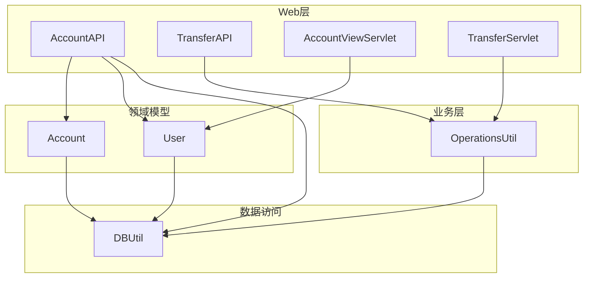
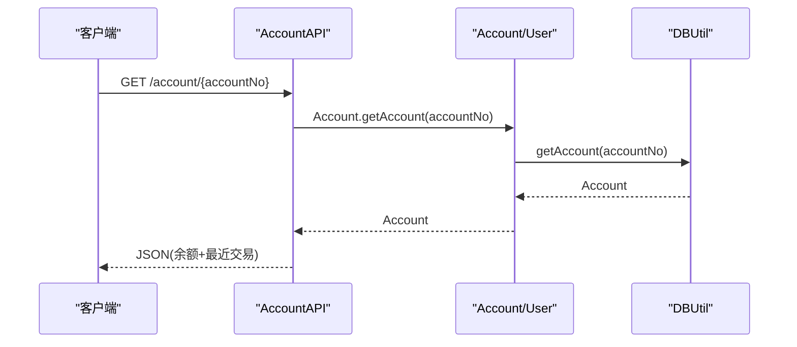
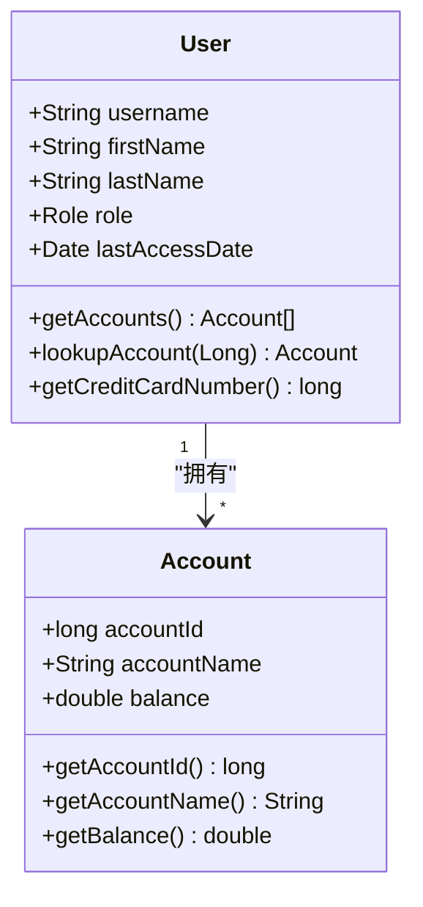
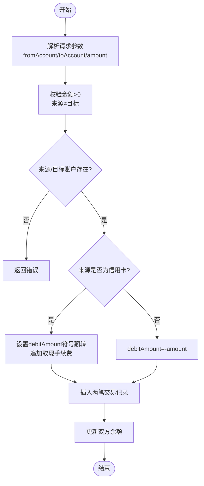
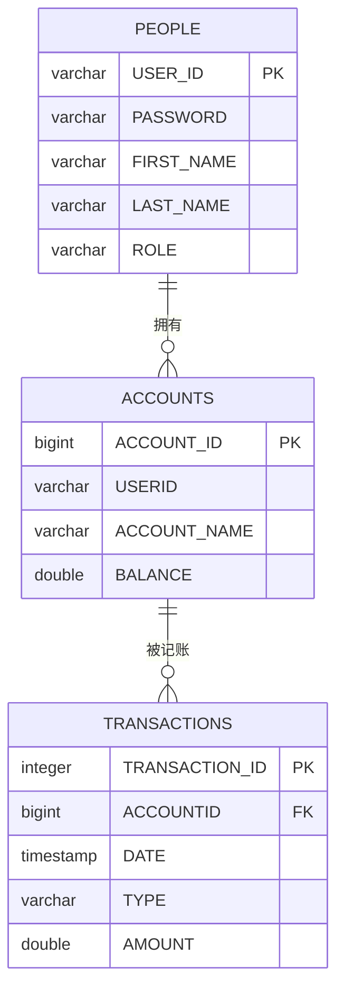
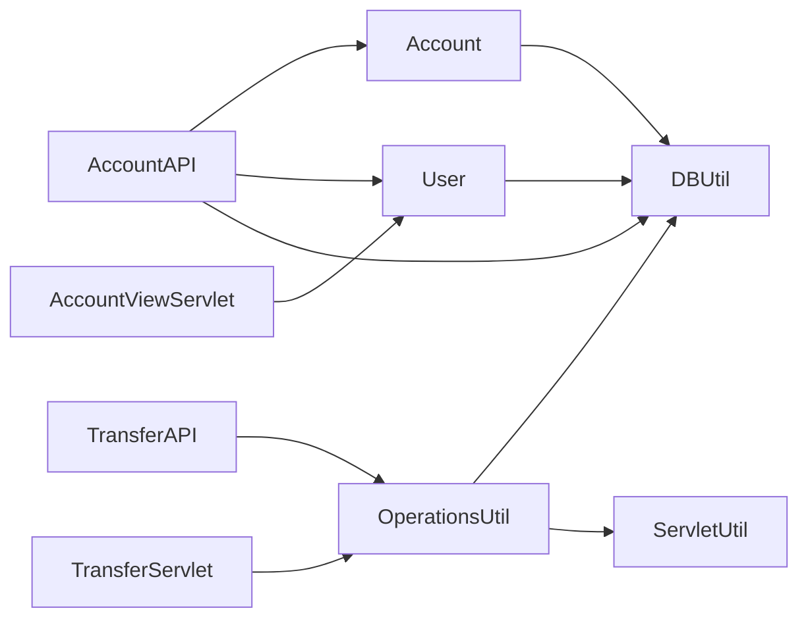

# 账户模型(Account)

<cite>
**本文引用的文件**   
- [Account.java](file://src/com/ibm/security/appscan/altoromutual/model/Account.java)
- [User.java](file://src/com/ibm/security/appscan/altoromutual/model/User.java)
- [DBUtil.java](file://src/com/ibm/security/appscan/altoromutual/util/DBUtil.java)
- [OperationsUtil.java](file://src/com/ibm/security/appscan/altoromutual/util/OperationsUtil.java)
- [AccountAPI.java](file://src/com/ibm/security/appscan/altoromutual/api/AccountAPI.java)
- [TransferAPI.java](file://src/com/ibm/security/appscan/altoromutual/api/TransferAPI.java)
- [AccountViewServlet.java](file://src/com/ibm/security/appscan/altoromutual/servlet/AccountViewServlet.java)
- [TransferServlet.java](file://src/com/ibm/security/appscan/altoromutual/servlet/TransferServlet.java)
</cite>

## 目录
1. [引言](#引言)
2. [项目结构](#项目结构)
3. [核心组件](#核心组件)
4. [架构总览](#架构总览)
5. [详细组件分析](#详细组件分析)
6. [依赖关系分析](#依赖关系分析)
7. [性能与一致性](#性能与一致性)
8. [故障排查指南](#故障排查指南)
9. [结论](#结论)
10. [附录：数据模型与接口定义](#附录数据模型与接口定义)

## 引言
本文件为 AltoroJ 的账户模型提供系统化、可追溯的数据模型文档。重点覆盖 Account 类的字段定义、账户类型语义、余额管理与校验规则、与用户(User)的关系映射、CRUD 操作实现、状态与生命周期、转账业务规则与一致性保障、安全访问控制，以及持久化策略与数据库映射。

## 项目结构
围绕账户模型的关键代码分布在以下包与文件中：
- 领域模型：model.Account、model.User
- 数据访问：util.DBUtil
- 业务编排：util.OperationsUtil
- Web API：api.AccountAPI、api.TransferAPI
- Servlet 控制器：servlet.AccountViewServlet、servlet.TransferServlet

图表来源
- [AccountAPI.java:23-238](file://src/com/ibm/security/appscan/altoromutual/api/AccountAPI.java#L23-L238)
- [TransferAPI.java:14-44](file://src/com/ibm/security/appscan/altoromutual/api/TransferAPI.java#L14-L44)
- [AccountViewServlet.java:35-82](file://src/com/ibm/security/appscan/altoromutual/servlet/AccountViewServlet.java#L35-L82)
- [TransferServlet.java:38-71](file://src/com/ibm/security/appscan/altoromutual/servlet/TransferServlet.java#L38-L71)
- [OperationsUtil.java:44-117](file://src/com/ibm/security/appscan/altoromutual/util/OperationsUtil.java#L44-L117)
- [DBUtil.java:45-536](file://src/com/ibm/security/appscan/altoromutual/util/DBUtil.java#L45-L536)
- [Account.java:32-122](file://src/com/ibm/security/appscan/altoromutual/model/Account.java#L32-L122)
- [User.java:30-108](file://src/com/ibm/security/appscan/altoromutual/model/User.java#L30-L108)

章节来源
- [AccountAPI.java:23-238](file://src/com/ibm/security/appscan/altoromutual/api/AccountAPI.java#L23-L238)
- [DBUtil.java:45-536](file://src/com/ibm/security/appscan/altoromutual/util/DBUtil.java#L45-L536)

## 核心组件
- Account：账户实体，包含账户标识、名称、余额；提供静态查询与序列化/反序列化工具方法。
- User：用户实体，包含角色、最近访问时间等；提供获取账户列表、查找账户、信用卡号识别、交易查询等方法。
- DBUtil：数据库工具类，封装连接管理、建库初始化、账户与交易的读写、转账逻辑等。
- OperationsUtil：业务编排，负责从请求中解析参数、校验并调用底层转账逻辑。
- AccountAPI/TransferAPI：RESTful API，暴露账户查询与转账能力。
- AccountViewServlet/TransferServlet：传统 Servlet 控制器，处理页面级交互。

章节来源
- [Account.java:32-122](file://src/com/ibm/security/appscan/altoromutual/model/Account.java#L32-L122)
- [User.java:30-108](file://src/com/ibm/security/appscan/altoromutual/model/User.java#L30-L108)
- [DBUtil.java:45-536](file://src/com/ibm/security/appscan/altoromutual/util/DBUtil.java#L45-L536)
- [OperationsUtil.java:44-117](file://src/com/ibm/security/appscan/altoromutual/util/OperationsUtil.java#L44-L117)
- [AccountAPI.java:23-238](file://src/com/ibm/security/appscan/altoromutual/api/AccountAPI.java#L23-L238)
- [TransferAPI.java:14-44](file://src/com/ibm/security/appscan/altoromutual/api/TransferAPI.java#L14-L44)
- [AccountViewServlet.java:35-82](file://src/com/ibm/security/appscan/altoromutual/servlet/AccountViewServlet.java#L35-L82)
- [TransferServlet.java:38-71](file://src/com/ibm/security/appscan/altoromutual/servlet/TransferServlet.java#L38-L71)

## 架构总览
账户相关请求的典型路径如下：
- REST 查询账户余额与交易：AccountAPI → Account/DBUtil → 返回 JSON
- REST 转账：TransferAPI → OperationsUtil → DBUtil.transferFunds
- 页面查看账户：AccountViewServlet → User.getAccounts → JSP 渲染
- 页面转账：TransferServlet → OperationsUtil → DBUtil.transferFunds

图表来源
- [AccountAPI.java:54-104](file://src/com/ibm/security/appscan/altoromutual/api/AccountAPI.java#L54-L104)
- [Account.java:37-48](file://src/com/ibm/security/appscan/altoromutual/model/Account.java#L37-L48)
- [DBUtil.java:452-470](file://src/com/ibm/security/appscan/altoromutual/util/DBUtil.java#L452-L470)

## 详细组件分析

### Account 类字段与行为
- 字段
  - accountId: long，账户唯一标识
  - accountName: String，账户名称（如 Checking、Savings、Credit Card）
  - balance: double，账户余额
- 构造器
  - Account(long, String, double)
- 静态方法
  - getAccount(String): 按字符串账号查询，内部转为 long 后委托 getAccount(long)
  - getAccount(long): 通过 DBUtil 获取账户
  - fromBase64List(String)/toBase64List(Account[]): 用于在 Cookie 中传输账户列表的编解码
- 属性访问
  - getAccountId()/setAccountId(int)
  - getBalance()/setBalance(long)

注意：setAccountId/setBalance 的参数类型与字段类型不一致（int/long vs long/double），属于历史遗留的类型不匹配问题，实际使用需留意。

章节来源
- [Account.java:32-122](file://src/com/ibm/security/appscan/altoromutual/model/Account.java#L32-L122)

### User 与 Account 的关系
- User 持有多个 Account（一对多）
- User.getAccounts() 通过 DBUtil.getAccounts(username) 加载当前用户的所有账户
- User.lookupAccount(Long) 在本地列表中查找指定账户
- User.getCreditCardNumber() 根据账户名称常量判断信用卡账户并返回其 ID

图表来源
- [User.java:30-108](file://src/com/ibm/security/appscan/altoromutual/model/User.java#L30-L108)
- [Account.java:32-122](file://src/com/ibm/security/appscan/altoromutual/model/Account.java#L32-L122)

章节来源
- [User.java:30-108](file://src/com/ibm/security/appscan/altoromutual/model/User.java#L30-L108)

### 账户类型与业务含义
- 支票账户（Checking）：日常结算账户，余额为正表示可用资金
- 储蓄账户（Savings）：储蓄性质账户，余额为正表示存款
- 信用卡账户（Credit Card）：余额表示欠款（负值方向相反），转账时特殊处理金额符号与手续费

常量定义位于 DBUtil：
- CREDIT_CARD_ACCOUNT_NAME = "Credit Card"
- CHECKING_ACCOUNT_NAME = "Checking"
- SAVINGS_ACCOUNT_NAME = "Savings"
- CASH_ADVANCE_FEE = 2.50（取现手续费）

章节来源
- [DBUtil.java:47-55](file://src/com/ibm/security/appscan/altoromutual/util/DBUtil.java#L47-L55)

### 账户余额管理与验证规则
- 读取余额：Account.getAccount(...) 或 User.getAccounts(...) 从 ACCOUNTS 表读取 BALANCE
- 写入余额：仅在转账流程中更新，由 DBUtil.transferFunds 执行 UPDATE
- 余额校验：
  - 前端/Servlet 层对转账金额进行基本非空与非负校验
  - 业务层未显式检查“可用余额是否足够”，存在透支风险（演示应用特性）
- 信用卡特殊规则：
  - 以信用卡作为转出方时，交易类型记为 Cash Advance，并收取固定手续费
  - 余额符号与普通账户相反，需在计算 debitAmount/creditAmount 时翻转

章节来源
- [DBUtil.java:303-364](file://src/com/ibm/security/appscan/altoromutual/util/DBUtil.java#L303-L364)
- [OperationsUtil.java:44-117](file://src/com/ibm/security/appscan/altoromutual/util/OperationsUtil.java#L44-L117)

### 账户 CRUD 操作实现细节
- 创建账户
  - DBUtil.addAccount(username, acctType)：插入 ACCOUNTS 表，初始余额为 0
  - 管理员界面支持选择账户类型（Checking/Savings/IRA），但 IRA 类型未在常量中定义
- 查询账户
  - DBUtil.getAccounts(username)：按用户查询所有账户
  - DBUtil.getAccount(accountNo)：按账号查询单个账户
  - AccountAPI.getAccounts/getAccountBalance：REST 接口返回账户列表与余额
- 修改账户
  - 无直接修改账户元数据的接口；余额变更仅通过转账流程触发
- 删除账户
  - 代码中未发现删除账户的逻辑

章节来源
- [DBUtil.java:472-481](file://src/com/ibm/security/appscan/altoromutual/util/DBUtil.java#L472-L481)
- [DBUtil.java:275-293](file://src/com/ibm/security/appscan/altoromutual/util/DBUtil.java#L275-L293)
- [DBUtil.java:452-470](file://src/com/ibm/security/appscan/altoromutual/util/DBUtil.java#L452-L470)
- [AccountAPI.java:27-51](file://src/com/ibm/security/appscan/altoromutual/api/AccountAPI.java#L27-L51)
- [AccountAPI.java:54-104](file://src/com/ibm/security/appscan/altoromutual/api/AccountAPI.java#L54-L104)

### 账户创建、查询、修改的代码示例（路径引用）
- 创建账户
  - [DBUtil.addAccount:472-481](file://src/com/ibm/security/appscan/altoromutual/util/DBUtil.java#L472-L481)
- 查询账户列表
  - [DBUtil.getAccounts:275-293](file://src/com/ibm/security/appscan/altoromutual/util/DBUtil.java#L275-L293)
  - [AccountAPI.getAccounts:27-51](file://src/com/ibm/security/appscan/altoromutual/api/AccountAPI.java#L27-L51)
- 查询单个账户余额
  - [AccountAPI.getAccountBalance:54-104](file://src/com/ibm/security/appscan/altoromutual/api/AccountAPI.java#L54-L104)
  - [Account.getAccount:37-48](file://src/com/ibm/security/appscan/altoromutual/model/Account.java#L37-L48)
  - [DBUtil.getAccount:452-470](file://src/com/ibm/security/appscan/altoromutual/util/DBUtil.java#L452-L470)
- 修改账户（余额）
  - 通过转账间接修改：[DBUtil.transferFunds:303-364](file://src/com/ibm/security/appscan/altoromutual/util/DBUtil.java#L303-L364)

### 账户状态管理与生命周期
- 状态维度
  - 账户类型：Checking/Savings/Credit Card（由 accountName 区分）
  - 余额正负：普通账户余额为正表示资产；信用卡余额为负表示负债
- 生命周期
  - 创建：DBUtil.addAccount 插入记录
  - 活跃：正常存取款与转账
  - 注销：代码中未见显式删除或停用逻辑

章节来源
- [DBUtil.java:156-164](file://src/com/ibm/security/appscan/altoromutual/util/DBUtil.java#L156-L164)
- [DBUtil.java:303-364](file://src/com/ibm/security/appscan/altoromutual/util/DBUtil.java#L303-L364)

### 账户间转账业务规则与一致性
- 输入校验
  - 来源账户与目标账户不能相同（前端校验）
  - 转账金额必须大于 0（前端校验）
  - 后端会校验来源/目标账户是否存在
- 业务规则
  - 若来源为信用卡：交易类型为 Cash Advance，并追加固定手续费
  - 若目标为信用卡：交易类型为 Payment
  - 普通账户：来源为 Withdrawal，目标为 Deposit
- 一致性
  - 代码注释指出应原子更新余额与交易记录，但当前实现分步执行 SQL，存在并发与失败回滚风险
  - 未做余额充足性检查，可能允许透支

图表来源
- [OperationsUtil.java:44-117](file://src/com/ibm/security/appscan/altoromutual/util/OperationsUtil.java#L44-L117)
- [DBUtil.java:303-364](file://src/com/ibm/security/appscan/altoromutual/util/DBUtil.java#L303-L364)

章节来源
- [OperationsUtil.java:44-117](file://src/com/ibm/security/appscan/altoromutual/util/OperationsUtil.java#L44-L117)
- [DBUtil.java:303-364](file://src/com/ibm/security/appscan/altoromutual/util/DBUtil.java#L303-L364)

### 安全访问控制与权限验证
- 会话与会话用户
  - TransferServlet 通过 ServletUtil.isLoggedin(request) 校验登录态
  - AccountAPI 中部分方法注释了登录检查，存在越权访问风险（代码注释明确提示）
- 账户所有权校验
  - AccountAPI.getAccountBalance 直接按传入 accountNo 查询，未校验该账户是否属于当前用户，存在水平越权风险
- Cookie 中的账户缓存
  - OperationsUtil 支持从 Cookie 中读取 Base64 编码的账户列表，用于快速定位来源账户，需注意 Cookie 篡改风险

章节来源
- [TransferServlet.java:51-67](file://src/com/ibm/security/appscan/altoromutual/servlet/TransferServlet.java#L51-L67)
- [AccountAPI.java:54-104](file://src/com/ibm/security/appscan/altoromutual/api/AccountAPI.java#L54-L104)
- [OperationsUtil.java:44-117](file://src/com/ibm/security/appscan/altoromutual/util/OperationsUtil.java#L44-L117)

### 持久化策略与数据库映射
- 数据库类型
  - 默认使用嵌入式 Apache Derby；可通过配置切换外部 DataSource
- 表结构
  - ACCOUNTS：ACCOUNT_ID(BIGINT, PK), USERID(VARCHAR), ACCOUNT_NAME(VARCHAR), BALANCE(DOUBLE)
  - TRANSACTIONS：TRANSACTION_ID(INTEGER, PK), ACCOUNTID(BIGINT), DATE(TIMESTAMP), TYPE(VARCHAR), AMOUNT(DOUBLE)
  - PEOPLE：USER_ID(PK), PASSWORD, FIRST_NAME, LAST_NAME, ROLE
- 初始化
  - initDB 在建库时创建表并插入样例数据
- 连接管理
  - getConnection 单例维护连接；支持外部 DataSource 与 Derby 直连两种模式

图表来源
- [DBUtil.java:156-164](file://src/com/ibm/security/appscan/altoromutual/util/DBUtil.java#L156-L164)

章节来源
- [DBUtil.java:47-97](file://src/com/ibm/security/appscan/altoromutual/util/DBUtil.java#L47-L97)
- [DBUtil.java:143-167](file://src/com/ibm/security/appscan/altoromutual/util/DBUtil.java#L143-L167)

## 依赖关系分析
- Account 依赖 DBUtil 进行数据访问
- User 依赖 DBUtil 获取账户与用户信息
- OperationsUtil 依赖 ServletUtil 获取会话用户，并调用 DBUtil 完成转账
- AccountAPI/TransferAPI 分别依赖 Account/User/DBUtil 与 OperationsUtil
- Servlet 控制器依赖 OperationsUtil 与 ServletUtil

图表来源
- [Account.java:37-48](file://src/com/ibm/security/appscan/altoromutual/model/Account.java#L37-L48)
- [User.java:76-83](file://src/com/ibm/security/appscan/altoromutual/model/User.java#L76-L83)
- [OperationsUtil.java:44-117](file://src/com/ibm/security/appscan/altoromutual/util/OperationsUtil.java#L44-L117)
- [AccountAPI.java:23-238](file://src/com/ibm/security/appscan/altoromutual/api/AccountAPI.java#L23-L238)
- [TransferAPI.java:14-44](file://src/com/ibm/security/appscan/altoromutual/api/TransferAPI.java#L14-L44)
- [AccountViewServlet.java:35-82](file://src/com/ibm/security/appscan/altoromutual/servlet/AccountViewServlet.java#L35-L82)
- [TransferServlet.java:38-71](file://src/com/ibm/security/appscan/altoromutual/servlet/TransferServlet.java#L38-L71)

## 性能与一致性
- 性能
  - 账户列表查询与交易查询均基于简单 SQL，未使用分页或索引优化（依赖数据库默认索引）
  - 交易查询限制最大行数（rowCount）以避免大结果集
- 一致性
  - 转账过程中余额更新与交易记录插入分步执行，未使用事务包裹，存在中间状态风险
  - 未检查余额充足性，可能导致透支
- 建议
  - 引入事务边界确保原子性
  - 增加余额充足性校验与风控阈值
  - 使用 PreparedStatement 防止注入攻击（当前多处拼接 SQL）

章节来源
- [DBUtil.java:303-364](file://src/com/ibm/security/appscan/altoromutual/util/DBUtil.java#L303-L364)
- [DBUtil.java:375-427](file://src/com/ibm/security/appscan/altoromutual/util/DBUtil.java#L375-L427)

## 故障排查指南
- 无法获取账户余额
  - 检查传入 accountNo 是否有效，Account.getAccount 会委托 DBUtil 查询
  - 确认数据库连接与表结构是否正确初始化
- 转账失败
  - 检查来源/目标账户是否存在
  - 检查金额是否大于 0
  - 若来源为信用卡，注意手续费与交易类型差异
- 越权访问
  - AccountAPI 中未校验账户归属，需补充所有权校验
- 登录态丢失
  - TransferServlet 会重定向到登录页，检查会话与 Cookie 配置

章节来源
- [AccountAPI.java:54-104](file://src/com/ibm/security/appscan/altoromutual/api/AccountAPI.java#L54-L104)
- [TransferServlet.java:51-67](file://src/com/ibm/security/appscan/altoromutual/servlet/TransferServlet.java#L51-L67)
- [DBUtil.java:303-364](file://src/com/ibm/security/appscan/altoromutual/util/DBUtil.java#L303-L364)

## 结论
AltoroJ 的账户模型以 Account 为核心，结合 User 与 DBUtil 完成账户的查询与转账等业务。账户类型通过 accountName 区分，信用卡具有特殊的余额符号与手续费规则。当前实现存在若干安全与一致性问题（越权访问、余额不足未校验、非原子更新），建议在后续迭代中引入权限校验、事务与参数化查询，以提升安全性与健壮性。

## 附录：数据模型与接口定义

### 数据模型字段定义
- Account
  - accountId: long
  - accountName: String
  - balance: double
- User
  - username: String
  - firstName: String
  - lastName: String
  - role: Role(User/Admin)
  - lastAccessDate: Date

章节来源
- [Account.java:32-70](file://src/com/ibm/security/appscan/altoromutual/model/Account.java#L32-L70)
- [User.java:30-62](file://src/com/ibm/security/appscan/altoromutual/model/User.java#L30-L62)

### 关键接口与路径
- REST
  - GET /account：返回当前用户账户列表
  - GET /account/{accountNo}：返回指定账户余额与最近交易
  - GET /account/{accountNo}/transactions：返回最近 10 笔交易
  - POST /account/{accountNo}/transactions：按日期范围查询交易
  - POST /transfer：发起转账
- Servlet
  - AccountViewServlet：展示账户余额与交易
  - TransferServlet：处理转账表单提交

章节来源
- [AccountAPI.java:23-238](file://src/com/ibm/security/appscan/altoromutual/api/AccountAPI.java#L23-L238)
- [TransferAPI.java:14-44](file://src/com/ibm/security/appscan/altoromutual/api/TransferAPI.java#L14-L44)
- [AccountViewServlet.java:35-82](file://src/com/ibm/security/appscan/altoromutual/servlet/AccountViewServlet.java#L35-L82)
- [TransferServlet.java:38-71](file://src/com/ibm/security/appscan/altoromutual/servlet/TransferServlet.java#L38-L71)