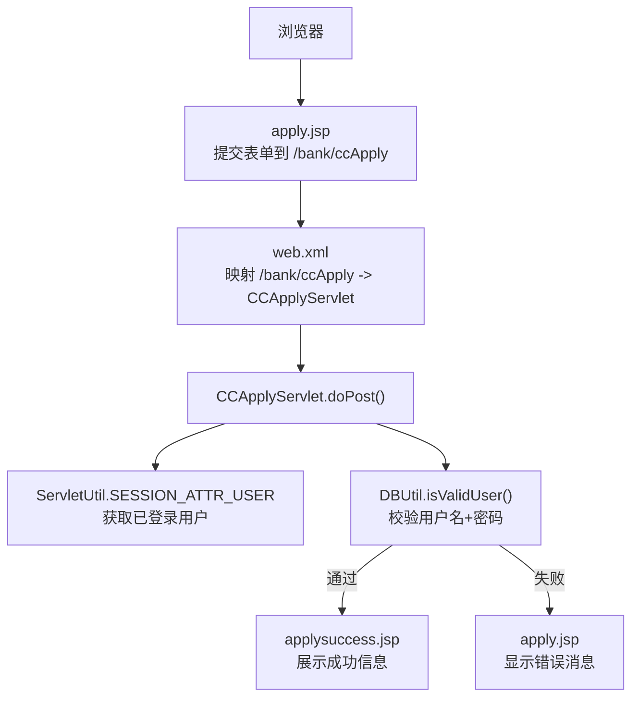
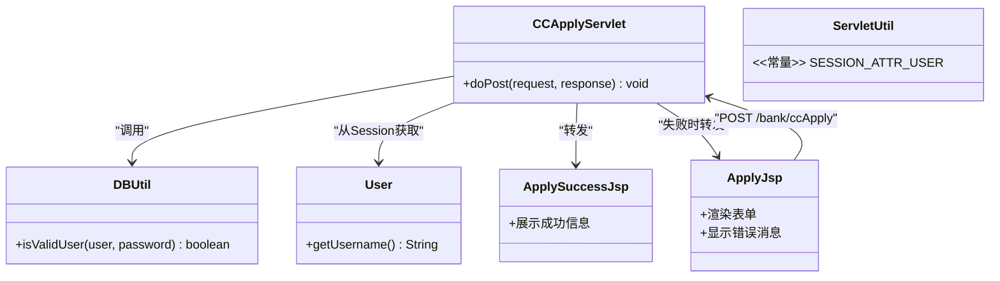
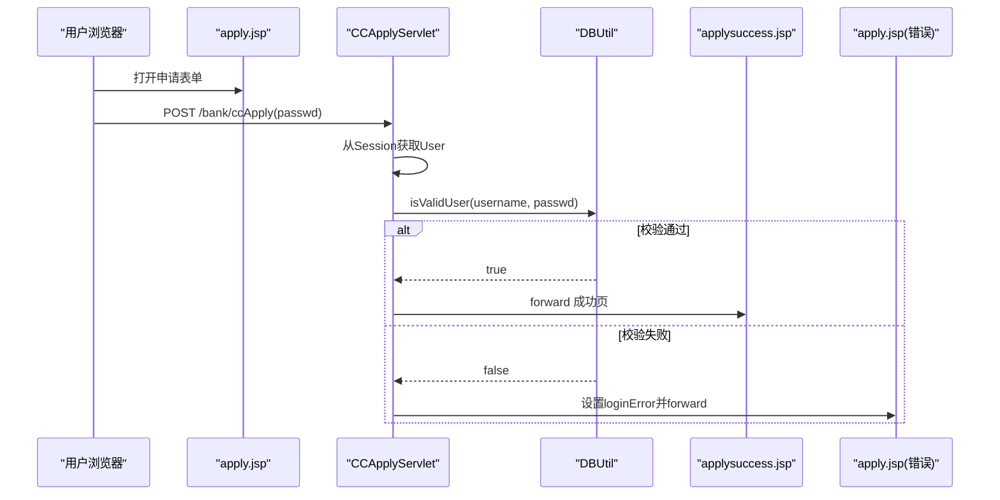
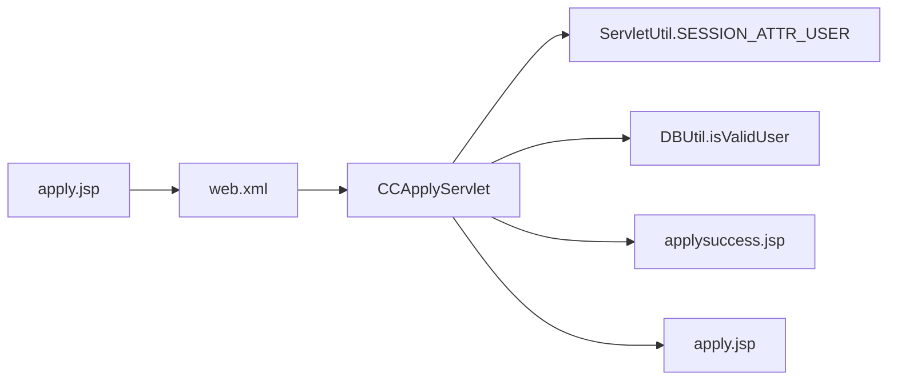

# 信用卡申请系统

<cite>
**本文引用的文件**   
- [CCApplyServlet.java](file://src/com/ibm/security/appscan/altoromutual/servlet/CCApplyServlet.java)
- [apply.jsp](file://WebContent/bank/apply.jsp)
- [applysuccess.jsp](file://WebContent/bank/applysuccess.jsp)
- [web.xml](file://WebContent/WEB-INF/web.xml)
- [DBUtil.java](file://src/com/ibm/security/appscan/altoromutual/util/DBUtil.java)
- [User.java](file://src/com/ibm/security/appscan/altoromutual/model/User.java)
- [ServletUtil.java](file://src/com/ibm/security/appscan/altoromutual/util/ServletUtil.java)
</cite>

## 目录
1. [简介](#简介)
2. [项目结构](#项目结构)
3. [核心组件](#核心组件)
4. [架构总览](#架构总览)
5. [详细组件分析](#详细组件分析)
6. [依赖关系分析](#依赖关系分析)
7. [性能与可扩展性](#性能与可扩展性)
8. [故障排查指南](#故障排查指南)
9. [结论](#结论)

## 简介
本文件面向“在线信用卡申请”功能，系统性梳理从前端表单到后端处理、再到成功页展示的完整流程。重点包括：
- 在线申请入口与表单字段
- CCApplyServlet 的申请处理逻辑（密码校验、会话用户获取、跳转）
- 表单数据验证与业务规则检查现状
- 申请信息的收集、验证流程与状态跟踪机制
- 与用户认证系统的集成关系
- 申请数据的持久化存储现状与建议

## 项目结构
围绕信用卡申请的关键路径涉及以下资源：
- 前端页面：bank/apply.jsp（申请表单）、bank/applysuccess.jsp（成功提示）
- 控制器：servlet/CCApplyServlet.java（POST 处理）
- 配置：WEB-INF/web.xml（Servlet 映射）
- 工具与模型：util/DBUtil.java（数据库访问与用户校验）、model/User.java（用户模型）、util/ServletUtil.java（会话与属性工具）

图表来源
- [web.xml:109-113](file://WebContent/WEB-INF/web.xml#L109-L113)
- [web.xml:179-182](file://WebContent/WEB-INF/web.xml#L179-L182)
- [CCApplyServlet.java:42-64](file://src/com/ibm/security/appscan/altoromutual/servlet/CCApplyServlet.java#L42-L64)
- [DBUtil.java:212-232](file://src/com/ibm/security/appscan/altoromutual/util/DBUtil.java#L212-L232)
- [apply.jsp:42](file://WebContent/bank/apply.jsp#L42)
- [applysuccess.jsp:31-33](file://WebContent/bank/applysuccess.jsp#L31-L33)

章节来源
- [web.xml:109-113](file://WebContent/WEB-INF/web.xml#L109-L113)
- [web.xml:179-182](file://WebContent/WEB-INF/web.xml#L179-L182)
- [CCApplyServlet.java:36-69](file://src/com/ibm/security/appscan/altoromutual/servlet/CCApplyServlet.java#L36-L69)
- [apply.jsp:24-46](file://WebContent/bank/apply.jsp#L24-L46)
- [applysuccess.jsp:24-37](file://WebContent/bank/applysuccess.jsp#L24-L37)

## 核心组件
- CCApplyServlet：处理 POST 请求，读取表单 passwd，从 Session 中取当前用户，调用 DBUtil 校验用户名+密码，成功后转发至 applysuccess.jsp，失败则返回 apply.jsp 并设置错误消息。
- apply.jsp：渲染申请表单，仅包含一个密码输入框；若存在 loginError 则回显错误。
- applysuccess.jsp：展示申请成功的静态提示。
- DBUtil.isValidUser：用户校验逻辑，支持硬编码特例与数据库查询。
- ServletUtil.SESSION_ATTR_USER：用于在 Session 中存取当前 User 对象。
- web.xml：注册 CCApplyServlet 并将 /bank/ccApply 映射到该 Servlet。

章节来源
- [CCApplyServlet.java:36-69](file://src/com/ibm/security/appscan/altoromutual/servlet/CCApplyServlet.java#L36-L69)
- [apply.jsp:24-46](file://WebContent/bank/apply.jsp#L24-L46)
- [applysuccess.jsp:24-37](file://WebContent/bank/applysuccess.jsp#L24-L37)
- [DBUtil.java:212-232](file://src/com/ibm/security/appscan/altoromutual/util/DBUtil.java#L212-L232)
- [ServletUtil.java:60-62](file://src/com/ibm/security/appscan/altoromutual/util/ServletUtil.java#L60-L62)
- [web.xml:109-113](file://WebContent/WEB-INF/web.xml#L109-L113)
- [web.xml:179-182](file://WebContent/WEB-INF/web.xml#L179-L182)

## 架构总览
信用卡申请采用经典的 MVC 模式：JSP 作为视图层，Servlet 作为控制层，DBUtil 作为数据访问层，User 为领域模型。

图表来源
- [CCApplyServlet.java:42-64](file://src/com/ibm/security/appscan/altoromutual/servlet/CCApplyServlet.java#L42-L64)
- [DBUtil.java:212-232](file://src/com/ibm/security/appscan/altoromutual/util/DBUtil.java#L212-L232)
- [apply.jsp:42](file://WebContent/bank/apply.jsp#L42)
- [applysuccess.jsp:31-33](file://WebContent/bank/applysuccess.jsp#L31-L33)
- [ServletUtil.java:60-62](file://src/com/ibm/security/appscan/altoromutual/util/ServletUtil.java#L60-L62)

## 详细组件分析

### CCApplyServlet 申请处理逻辑
- 接收参数：passwd（来自表单）。
- 获取当前用户：从 Session 中按 SESSION_ATTR_USER 键取出 User 对象。
- 业务校验：调用 DBUtil.isValidUser(user.getUsername(), passwd.trim().toLowerCase())。
- 结果分支：
  - 校验通过：forward 到 /bank/applysuccess.jsp。
  - 校验失败：在 Session 中设置 loginError，并 forward 回 /bank/apply.jsp。
- 异常处理：捕获异常后返回 HTTP 500。

图表来源
- [CCApplyServlet.java:42-64](file://src/com/ibm/security/appscan/altoromutual/servlet/CCApplyServlet.java#L42-L64)
- [DBUtil.java:212-232](file://src/com/ibm/security/appscan/altoromutual/util/DBUtil.java#L212-L232)
- [apply.jsp:42](file://WebContent/bank/apply.jsp#L42)
- [applysuccess.jsp:31-33](file://WebContent/bank/applysuccess.jsp#L31-L33)

章节来源
- [CCApplyServlet.java:42-64](file://src/com/ibm/security/appscan/altoromutual/servlet/CCApplyServlet.java#L42-L64)

### 表单数据验证与业务规则检查
- 前端验证：apply.jsp 未实现客户端校验，仅提交 passwd。
- 后端验证：CCApplyServlet 仅做非空与大小写规范化（trim/lowercase），无格式校验（如长度、字符集）。
- 业务规则：
  - 当前实现不保存申请记录，也不进行额度、风控等审批逻辑。
  - 成功即视为申请完成，直接跳转到成功页。
- 建议增强：
  - 增加服务端表单校验（必填、格式、长度）。
  - 引入申请单实体与状态机（待审核、已通过、已拒绝）。
  - 审计日志与幂等保护（防止重复提交）。

章节来源
- [apply.jsp:42](file://WebContent/bank/apply.jsp#L42)
- [CCApplyServlet.java:46-60](file://src/com/ibm/security/appscan/altoromutual/servlet/CCApplyServlet.java#L46-L60)

### 申请信息的收集、验证流程与状态跟踪
- 信息收集：目前仅收集 passwd，并通过 Session 中的 User 间接获得 username。
- 验证流程：见上节时序图。
- 状态跟踪：当前未持久化申请记录，也未维护申请状态；如需跟踪，应新增申请表与状态字段。

章节来源
- [CCApplyServlet.java:46-60](file://src/com/ibm/security/appscan/altoromutual/servlet/CCApplyServlet.java#L46-L60)

### 与用户认证系统的集成关系
- 登录与会话：用户登录后，ServletUtil.establishSession 将 User 写入 Session 的 SESSION_ATTR_USER。
- 申请流程：CCApplyServlet 直接从 Session 取 User，无需再次鉴权，但会二次校验 passwd。
- 安全注意：
  - 二次密码校验可提升安全性，但需确保传输加密与防重放。
  - 避免在错误消息中泄露敏感信息。

章节来源
- [ServletUtil.java:340-353](file://src/com/ibm/security/appscan/altoromutual/util/ServletUtil.java#L340-L353)
- [ServletUtil.java:60-62](file://src/com/ibm/security/appscan/altoromutual/util/ServletUtil.java#L60-L62)
- [CCApplyServlet.java:46-60](file://src/com/ibm/security/appscan/altoromutual/servlet/CCApplyServlet.java#L46-L60)

### 申请数据的持久化存储
- 现状：CCApplyServlet 未对申请数据进行持久化，仅根据校验结果跳转页面。
- 数据库能力：DBUtil 提供连接与基础 CRUD，但未提供“申请单”相关方法。
- 建议设计：
  - 新增申请表（例如 APPLICATIONS），包含用户ID、申请时间、状态、备注等字段。
  - 在 CCApplyServlet 中创建申请记录，初始状态为“待审核”。
  - 后续扩展审批流程与通知机制。

章节来源
- [CCApplyServlet.java:42-64](file://src/com/ibm/security/appscan/altoromutual/servlet/CCApplyServlet.java#L42-L64)
- [DBUtil.java:143-167](file://src/com/ibm/security/appscan/altoromutual/util/DBUtil.java#L143-L167)

## 依赖关系分析
- CCApplyServlet 依赖：
  - ServletUtil.SESSION_ATTR_USER（Session 键）
  - DBUtil.isValidUser（用户校验）
  - RequestDispatcher（转发到 JSP）
- apply.jsp 依赖：
  - 表单 action="/bank/ccApply"（由 web.xml 映射到 CCApplyServlet）
- web.xml 作用：
  - 注册 CCApplyServlet
  - 映射 /bank/ccApply 到 CCApplyServlet

图表来源
- [web.xml:109-113](file://WebContent/WEB-INF/web.xml#L109-L113)
- [web.xml:179-182](file://WebContent/WEB-INF/web.xml#L179-L182)
- [CCApplyServlet.java:42-64](file://src/com/ibm/security/appscan/altoromutual/servlet/CCApplyServlet.java#L42-L64)
- [apply.jsp:42](file://WebContent/bank/apply.jsp#L42)

章节来源
- [web.xml:109-113](file://WebContent/WEB-INF/web.xml#L109-L113)
- [web.xml:179-182](file://WebContent/WEB-INF/web.xml#L179-L182)
- [CCApplyServlet.java:42-64](file://src/com/ibm/security/appscan/altoromutual/servlet/CCApplyServlet.java#L42-L64)

## 性能与可扩展性
- 当前实现轻量，无额外计算或复杂查询，性能开销低。
- 可扩展点：
  - 引入申请单持久化与异步审批队列。
  - 增加缓存（如 Redis）以加速高频校验。
  - 使用连接池与预编译语句优化数据库访问（DBUtil 当前使用 Statement）。

[本节为通用指导，不涉及具体文件]

## 故障排查指南
- 常见问题
  - 提交后始终失败：检查 DBUtil.isValidUser 的用户名/密码匹配逻辑与数据库内容。
  - 成功页不显示：确认 web.xml 中 /bank/ccApply 映射是否正确，以及 forward 路径是否有效。
  - 错误消息未显示：检查 apply.jsp 中 loginError 的读取与清除逻辑。
- 定位步骤
  - 查看 Session 中是否存在 USER 对象（SESSION_ATTR_USER）。
  - 检查 DBUtil 是否能正常连接数据库并执行查询。
  - 观察异常分支是否触发（HTTP 500）。

章节来源
- [DBUtil.java:212-232](file://src/com/ibm/security/appscan/altoromutual/util/DBUtil.java#L212-L232)
- [CCApplyServlet.java:62-64](file://src/com/ibm/security/appscan/altoromutual/servlet/CCApplyServlet.java#L62-L64)
- [apply.jsp:33-40](file://WebContent/bank/apply.jsp#L33-L40)

## 结论
当前信用卡申请流程以“密码校验通过后即视为申请成功”为核心逻辑，未实现申请记录的持久化与审批流程。建议在保留现有交互的基础上，补充服务端表单校验、申请单建模与状态管理、审计日志与安全加固，以提升系统的安全性与可维护性。