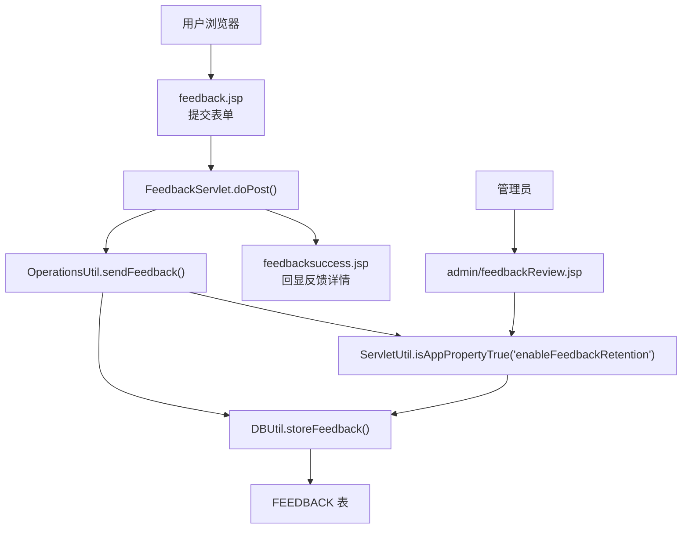
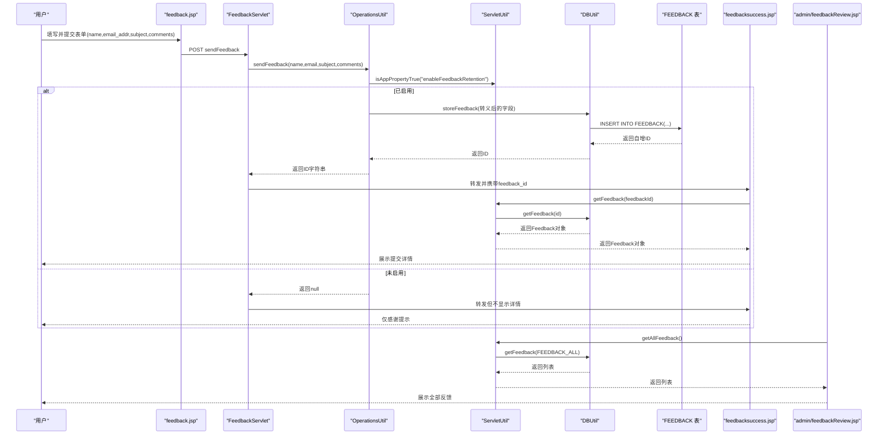
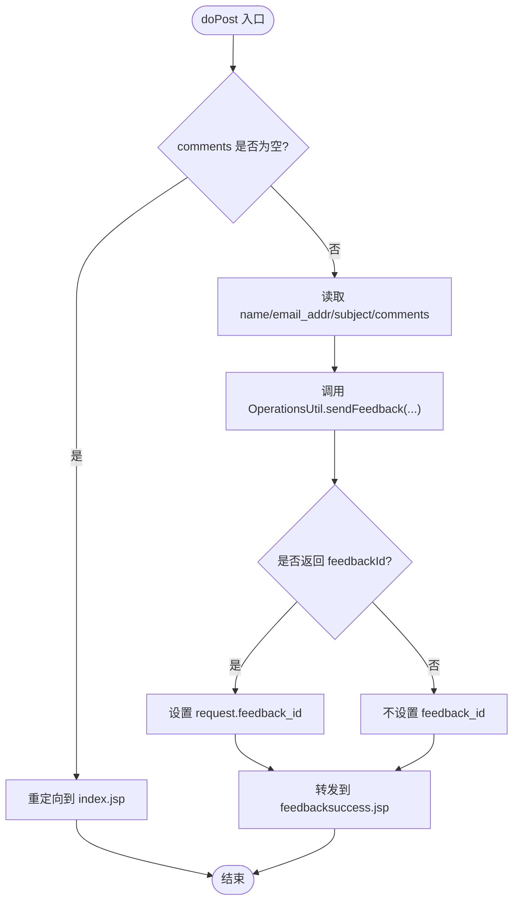
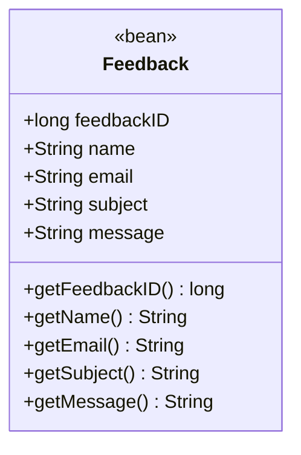
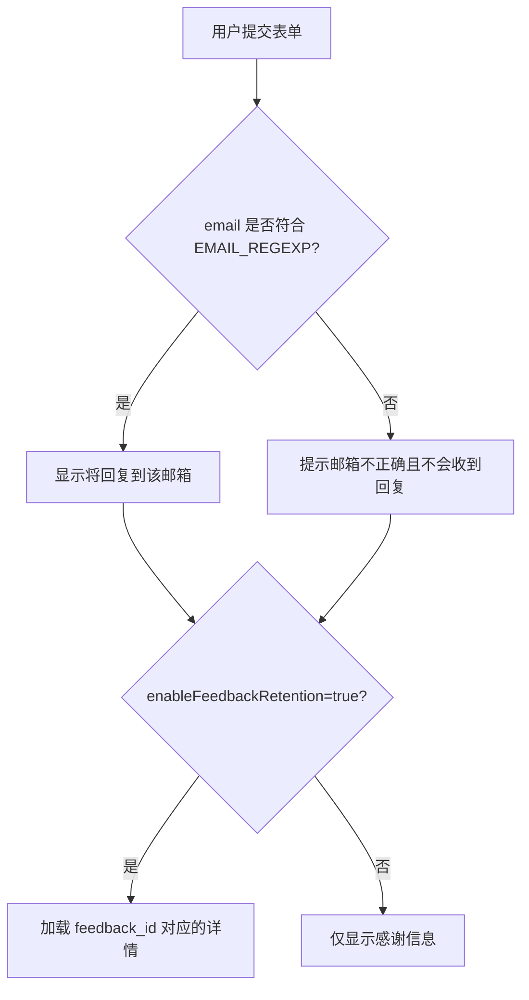
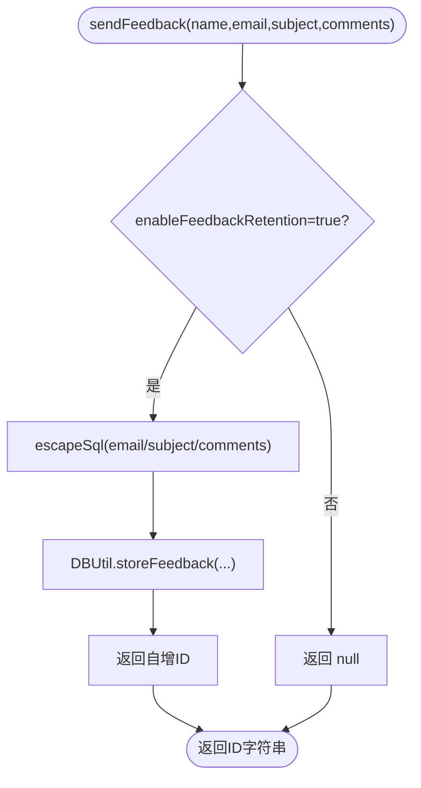
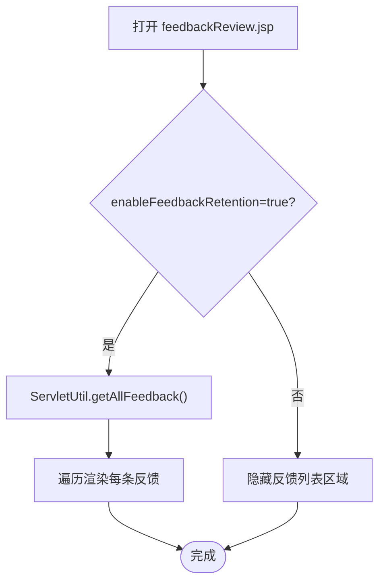
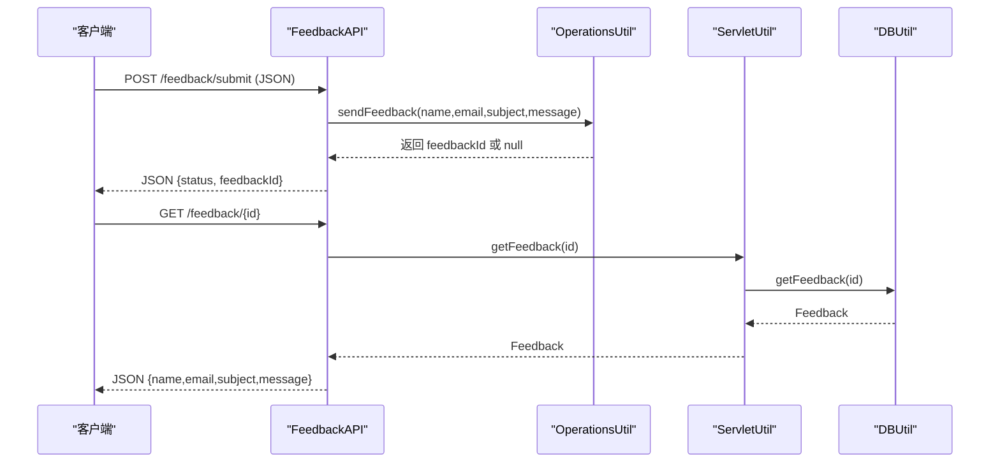
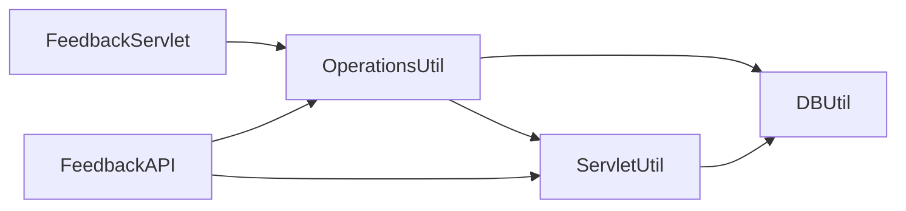

# 反馈收集系统

<cite>
**本文引用的文件**   
- [FeedbackServlet.java](file://src/com/ibm/security/appscan/altoromutual/servlet/FeedbackServlet.java)
- [Feedback.java](file://src/com/ibm/security/appscan/altoromutual/model/Feedback.java)
- [OperationsUtil.java](file://src/com/ibm/security/appscan/altoromutual/util/OperationsUtil.java)
- [ServletUtil.java](file://src/com/ibm/security/appscan/altoromutual/util/ServletUtil.java)
- [DBUtil.java](file://src/com/ibm/security/appscan/altoromutual/util/DBUtil.java)
- [FeedbackAPI.java](file://src/com/ibm/security/appscan/altoromutual/api/FeedbackAPI.java)
- [feedback.jsp](file://WebContent/feedback.jsp)
- [feedbacksuccess.jsp](file://WebContent/feedbacksuccess.jsp)
- [feedbackReview.jsp](file://WebContent/admin/feedbackReview.jsp)
</cite>

## 目录
1. [简介](#简介)
2. [项目结构](#项目结构)
3. [核心组件](#核心组件)
4. [架构总览](#架构总览)
5. [详细组件分析](#详细组件分析)
6. [依赖关系分析](#依赖关系分析)
7. [性能与可扩展性](#性能与可扩展性)
8. [故障排查指南](#故障排查指南)
9. [结论](#结论)

## 简介
本文件面向“反馈收集系统”的实现细节，覆盖用户侧反馈提交、数据存储与管理端查看的完整链路。重点包括：
- FeedbackServlet 的请求处理流程
- Feedback 模型的数据结构与字段含义
- 表单输入校验与内容清洗规则
- 反馈数据的存储格式（数据库表结构）
- 管理员界面的集成与数据查询展示
- REST API 的反馈提交与查询接口

## 项目结构
反馈功能涉及 Web 层（JSP）、Servlet 控制器、工具类、数据访问层以及管理界面：
- 前端表单：WebContent/feedback.jsp
- 成功页：WebContent/feedbacksuccess.jsp
- Servlet 控制器：src/.../servlet/FeedbackServlet.java
- 业务工具：src/.../util/OperationsUtil.java
- 通用工具与属性开关：src/.../util/ServletUtil.java
- 数据访问与建库脚本：src/.../util/DBUtil.java
- 管理界面：WebContent/admin/feedbackReview.jsp
- REST API：src/.../api/FeedbackAPI.java

图表来源
- [feedback.jsp:46-77](file://WebContent/feedback.jsp#L46-L77)
- [FeedbackServlet.java:42-68](file://src/com/ibm/security/appscan/altoromutual/servlet/FeedbackServlet.java#L42-L68)
- [OperationsUtil.java:119-132](file://src/com/ibm/security/appscan/altoromutual/util/OperationsUtil.java#L119-L132)
- [ServletUtil.java:210-218](file://src/com/ibm/security/appscan/altoromutual/util/ServletUtil.java#L210-L218)
- [DBUtil.java:520-535](file://src/com/ibm/security/appscan/altoromutual/util/DBUtil.java#L520-L535)
- [feedbacksuccess.jsp:51-91](file://WebContent/feedbacksuccess.jsp#L51-L91)
- [feedbackReview.jsp:33-69](file://WebContent/admin/feedbackReview.jsp#L33-L69)

章节来源
- [feedback.jsp:46-77](file://WebContent/feedback.jsp#L46-L77)
- [FeedbackServlet.java:42-68](file://src/com/ibm/security/appscan/altoromutual/servlet/FeedbackServlet.java#L42-L68)
- [OperationsUtil.java:119-132](file://src/com/ibm/security/appscan/altoromutual/util/OperationsUtil.java#L119-L132)
- [ServletUtil.java:210-218](file://src/com/ibm/security/appscan/altoromutual/util/ServletUtil.java#L210-L218)
- [DBUtil.java:520-535](file://src/com/ibm/security/appscan/altoromutual/util/DBUtil.java#L520-L535)
- [feedbacksuccess.jsp:51-91](file://WebContent/feedbacksuccess.jsp#L51-L91)
- [feedbackReview.jsp:33-69](file://WebContent/admin/feedbackReview.jsp#L33-L69)

## 核心组件
- FeedbackServlet：接收 POST 请求，提取 name/email_addr/subject/comments，调用 OperationsUtil.sendFeedback 持久化，并转发到 feedbacksuccess.jsp。
- OperationsUtil：根据应用属性 enableFeedbackRetention 决定是否存储；若开启，对 email/subject/comments 进行 SQL 转义后写入数据库。
- ServletUtil：提供 isAppPropertyTrue 读取 app.properties 配置；提供 getAllFeedback/getFeedback 供管理界面和成功页使用；提供 XSS 正则与 HTML 转义工具。
- DBUtil：负责数据库连接、建库与 FEEDBACK 表初始化；实现 storeFeedback 插入与 getFeedback 查询。
- Feedback：领域模型，包含 feedbackID/name/email/subject/message 等字段及常量 FEEDBACK_ALL。
- FeedbackAPI：REST 接口，POST /feedback/submit 提交反馈，GET /feedback/{id} 查询单条反馈。
- JSP 页面：feedback.jsp 提供表单；feedbacksuccess.jsp 显示提交结果与详情；admin/feedbackReview.jsp 列出所有反馈。

章节来源
- [FeedbackServlet.java:42-68](file://src/com/ibm/security/appscan/altoromutual/servlet/FeedbackServlet.java#L42-L68)
- [OperationsUtil.java:119-132](file://src/com/ibm/security/appscan/altoromutual/util/OperationsUtil.java#L119-L132)
- [ServletUtil.java:210-218](file://src/com/ibm/security/appscan/altoromutual/util/ServletUtil.java#L210-L218)
- [DBUtil.java:520-535](file://src/com/ibm/security/appscan/altoromutual/util/DBUtil.java#L520-L535)
- [Feedback.java:6-47](file://src/com/ibm/security/appscan/altoromutual/model/Feedback.java#L6-L47)
- [FeedbackAPI.java:22-76](file://src/com/ibm/security/appscan/altoromutual/api/FeedbackAPI.java#L22-L76)

## 架构总览
下图展示了从用户提交到数据落库再到管理端展示的端到端流程。

图表来源
- [feedback.jsp:46-77](file://WebContent/feedback.jsp#L46-L77)
- [FeedbackServlet.java:42-68](file://src/com/ibm/security/appscan/altoromutual/servlet/FeedbackServlet.java#L42-L68)
- [OperationsUtil.java:119-132](file://src/com/ibm/security/appscan/altoromutual/util/OperationsUtil.java#L119-L132)
- [ServletUtil.java:210-218](file://src/com/ibm/security/appscan/altoromutual/util/ServletUtil.java#L210-L218)
- [DBUtil.java:520-535](file://src/com/ibm/security/appscan/altoromutual/util/DBUtil.java#L520-L535)
- [feedbacksuccess.jsp:51-91](file://WebContent/feedbacksuccess.jsp#L51-L91)
- [feedbackReview.jsp:33-69](file://WebContent/admin/feedbackReview.jsp#L33-L69)

## 详细组件分析

### FeedbackServlet 请求处理逻辑
- 入口方法 doPost：
  - 校验 comments 参数是否存在，不存在则重定向至首页。
  - 若存在 name，则设置 message_feedback 属性，并读取 email_addr、subject、comments。
  - 调用 OperationsUtil.sendFeedback 存储反馈，若返回非空 ID，则设置 feedback_id 属性。
  - 最终统一转发到 feedbacksuccess.jsp。

图表来源
- [FeedbackServlet.java:42-68](file://src/com/ibm/security/appscan/altoromutual/servlet/FeedbackServlet.java#L42-L68)

章节来源
- [FeedbackServlet.java:42-68](file://src/com/ibm/security/appscan/altoromutual/servlet/FeedbackServlet.java#L42-L68)

### Feedback 模型数据结构
- 字段：
  - feedbackID：长整型主键
  - name：姓名
  - email：邮箱
  - subject：主题
  - message：消息正文
- 常量：FEEDBACK_ALL = -999，用于查询全部反馈。
- 构造器与 getter 方法提供数据封装。

图表来源
- [Feedback.java:6-47](file://src/com/ibm/security/appscan/altoromutual/model/Feedback.java#L6-L47)

章节来源
- [Feedback.java:6-47](file://src/com/ibm/security/appscan/altoromutual/model/Feedback.java#L6-L47)

### 反馈表单与前端验证
- feedback.jsp：
  - 表单 action="sendFeedback"，method=post。
  - 字段：name、email_addr、subject、comments。
  - 隐藏字段 cfile=comments.txt（历史遗留，不影响当前存储）。
- feedbacksuccess.jsp：
  - 使用 ServletUtil.EMAIL_REGEXP 校验 email 格式。
  - 若 enableFeedbackRetention 为 true，则通过 feedback_id 查询并展示反馈详情。
  - 输出时对邮箱进行 XSS 过滤（sanitzieHtmlWithRegex）。

图表来源
- [feedback.jsp:46-77](file://WebContent/feedback.jsp#L46-L77)
- [feedbacksuccess.jsp:42-91](file://WebContent/feedbacksuccess.jsp#L42-L91)
- [ServletUtil.java:70-77](file://src/com/ibm/security/appscan/altoromutual/util/ServletUtil.java#L70-L77)

章节来源
- [feedback.jsp:46-77](file://WebContent/feedback.jsp#L46-L77)
- [feedbacksuccess.jsp:42-91](file://WebContent/feedbacksuccess.jsp#L42-L91)
- [ServletUtil.java:70-77](file://src/com/ibm/security/appscan/altoromutual/util/ServletUtil.java#L70-L77)

### 数据存储与数据清洗规则
- 存储开关：
  - 由 ServletUtil.isAppPropertyTrue("enableFeedbackRetention") 控制。
  - 当属性为 true 时，才执行存储逻辑。
- 数据清洗：
  - 在 OperationsUtil.sendFeedback 中，对 email、subject、comments 使用 StringEscapeUtils.escapeSql 进行 SQL 转义。
  - 注意：此处未对 name 做转义。
- 数据库写入：
  - DBUtil.storeFeedback 使用 Statement 拼接 SQL 插入 FEEDBACK 表，并返回自增 ID。
  - FEEDBACK 表结构：FEEDBACK_ID（自增）、NAME、EMAIL、SUBJECT、COMMENTS。

图表来源
- [OperationsUtil.java:119-132](file://src/com/ibm/security/appscan/altoromutual/util/OperationsUtil.java#L119-L132)
- [DBUtil.java:520-535](file://src/com/ibm/security/appscan/altoromutual/util/DBUtil.java#L520-L535)
- [DBUtil.java:156-158](file://src/com/ibm/security/appscan/altoromutual/util/DBUtil.java#L156-L158)

章节来源
- [OperationsUtil.java:119-132](file://src/com/ibm/security/appscan/altoromutual/util/OperationsUtil.java#L119-L132)
- [DBUtil.java:520-535](file://src/com/ibm/security/appscan/altoromutual/util/DBUtil.java#L520-L535)
- [DBUtil.java:156-158](file://src/com/ibm/security/appscan/altoromutual/util/DBUtil.java#L156-L158)

### 管理员界面与反馈审核
- admin/feedbackReview.jsp：
  - 仅在 enableFeedbackRetention 为 true 时显示“Customer feedback submissions”。
  - 调用 ServletUtil.getAllFeedback 获取全部反馈并逐条渲染。
- 审核流程：
  - 当前代码未实现状态机或审批动作，仅提供只读展示。
  - 如需审核，可在后续扩展中添加状态字段与操作接口。

图表来源
- [feedbackReview.jsp:33-69](file://WebContent/admin/feedbackReview.jsp#L33-L69)
- [ServletUtil.java:220-224](file://src/com/ibm/security/appscan/altoromutual/util/ServletUtil.java#L220-L224)

章节来源
- [feedbackReview.jsp:33-69](file://WebContent/admin/feedbackReview.jsp#L33-L69)
- [ServletUtil.java:220-224](file://src/com/ibm/security/appscan/altoromutual/util/ServletUtil.java#L220-L224)

### REST API 集成（FeedbackAPI）
- POST /feedback/submit：
  - 接收 JSON body，解析 name/email/subject/message。
  - 调用 OperationsUtil.sendFeedback 存储，返回包含 status 与 feedbackId 的 JSON。
  - 若解析失败或缺少必要字段，返回错误响应。
- GET /feedback/{feedbackId}：
  - 通过 ServletUtil.getFeedback 查询单条反馈并以 JSON 返回。

图表来源
- [FeedbackAPI.java:22-76](file://src/com/ibm/security/appscan/altoromutual/api/FeedbackAPI.java#L22-L76)
- [FeedbackAPI.java:78-90](file://src/com/ibm/security/appscan/altoromutual/api/FeedbackAPI.java#L78-L90)
- [OperationsUtil.java:119-132](file://src/com/ibm/security/appscan/altoromutual/util/OperationsUtil.java#L119-L132)
- [ServletUtil.java:229-235](file://src/com/ibm/security/appscan/altoromutual/util/ServletUtil.java#L229-L235)

章节来源
- [FeedbackAPI.java:22-76](file://src/com/ibm/security/appscan/altoromutual/api/FeedbackAPI.java#L22-L76)
- [FeedbackAPI.java:78-90](file://src/com/ibm/security/appscan/altoromutual/api/FeedbackAPI.java#L78-L90)

## 依赖关系分析
- 组件耦合：
  - FeedbackServlet 依赖 OperationsUtil 与 RequestDispatcher。
  - OperationsUtil 依赖 ServletUtil（属性开关）与 DBUtil（存储）。
  - ServletUtil 提供通用工具方法与属性读取，被多个组件复用。
  - DBUtil 直接操作数据库，定义 FEEDBACK 表结构并提供 CRUD 方法。
  - FeedbackAPI 复用 OperationsUtil 与 ServletUtil，暴露 REST 能力。
- 外部依赖：
  - Apache Commons Lang 的 StringEscapeUtils 用于 SQL 转义。
  - Wink/Jersey 注解用于 REST 路由与响应构建。

图表来源
- [FeedbackServlet.java:42-68](file://src/com/ibm/security/appscan/altoromutual/servlet/FeedbackServlet.java#L42-L68)
- [OperationsUtil.java:119-132](file://src/com/ibm/security/appscan/altoromutual/util/OperationsUtil.java#L119-L132)
- [ServletUtil.java:210-218](file://src/com/ibm/security/appscan/altoromutual/util/ServletUtil.java#L210-L218)
- [DBUtil.java:520-535](file://src/com/ibm/security/appscan/altoromutual/util/DBUtil.java#L520-L535)
- [FeedbackAPI.java:22-76](file://src/com/ibm/security/appscan/altoromutual/api/FeedbackAPI.java#L22-L76)

章节来源
- [FeedbackServlet.java:42-68](file://src/com/ibm/security/appscan/altoromutual/servlet/FeedbackServlet.java#L42-L68)
- [OperationsUtil.java:119-132](file://src/com/ibm/security/appscan/altoromutual/util/OperationsUtil.java#L119-L132)
- [ServletUtil.java:210-218](file://src/com/ibm/security/appscan/altoromutual/util/ServletUtil.java#L210-L218)
- [DBUtil.java:520-535](file://src/com/ibm/security/appscan/altoromutual/util/DBUtil.java#L520-L535)
- [FeedbackAPI.java:22-76](file://src/com/ibm/security/appscan/altoromutual/api/FeedbackAPI.java#L22-L76)

## 性能与可扩展性
- 性能特性：
  - 存储路径使用 JDBC Statement 直连数据库，无连接池或事务包装，适合演示环境。
  - 查询采用全表扫描（getAllFeedback），数据量大时需考虑分页与索引优化。
- 可扩展点：
  - 引入连接池与事务管理，提升并发与一致性。
  - 增加分页、排序与条件筛选（按时间、主题、关键词）。
  - 引入审核状态字段与操作接口，支持工作流。
  - 完善输入校验与输出编码，避免注入与 XSS。
  - 使用预编译语句替代字符串拼接，消除 SQL 注入风险。

[本节为通用建议，不涉及具体文件分析]

## 故障排查指南
- 提交后未显示反馈详情：
  - 检查应用属性 enableFeedbackRetention 是否为 true。
  - 确认 feedback_id 是否正确传递到 feedbacksuccess.jsp。
- 邮箱校验失败：
  - 检查 email 是否符合 EMAIL_REGEXP。
  - 确认 feedbacksuccess.jsp 中的正则匹配与输出逻辑。
- 数据库写入失败：
  - 检查 DBUtil.storeFeedback 是否抛出异常。
  - 确认 FEEDBACK 表是否存在且字段类型匹配。
- 管理界面空白：
  - 确认 enableFeedbackRetention 为 true。
  - 检查 ServletUtil.getAllFeedback 是否能返回数据。

章节来源
- [feedbacksuccess.jsp:42-91](file://WebContent/feedbacksuccess.jsp#L42-L91)
- [DBUtil.java:520-535](file://src/com/ibm/security/appscan/altoromutual/util/DBUtil.java#L520-L535)
- [feedbackReview.jsp:33-69](file://WebContent/admin/feedbackReview.jsp#L33-L69)
- [ServletUtil.java:210-218](file://src/com/ibm/security/appscan/altoromutual/util/ServletUtil.java#L210-L218)

## 结论
本反馈收集系统以 Servlet 作为入口，结合工具类与数据库访问层实现反馈的存储与展示。通过应用属性开关控制是否启用反馈保留，管理界面提供只读查看能力。REST API 提供了程序化提交与查询能力。当前实现适合演示与教学场景，建议在真实环境中增强输入校验、输出编码、SQL 安全与性能优化，并补充审核工作流与权限控制。