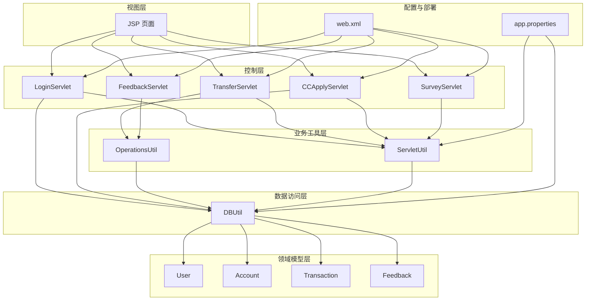
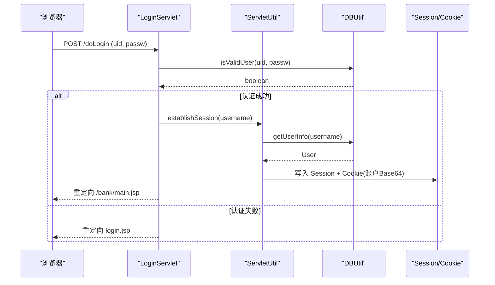
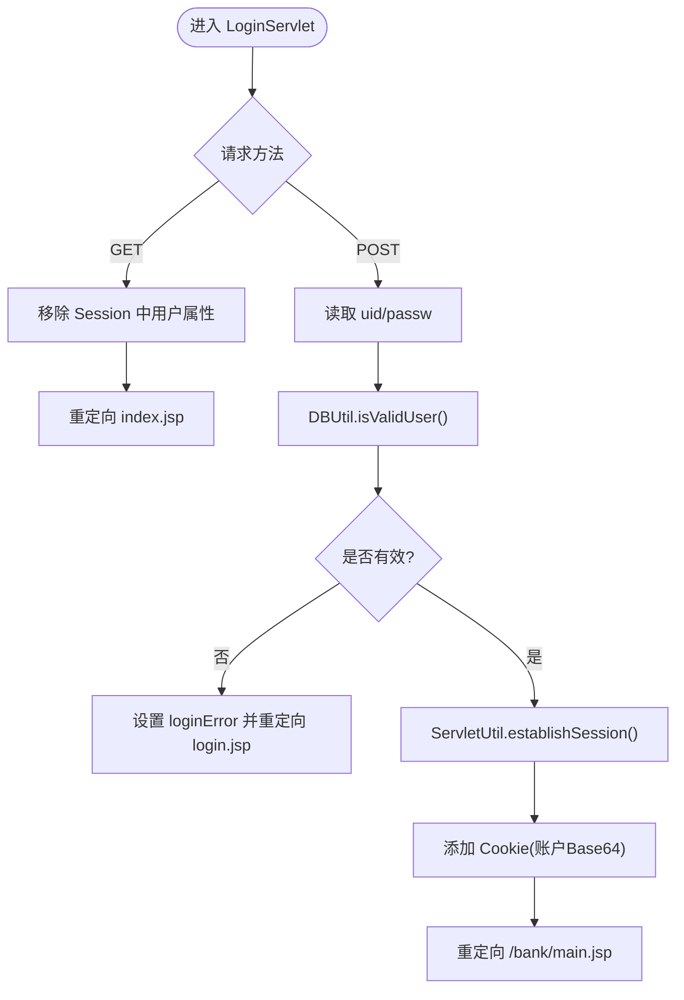
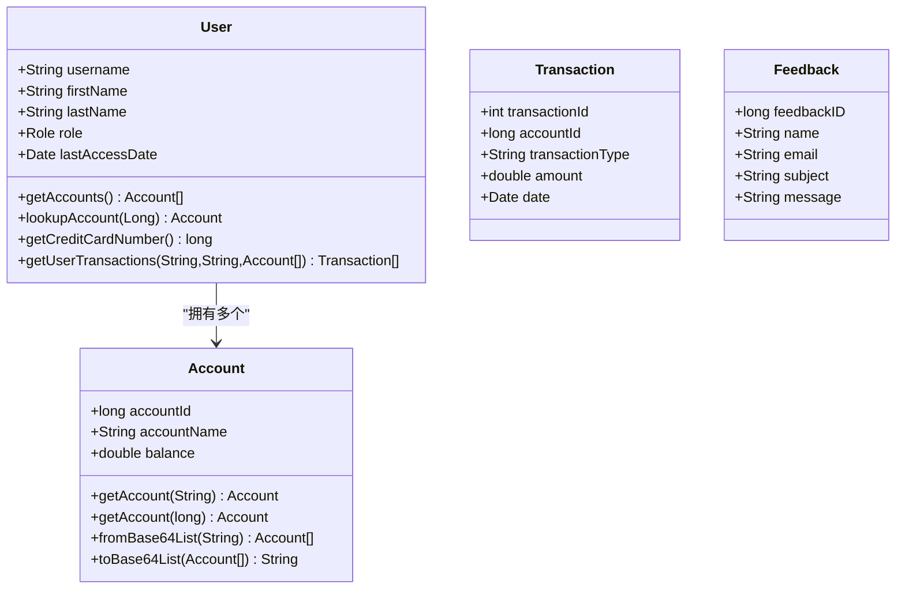
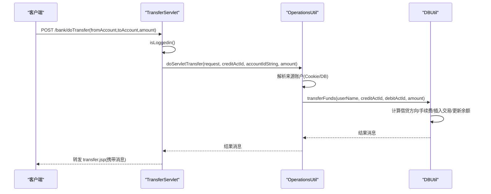
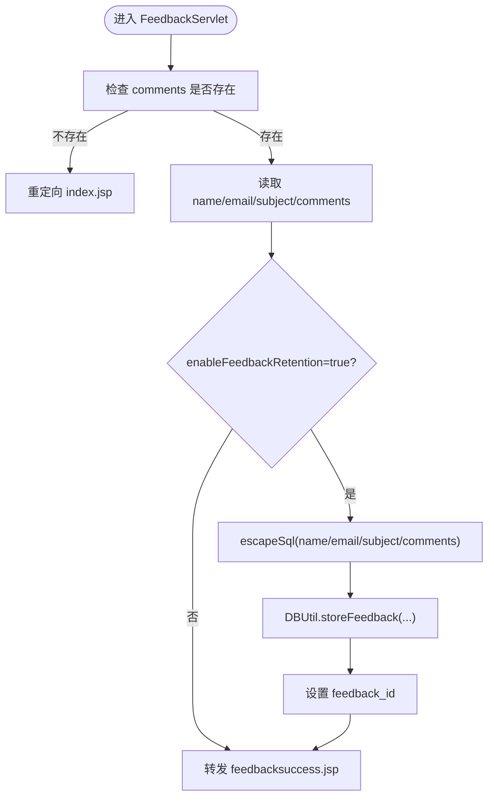
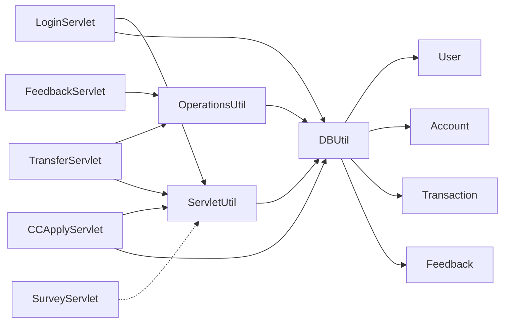

# 核心功能模块

<cite>
**本文引用的文件**   
- [README.md](file://README.md)
- [web.xml](file://WebContent/WEB-INF/web.xml)
- [app.properties](file://WebContent/WEB-INF/app.properties)
- [User.java](file://src/com/ibm/security/appscan/altoromutual/model/User.java)
- [Account.java](file://src/com/ibm/security/appscan/altoromutual/model/Account.java)
- [Transaction.java](file://src/com/ibm/security/appscan/altoromutual/model/Transaction.java)
- [Feedback.java](file://src/com/ibm/security/appscan/altoromutual/model/Feedback.java)
- [DBUtil.java](file://src/com/ibm/security/appscan/altoromutual/util/DBUtil.java)
- [OperationsUtil.java](file://src/com/ibm/security/appscan/altoromutual/util/OperationsUtil.java)
- [ServletUtil.java](file://src/com/ibm/security/appscan/altoromutual/util/ServletUtil.java)
- [LoginServlet.java](file://src/com/ibm/security/appscan/altoromutual/servlet/LoginServlet.java)
- [TransferServlet.java](file://src/com/ibm/security/appscan/altoromutual/servlet/TransferServlet.java)
- [FeedbackServlet.java](file://src/com/ibm/security/appscan/altoromutual/servlet/FeedbackServlet.java)
- [CCApplyServlet.java](file://src/com/ibm/security/appscan/altoromutual/servlet/CCApplyServlet.java)
- [SurveyServlet.java](file://src/com/ibm/security/appscan/altoromutual/servlet/SurveyServlet.java)
</cite>

## 目录
1. [简介](#简介)
2. [项目结构](#项目结构)
3. [核心组件](#核心组件)
4. [架构总览](#架构总览)
5. [详细组件分析](#详细组件分析)
6. [依赖关系分析](#依赖关系分析)
7. [性能与可扩展性](#性能与可扩展性)
8. [故障排查指南](#故障排查指南)
9. [结论](#结论)
10. [附录：配置项与接口清单](#附录配置项与接口清单)

## 简介
本文件聚焦 AltoroJ 的核心业务功能模块，包括用户认证、账户管理、资金转账、反馈收集、信用卡申请与调查系统。文档从领域模型、服务层工具类、控制器（Servlet）到数据访问层进行逐层剖析，给出调用链、数据流、错误处理与常见问题的解决方案，并附带架构图与流程图，帮助初学者快速上手，同时为有经验的开发者提供足够的技术深度。

## 项目结构
AltoroJ 采用经典的 J2EE Web 应用分层：
- 视图层：JSP 页面（银行主页、转账页、反馈页等）
- 控制层：Servlet 处理请求与响应
- 业务工具层：OperationsUtil、ServletUtil 封装通用逻辑
- 领域模型层：User、Account、Transaction、Feedback
- 数据访问层：DBUtil 统一数据库操作
- 配置与部署：web.xml、app.properties



图表来源
- [web.xml:1-227](file://WebContent/WEB-INF/web.xml#L1-L227)
- [app.properties:1-74](file://WebContent/WEB-INF/app.properties#L1-L74)

章节来源
- [web.xml:1-227](file://WebContent/WEB-INF/web.xml#L1-L227)
- [app.properties:1-74](file://WebContent/WEB-INF/app.properties#L1-L74)

## 核心组件
- 领域模型
  - User：用户实体，包含角色、最近访问时间，以及获取账户、交易的方法
  - Account：账户实体，支持 Base64 序列化用于 Cookie 传输
  - Transaction：交易记录，含账户ID、类型、金额、时间
  - Feedback：反馈实体，含 ID、姓名、邮箱、主题、内容
- 工具类
  - DBUtil：数据库连接、初始化、CRUD 与查询（含 SQL 注入风险点）
  - OperationsUtil：转账、反馈存储、API 鉴权解析等
  - ServletUtil：会话建立、登录校验、属性读取、输出转义、Swagger 初始化
- 控制器（Servlet）
  - LoginServlet：登录/登出
  - TransferServlet：转账
  - FeedbackServlet：反馈提交
  - CCApplyServlet：信用卡申请
  - SurveyServlet：调查问卷流程

章节来源
- [User.java:1-108](file://src/com/ibm/security/appscan/altoromutual/model/User.java#L1-L108)
- [Account.java:1-122](file://src/com/ibm/security/appscan/altoromutual/model/Account.java#L1-L122)
- [Transaction.java:1-64](file://src/com/ibm/security/appscan/altoromutual/model/Transaction.java#L1-L64)
- [Feedback.java:1-48](file://src/com/ibm/security/appscan/altoromutual/model/Feedback.java#L1-L48)
- [DBUtil.java:1-536](file://src/com/ibm/security/appscan/altoromutual/util/DBUtil.java#L1-L536)
- [OperationsUtil.java:1-155](file://src/com/ibm/security/appscan/altoromutual/util/OperationsUtil.java#L1-L155)
- [ServletUtil.java:1-412](file://src/com/ibm/security/appscan/altoromutual/util/ServletUtil.java#L1-L412)

## 架构总览
整体采用 MVC 风格：JSP 作为视图，Servlet 作为控制器，工具类与模型承载业务与数据，DBUtil 负责持久化。



图表来源
- [LoginServlet.java:48-105](file://src/com/ibm/security/appscan/altoromutual/servlet/LoginServlet.java#L48-L105)
- [DBUtil.java:212-232](file://src/com/ibm/security/appscan/altoromutual/util/DBUtil.java#L212-L232)
- [ServletUtil.java:340-353](file://src/com/ibm/security/appscan/altoromutual/util/ServletUtil.java#L340-L353)

## 详细组件分析

### 用户认证模块（LoginServlet）
- 功能要点
  - GET：清除 Session 中的用户属性，实现登出
  - POST：校验用户名密码，成功后建立 Session 与 Cookie，并重定向至银行主页
- 关键交互
  - 使用 DBUtil.isValidUser 进行认证（存在硬编码回退逻辑）
  - 通过 ServletUtil.establishSession 将用户对象放入 Session，并将账户列表 Base64 编码后写入 Cookie
- 错误处理
  - 认证失败时设置错误消息并重定向登录页
  - 异常时返回 500



图表来源
- [LoginServlet.java:48-105](file://src/com/ibm/security/appscan/altoromutual/servlet/LoginServlet.java#L48-L105)
- [DBUtil.java:212-232](file://src/com/ibm/security/appscan/altoromutual/util/DBUtil.java#L212-L232)
- [ServletUtil.java:340-353](file://src/com/ibm/security/appscan/altoromutual/util/ServletUtil.java#L340-L353)

章节来源
- [LoginServlet.java:48-105](file://src/com/ibm/security/appscan/altoromutual/servlet/LoginServlet.java#L48-L105)
- [DBUtil.java:212-232](file://src/com/ibm/security/appscan/altoromutual/util/DBUtil.java#L212-L232)
- [ServletUtil.java:340-353](file://src/com/ibm/security/appscan/altoromutual/util/ServletUtil.java#L340-L353)

### 账户管理模块（User/Account/DBUtil）
- 领域模型
  - User.getAccounts() 调用 DBUtil.getAccounts(username)
  - Account.getAccount(accountNo) 调用 DBUtil.getAccount(accountId)
  - Account 提供 Base64 编解码以在 Cookie 中传输账户列表
- 数据访问
  - DBUtil.getAccounts/getAccount 直接拼接 SQL（存在 SQL 注入风险）
- 使用模式
  - 登录后通过 ServletUtil.establishSession 将账户列表序列化为 Cookie，后续页面可直接读取减少数据库访问



图表来源
- [User.java:76-106](file://src/com/ibm/security/appscan/altoromutual/model/User.java#L76-L106)
- [Account.java:37-48](file://src/com/ibm/security/appscan/altoromutual/model/Account.java#L37-L48)
- [Account.java:76-120](file://src/com/ibm/security/appscan/altoromutual/model/Account.java#L76-L120)
- [DBUtil.java:275-293](file://src/com/ibm/security/appscan/altoromutual/util/DBUtil.java#L275-L293)
- [DBUtil.java:452-470](file://src/com/ibm/security/appscan/altoromutual/util/DBUtil.java#L452-L470)

章节来源
- [User.java:76-106](file://src/com/ibm/security/appscan/altoromutual/model/User.java#L76-L106)
- [Account.java:37-48](file://src/com/ibm/security/appscan/altoromutual/model/Account.java#L37-L48)
- [Account.java:76-120](file://src/com/ibm/security/appscan/altoromutual/model/Account.java#L76-L120)
- [DBUtil.java:275-293](file://src/com/ibm/security/appscan/altoromutual/util/DBUtil.java#L275-L293)
- [DBUtil.java:452-470](file://src/com/ibm/security/appscan/altoromutual/util/DBUtil.java#L452-L470)

### 资金转账模块（TransferServlet + OperationsUtil + DBUtil）
- 功能要点
  - 校验登录状态
  - 解析 fromAccount（可为账号名或ID）、toAccount（目标账户ID）、transferAmount
  - 通过 OperationsUtil.doServletTransfer 完成转账，最终调用 DBUtil.transferFunds
- 转账逻辑
  - 根据是否为信用卡账户调整借贷方向与手续费
  - 插入交易记录并更新余额
- 错误处理
  - 目标/来源账户无效、金额为负等情形返回错误信息



图表来源
- [TransferServlet.java:51-67](file://src/com/ibm/security/appscan/altoromutual/servlet/TransferServlet.java#L51-L67)
- [OperationsUtil.java:39-117](file://src/com/ibm/security/appscan/altoromutual/util/OperationsUtil.java#L39-L117)
- [DBUtil.java:303-364](file://src/com/ibm/security/appscan/altoromutual/util/DBUtil.java#L303-L364)

章节来源
- [TransferServlet.java:51-67](file://src/com/ibm/security/appscan/altoromutual/servlet/TransferServlet.java#L51-L67)
- [OperationsUtil.java:39-117](file://src/com/ibm/security/appscan/altoromutual/util/OperationsUtil.java#L39-L117)
- [DBUtil.java:303-364](file://src/com/ibm/security/appscan/altoromutual/util/DBUtil.java#L303-L364)

### 反馈收集模块（FeedbackServlet + OperationsUtil + DBUtil）
- 功能要点
  - 接收 name/email/subject/comments
  - 若启用 enableFeedbackRetention，则对输入进行 SQL 转义后入库
  - 返回反馈 ID 供展示
- 安全注意
  - 未启用保留时不入库；启用时使用 escapeSql（非参数化查询仍存在风险）



图表来源
- [FeedbackServlet.java:42-67](file://src/com/ibm/security/appscan/altoromutual/servlet/FeedbackServlet.java#L42-L67)
- [OperationsUtil.java:119-132](file://src/com/ibm/security/appscan/altoromutual/util/OperationsUtil.java#L119-L132)
- [DBUtil.java:520-535](file://src/com/ibm/security/appscan/altoromutual/util/DBUtil.java#L520-L535)

章节来源
- [FeedbackServlet.java:42-67](file://src/com/ibm/security/appscan/altoromutual/servlet/FeedbackServlet.java#L42-L67)
- [OperationsUtil.java:119-132](file://src/com/ibm/security/appscan/altoromutual/util/OperationsUtil.java#L119-L132)
- [DBUtil.java:520-535](file://src/com/ibm/security/appscan/altoromutual/util/DBUtil.java#L520-L535)

### 信用卡申请模块（CCApplyServlet）
- 功能要点
  - 从 Session 获取当前用户
  - 再次校验用户密码（DBUtil.isValidUser）
  - 成功则转发 applysuccess.jsp，失败则返回 apply.jsp 并提示错误
- 使用场景
  - 二次确认用户身份后再执行敏感操作

章节来源
- [CCApplyServlet.java:42-64](file://src/com/ibm/security/appscan/altoromutual/servlet/CCApplyServlet.java#L42-L64)
- [DBUtil.java:212-232](file://src/com/ibm/security/appscan/altoromutual/util/DBUtil.java#L212-L232)

### 调查系统（SurveyServlet）
- 功能要点
  - 基于 step 参数驱动多步问卷流程
  - 使用 Referer 与 Session 的 surveyStep 进行顺序校验，防止跳过步骤
  - 最后一步收集邮箱并显示感谢信息
- 交互流程
  - 按 a→b→c→d→email→done 的顺序推进

```mermaid
stateDiagram-v2
[*] --> Welcome
Welcome --> Q1 : "step=a"
Q1 --> Q2 : "step=b"
Q2 --> Q3 : "step=c"
Q3 --> Q4 : "step=d"
Q4 --> Email : "step=email"
Email --> Done : "step=done"
Note over Welcome,Done : 通过 Referer 与 session.surveyStep 校验步骤顺序
```

图表来源
- [SurveyServlet.java:45-101](file://src/com/ibm/security/appscan/altoromutual/servlet/SurveyServlet.java#L45-L101)

章节来源
- [SurveyServlet.java:45-101](file://src/com/ibm/security/appscan/altoromutual/servlet/SurveyServlet.java#L45-L101)

## 依赖关系分析
- 控制器依赖
  - LoginServlet → ServletUtil、DBUtil
  - TransferServlet → OperationsUtil、ServletUtil
  - FeedbackServlet → OperationsUtil
  - CCApplyServlet → ServletUtil、DBUtil
  - SurveyServlet → 无外部依赖（仅处理请求）
- 工具类依赖
  - OperationsUtil → DBUtil、ServletUtil
  - ServletUtil → DBUtil
- 模型依赖
  - User → DBUtil
  - Account → DBUtil
- 配置依赖
  - web.xml 定义 Servlet 映射与 Filter
  - app.properties 控制行为开关与数据库连接



图表来源
- [web.xml:60-218](file://WebContent/WEB-INF/web.xml#L60-L218)
- [LoginServlet.java:48-105](file://src/com/ibm/security/appscan/altoromutual/servlet/LoginServlet.java#L48-L105)
- [TransferServlet.java:51-67](file://src/com/ibm/security/appscan/altoromutual/servlet/TransferServlet.java#L51-L67)
- [FeedbackServlet.java:42-67](file://src/com/ibm/security/appscan/altoromutual/servlet/FeedbackServlet.java#L42-L67)
- [CCApplyServlet.java:42-64](file://src/com/ibm/security/appscan/altoromutual/servlet/CCApplyServlet.java#L42-L64)
- [OperationsUtil.java:18-143](file://src/com/ibm/security/appscan/altoromutual/util/OperationsUtil.java#L18-L143)
- [ServletUtil.java:200-218](file://src/com/ibm/security/appscan/altoromutual/util/ServletUtil.java#L200-L218)

章节来源
- [web.xml:60-218](file://WebContent/WEB-INF/web.xml#L60-L218)

## 性能与可扩展性
- 数据库连接
  - 默认使用嵌入式 Derby，首次登录自动创建与初始化
  - 支持通过 external DataSource 切换至外部数据库（如 DB2），需配合 reinitializeOnStart 初始化数据
- 缓存与优化
  - 登录后将账户列表 Base64 存入 Cookie，减少重复查询
  - 可考虑引入服务端缓存（如 Redis）缓存账户与交易热点数据
- 并发与事务
  - 转账涉及多表更新，建议引入事务边界保证一致性
  - 当前代码注释指出应原子操作，但实际未显式事务包裹

[本节为通用指导，不直接分析具体文件]

## 故障排查指南
- 数据库无法创建
  - 现象：登录时报“Failed to create database 'altoro'”
  - 原因：权限不足导致无法在 user.home/altoro 下创建数据库
  - 解决：赋予运行用户对 user.home 的写权限，或修改 Tomcat 启动参数 -Duser.home 指向可写路径
- 编译错误导致无法运行
  - 现象：Tomcat 启动失败
  - 原因：Eclipse 构建路径缺失第三方库
  - 解决：使用 Gradle 构建下载依赖并重新部署
- 外部数据库未初始化
  - 现象：使用 external DataSource 后首次登录失败
  - 原因：未开启 database.reinitializeOnStart 或未手动初始化数据
  - 解决：首次运行时设置为 true 并登录一次，之后可关闭

章节来源
- [README.md:44-56](file://README.md#L44-L56)
- [DBUtil.java:71-97](file://src/com/ibm/security/appscan/altoromutual/util/DBUtil.java#L71-L97)
- [DBUtil.java:110-133](file://src/com/ibm/security/appscan/altoromutual/util/DBUtil.java#L110-L133)

## 结论
AltoroJ 的核心模块围绕用户认证、账户与交易、反馈与调查展开，采用清晰的 MVC 分层与工具类抽象。尽管存在若干安全风险（如 SQL 注入、弱校验），但其结构便于理解与扩展。建议在保持现有功能的基础上，引入参数化查询、事务管理、更严格的输入校验与输出转义，以提升安全性与稳定性。

[本节为总结性内容，不直接分析具体文件]

## 附录：配置项与接口清单
- 配置项（app.properties）
  - enableAdminFunctions：启用管理员功能（谨慎使用）
  - specialLink：替换导航链接（演示恶意站点检测）
  - advancedStaticPageProcessing：启用高级静态页面处理（命令执行风险）
  - enableFeedbackRetention：启用反馈持久化（XSS 演示）
  - database.alternateDataSource：外部数据源名称（需配合 context.xml）
  - database.reinitializeOnStart：启动时重建数据库（首次必须启用）
- 主要 Servlet 映射（web.xml）
  - /doLogin → LoginServlet
  - /logout.jsp → LoginServlet
  - /bank/showAccount → AccountViewServlet
  - /bank/doTransfer → TransferServlet
  - /bank/showTransactions → AccountViewServlet
  - /bank/ccApply → CCApplyServlet
  - /sendFeedback → FeedbackServlet
  - /admin/* → AdminServlet/AdminLoginServlet
  - /static/doSurvey → SurveyServlet

章节来源
- [app.properties:25-74](file://WebContent/WEB-INF/app.properties#L25-L74)
- [web.xml:159-218](file://WebContent/WEB-INF/web.xml#L159-L218)