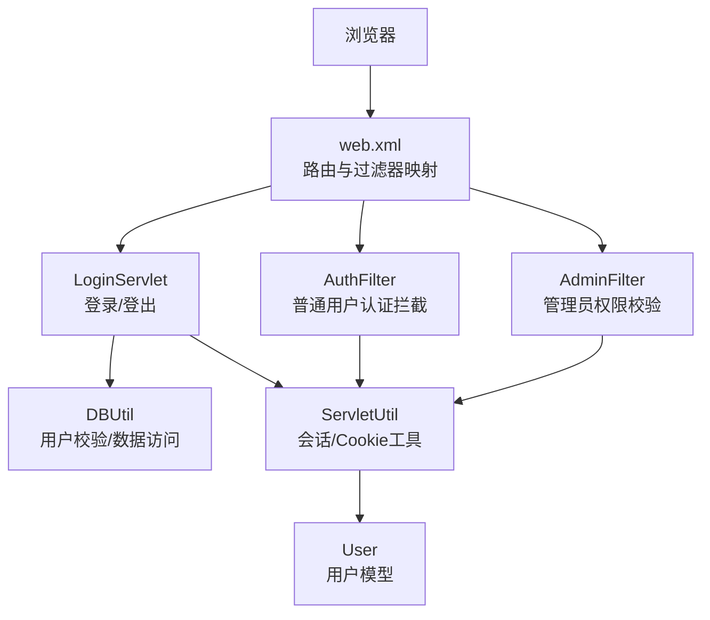
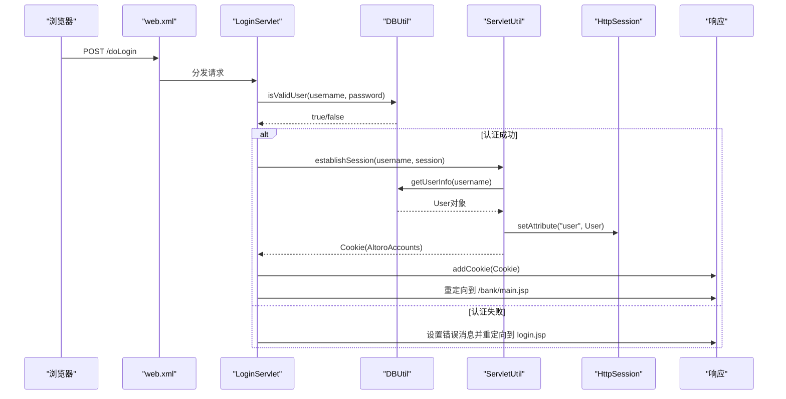
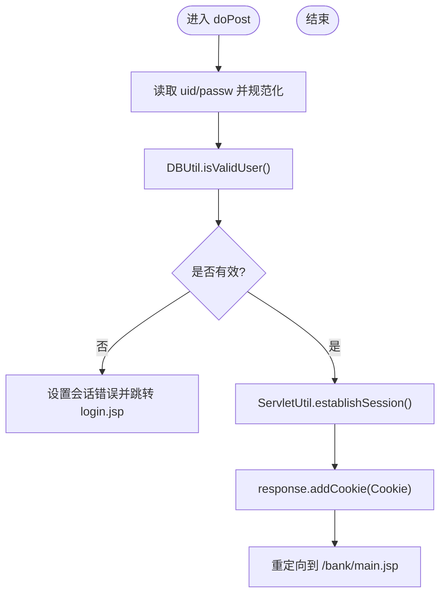
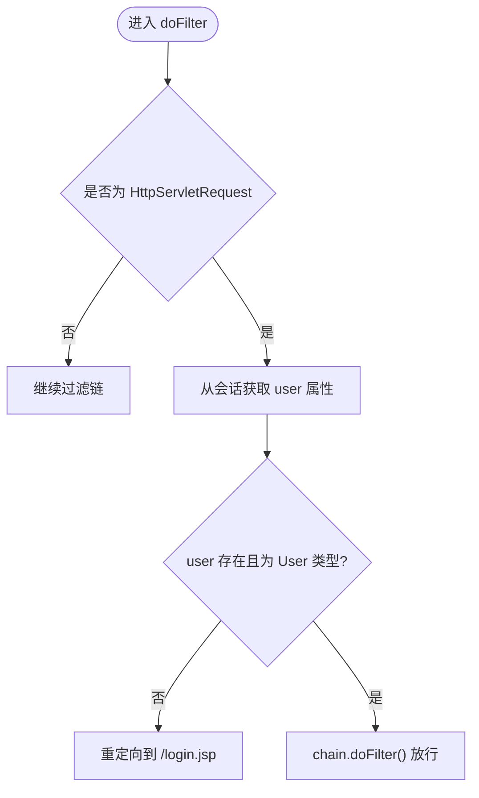
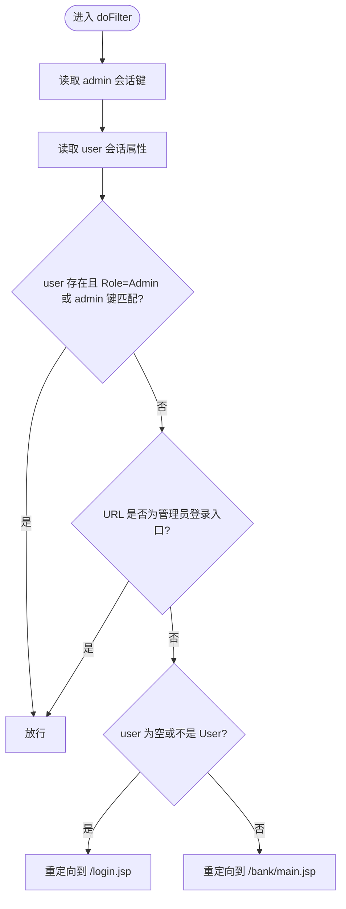
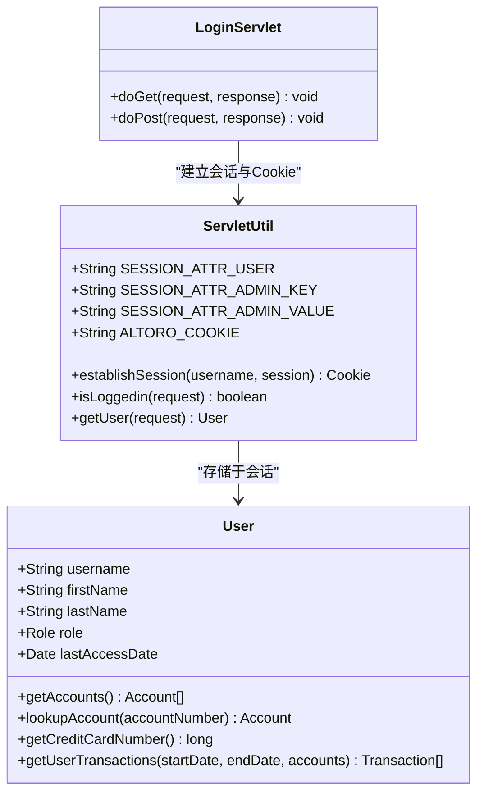
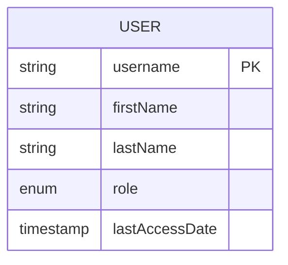
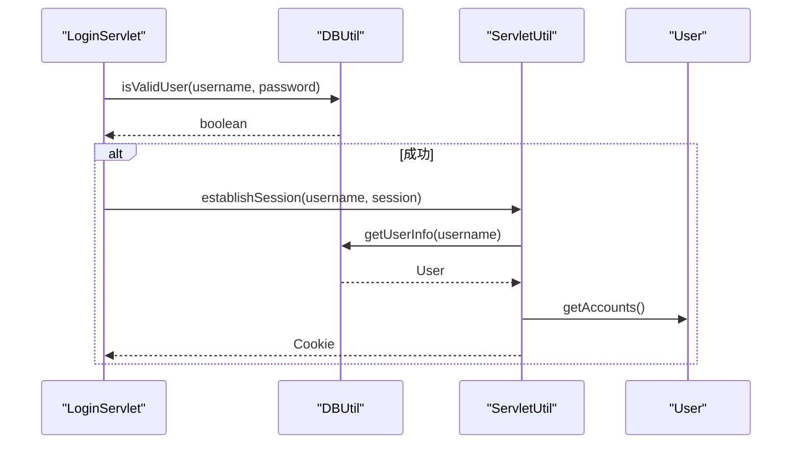
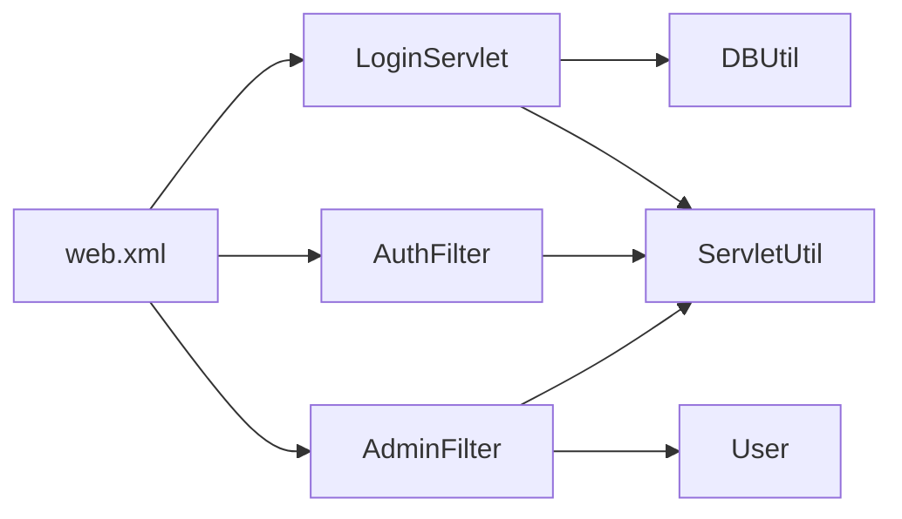

# 用户认证系统

<cite>
**本文引用的文件**   
- [LoginServlet.java](file://src/com/ibm/security/appscan/altoromutual/servlet/LoginServlet.java)
- [AuthFilter.java](file://src/com/ibm/security/appscan/altoromutual/filter/AuthFilter.java)
- [AdminFilter.java](file://src/com/ibm/security/appscan/altoromutual/filter/AdminFilter.java)
- [User.java](file://src/com/ibm/security/appscan/altoromutual/model/User.java)
- [DBUtil.java](file://src/com/ibm/security/appscan/altoromutual/util/DBUtil.java)
- [ServletUtil.java](file://src/com/ibm/security/appscan/altoromutual/util/ServletUtil.java)
- [web.xml](file://WebContent/WEB-INF/web.xml)
- [login.jsp](file://WebContent/login.jsp)
- [admin/login.jsp](file://WebContent/admin/login.jsp)
</cite>

## 目录
1. [简介](#简介)
2. [项目结构](#项目结构)
3. [核心组件](#核心组件)
4. [架构总览](#架构总览)
5. [详细组件分析](#详细组件分析)
6. [依赖关系分析](#依赖关系分析)
7. [性能与可扩展性](#性能与可扩展性)
8. [故障排查指南](#故障排查指南)
9. [结论](#结论)
10. [附录：关键流程与代码片段路径](#附录关键流程与代码片段路径)

## 简介
本文件面向用户认证子系统，系统性说明登录、登出、会话管理与权限控制的设计与实现。重点覆盖：
- LoginServlet 的认证与登出流程
- AuthFilter 与 AdminFilter 的权限校验机制
- Cookie 与会话的生命周期管理
- User 模型的数据结构与角色体系
- 安全注意事项、错误处理策略与最佳实践
- 与数据库验证层（DBUtil）及业务层的集成方式

## 项目结构
认证相关的关键位置如下：
- Servlet 层：LoginServlet 负责登录/登出
- Filter 层：AuthFilter 用于普通用户认证拦截；AdminFilter 用于管理员权限校验
- 模型层：User 表示用户实体与角色
- 工具层：ServletUtil 提供会话建立、常量定义等；DBUtil 提供数据库访问与用户校验
- 配置层：web.xml 注册 Servlet、Filter 及其映射
- 视图层：login.jsp 与 admin/login.jsp 提供登录表单

图表来源
- [web.xml:12-51](file://WebContent/WEB-INF/web.xml#L12-L51)
- [LoginServlet.java:38-107](file://src/com/ibm/security/appscan/altoromutual/servlet/LoginServlet.java#L38-L107)
- [AuthFilter.java:40-70](file://src/com/ibm/security/appscan/altoromutual/filter/AuthFilter.java#L40-L70)
- [AdminFilter.java:40-81](file://src/com/ibm/security/appscan/altoromutual/filter/AdminFilter.java#L40-L81)
- [ServletUtil.java:340-353](file://src/com/ibm/security/appscan/altoromutual/util/ServletUtil.java#L340-L353)
- [DBUtil.java:212-232](file://src/com/ibm/security/appscan/altoromutual/util/DBUtil.java#L212-L232)

章节来源
- [web.xml:12-51](file://WebContent/WEB-INF/web.xml#L12-L51)
- [LoginServlet.java:38-107](file://src/com/ibm/security/appscan/altoromutual/servlet/LoginServlet.java#L38-L107)
- [AuthFilter.java:40-70](file://src/com/ibm/security/appscan/altoromutual/filter/AuthFilter.java#L40-L70)
- [AdminFilter.java:40-81](file://src/com/ibm/security/appscan/altoromutual/filter/AdminFilter.java#L40-L81)

## 核心组件
- LoginServlet：处理用户登录与登出，调用 DBUtil 进行用户名/密码校验，成功后通过 ServletUtil 建立会话并写入 Cookie，再重定向至银行主页。
- AuthFilter：对 /bank/* 与 /admin/* 等受保护资源进行“已登录”检查，若未登录则重定向到登录页。
- AdminFilter：在 AdminFilter 中进一步校验管理员身份（Role.Admin 或特定会话键值），否则拒绝访问或重定向。
- User：用户模型，包含用户名、姓名、角色、最近访问时间等，并提供账户查询等方法。
- ServletUtil：封装会话属性常量、Cookie 名称、会话建立逻辑、登录状态判断等。
- DBUtil：数据库连接与操作，包括 isValidUser 用户校验、getUserInfo 获取用户信息、账户与交易数据访问。

章节来源
- [LoginServlet.java:38-107](file://src/com/ibm/security/appscan/altoromutual/servlet/LoginServlet.java#L38-L107)
- [AuthFilter.java:40-70](file://src/com/ibm/security/appscan/altoromutual/filter/AuthFilter.java#L40-L70)
- [AdminFilter.java:40-81](file://src/com/ibm/security/appscan/altoromutual/filter/AdminFilter.java#L40-L81)
- [User.java:30-107](file://src/com/ibm/security/appscan/altoromutual/model/User.java#L30-L107)
- [ServletUtil.java:60-68](file://src/com/ibm/security/appscan/altoromutual/util/ServletUtil.java#L60-L68)
- [ServletUtil.java:340-353](file://src/com/ibm/security/appscan/altoromutual/util/ServletUtil.java#L340-L353)
- [DBUtil.java:212-232](file://src/com/ibm/security/appscan/altoromutual/util/DBUtil.java#L212-L232)

## 架构总览
下图展示从浏览器发起请求到认证、鉴权、会话建立与页面返回的整体流程。

图表来源
- [web.xml:159-166](file://WebContent/WEB-INF/web.xml#L159-L166)
- [LoginServlet.java:67-104](file://src/com/ibm/security/appscan/altoromutual/servlet/LoginServlet.java#L67-L104)
- [DBUtil.java:212-232](file://src/com/ibm/security/appscan/altoromutual/util/DBUtil.java#L212-L232)
- [ServletUtil.java:340-353](file://src/com/ibm/security/appscan/altoromutual/util/ServletUtil.java#L340-L353)

## 详细组件分析

### LoginServlet 认证与登出流程
- 登录（POST /doLogin）
  - 读取 uid 与 passw 参数并进行规范化处理（trim、toLowerCase）。
  - 调用 DBUtil.isValidUser 进行用户名/密码校验。
  - 校验失败：记录日志、设置错误消息到会话、重定向回 login.jsp。
  - 校验成功：调用 ServletUtil.establishSession 建立会话与 Cookie，将 User 对象存入会话，添加 Cookie 后重定向到 /bank/main.jsp。
- 登出（GET /logout.jsp）
  - 尝试移除会话中的用户属性（SESSION_ATTR_USER），然后重定向到首页 index.jsp。

图表来源
- [LoginServlet.java:67-104](file://src/com/ibm/security/appscan/altoromutual/servlet/LoginServlet.java#L67-L104)
- [DBUtil.java:212-232](file://src/com/ibm/security/appscan/altoromutual/util/DBUtil.java#L212-L232)
- [ServletUtil.java:340-353](file://src/com/ibm/security/appscan/altoromutual/util/ServletUtil.java#L340-L353)

章节来源
- [LoginServlet.java:51-62](file://src/com/ibm/security/appscan/altoromutual/servlet/LoginServlet.java#L51-L62)
- [LoginServlet.java:67-104](file://src/com/ibm/security/appscan/altoromutual/servlet/LoginServlet.java#L67-L104)

### AuthFilter 权限验证机制
- 作用范围：/bank/* 与 /admin/*（由 web.xml 映射）。
- 行为：从 HttpSession 中读取 SESSION_ATTR_USER，若为空或非 User 类型，则重定向到 /login.jsp；否则放行。

图表来源
- [AuthFilter.java:58-70](file://src/com/ibm/security/appscan/altoromutual/filter/AuthFilter.java#L58-L70)
- [web.xml:28-43](file://WebContent/WEB-INF/web.xml#L28-L43)

章节来源
- [AuthFilter.java:40-70](file://src/com/ibm/security/appscan/altoromutual/filter/AuthFilter.java#L40-L70)
- [web.xml:28-43](file://WebContent/WEB-INF/web.xml#L28-L43)

### AdminFilter 管理员权限校验
- 作用范围：/admin/*（注意：web.xml 中存在一个拼写错误的映射 /adimn/*，需修正）。
- 行为：
  - 若会话中包含 Role.Admin 的用户，或存在特定的管理员会话键值（SESSION_ATTR_ADMIN_KEY=SESSION_ATTR_ADMIN_VALUE），则放行。
  - 若请求 URL 为管理员登录入口（/admin/login.jsp 或 /admin/doAdminLogin），直接放行。
  - 若未登录或用户非 User 类型，重定向到 /login.jsp。
  - 其他情况（已登录但非管理员），重定向到 /bank/main.jsp。

图表来源
- [AdminFilter.java:58-81](file://src/com/ibm/security/appscan/altoromutual/filter/AdminFilter.java#L58-L81)
- [web.xml:44-51](file://WebContent/WEB-INF/web.xml#L44-L51)

章节来源
- [AdminFilter.java:40-81](file://src/com/ibm/security/appscan/altoromutual/filter/AdminFilter.java#L40-L81)
- [web.xml:44-51](file://WebContent/WEB-INF/web.xml#L44-L51)

### Cookie 与会话生命周期管理
- 会话属性：
  - SESSION_ATTR_USER：存储 User 对象，用于判断是否已登录。
  - SESSION_ATTR_ADMIN_KEY/SESSION_ATTR_ADMIN_VALUE：用于管理员快捷通道。
- Cookie：
  - ALTORO_COOKIE：名为 AltoroAccounts，值为账户列表的 Base64 编码字符串，便于前端快速展示账户信息。
- 会话建立：
  - ServletUtil.establishSession 会查询用户信息、构建账户列表、创建 Cookie，并将 User 对象放入会话。
- 会话销毁：
  - LoginServlet.doGet 中移除 SESSION_ATTR_USER 以完成登出。

图表来源
- [ServletUtil.java:60-68](file://src/com/ibm/security/appscan/altoromutual/util/ServletUtil.java#L60-L68)
- [ServletUtil.java:340-353](file://src/com/ibm/security/appscan/altoromutual/util/ServletUtil.java#L340-L353)
- [LoginServlet.java:51-62](file://src/com/ibm/security/appscan/altoromutual/servlet/LoginServlet.java#L51-L62)
- [User.java:30-107](file://src/com/ibm/security/appscan/altoromutual/model/User.java#L30-L107)

章节来源
- [ServletUtil.java:340-353](file://src/com/ibm/security/appscan/altoromutual/util/ServletUtil.java#L340-L353)
- [LoginServlet.java:51-62](file://src/com/ibm/security/appscan/altoromutual/servlet/LoginServlet.java#L51-L62)

### User 模型数据结构
- 字段：username、firstName、lastName、role（User/Admin）、lastAccessDate。
- 方法：
  - getAccounts：根据用户名查询账户列表。
  - lookupAccount：按账号号查找账户。
  - getCreditCardNumber：识别信用卡账户号。
  - getUserTransactions：按日期范围与账户集合查询交易记录。

图表来源
- [User.java:30-107](file://src/com/ibm/security/appscan/altoromutual/model/User.java#L30-L107)

章节来源
- [User.java:30-107](file://src/com/ibm/security/appscan/altoromutual/model/User.java#L30-L107)

### 与数据库验证和业务逻辑层的交互
- 登录时：
  - LoginServlet 调用 DBUtil.isValidUser 进行用户名/密码校验。
  - 成功后通过 ServletUtil.establishSession 调用 DBUtil.getUserInfo 获取用户详细信息并构建会话。
- 业务扩展点：
  - User.getAccounts、User.getUserTransactions 等方法通过 DBUtil 访问账户与交易数据，体现模型层与数据访问层的解耦。

图表来源
- [LoginServlet.java:67-104](file://src/com/ibm/security/appscan/altoromutual/servlet/LoginServlet.java#L67-L104)
- [DBUtil.java:212-232](file://src/com/ibm/security/appscan/altoromutual/util/DBUtil.java#L212-L232)
- [DBUtil.java:241-267](file://src/com/ibm/security/appscan/altoromutual/util/DBUtil.java#L241-L267)
- [ServletUtil.java:340-353](file://src/com/ibm/security/appscan/altoromutual/util/ServletUtil.java#L340-L353)

章节来源
- [LoginServlet.java:67-104](file://src/com/ibm/security/appscan/altoromutual/servlet/LoginServlet.java#L67-L104)
- [DBUtil.java:212-232](file://src/com/ibm/security/appscan/altoromutual/util/DBUtil.java#L212-L232)
- [DBUtil.java:241-267](file://src/com/ibm/security/appscan/altoromutual/util/DBUtil.java#L241-L267)
- [ServletUtil.java:340-353](file://src/com/ibm/security/appscan/altoromutual/util/ServletUtil.java#L340-L353)

## 依赖关系分析
- LoginServlet 依赖：
  - DBUtil：用户校验与数据访问
  - ServletUtil：会话与 Cookie 工具
- AuthFilter/AdminFilter 依赖：
  - ServletUtil：会话属性常量
  - User：角色枚举 Role
- web.xml 作为中心路由与过滤器映射，协调各组件。

图表来源
- [web.xml:12-51](file://WebContent/WEB-INF/web.xml#L12-L51)
- [LoginServlet.java:38-107](file://src/com/ibm/security/appscan/altoromutual/servlet/LoginServlet.java#L38-L107)
- [AuthFilter.java:40-70](file://src/com/ibm/security/appscan/altoromutual/filter/AuthFilter.java#L40-L70)
- [AdminFilter.java:40-81](file://src/com/ibm/security/appscan/altoromutual/filter/AdminFilter.java#L40-L81)

章节来源
- [web.xml:12-51](file://WebContent/WEB-INF/web.xml#L12-L51)
- [LoginServlet.java:38-107](file://src/com/ibm/security/appscan/altoromutual/servlet/LoginServlet.java#L38-L107)
- [AuthFilter.java:40-70](file://src/com/ibm/security/appscan/altoromutual/filter/AuthFilter.java#L40-L70)
- [AdminFilter.java:40-81](file://src/com/ibm/security/appscan/altoromutual/filter/AdminFilter.java#L40-L81)

## 性能与可扩展性
- 会话与 Cookie：
  - 当前会话仅存储 User 对象，Cookie 存储账户列表的 Base64 字符串，适合演示场景。生产环境建议避免在 Cookie 中存放敏感数据，改用服务端会话或令牌机制。
- 数据库访问：
  - DBUtil 使用 Statement 拼接 SQL，存在注入风险与性能问题。建议迁移到 PreparedStatement 与连接池，提升安全性与并发性能。
- 过滤器：
  - AuthFilter/AdminFilter 逻辑简单高效，可考虑统一鉴权框架（如 Spring Security）以支持更细粒度的权限控制。

[本节为通用指导，不直接分析具体文件]

## 故障排查指南
- 登录失败
  - 现象：跳转到 login.jsp 并显示错误消息。
  - 可能原因：用户名/密码无效；DBUtil.isValidUser 返回 false。
  - 排查要点：确认输入参数是否正确；检查数据库表 PEOPLE 是否存在对应记录。
  - 参考路径：[LoginServlet.java:82-90](file://src/com/ibm/security/appscan/altoromutual/servlet/LoginServlet.java#L82-L90)，[DBUtil.java:212-232](file://src/com/ibm/security/appscan/altoromutual/util/DBUtil.java#L212-L232)
- 无法访问受保护资源
  - 现象：访问 /bank/* 被重定向到 /login.jsp。
  - 可能原因：会话中缺少 SESSION_ATTR_USER 或类型不正确。
  - 排查要点：检查登录流程是否成功建立会话；确认过滤器映射是否正确。
  - 参考路径：[AuthFilter.java:58-70](file://src/com/ibm/security/appscan/altoromutual/filter/AuthFilter.java#L58-L70)，[web.xml:28-43](file://WebContent/WEB-INF/web.xml#L28-L43)
- 管理员访问受限
  - 现象：访问 /admin/* 被重定向到 /bank/main.jsp 或 /login.jsp。
  - 可能原因：用户非 Role.Admin 或未设置管理员会话键值；web.xml 中 /adimn/* 映射拼写错误导致 AdminFilter 未生效。
  - 排查要点：修正 web.xml 中的映射为 /admin/*；确保管理员登录流程设置正确的会话键值。
  - 参考路径：[AdminFilter.java:58-81](file://src/com/ibm/security/appscan/altoromutual/filter/AdminFilter.java#L58-L81)，[web.xml:44-51](file://WebContent/WEB-INF/web.xml#L44-L51)
- 登出不生效
  - 现象：登出后仍可访问受保护资源。
  - 可能原因：会话未正确清理或客户端仍持有有效 Cookie。
  - 排查要点：确认 LoginServlet.doGet 是否执行移除用户属性；检查会话超时与 Cookie 过期策略。
  - 参考路径：[LoginServlet.java:51-62](file://src/com/ibm/security/appscan/altoromutual/servlet/LoginServlet.java#L51-L62)

章节来源
- [LoginServlet.java:51-62](file://src/com/ibm/security/appscan/altoromutual/servlet/LoginServlet.java#L51-L62)
- [LoginServlet.java:82-90](file://src/com/ibm/security/appscan/altoromutual/servlet/LoginServlet.java#L82-L90)
- [AuthFilter.java:58-70](file://src/com/ibm/security/appscan/altoromutual/filter/AuthFilter.java#L58-L70)
- [AdminFilter.java:58-81](file://src/com/ibm/security/appscan/altoromutual/filter/AdminFilter.java#L58-L81)
- [web.xml:28-51](file://WebContent/WEB-INF/web.xml#L28-L51)

## 结论
该认证系统通过 Servlet 与 Filter 的组合实现了基础的登录、登出与会话管理，并使用 User 模型与 DBUtil 完成用户校验与数据访问。整体设计简洁直观，适合演示与教学。但在安全性（SQL 注入、明文密码、Cookie 敏感数据）与健壮性（异常处理、会话安全）方面仍有改进空间。建议在生产环境中引入参数化查询、加密存储、安全的会话与令牌机制，以及统一的权限框架。

[本节为总结性内容，不直接分析具体文件]

## 附录：关键流程与代码片段路径
- 登录表单提交与错误提示
  - [login.jsp:45-72](file://WebContent/login.jsp#L45-L72)
  - [login.jsp:35-43](file://WebContent/login.jsp#L35-L43)
- 管理员登录表单
  - [admin/login.jsp:33-51](file://WebContent/admin/login.jsp#L33-L51)
- 登录/登出路由
  - [web.xml:159-166](file://WebContent/WEB-INF/web.xml#L159-L166)
- 会话建立与 Cookie 生成
  - [ServletUtil.java:340-353](file://src/com/ibm/security/appscan/altoromutual/util/ServletUtil.java#L340-L353)
- 用户校验与信息查询
  - [DBUtil.java:212-232](file://src/com/ibm/security/appscan/altoromutual/util/DBUtil.java#L212-L232)
  - [DBUtil.java:241-267](file://src/com/ibm/security/appscan/altoromutual/util/DBUtil.java#L241-L267)