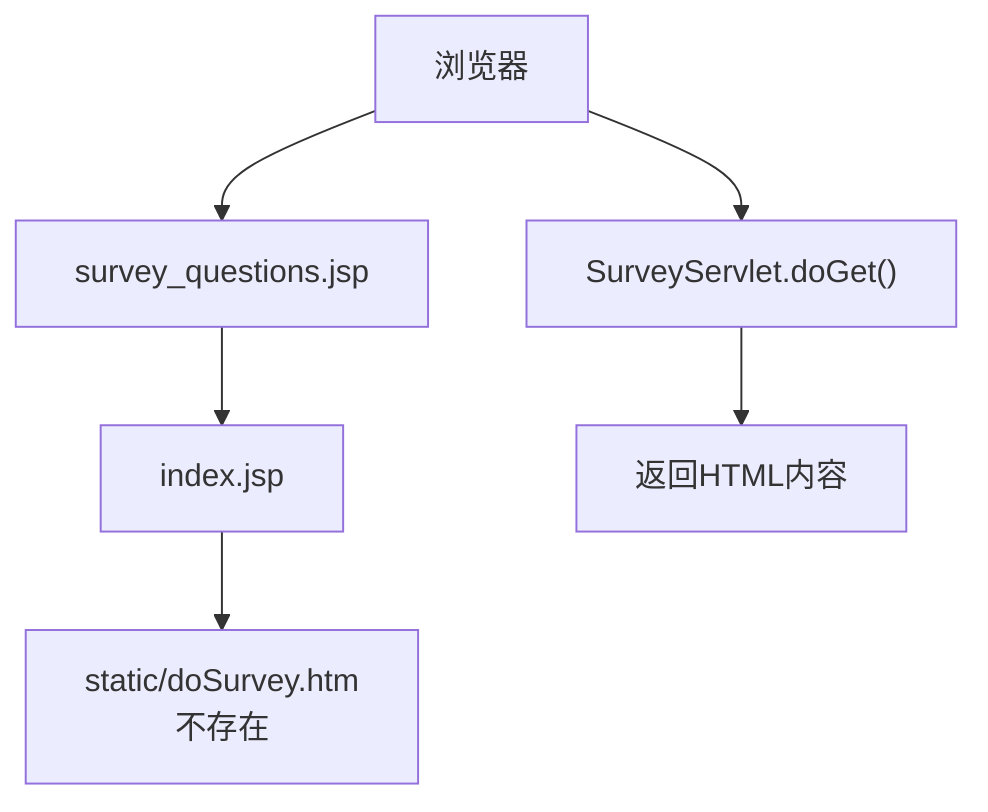
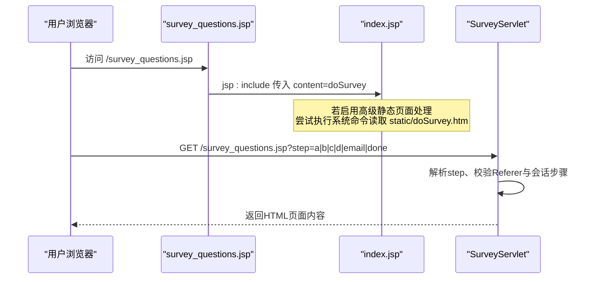
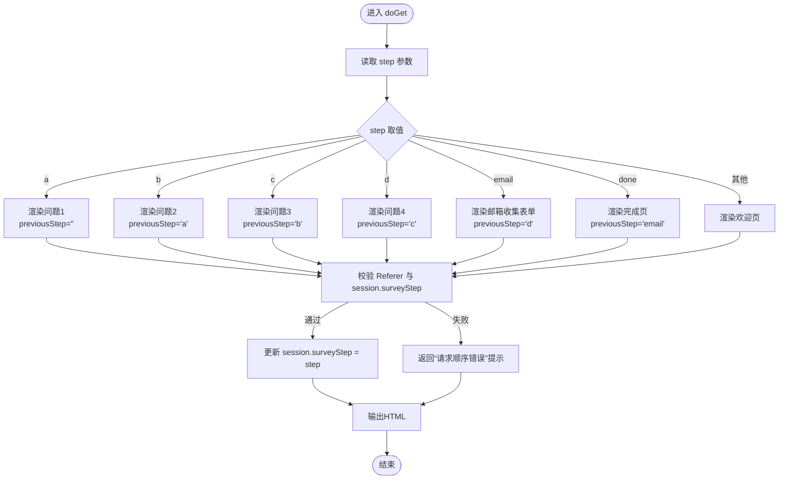
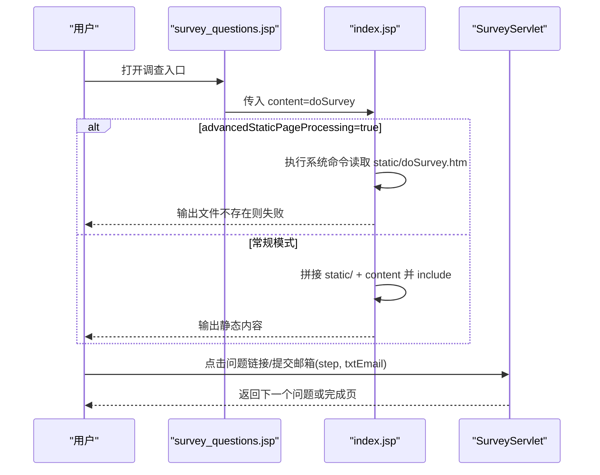
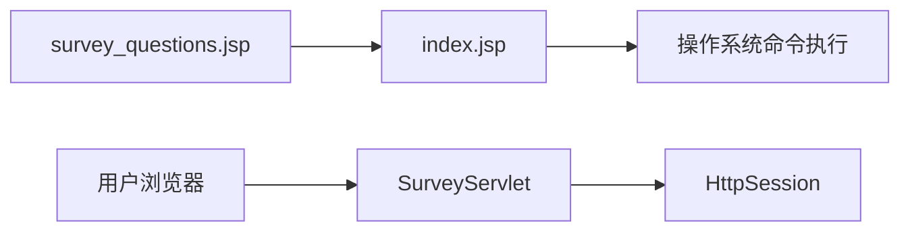

# 调查系统

<cite>
**本文引用的文件**   
- [SurveyServlet.java](file://src/com/ibm/security/appscan/altoromutual/servlet/SurveyServlet.java)
- [survey_questions.jsp](file://WebContent/survey_questions.jsp)
- [index.jsp](file://WebContent/index.jsp)
</cite>

## 目录
1. [简介](#简介)
2. [项目结构](#项目结构)
3. [核心组件](#核心组件)
4. [架构总览](#架构总览)
5. [详细组件分析](#详细组件分析)
6. [依赖关系分析](#依赖关系分析)
7. [性能与可扩展性](#性能与可扩展性)
8. [故障排查指南](#故障排查指南)
9. [结论](#结论)

## 简介
本章节面向“调查系统”的端到端实现，重点解释多步骤调查流程、动态页面生成与用户交互响应机制。该系统由一个 Servlet 负责处理调查步骤逻辑与内容渲染，配合 JSP 入口页将请求路由到主框架页面，最终通过 HTTP 响应直接输出 HTML 内容。当前实现未包含持久化存储与统计分析能力，属于演示用途的最小可用版本。

## 项目结构
围绕调查功能的关键文件如下：
- WebContent/survey_questions.jsp：调查入口 JSP，向 index.jsp 传递 content=doSurvey 参数以进入调查流程。
- WebContent/index.jsp：主框架页面，根据 content 参数决定加载静态内容或执行特殊逻辑；在高级模式下会尝试执行系统命令读取 static/doSurvey.htm（该文件不存在）。
- src/.../servlet/SurveyServlet.java：调查逻辑控制器，按 step 参数分发不同问题页面，维护会话中的步骤状态并进行简单的来源校验。

图表来源
- [survey_questions.jsp:24-26](file://WebContent/survey_questions.jsp#L24-L26)
- [index.jsp:34-105](file://WebContent/index.jsp#L34-L105)
- [SurveyServlet.java:45-102](file://src/com/ibm/security/appscan/altoromutual/servlet/SurveyServlet.java#L45-L102)

章节来源
- [survey_questions.jsp:1-27](file://WebContent/survey_questions.jsp#L1-L27)
- [index.jsp:1-110](file://WebContent/index.jsp#L1-L110)
- [SurveyServlet.java:1-106](file://src/com/ibm/security/appscan/altoromutual/servlet/SurveyServlet.java#L1-L106)

## 核心组件
- SurveyServlet：接收 step 参数，选择对应的问题页面内容，维护 session 中的 surveyStep，进行 Referer 与上一步校验，最后输出 HTML。
- survey_questions.jsp：作为调查入口，将 content 参数设为 doSurvey，交由 index.jsp 处理。
- index.jsp：根据 content 参数决定行为；当 advancedStaticPageProcessing 为 true 时，尝试执行系统命令读取 static/doSurvey.htm；否则拼接 static/ 前缀并 include 对应静态文件。

章节来源
- [SurveyServlet.java:45-102](file://src/com/ibm/security/appscan/altoromutual/servlet/SurveyServlet.java#L45-L102)
- [survey_questions.jsp:24-26](file://WebContent/survey_questions.jsp#L24-L26)
- [index.jsp:34-105](file://WebContent/index.jsp#L34-L105)

## 架构总览
下图展示从用户访问调查入口到 Servlet 渲染页面的整体流程。

图表来源
- [survey_questions.jsp:24-26](file://WebContent/survey_questions.jsp#L24-L26)
- [index.jsp:40-105](file://WebContent/index.jsp#L40-L105)
- [SurveyServlet.java:45-102](file://src/com/ibm/security/appscan/altoromutual/servlet/SurveyServlet.java#L45-L102)

## 详细组件分析

### SurveyServlet 调查逻辑处理
- 输入参数
  - step：控制当前显示的问题或阶段，取值包括 a、b、c、d、email、done 以及空值（欢迎页）。
  - txtEmail：仅在 step=done 时出现，用于回显用户邮箱。
- 步骤映射
  - a：年龄分组选择，下一步为 b。
  - b：是否收藏网站，下一步为 c。
  - c：性别选择，下一步为 d。
  - d：对新设计的印象，下一步为 email。
  - email：收集邮箱表单，提交后进入 done。
  - done：完成提示，回显邮箱。
- 会话与校验
  - 使用 session 属性 surveyStep 记录当前步骤。
  - 校验 Referer 是否来自允许的 URL（含上一 step），并结合 session 中上一步值进行顺序校验，防止跳过或重复。
- 输出
  - 直接以 text/html 输出 HTML 字符串，无模板引擎或数据模型。

图表来源
- [SurveyServlet.java:45-102](file://src/com/ibm/security/appscan/altoromutual/servlet/SurveyServlet.java#L45-L102)

章节来源
- [SurveyServlet.java:45-102](file://src/com/ibm/security/appscan/altoromutual/servlet/SurveyServlet.java#L45-L102)

### 动态页面生成与用户交互
- 入口 JSP
  - survey_questions.jsp 通过 jsp:include 将 content=doSurvey 传递给 index.jsp，从而复用主框架布局。
- 主框架行为
  - index.jsp 读取 content 参数，默认值为 default.htm。
  - 当配置 advancedStaticPageProcessing=true 时，会根据操作系统调用系统命令（cmd/bash）读取 static/doSurvey.htm 的内容并输出；该文件在当前仓库中不存在，因此该路径不会生效。
  - 否则，将 content 拼接为 static/content 并通过 jsp:include 引入静态文件。
- 用户交互
  - 用户在 SurveyServlet 输出的页面中点击链接或提交邮箱表单，通过 GET 请求携带 step 和 txtEmail 参数回到 SurveyServlet 继续流程。

图表来源
- [survey_questions.jsp:24-26](file://WebContent/survey_questions.jsp#L24-L26)
- [index.jsp:40-105](file://WebContent/index.jsp#L40-L105)
- [SurveyServlet.java:74-82](file://src/com/ibm/security/appscan/altoromutual/servlet/SurveyServlet.java#L74-L82)

章节来源
- [survey_questions.jsp:1-27](file://WebContent/survey_questions.jsp#L1-L27)
- [index.jsp:34-105](file://WebContent/index.jsp#L34-L105)
- [SurveyServlet.java:74-82](file://src/com/ibm/security/appscan/altoromutual/servlet/SurveyServlet.java#L74-L82)

### 调查问题的配置方式
- 当前实现采用硬编码的分支逻辑，每个 step 对应一段 HTML 文本。
- 扩展建议
  - 将问题与选项抽取为外部配置（如 JSON/XML），由服务层加载并在 Servlet 中渲染。
  - 引入模板引擎（如 JSP/JSTL、Thymeleaf）替代字符串拼接，提升可维护性与安全性。
  - 将步骤流转规则抽象为配置表，支持条件跳转与分支逻辑。

章节来源
- [SurveyServlet.java:54-87](file://src/com/ibm/security/appscan/altoromutual/servlet/SurveyServlet.java#L54-L87)

### 答案收集与结果保存
- 答案收集
  - 通过 GET 请求的 step 参数隐式传递用户选择；邮箱通过 txtEmail 参数传递。
- 结果保存
  - 当前实现未进行任何持久化存储，所有数据仅存在于会话中用于流程校验。
  - 如需持久化，可在 Servlet 中增加数据库写入逻辑，或使用现有工具类（例如 DBUtil）封装数据访问。

章节来源
- [SurveyServlet.java:45-102](file://src/com/ibm/security/appscan/altoromutual/servlet/SurveyServlet.java#L45-L102)

### 统计分析功能
- 当前实现未提供统计与分析能力。
- 扩展建议
  - 建立调查答题结果表，记录用户标识、各题答案、时间戳等。
  - 提供聚合查询接口，计算各选项分布、完成率、漏斗转化等指标。
  - 结合报表工具或前端可视化库输出图表。

[本节为概念性说明，不直接分析具体文件]

## 依赖关系分析
- 组件耦合
  - survey_questions.jsp 依赖 index.jsp 的 content 参数处理逻辑。
  - index.jsp 在高级模式下依赖操作系统命令执行环境。
  - SurveyServlet 依赖 HttpSession 与 HttpServletRequest/Response API。
- 外部依赖
  - 无第三方库依赖，纯 Java EE Servlet/JSP。

图表来源
- [survey_questions.jsp:24-26](file://WebContent/survey_questions.jsp#L24-L26)
- [index.jsp:40-105](file://WebContent/index.jsp#L40-L105)
- [SurveyServlet.java:45-102](file://src/com/ibm/security/appscan/altoromutual/servlet/SurveyServlet.java#L45-L102)

章节来源
- [survey_questions.jsp:1-27](file://WebContent/survey_questions.jsp#L1-L27)
- [index.jsp:1-110](file://WebContent/index.jsp#L1-L110)
- [SurveyServlet.java:1-106](file://src/com/ibm/security/appscan/altoromutual/servlet/SurveyServlet.java#L1-L106)

## 性能与可扩展性
- 性能特征
  - 每次请求直接拼接并返回 HTML，无数据库访问，延迟低。
  - 在高级静态页面模式下可能触发系统命令执行，存在额外开销与安全风险。
- 可扩展性
  - 建议将步骤与内容外置为配置，支持热更新。
  - 引入模板引擎与数据模型，避免字符串拼接。
  - 增加异步任务或消息队列处理结果落库与统计计算。

[本节为通用指导，不直接分析具体文件]

## 故障排查指南
- 常见问题
  - 请求顺序错误：当 Referer 不符合预期或 session.surveyStep 与 previousStep 不一致时，返回“请求顺序错误”。检查用户是否手动修改 URL 或禁用 Cookie。
  - 高级静态页面处理失败：advancedStaticPageProcessing=true 且 static/doSurvey.htm 不存在时，index.jsp 的命令执行会失败。关闭该配置或创建对应文件。
  - 中文乱码：页面编码为 ISO-8859-1，若需中文显示，应统一为 UTF-8 并在响应头设置字符集。
- 定位方法
  - 查看浏览器网络面板的请求参数 step 与 txtEmail。
  - 检查服务器日志中命令执行异常信息。
  - 确认 session 是否存在且未被清理。

章节来源
- [SurveyServlet.java:89-99](file://src/com/ibm/security/appscan/altoromutual/servlet/SurveyServlet.java#L89-L99)
- [index.jsp:40-105](file://WebContent/index.jsp#L40-L105)

## 结论
该调查系统以最小实现展示了多步骤流程控制与动态页面渲染的基本思路。SurveyServlet 通过 step 参数驱动流程，index.jsp 提供页面框架与可选的系统命令执行路径。当前版本未实现答案持久化与统计分析，适合用于演示与安全测试场景。后续可通过配置化、模板化与数据持久化增强其可维护性与业务价值。