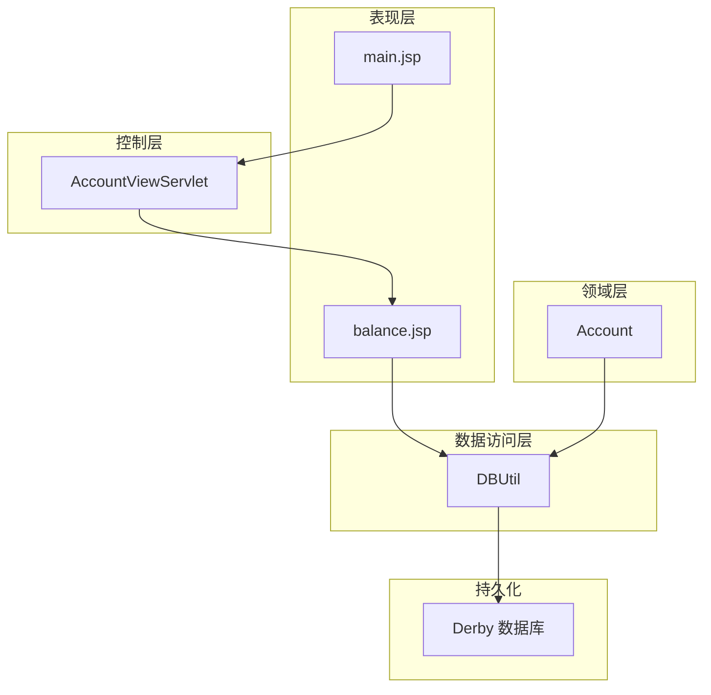
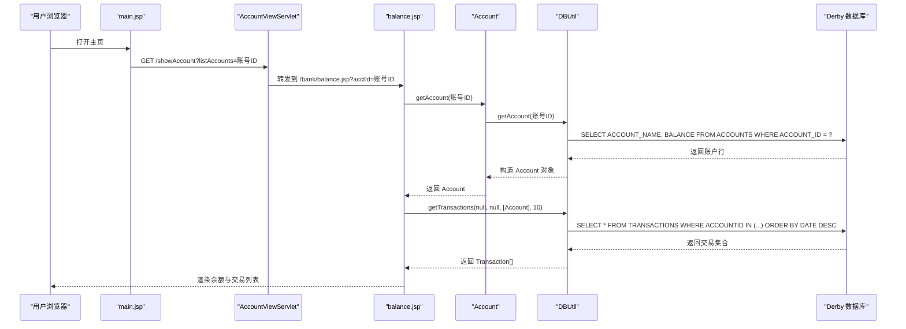
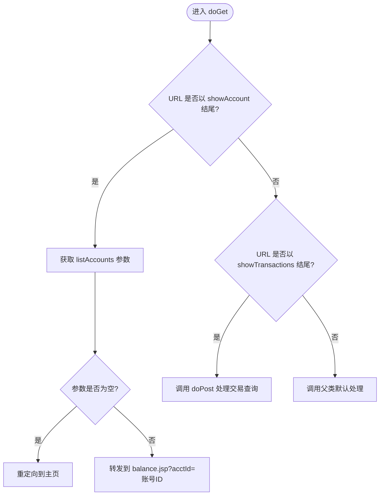
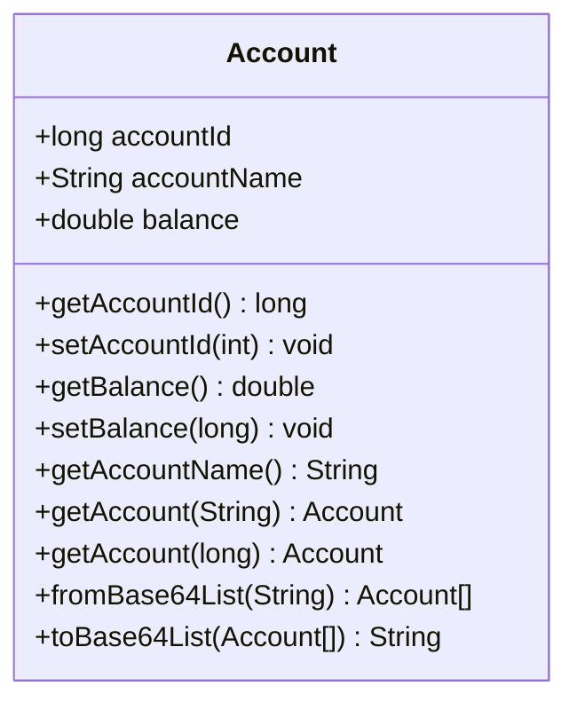
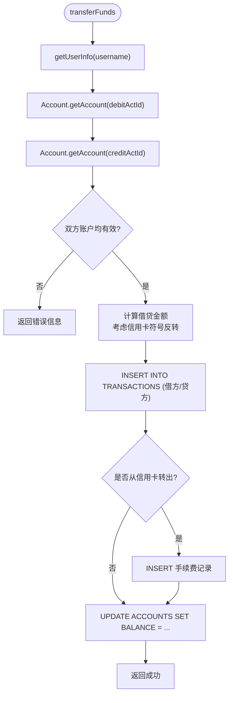
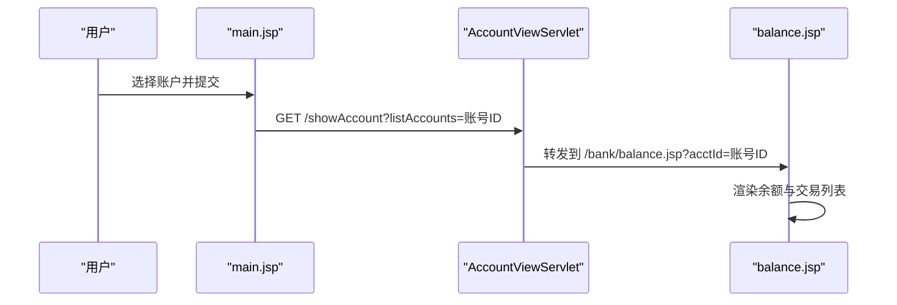
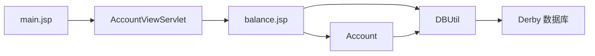

# 账户管理系统

<cite>
**本文引用的文件**   
- [AccountViewServlet.java](file://src/com/ibm/security/appscan/altoromutual/servlet/AccountViewServlet.java)
- [Account.java](file://src/com/ibm/security/appscan/altoromutual/model/Account.java)
- [DBUtil.java](file://src/com/ibm/security/appscan/altoromutual/util/DBUtil.java)
- [balance.jsp](file://WebContent/bank/balance.jsp)
- [main.jsp](file://WebContent/bank/main.jsp)
</cite>

## 目录
1. [简介](#简介)
2. [项目结构](#项目结构)
3. [核心组件](#核心组件)
4. [架构总览](#架构总览)
5. [详细组件分析](#详细组件分析)
6. [依赖关系分析](#依赖关系分析)
7. [性能与一致性](#性能与一致性)
8. [故障排查指南](#故障排查指南)
9. [结论](#结论)

## 简介
本文件围绕账户管理系统的核心能力展开，重点覆盖：
- 账户信息查看、余额查询、账户状态管理的实现细节
- AccountViewServlet 的业务路由与转发逻辑
- Account 模型的数据结构与序列化/反序列化工具方法
- DBUtil 中的账户读取、转账（余额更新）、交易记录等数据库操作接口
- 账户 CRUD 操作、数据验证规则与业务约束条件
- 与数据库的交互模式、事务处理和数据一致性保证

## 项目结构
本系统采用典型的 Web 分层结构：
- 表现层：JSP 页面负责展示账户列表、余额详情和交易历史
- 控制层：Servlet 接收请求并进行参数校验与页面转发
- 领域层：Account 模型封装账户实体及基础工具方法
- 数据访问层：DBUtil 提供统一的数据库连接、初始化与 SQL 操作

图表来源
- [AccountViewServlet.java:48-80](file://src/com/ibm/security/appscan/altoromutual/servlet/AccountViewServlet.java#L48-L80)
- [Account.java:32-121](file://src/com/ibm/security/appscan/altoromutual/model/Account.java#L32-L121)
- [DBUtil.java:45-536](file://src/com/ibm/security/appscan/altoromutual/util/DBUtil.java#L45-L536)
- [balance.jsp:37-118](file://WebContent/bank/balance.jsp#L37-L118)
- [main.jsp:32-62](file://WebContent/bank/main.jsp#L32-L62)

章节来源
- [AccountViewServlet.java:1-82](file://src/com/ibm/security/appscan/altoromutual/servlet/AccountViewServlet.java#L1-L82)
- [Account.java:1-122](file://src/com/ibm/security/appscan/altoromutual/model/Account.java#L1-L122)
- [DBUtil.java:1-536](file://src/com/ibm/security/appscan/altoromutual/util/DBUtil.java#L1-L536)
- [balance.jsp:1-132](file://WebContent/bank/balance.jsp#L1-L132)
- [main.jsp:1-68](file://WebContent/bank/main.jsp#L1-L68)

## 核心组件
- AccountViewServlet：负责账户查看与交易查询的请求分发，将请求转发至 JSP 进行渲染
- Account：账户实体类，包含账户 ID、名称、余额字段，以及从 Base64 列表解析/序列化的工具方法
- DBUtil：数据库工具类，提供账户查询、转账（余额更新）、交易查询、用户信息查询、账户创建等接口，并管理 Derby 或外部 DataSource 的连接与初始化
- balance.jsp：账户余额与最近交易展示的视图
- main.jsp：账户选择入口，提交到 showAccount 以进入余额页

章节来源
- [AccountViewServlet.java:48-80](file://src/com/ibm/security/appscan/altoromutual/servlet/AccountViewServlet.java#L48-L80)
- [Account.java:32-121](file://src/com/ibm/security/appscan/altoromutual/model/Account.java#L32-L121)
- [DBUtil.java:275-470](file://src/com/ibm/security/appscan/altoromutual/util/DBUtil.java#L275-L470)
- [balance.jsp:37-118](file://WebContent/bank/balance.jsp#L37-L118)
- [main.jsp:43-62](file://WebContent/bank/main.jsp#L43-L62)

## 架构总览
下图展示了账户查看与余额查询的关键调用链：

图表来源
- [main.jsp:43-62](file://WebContent/bank/main.jsp#L43-L62)
- [AccountViewServlet.java:48-60](file://src/com/ibm/security/appscan/altoromutual/servlet/AccountViewServlet.java#L48-L60)
- [balance.jsp:37-118](file://WebContent/bank/balance.jsp#L37-L118)
- [Account.java:37-48](file://src/com/ibm/security/appscan/altoromutual/model/Account.java#L37-L48)
- [DBUtil.java:452-470](file://src/com/ibm/security/appscan/altoromutual/util/DBUtil.java#L452-L470)
- [DBUtil.java:375-427](file://src/com/ibm/security/appscan/altoromutual/util/DBUtil.java#L375-L427)

## 详细组件分析

### AccountViewServlet 业务逻辑
- 请求路由
  - 当 URL 以 showAccount 结尾时，提取 listAccounts 参数作为账号标识；若缺失则重定向回主页
  - 使用 RequestDispatcher 将请求转发到 /bank/balance.jsp，并附带 acctId 参数
  - 当 URL 以 showTransactions 结尾时，转发到交易查询页面，携带可选的 startDate 与 endDate 参数
- 输入校验
  - 对 listAccounts 参数进行空值检查，避免无效跳转
- 错误处理
  - 未匹配的路径交由父类默认处理

图表来源
- [AccountViewServlet.java:48-80](file://src/com/ibm/security/appscan/altoromutual/servlet/AccountViewServlet.java#L48-L80)

章节来源
- [AccountViewServlet.java:48-80](file://src/com/ibm/security/appscan/altoromutual/servlet/AccountViewServlet.java#L48-L80)

### Account 模型数据结构与工具方法
- 字段
  - accountId：账户编号（long）
  - accountName：账户名称（String）
  - balance：余额（double）
- 静态方法
  - getAccount(String)：字符串转 long 后委托给 getAccount(long)
  - getAccount(long)：委托 DBUtil.getAccount(accountNo)
  - fromBase64List(String)：从 Base64 编码的“|”分隔列表中解析多个账户
  - toBase64List(Account[])：将账户数组序列化为 Base64 编码的“|”分隔字符串
- 注意
  - setBalance 的参数类型为 long，但内部字段为 double，存在类型不一致风险

图表来源
- [Account.java:32-121](file://src/com/ibm/security/appscan/altoromutual/model/Account.java#L32-L121)

章节来源
- [Account.java:32-121](file://src/com/ibm/security/appscan/altoromutual/model/Account.java#L32-L121)

### DBUtil 账户操作接口与事务处理
- 账户查询
  - getAccounts(String username)：按用户名查询账户数组
  - getAccount(long accountNo)：按账户号查询单个账户
- 转账与余额更新
  - transferFunds(username, creditActId, debitActId, amount)：在两个账户之间转账，同时写入交易记录并更新余额
  - 特殊处理信用卡账户余额符号反转，并在从信用卡转出时收取固定手续费
- 交易查询
  - getTransactions(startDate, endDate, accounts, rowCount)：根据账户列表与日期范围查询交易，支持限制返回行数
- 数据库连接与初始化
  - getConnection()：优先使用外部 DataSource，否则使用内置 Derby；支持启动时重新初始化数据库
  - initDB()：删除并重建表结构，插入初始数据
- 其他账户相关操作
  - addAccount(username, acctType)：新增账户
  - getBankUsernames()：获取银行用户列表

图表来源
- [DBUtil.java:303-364](file://src/com/ibm/security/appscan/altoromutual/util/DBUtil.java#L303-L364)

章节来源
- [DBUtil.java:275-470](file://src/com/ibm/security/appscan/altoromutual/util/DBUtil.java#L275-L470)
- [DBUtil.java:303-364](file://src/com/ibm/security/appscan/altoromutual/util/DBUtil.java#L303-L364)

### 前端视图交互
- main.jsp
  - 从 Session 中获取当前用户，遍历其账户列表生成下拉选项
  - 表单提交到 showAccount，携带 listAccounts 参数
- balance.jsp
  - 从 request 中获取 acctId，定位当前账户并将其置于列表首位
  - 通过 Account.getAccount(acctId) 获取余额并格式化显示
  - 通过 DBUtil.getTransactions(...) 获取最近 10 条交易并渲染

图表来源
- [main.jsp:43-62](file://WebContent/bank/main.jsp#L43-L62)
- [AccountViewServlet.java:48-60](file://src/com/ibm/security/appscan/altoromutual/servlet/AccountViewServlet.java#L48-L60)
- [balance.jsp:37-118](file://WebContent/bank/balance.jsp#L37-L118)

章节来源
- [main.jsp:32-62](file://WebContent/bank/main.jsp#L32-L62)
- [balance.jsp:37-118](file://WebContent/bank/balance.jsp#L37-L118)

## 依赖关系分析
- Servlet 依赖 JSP 视图进行渲染
- JSP 直接调用 Account 与 DBUtil 进行数据获取
- Account 委托 DBUtil 完成数据库访问
- DBUtil 管理 JDBC 连接与 SQL 执行

图表来源
- [AccountViewServlet.java:48-80](file://src/com/ibm/security/appscan/altoromutual/servlet/AccountViewServlet.java#L48-L80)
- [Account.java:37-48](file://src/com/ibm/security/appscan/altoromutual/model/Account.java#L37-L48)
- [DBUtil.java:452-470](file://src/com/ibm/security/appscan/altoromutual/util/DBUtil.java#L452-L470)
- [balance.jsp:37-118](file://WebContent/bank/balance.jsp#L37-L118)
- [main.jsp:43-62](file://WebContent/bank/main.jsp#L43-L62)

章节来源
- [AccountViewServlet.java:48-80](file://src/com/ibm/security/appscan/altoromutual/servlet/AccountViewServlet.java#L48-L80)
- [Account.java:37-48](file://src/com/ibm/security/appscan/altoromutual/model/Account.java#L37-L48)
- [DBUtil.java:452-470](file://src/com/ibm/security/appscan/altoromutual/util/DBUtil.java#L452-L470)
- [balance.jsp:37-118](file://WebContent/bank/balance.jsp#L37-L118)
- [main.jsp:43-62](file://WebContent/bank/main.jsp#L43-L62)

## 性能与一致性
- 连接管理
  - DBUtil 使用单例维护 Connection，优先使用外部 DataSource；若未配置则使用嵌入式 Derby
  - 支持通过配置项在启动时重新初始化数据库
- 查询优化
  - getTransactions 支持设置最大返回行数，减少网络与渲染开销
- 事务与一致性
  - transferFunds 中注释指出应原子性执行余额更新与交易记录写入，但当前代码未显式开启事务，存在并发下数据一致性的潜在风险
  - 建议引入事务边界，确保多语句操作的原子性与回滚机制
- 并发安全
  - 当前实现未对账户余额更新加锁，高并发转账可能导致竞态条件
  - 建议在数据库层面使用行级锁或应用层分布式锁保障一致性

章节来源
- [DBUtil.java:99-138](file://src/com/ibm/security/appscan/altoromutual/util/DBUtil.java#L99-L138)
- [DBUtil.java:303-364](file://src/com/ibm/security/appscan/altoromutual/util/DBUtil.java#L303-L364)
- [DBUtil.java:375-427](file://src/com/ibm/security/appscan/altoromutual/util/DBUtil.java#L375-L427)

## 故障排查指南
- 常见问题
  - 参数缺失：showAccount 未传入 listAccounts 会重定向到主页
  - 账户不存在：getAccount 返回 null，需在前端做空值判断
  - 交易查询异常：日期格式不正确会抛出特定错误码，提示正确的时间格式
- 日志与错误
  - DBUtil 在连接失败或 SQL 异常时记录日志或抛出异常
  - transferFunds 捕获 SQLException 并返回通用错误消息
- 调试建议
  - 检查数据库是否已初始化（initDB），必要时启用 reinitializeOnStart
  - 确认外部 DataSource 配置是否正确

章节来源
- [AccountViewServlet.java:48-60](file://src/com/ibm/security/appscan/altoromutual/servlet/AccountViewServlet.java#L48-L60)
- [DBUtil.java:143-167](file://src/com/ibm/security/appscan/altoromutual/util/DBUtil.java#L143-L167)
- [DBUtil.java:375-427](file://src/com/ibm/security/appscan/altoromutual/util/DBUtil.java#L375-L427)
- [DBUtil.java:303-364](file://src/com/ibm/security/appscan/altoromutual/util/DBUtil.java#L303-L364)

## 结论
- AccountViewServlet 承担轻量路由职责，将账户查看与交易查询请求转发到对应 JSP
- Account 模型提供基础账户实体与 Base64 序列化/反序列化能力
- DBUtil 集中处理数据库连接、账户查询、转账与交易查询等核心逻辑
- 当前系统在事务与并发一致性方面存在改进空间，建议引入显式事务与锁机制
- 前端通过 JSP 直接调用模型与数据访问层，适合演示用途，但在生产环境中建议进一步解耦