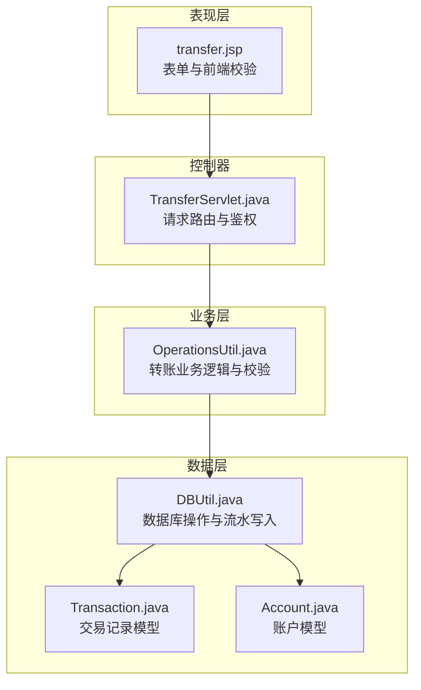
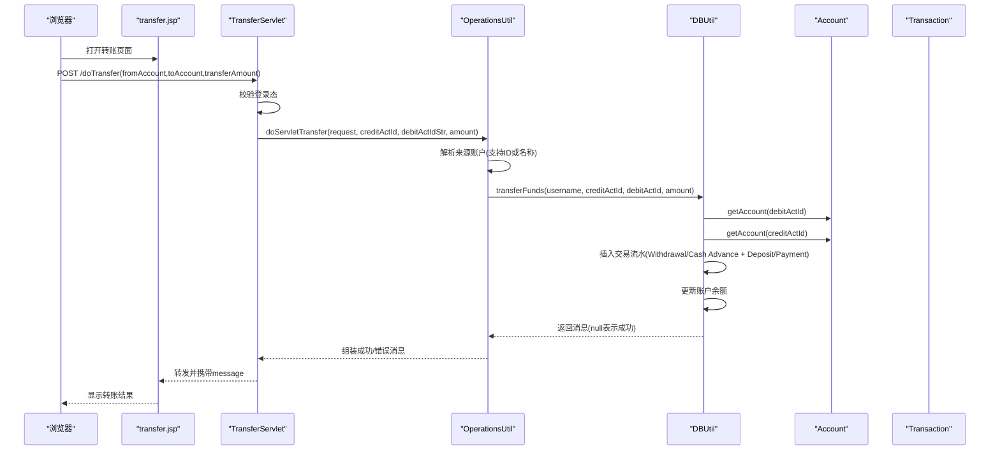
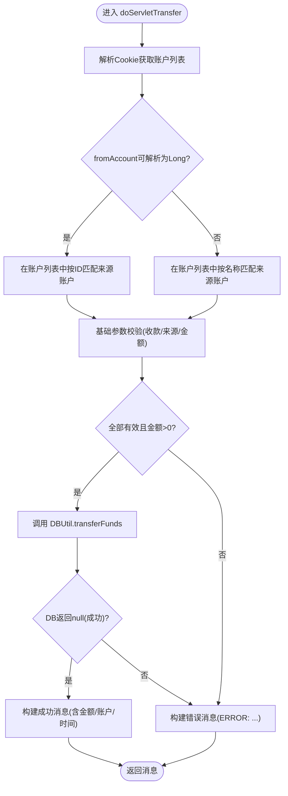
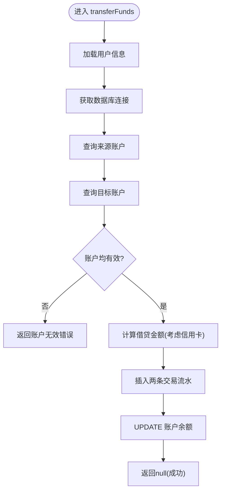
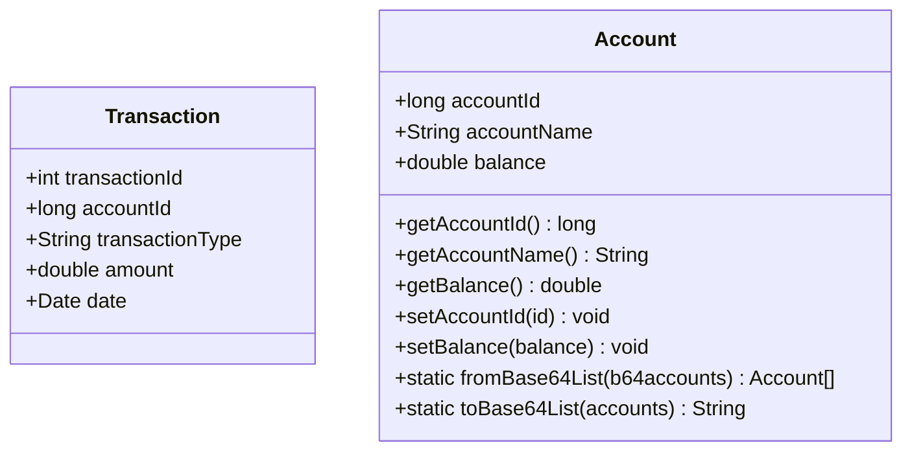
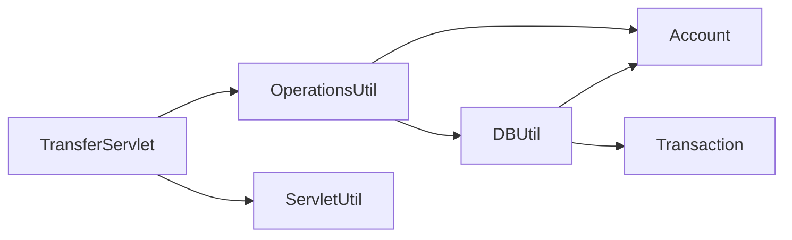
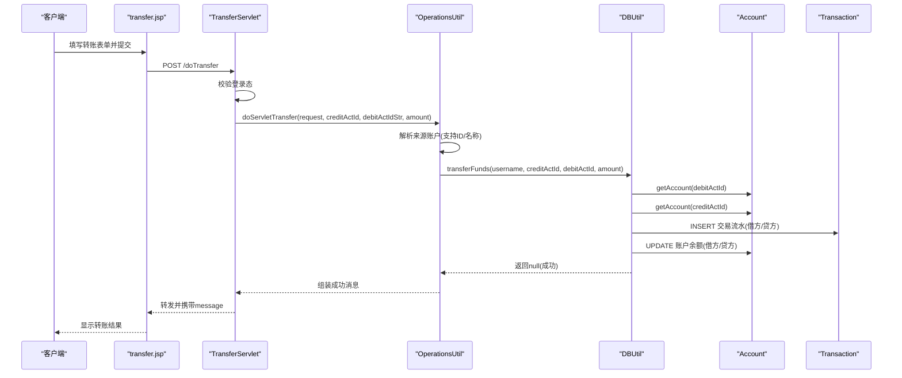
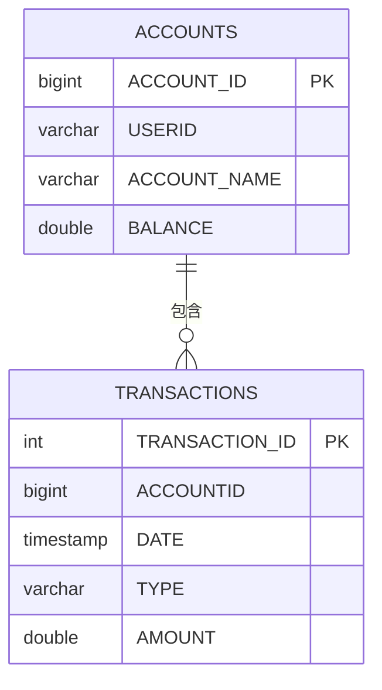

# 资金转账系统

<cite>
**本文引用的文件**   
- [TransferServlet.java](file://src/com/ibm/security/appscan/altoromutual/servlet/TransferServlet.java)
- [OperationsUtil.java](file://src/com/ibm/security/appscan/altoromutual/util/OperationsUtil.java)
- [DBUtil.java](file://src/com/ibm/security/appscan/altoromutual/util/DBUtil.java)
- [Transaction.java](file://src/com/ibm/security/appscan/altoromutual/model/Transaction.java)
- [Account.java](file://src/com/ibm/security/appscan/altoromutual/model/Account.java)
- [transfer.jsp](file://WebContent/bank/transfer.jsp)
</cite>

## 目录
1. [简介](#简介)
2. [项目结构](#项目结构)
3. [核心组件](#核心组件)
4. [架构总览](#架构总览)
5. [详细组件分析](#详细组件分析)
6. [依赖关系分析](#依赖关系分析)
7. [性能与并发特性](#性能与并发特性)
8. [故障排查指南](#故障排查指南)
9. [结论](#结论)
10. [附录：关键流程时序图与数据模型](#附录关键流程时序图与数据模型)

## 简介
本文件面向“资金转账系统”的完整技术文档，聚焦以下目标：
- 深入解释转账业务流程、事务处理与安全性在 TransferServlet 中的实现。
- 记录 Transaction 模型的交易记录结构、OperationsUtil 的业务逻辑处理与转账验证机制。
- 明确转账金额限制、账户余额检查、交易流水记录与异常处理策略。
- 提供从“发起转账 → 扣款入账 → 写入流水 → 返回结果”的端到端流程说明。
- 解释事务管理机制、并发控制与数据完整性保证的现状与改进建议。

## 项目结构
围绕转账功能的关键代码分布如下：
- 表现层（JSP）：WebContent/bank/transfer.jsp 负责转账表单展示与前端校验。
- 控制器（Servlet）：src/.../servlet/TransferServlet.java 接收请求、鉴权并委派业务。
- 业务工具（Util）：src/.../util/OperationsUtil.java 封装转账业务逻辑与参数校验。
- 数据访问（Util）：src/.../util/DBUtil.java 负责数据库连接、SQL 执行与流水写入。
- 领域模型（Model）：src/.../model/Transaction.java、Account.java 描述交易与账户数据结构。

图表来源
- [transfer.jsp:58-95](file://WebContent/bank/transfer.jsp#L58-L95)
- [TransferServlet.java:51-67](file://src/com/ibm/security/appscan/altoromutual/servlet/TransferServlet.java#L51-L67)
- [OperationsUtil.java:39-117](file://src/com/ibm/security/appscan/altoromutual/util/OperationsUtil.java#L39-L117)
- [DBUtil.java:303-363](file://src/com/ibm/security/appscan/altoromutual/util/DBUtil.java#L303-L363)
- [Transaction.java:28-63](file://src/com/ibm/security/appscan/altoromutual/model/Transaction.java#L28-L63)
- [Account.java:32-121](file://src/com/ibm/security/appscan/altoromutual/model/Account.java#L32-L121)

章节来源
- [transfer.jsp:1-112](file://WebContent/bank/transfer.jsp#L1-L112)
- [TransferServlet.java:1-71](file://src/com/ibm/security/appscan/altoromutual/servlet/TransferServlet.java#L1-L71)
- [OperationsUtil.java:1-155](file://src/com/ibm/security/appscan/altoromutual/util/OperationsUtil.java#L1-L155)
- [DBUtil.java:1-536](file://src/com/ibm/security/appscan/altoromutual/util/DBUtil.java#L1-L536)
- [Transaction.java:1-64](file://src/com/ibm/security/appscan/altoromutual/model/Transaction.java#L1-L64)
- [Account.java:1-122](file://src/com/ibm/security/appscan/altoromutual/model/Account.java#L1-L122)

## 核心组件
- TransferServlet：负责 HTTP 请求入口、登录态校验、参数提取与转发到业务层。
- OperationsUtil：封装转账业务逻辑，包括来源账户解析、基础参数校验、调用数据层执行转账。
- DBUtil：数据库连接管理、账户查询、交易流水插入、账户余额更新。
- Transaction：交易记录的数据模型（ID、账户ID、类型、金额、时间）。
- Account：账户数据模型（账户ID、名称、余额），并提供 Base64 序列化辅助方法。

章节来源
- [TransferServlet.java:38-67](file://src/com/ibm/security/appscan/altoromutual/servlet/TransferServlet.java#L38-L67)
- [OperationsUtil.java:18-117](file://src/com/ibm/security/appscan/altoromutual/util/OperationsUtil.java#L18-L117)
- [DBUtil.java:303-363](file://src/com/ibm/security/appscan/altoromutual/util/DBUtil.java#L303-L363)
- [Transaction.java:28-63](file://src/com/ibm/security/appscan/altoromutual/model/Transaction.java#L28-L63)
- [Account.java:32-121](file://src/com/ibm/security/appscan/altoromutual/model/Account.java#L32-L121)

## 架构总览
转账请求的整体调用链如下：
- 客户端通过 transfer.jsp 提交转账表单。
- TransferServlet 校验登录状态，提取 fromAccount、toAccount、transferAmount。
- OperationsUtil.doServletTransfer 进行来源账户解析与基础校验，然后调用 DBUtil.transferFunds。
- DBUtil 查询账户信息、写入交易流水、更新账户余额，并返回消息。
- TransferServlet 将消息回写至 request 属性并转发回 transfer.jsp 展示。

图表来源
- [transfer.jsp:58-95](file://WebContent/bank/transfer.jsp#L58-L95)
- [TransferServlet.java:51-67](file://src/com/ibm/security/appscan/altoromutual/servlet/TransferServlet.java#L51-L67)
- [OperationsUtil.java:39-117](file://src/com/ibm/security/appscan/altoromutual/util/OperationsUtil.java#L39-L117)
- [DBUtil.java:303-363](file://src/com/ibm/security/appscan/altoromutual/util/DBUtil.java#L303-L363)
- [Transaction.java:28-63](file://src/com/ibm/security/appscan/altoromutual/model/Transaction.java#L28-L63)
- [Account.java:32-121](file://src/com/ibm/security/appscan/altoromutual/model/Account.java#L32-L121)

## 详细组件分析

### TransferServlet：请求入口与鉴权
- 职责
  - 统一处理 GET/POST 请求（GET 直接委托给 POST）。
  - 使用 ServletUtil.isLoggedin 校验用户登录态，未登录则重定向到 login.jsp。
  - 从请求参数中提取 fromAccount、toAccount、transferAmount。
  - 调用 OperationsUtil.doServletTransfer 执行业务逻辑。
  - 将返回消息设置到 request 属性并转发回 transfer.jsp。
- 关键点
  - 未对金额做服务端数值范围校验，仅依赖业务层与前端校验。
  - 未对 toAccount/fromAccount 做严格的类型与存在性校验，交由业务层处理。

章节来源
- [TransferServlet.java:41-67](file://src/com/ibm/security/appscan/altoromutual/servlet/TransferServlet.java#L41-L67)

### OperationsUtil：转账业务逻辑与验证
- 职责
  - doServletTransfer：解析来源账户（支持 Cookie 中 Base64 序列化的账户列表或用户对象中的账户数组），根据 ID 或名称匹配来源账户；进行基础参数校验（收款账户、付款账户、金额合法性）；调用 DBUtil.transferFunds 执行转账。
  - doApiTransfer：API 风格转账，基于 Authorization Header 解析用户，调用 DBUtil.transferFunds。
- 验证机制
  - 来源账户解析：优先尝试将 fromAccount 解析为 Long；若失败则按账户名模糊匹配（忽略大小写）。
  - 基础校验：收款账户必须大于等于 0；来源账户必须大于等于 0；转账金额必须大于 0。
  - 注释明确指出“未检查可用余额”，余额检查由业务规则决定（当前未实现）。
- 返回值
  - 成功：返回包含转账金额、来源账户、目标账户与时间的成功消息。
  - 失败：返回以 “ERROR: ” 前缀的错误消息。

图表来源
- [OperationsUtil.java:39-117](file://src/com/ibm/security/appscan/altoromutual/util/OperationsUtil.java#L39-L117)

章节来源
- [OperationsUtil.java:39-117](file://src/com/ibm/security/appscan/altoromutual/util/OperationsUtil.java#L39-L117)

### DBUtil：数据访问与流水写入
- 职责
  - 提供数据库连接管理（内置 Derby 或外部 DataSource）。
  - transferFunds：查询来源与目标账户，判断是否为信用卡账户，计算借贷金额，插入交易流水，更新账户余额。
  - getTransactions：按账户与日期范围查询交易流水。
  - getAccount/getAccounts：账户信息查询。
- 转账逻辑要点
  - 账户有效性校验：来源/目标账户为空时返回错误消息。
  - 信用卡特殊处理：若来源账户为用户信用卡，则借贷方向反转，并额外插入“现金预支手续费”流水。
  - 流水记录：同时插入两条流水（借方 Withdrawal/Cash Advance，贷方 Deposit/Payment）。
  - 余额更新：分别 UPDATE 两个账户的 BALANCE。
  - 事务与原子性：代码注释指出应作为原子操作，但当前实现未显式开启事务或使用锁，存在并发风险。
- 异常处理
  - 捕获 SQLException 并返回通用错误消息。

图表来源
- [DBUtil.java:303-363](file://src/com/ibm/security/appscan/altoromutual/util/DBUtil.java#L303-L363)

章节来源
- [DBUtil.java:303-363](file://src/com/ibm/security/appscan/altoromutual/util/DBUtil.java#L303-L363)

### Transaction 与 Account 模型
- Transaction
  - 字段：transactionId、accountId、transactionType、amount、date。
  - 用途：持久化每笔交易的明细，供查询与审计。
- Account
  - 字段：accountId、accountName、balance。
  - 辅助：Base64 序列化/反序列化用于 Cookie 存储账户列表。

图表来源
- [Transaction.java:28-63](file://src/com/ibm/security/appscan/altoromutual/model/Transaction.java#L28-L63)
- [Account.java:32-121](file://src/com/ibm/security/appscan/altoromutual/model/Account.java#L32-L121)

章节来源
- [Transaction.java:28-63](file://src/com/ibm/security/appscan/altoromutual/model/Transaction.java#L28-L63)
- [Account.java:32-121](file://src/com/ibm/security/appscan/altoromutual/model/Account.java#L32-L121)

## 依赖关系分析
- TransferServlet 依赖 OperationsUtil 与 ServletUtil（登录态校验）。
- OperationsUtil 依赖 DBUtil 与 Account（账户解析与序列化）。
- DBUtil 依赖 Account 与 Transaction（数据模型），并通过 JDBC 访问数据库。
- 前端 transfer.jsp 依赖后端 Servlet 接口与 Session 中的用户信息。

图表来源
- [TransferServlet.java:29-30](file://src/com/ibm/security/appscan/altoromutual/servlet/TransferServlet.java#L29-L30)
- [OperationsUtil.java:13-14](file://src/com/ibm/security/appscan/altoromutual/util/OperationsUtil.java#L13-L14)
- [DBUtil.java:34-38](file://src/com/ibm/security/appscan/altoromutual/util/DBUtil.java#L34-L38)

章节来源
- [TransferServlet.java:29-30](file://src/com/ibm/security/appscan/altoromutual/servlet/TransferServlet.java#L29-L30)
- [OperationsUtil.java:13-14](file://src/com/ibm/security/appscan/altoromutual/util/OperationsUtil.java#L13-L14)
- [DBUtil.java:34-38](file://src/com/ibm/security/appscan/altoromutual/util/DBUtil.java#L34-L38)

## 性能与并发特性
- 连接管理
  - DBUtil 使用单例模式维护 Connection，并在需要时初始化 Derby 或外部 DataSource。
- 并发与事务
  - 当前转账逻辑未显式开启事务或使用行级锁，存在并发下的竞态条件风险（如重复扣款、余额不一致）。
  - 建议在 DBUtil.transferFunds 中使用数据库事务（BEGIN/COMMIT/ROLLBACK）与 SELECT ... FOR UPDATE 锁定待更新账户行，确保原子性与一致性。
- SQL 注入风险
  - 多处 SQL 拼接字符串，存在注入风险；建议使用 PreparedStatement 与参数绑定。
- 性能优化建议
  - 引入连接池（如 HikariCP）替代单例连接。
  - 对高频查询（如账户余额）增加缓存（需配合失效策略）。
  - 对流水表添加索引（ACCOUNTID、DATE）以提升查询性能。

[本节为通用指导，不直接分析具体文件]

## 故障排查指南
- 常见错误消息
  - “Destination account is invalid”：目标账户无效或未找到。
  - “Originating account is invalid”：来源账户无效或未找到。
  - “Transfer amount is invalid”：转账金额非法（小于等于 0）。
  - “ERROR: ...”：业务层或数据层返回的错误被统一加前缀。
- 定位步骤
  - 检查前端表单是否传递了有效的 fromAccount、toAccount、transferAmount。
  - 检查用户登录态是否有效（Session 中是否存在 user）。
  - 检查 Cookie 中是否包含正确的账户 Base64 列表（当 fromAccount 为名称时）。
  - 查看数据库 TRANSACTIONS 表是否已插入流水，ACCOUNTS 表余额是否正确更新。
  - 关注 DBUtil 的日志输出（Log4AltoroJ）与异常堆栈。

章节来源
- [OperationsUtil.java:95-117](file://src/com/ibm/security/appscan/altoromutual/util/OperationsUtil.java#L95-L117)
- [DBUtil.java:303-363](file://src/com/ibm/security/appscan/altoromutual/util/DBUtil.java#L303-L363)

## 结论
- TransferServlet 提供了简洁的请求入口与鉴权，但未做严格的参数校验。
- OperationsUtil 实现了转账业务的核心逻辑与基础校验，但注释明确指出未检查余额。
- DBUtil 完成了流水写入与余额更新，但缺乏事务与并发保护，存在一致性与安全风险。
- 建议尽快引入事务、行级锁、参数化查询与余额校验，以提升系统的安全性与可靠性。

[本节为总结性内容，不直接分析具体文件]

## 附录：关键流程时序图与数据模型

### 转账发起、余额扣减、收入入账与交易记录的完整流程

图表来源
- [transfer.jsp:58-95](file://WebContent/bank/transfer.jsp#L58-L95)
- [TransferServlet.java:51-67](file://src/com/ibm/security/appscan/altoromutual/servlet/TransferServlet.java#L51-L67)
- [OperationsUtil.java:39-117](file://src/com/ibm/security/appscan/altoromutual/util/OperationsUtil.java#L39-L117)
- [DBUtil.java:303-363](file://src/com/ibm/security/appscan/altoromutual/util/DBUtil.java#L303-L363)
- [Transaction.java:28-63](file://src/com/ibm/security/appscan/altoromutual/model/Transaction.java#L28-L63)
- [Account.java:32-121](file://src/com/ibm/security/appscan/altoromutual/model/Account.java#L32-L121)

### 数据模型（ER 示意）

图表来源
- [DBUtil.java:156-164](file://src/com/ibm/security/appscan/altoromutual/util/DBUtil.java#L156-L164)