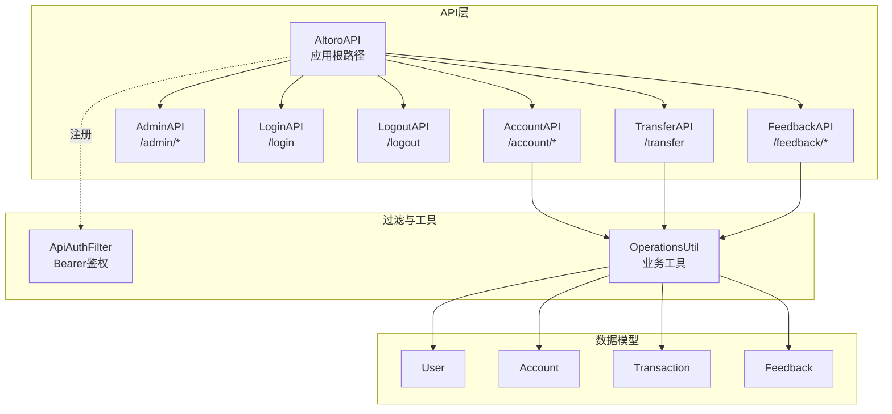
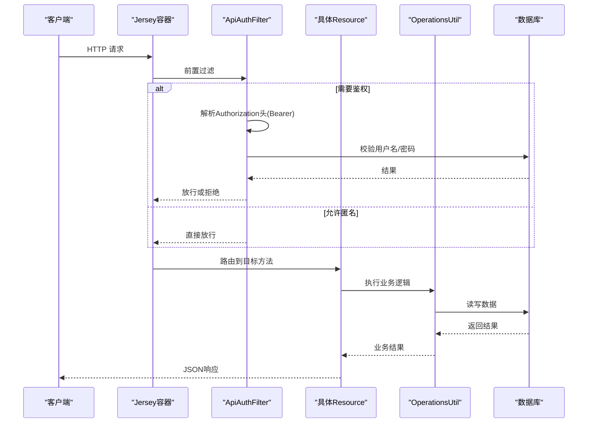
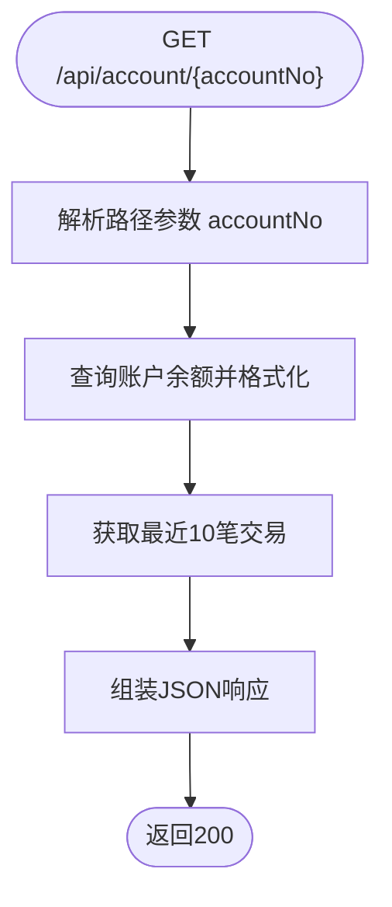
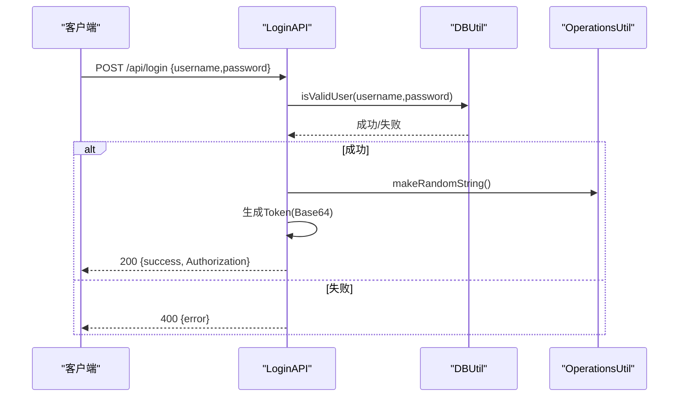
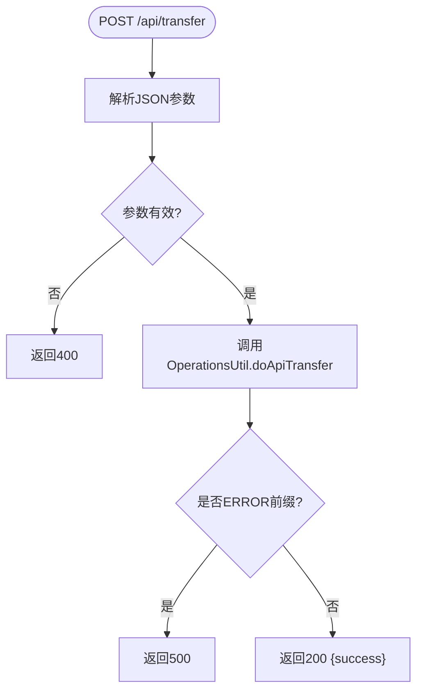
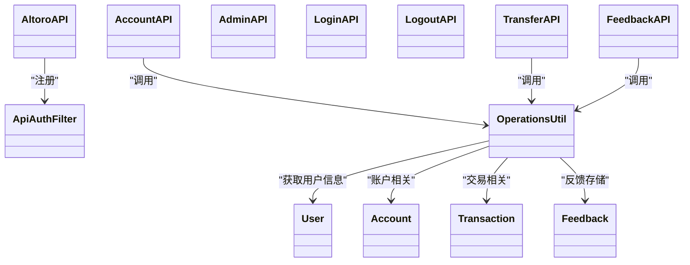

# API接口设计

<cite>
**本文引用的文件**   
- [AltoroAPI.java](file://src/com/ibm/security/appscan/altoromutual/api/AltoroAPI.java)
- [AccountAPI.java](file://src/com/ibm/security/appscan/altoromutual/api/AccountAPI.java)
- [AdminAPI.java](file://src/com/ibm/security/appscan/altoromutual/api/AdminAPI.java)
- [LoginAPI.java](file://src/com/ibm/security/appscan/altoromutual/api/LoginAPI.java)
- [LogoutAPI.java](file://src/com/ibm/security/appscan/altoromutual/api/LogoutAPI.java)
- [TransferAPI.java](file://src/com/ibm/security/appscan/altoromutual/api/TransferAPI.java)
- [FeedbackAPI.java](file://src/com/ibm/security/appscan/altoromutual/api/FeedbackAPI.java)
- [ApiAuthFilter.java](file://src/com/ibm/security/appscan/altoromutual/filter/ApiAuthFilter.java)
- [OperationsUtil.java](file://src/com/ibm/security/appscan/altoromutual/util/OperationsUtil.java)
- [User.java](file://src/com/ibm/security/appscan/altoromutual/model/User.java)
- [Account.java](file://src/com/ibm/security/appscan/altoromutual/model/Account.java)
- [Transaction.java](file://src/com/ibm/security/appscan/altoromutual/model/Transaction.java)
- [Feedback.java](file://src/com/ibm/security/appscan/altoromutual/model/Feedback.java)
</cite>

## 目录
1. [简介](#简介)
2. [项目结构](#项目结构)
3. [核心组件](#核心组件)
4. [架构总览](#架构总览)
5. [详细组件分析](#详细组件分析)
6. [依赖关系分析](#依赖关系分析)
7. [性能与可扩展性](#性能与可扩展性)
8. [故障排查指南](#故障排查指南)
9. [结论](#结论)
10. [附录：API规范与示例](#附录api规范与示例)

## 简介
本文件为 AltoroJ 的 RESTful API 提供完整的技术文档，覆盖基于 Jersey 的 API 架构、路由定义、认证鉴权、账户管理、管理员操作、登录登出、转账业务与反馈收集等。文档同时给出请求/响应示例、错误码说明、版本管理与兼容性建议，以及测试与调试方法，帮助开发者快速理解并安全使用这些接口。

## 项目结构
AltoroJ 的 REST API 位于 src/com/ibm/security/appscan/altoromutual/api 包下，采用 JAX-RS（Jersey）注解进行路由声明；统一的认证过滤器在 filter 包中实现；业务工具类集中在 util 包；数据模型在 model 包中定义。

图表来源
- [AltoroAPI.java:9-14](file://src/com/ibm/security/appscan/altoromutual/api/AltoroAPI.java#L9-L14)
- [ApiAuthFilter.java:20-74](file://src/com/ibm/security/appscan/altoromutual/filter/ApiAuthFilter.java#L20-L74)
- [OperationsUtil.java:18-144](file://src/com/ibm/security/appscan/altoromutual/util/OperationsUtil.java#L18-L144)

章节来源
- [AltoroAPI.java:1-16](file://src/com/ibm/security/appscan/altoromutual/api/AltoroAPI.java#L1-L16)

## 核心组件
- AltoroAPI：Jersey ApplicationPath 配置，设置基础路径为 /api，扫描 api 包，注册 ApiAuthFilter。
- ApiAuthFilter：容器级过滤器，对未标注 @PermitAll 的资源进行 Bearer Token 校验，通过 Base64 解码后验证用户名密码有效性。
- OperationsUtil：封装转账、用户获取、反馈存储等通用逻辑。
- 各资源类：AccountAPI、AdminAPI、LoginAPI、LogoutAPI、TransferAPI、FeedbackAPI 分别暴露对应业务端点。

章节来源
- [AltoroAPI.java:9-14](file://src/com/ibm/security/appscan/altoromutual/api/AltoroAPI.java#L9-L14)
- [ApiAuthFilter.java:20-74](file://src/com/ibm/security/appscan/altoromutual/filter/ApiAuthFilter.java#L20-L74)
- [OperationsUtil.java:18-144](file://src/com/ibm/security/appscan/altoromutual/util/OperationsUtil.java#L18-L144)

## 架构总览
整体流程：客户端请求进入 Jersey 容器，先经过 ApiAuthFilter 进行鉴权（除非方法标注 @PermitAll），然后路由到具体资源方法，调用 OperationsUtil 或模型类完成业务逻辑，最终返回 JSON 响应。

图表来源
- [ApiAuthFilter.java:29-74](file://src/com/ibm/security/appscan/altoromutual/filter/ApiAuthFilter.java#L29-L74)
- [OperationsUtil.java:18-144](file://src/com/ibm/security/appscan/altoromutual/util/OperationsUtil.java#L18-L144)

## 详细组件分析

### AltoroAPI 主接口与基础路径
- 基础路径：/api
- 自动扫描：com.ibm.security.appscan.altoromutual.api
- 全局过滤器：ApiAuthFilter

章节来源
- [AltoroAPI.java:9-14](file://src/com/ibm/security/appscan/altoromutual/api/AltoroAPI.java#L9-L14)

### AccountAPI 账户管理接口
- GET /api/account：返回当前登录用户的账户列表（名称与ID）。
- GET /api/account/{accountNo}：返回指定账户余额与最近交易摘要（含硬编码示例片段）。
- GET /api/account/{accountNo}/transactions：返回该账户最近10笔交易。
- POST /api/account/{accountNo}/transactions：按日期范围查询交易，限制最多100条。

参数与规则
- 路径参数 accountNo：字符串形式的账号编号。
- POST 请求体 JSON：包含 startDate、endDate。
- 鉴权：默认需 Bearer Token（未标注 @PermitAll）。
- 业务：从当前会话用户关联账户中查询交易；余额格式化输出。

错误处理
- 内部异常统一返回 500。
- JSON 解析失败返回 400。

图表来源
- [AccountAPI.java:54-104](file://src/com/ibm/security/appscan/altoromutual/api/AccountAPI.java#L54-L104)

章节来源
- [AccountAPI.java:23-237](file://src/com/ibm/security/appscan/altoromutual/api/AccountAPI.java#L23-L237)

### AdminAPI 管理员接口
- POST /api/admin/changePassword：修改用户密码。
- POST /api/admin/addUser：新增用户。

权限控制
- 两个接口均未标注 @PermitAll，因此受 ApiAuthFilter 保护。
- 实际功能开关由应用属性 enableAdminFunctions 控制，仅在启用时执行数据库操作。

参数与规则
- changePassword：username、password1、password2（必填且一致）。
- addUser：firstname、lastname、username、password1、password2（必填且一致）。

错误处理
- 参数缺失或格式错误返回 400。
- 业务错误或数据库错误返回 500。

章节来源
- [AdminAPI.java:17-112](file://src/com/ibm/security/appscan/altoromutual/api/AdminAPI.java#L17-L112)

### LoginAPI 登录接口
- GET /api/login：检查登录状态（当前实现始终返回已登录）。
- POST /api/login：接收 username、password，校验成功后生成 Authorization Token（Base64 编码的用户名+密码+随机串）。

认证流程
- 输入校验：必须包含 username、password。
- 用户校验：调用 DBUtil.isValidUser。
- Token 生成：将用户名、密码与随机串拼接后进行 Base64 编码，放入响应字段 Authorization。

注意
- 该 Token 仅用于演示，安全性较弱；生产环境应使用标准 JWT/OAuth2。

图表来源
- [LoginAPI.java:29-82](file://src/com/ibm/security/appscan/altoromutual/api/LoginAPI.java#L29-L82)
- [OperationsUtil.java:146-152](file://src/com/ibm/security/appscan/altoromutual/util/OperationsUtil.java#L146-L152)

章节来源
- [LoginAPI.java:19-83](file://src/com/ibm/security/appscan/altoromutual/api/LoginAPI.java#L19-L83)

### LogoutAPI 登出接口
- GET /api/logout：移除会话中的用户属性，返回 LoggedOut 标志。

行为
- 清除会话属性 ServletUtil.SESSION_ATTR_USER。
- 返回 200 或 500（异常）。

章节来源
- [LogoutAPI.java:13-29](file://src/com/ibm/security/appscan/altoromutual/api/LogoutAPI.java#L13-L29)

### TransferAPI 转账接口
- POST /api/transfer：执行转账。

参数与规则
- 请求体 JSON：toAccount（收款账户）、fromAccount（付款账户）、transferAmount（金额）。
- 鉴权：默认需 Bearer Token。
- 业务：调用 OperationsUtil.doApiTransfer，内部根据 Authorization 头解析用户并调用 DBUtil.transferFunds。

错误处理
- 参数解析失败返回 400。
- 业务错误返回 500。

图表来源
- [TransferAPI.java:17-43](file://src/com/ibm/security/appscan/altoromutual/api/TransferAPI.java#L17-L43)
- [OperationsUtil.java:18-36](file://src/com/ibm/security/appscan/altoromutual/util/OperationsUtil.java#L18-L36)

章节来源
- [TransferAPI.java:14-44](file://src/com/ibm/security/appscan/altoromutual/api/TransferAPI.java#L14-L44)

### FeedbackAPI 反馈接口
- POST /api/feedback/submit：提交反馈（匿名开放）。
- GET /api/feedback/{feedbackId}：根据ID获取反馈详情。

数据存储
- 当应用属性 enableFeedbackRetention 为 true 时，调用 OperationsUtil.sendFeedback 存储至数据库，返回 feedbackId。
- 否则不存储，返回空对象（保留原始字段）。

参数与规则
- submit：name、email、subject、message（message字段名）。
- getFeedback：路径参数 feedbackId。

错误处理
- JSON 解析失败返回 400。
- 内部异常返回 500。

章节来源
- [FeedbackAPI.java:19-92](file://src/com/ibm/security/appscan/altoromutual/api/FeedbackAPI.java#L19-L92)
- [OperationsUtil.java:119-132](file://src/com/ibm/security/appscan/altoromutual/util/OperationsUtil.java#L119-L132)

## 依赖关系分析
- AltoroAPI 作为入口，注册 ApiAuthFilter 并扫描资源类。
- ApiAuthFilter 依赖 DBUtil 进行用户有效性校验。
- AccountAPI、TransferAPI、FeedbackAPI 均依赖 OperationsUtil 进行业务处理。
- 数据模型 User、Account、Transaction、Feedback 被工具类与资源类引用。

图表来源
- [AltoroAPI.java:9-14](file://src/com/ibm/security/appscan/altoromutual/api/AltoroAPI.java#L9-L14)
- [ApiAuthFilter.java:20-74](file://src/com/ibm/security/appscan/altoromutual/filter/ApiAuthFilter.java#L20-L74)
- [OperationsUtil.java:18-144](file://src/com/ibm/security/appscan/altoromutual/util/OperationsUtil.java#L18-L144)

章节来源
- [AltoroAPI.java:1-16](file://src/com/ibm/security/appscan/altoromutual/api/AltoroAPI.java#L1-L16)
- [ApiAuthFilter.java:1-76](file://src/com/ibm/security/appscan/altoromutual/filter/ApiAuthFilter.java#L1-L76)
- [OperationsUtil.java:1-155](file://src/com/ibm/security/appscan/altoromutual/util/OperationsUtil.java#L1-L155)

## 性能与可扩展性
- 批量交易查询限制最大100条，避免大数据量返回。
- 余额与金额格式化在接口层完成，建议在服务层统一处理以提升一致性。
- Token 生成使用简单随机串，建议升级为带过期时间与签名的令牌机制。
- 建议引入分页、缓存与限流策略以支撑高并发场景。

[本节为通用指导，不涉及具体文件分析]

## 故障排查指南
- 鉴权失败（401）：检查 Authorization 头是否为 Bearer + Base64 编码的 token，并确保用户名密码有效。
- 参数错误（400）：确认请求体 JSON 字段齐全且类型正确。
- 内部错误（500）：查看服务器日志，定位数据库或业务异常。
- 管理员功能不可用：检查应用属性 enableAdminFunctions 是否启用。
- 反馈未存储：检查应用属性 enableFeedbackRetention 是否启用。

章节来源
- [ApiAuthFilter.java:29-74](file://src/com/ibm/security/appscan/altoromutual/filter/ApiAuthFilter.java#L29-L74)
- [AdminAPI.java:55-59](file://src/com/ibm/security/appscan/altoromutual/api/AdminAPI.java#L55-L59)
- [OperationsUtil.java:119-132](file://src/com/ibm/security/appscan/altoromutual/util/OperationsUtil.java#L119-L132)

## 结论
AltoroJ 的 REST API 基于 Jersey 提供了清晰的资源划分与统一的鉴权机制。账户、转账、反馈与管理接口覆盖了典型银行业务场景。当前实现适合教学与演示，但在安全性（Token 机制、权限控制）、健壮性（参数校验、错误处理）与可维护性（分层与抽象）方面仍有改进空间。建议在生产环境中引入标准化认证、完善的错误码体系与 API 版本管理策略。

[本节为总结性内容，不涉及具体文件分析]

## 附录：API规范与示例

### 基础信息
- 基础路径：/api
- 内容类型：application/json
- 鉴权方式：Bearer Token（Authorization 头）

### 账户接口
- GET /api/account
  - 鉴权：需要
  - 响应：{ Accounts:[{Name,id}] }
- GET /api/account/{accountNo}
  - 鉴权：需要
  - 响应：{ balance, credits:[...], debits:[...], accountId }
- GET /api/account/{accountNo}/transactions
  - 鉴权：需要
  - 响应：{ last_10_transactions:[...] }
- POST /api/account/{accountNo}/transactions
  - 鉴权：需要
  - 请求体：{ startDate, endDate }
  - 响应：{ transactions:[{id,date,account,type,amount}] }

### 管理员接口
- POST /api/admin/changePassword
  - 鉴权：需要
  - 请求体：{ username, password1, password2 }
  - 响应：{ success | error }
- POST /api/admin/addUser
  - 鉴权：需要
  - 请求体：{ firstname, lastname, username, password1, password2 }
  - 响应：{ success | error }

### 登录与登出
- GET /api/login
  - 鉴权：不需要
  - 响应：{ loggedin:"true" }
- POST /api/login
  - 鉴权：不需要
  - 请求体：{ username, password }
  - 响应：{ success, Authorization }
- GET /api/logout
  - 鉴权：不需要
  - 响应：{ LoggedOut:"True" }

### 转账接口
- POST /api/transfer
  - 鉴权：需要
  - 请求体：{ toAccount, fromAccount, transferAmount }
  - 响应：{ success | error }

### 反馈接口
- POST /api/feedback/submit
  - 鉴权：不需要
  - 请求体：{ name, email, subject, message }
  - 响应：{ status, feedbackId } 或 原样回显
- GET /api/feedback/{feedbackId}
  - 鉴权：需要
  - 响应：{ name, email, subject, message }

### 错误码与状态码
- 200 OK：请求成功
- 400 Bad Request：参数缺失或格式错误
- 401 Unauthorized：未携带或无效 Bearer Token
- 500 Internal Server Error：服务器内部错误或业务异常

### 版本管理与向后兼容
- 当前无显式版本路径（如 /v1）。建议在基础路径中加入版本号，例如 /api/v1。
- 保持字段命名稳定，新增字段时避免破坏现有客户端。
- 废弃字段应标记并在后续版本移除，提前发布迁移指南。

### 测试与调试技巧
- 使用 curl 或 Postman 发送请求，确保 Authorization 头格式正确。
- 登录成功后保存 Authorization 值，后续请求携带该头。
- 开启服务器日志，捕获 4xx/5xx 响应的详细信息。
- 针对敏感接口（管理员、转账）进行最小权限测试与边界值测试。

[本节为通用规范与示例，不涉及具体文件分析]