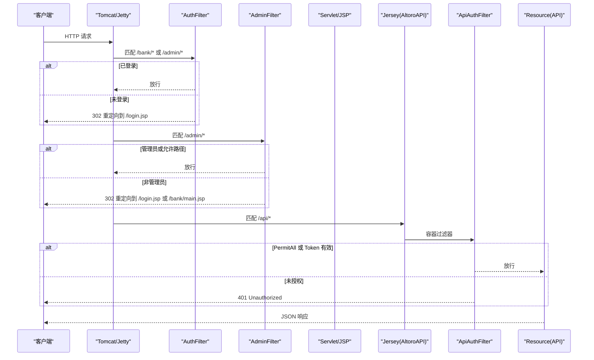
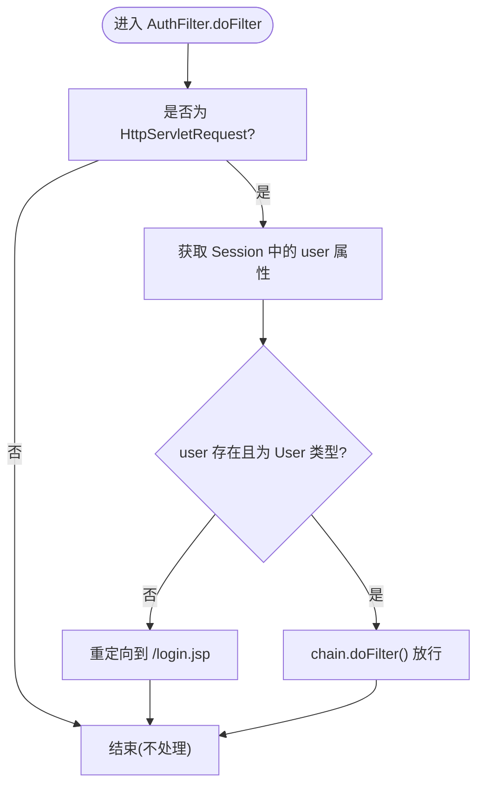
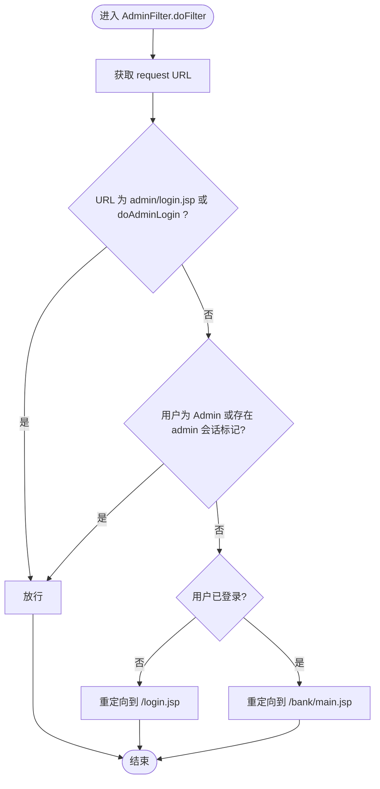
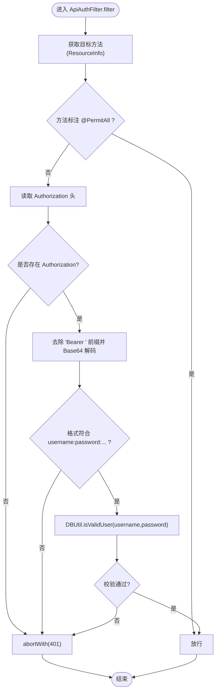
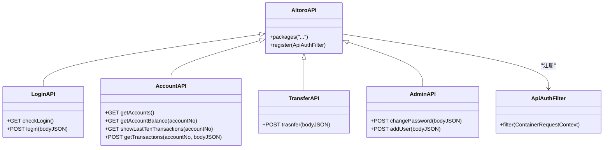
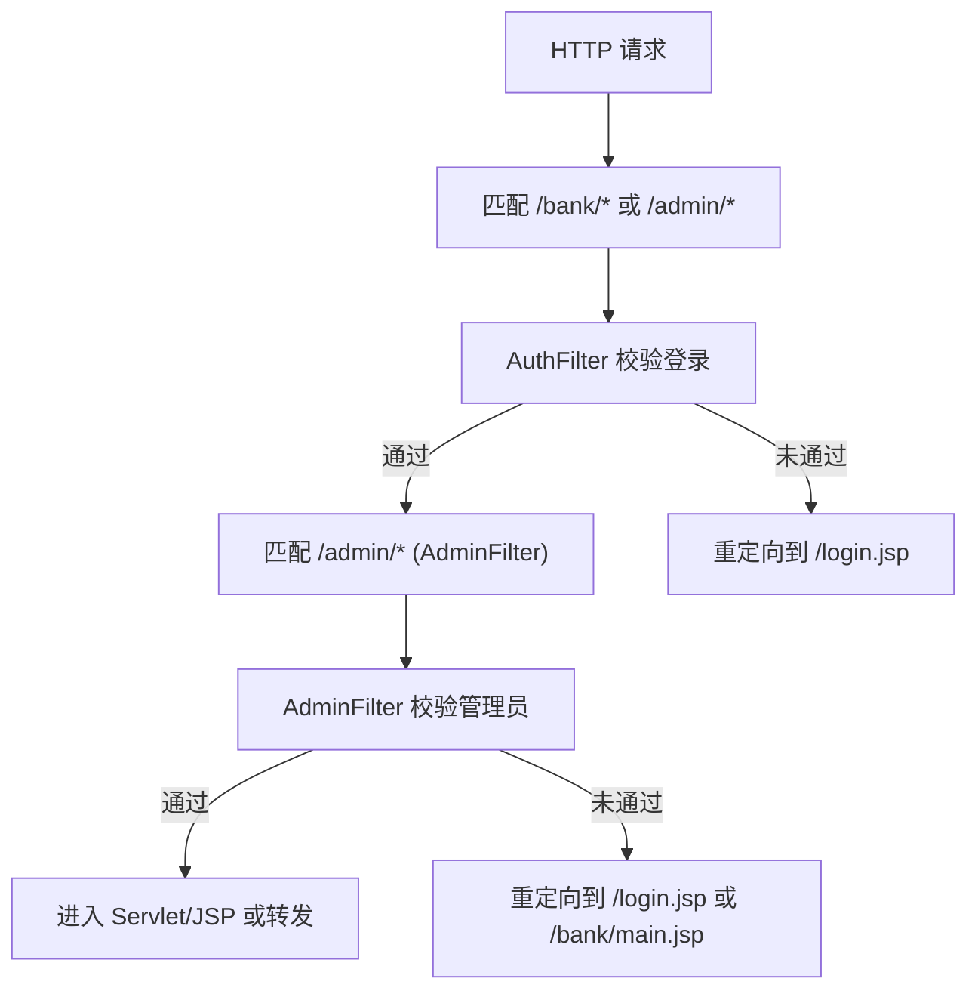
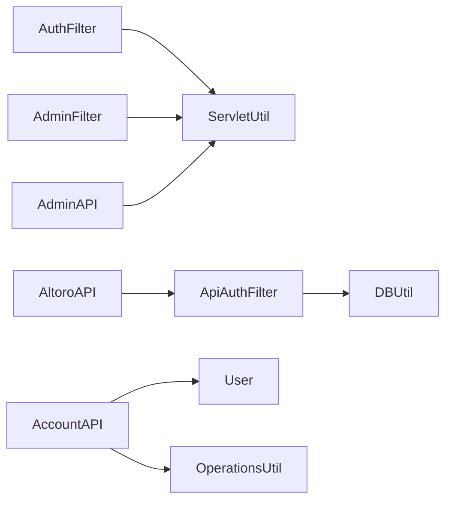

# 业务逻辑层（Filter过滤器和API接口）

<cite>
**本文引用的文件**   
- [web.xml](file://WebContent/WEB-INF/web.xml)
- [AuthFilter.java](file://src/com/ibm/security/appscan/altoromutual/filter/AuthFilter.java)
- [AdminFilter.java](file://src/com/ibm/security/appscan/altoromutual/filter/AdminFilter.java)
- [ApiAuthFilter.java](file://src/com/ibm/security/appscan/altoromutual/filter/ApiAuthFilter.java)
- [AltoroAPI.java](file://src/com/ibm/security/appscan/altoromutual/api/AltoroAPI.java)
- [LoginAPI.java](file://src/com/ibm/security/appscan/altoromutual/api/LoginAPI.java)
- [AccountAPI.java](file://src/com/ibm/security/appscan/altoromutual/api/AccountAPI.java)
- [TransferAPI.java](file://src/com/ibm/security/appscan/altoromutual/api/TransferAPI.java)
- [AdminAPI.java](file://src/com/ibm/security/appscan/altoromutual/api/AdminAPI.java)
- [ServletUtil.java](file://src/com/ibm/security/appscan/altoromutual/util/ServletUtil.java)
- [User.java](file://src/com/ibm/security/appscan/altoromutual/model/User.java)
</cite>

## 目录
1. [引言](#引言)
2. [项目结构](#项目结构)
3. [核心组件](#核心组件)
4. [架构总览](#架构总览)
5. [详细组件分析](#详细组件分析)
6. [依赖关系分析](#依赖关系分析)
7. [性能与可扩展性](#性能与可扩展性)
8. [故障排查指南](#故障排查指南)
9. [结论](#结论)

## 引言
本文件聚焦于 AltoroJ 的业务逻辑层，重点说明：
- Servlet Filter 的拦截机制与执行顺序
- RESTful API 的路由定义、请求验证与业务规则处理
- AuthFilter（用户认证）、AdminFilter（管理员权限）、ApiAuthFilter（API 认证）的实现原理
- 过滤器链的执行顺序与条件判断逻辑
- 安全考虑与最佳实践

## 项目结构
AltoroJ 采用传统 Java EE 分层组织：
- Web 配置与静态资源位于 WebContent
- 业务逻辑与控制器位于 src 下，按 filter、api、servlet、model、util 等包划分
- Jersey（JAX-RS）用于 REST API，通过 ApplicationPath 注册到 /api

```mermaid
graph TB
subgraph "Web 容器"
WXML["web.xml<br/>过滤器映射与Servlet映射"]
end
subgraph "Servlet 过滤器"
AF["AuthFilter.java"]
AMF["AdminFilter.java"]
end
subgraph "REST API (Jersey)"
APP["AltoroAPI.java<br/>@ApplicationPath(\"api\")"]
AAF["ApiAuthFilter.java"]
LAPI["LoginAPI.java"]
AAP["AccountAPI.java"]
TAPI["TransferAPI.java"]
AMP["AdminAPI.java"]
end
subgraph "模型与工具"
U["User.java"]
SU["ServletUtil.java"]
end
WXML --> AF
WXML --> AMF
WXML --> APP
APP --> AAF
APP --> LAPI
APP --> AAP
APP --> TAPI
APP --> AMP
AF --> SU
AF --> U
AMF --> SU
AMF --> U
AAF --> SU
```

图表来源
- [web.xml:12-50](file://WebContent/WEB-INF/web.xml#L12-L50)
- [AltoroAPI.java:9-14](file://src/com/ibm/security/appscan/altoromutual/api/AltoroAPI.java#L9-L14)
- [ApiAuthFilter.java:20-30](file://src/com/ibm/security/appscan/altoromutual/filter/ApiAuthFilter.java#L20-L30)

章节来源
- [web.xml:1-227](file://WebContent/WEB-INF/web.xml#L1-L227)

## 核心组件
- AuthFilter：对 /bank/* 与 /admin/* 的请求进行登录态校验，未登录重定向至登录页。
- AdminFilter：对管理端路径进行管理员角色或会话标记校验，允许 admin/login.jsp 与 doAdminLogin 放行。
- ApiAuthFilter：基于 JAX-RS ContainerRequestFilter 实现 API 鉴权，解析 Authorization Bearer Token，校验用户有效性；支持 @PermitAll 豁免。
- AltoroAPI：Jersey Application，注册 API 包并全局注册 ApiAuthFilter。
- LoginAPI/AccountAPI/TransferAPI/AdminAPI：REST 资源类，定义路由、参数校验与业务调用。
- ServletUtil：会话属性常量、用户会话建立与查询、Swagger 初始化等工具方法。
- User：用户模型，包含角色枚举 Role.User/Admin。

章节来源
- [AuthFilter.java:40-70](file://src/com/ibm/security/appscan/altoromutual/filter/AuthFilter.java#L40-L70)
- [AdminFilter.java:40-80](file://src/com/ibm/security/appscan/altoromutual/filter/AdminFilter.java#L40-L80)
- [ApiAuthFilter.java:20-75](file://src/com/ibm/security/appscan/altoromutual/filter/ApiAuthFilter.java#L20-L75)
- [AltoroAPI.java:9-14](file://src/com/ibm/security/appscan/altoromutual/api/AltoroAPI.java#L9-L14)
- [LoginAPI.java:19-82](file://src/com/ibm/security/appscan/altoromutual/api/LoginAPI.java#L19-L82)
- [AccountAPI.java:23-237](file://src/com/ibm/security/appscan/altoromutual/api/AccountAPI.java#L23-L237)
- [TransferAPI.java:14-44](file://src/com/ibm/security/appscan/altoromutual/api/TransferAPI.java#L14-L44)
- [AdminAPI.java:17-112](file://src/com/ibm/security/appscan/altoromutual/api/AdminAPI.java#L17-L112)
- [ServletUtil.java:60-62,340-373:60-62](file://src/com/ibm/security/appscan/altoromutual/util/ServletUtil.java#L60-L62)
- [User.java:30-54](file://src/com/ibm/security/appscan/altoromutual/model/User.java#L30-L54)

## 架构总览
下图展示从浏览器到后端的核心流程：Servlet 过滤器先拦截 Web 请求，随后进入 Servlet/JSP 或 Jersey REST API；API 请求在 Jersey 层再经 ApiAuthFilter 进行鉴权。



图表来源
- [web.xml:28-50](file://WebContent/WEB-INF/web.xml#L28-L50)
- [AltoroAPI.java:9-14](file://src/com/ibm/security/appscan/altoromutual/api/AltoroAPI.java#L9-L14)
- [ApiAuthFilter.java:29-74](file://src/com/ibm/security/appscan/altoromutual/filter/ApiAuthFilter.java#L29-L74)

## 详细组件分析

### AuthFilter（用户认证过滤）
- 作用：确保访问 /bank/* 与 /admin/* 的用户已登录。
- 逻辑：
  - 从 Session 中读取用户对象（键为 SESSION_ATTR_USER）。
  - 若用户为空或类型不匹配，返回 302 重定向到 /login.jsp。
  - 否则继续过滤器链。
- 关键点：
  - 使用 HttpServletRequest/HttpServletResponse 进行重定向。
  - 依赖 ServletUtil.SESSION_ATTR_USER 常量。



图表来源
- [AuthFilter.java:58-70](file://src/com/ibm/security/appscan/altoromutual/filter/AuthFilter.java#L58-L70)
- [ServletUtil.java:60-62](file://src/com/ibm/security/appscan/altoromutual/util/ServletUtil.java#L60-L62)

章节来源
- [AuthFilter.java:40-70](file://src/com/ibm/security/appscan/altoromutual/filter/AuthFilter.java#L40-L70)
- [web.xml:28-50](file://WebContent/WEB-INF/web.xml#L28-L50)

### AdminFilter（管理员权限过滤）
- 作用：保护管理端功能，仅允许管理员或具备特定会话标记的用户访问。
- 逻辑：
  - 检查 Session 中的 admin 标记（SESSION_ATTR_ADMIN_KEY）与值（SESSION_ATTR_ADMIN_VALUE）。
  - 或检查当前用户的 Role 是否为 Admin。
  - 放行 admin/login.jsp 与 /admin/doAdminLogin 请求。
  - 其他情况根据是否登录重定向到 /login.jsp 或 /bank/main.jsp。
- 关键点：
  - 同时支持“用户角色”和“会话标记”两种管理员判定方式。
  - 对登录相关路径做白名单放行。



图表来源
- [AdminFilter.java:58-80](file://src/com/ibm/security/appscan/altoromutual/filter/AdminFilter.java#L58-L80)
- [ServletUtil.java:60-62](file://src/com/ibm/security/appscan/altoromutual/util/ServletUtil.java#L60-L62)

章节来源
- [AdminFilter.java:40-80](file://src/com/ibm/security/appscan/altoromutual/filter/AdminFilter.java#L40-L80)
- [web.xml:44-50](file://WebContent/WEB-INF/web.xml#L44-L50)

### ApiAuthFilter（API 认证过滤）
- 作用：对 /api/* 下的所有 JAX-RS 资源进行统一鉴权。
- 逻辑：
  - 若目标方法标注 @PermitAll，直接放行。
  - 从请求头 Authorization 提取 Bearer Token。
  - 解码 Token，期望格式为 base64(username):base64(password):randomString。
  - 调用 DBUtil.isValidUser 校验用户名密码。
  - 校验失败返回 401，数据库异常返回 500。
- 关键点：
  - 使用 ResourceInfo 反射获取目标方法注解。
  - 使用 Base64 解码 Token。
  - 通过 @PermitAll 实现细粒度豁免。



图表来源
- [ApiAuthFilter.java:29-74](file://src/com/ibm/security/appscan/altoromutual/filter/ApiAuthFilter.java#L29-L74)

章节来源
- [ApiAuthFilter.java:20-75](file://src/com/ibm/security/appscan/altoromutual/filter/ApiAuthFilter.java#L20-L75)
- [AltoroAPI.java:9-14](file://src/com/ibm/security/appscan/altoromutual/api/AltoroAPI.java#L9-L14)

### RESTful API 路由与业务规则
- 应用根路径：/api（由 AltoroAPI 的 @ApplicationPath 指定）。
- 资源类与路径：
  - LoginAPI：/login
    - GET /login：检查登录状态（注意：该方法未使用 @PermitAll，但通常作为公开接口，建议显式标注）。
    - POST /login：接收 JSON body，校验 username/password，成功返回 Authorization Token。
  - AccountAPI：/account
    - GET /account：列出当前用户账户列表。
    - GET /account/{accountNo}：获取账户余额与最近交易。
    - GET /account/{accountNo}/transactions：获取最近 10 笔交易。
    - POST /account/{accountNo}/transactions：按日期范围查询交易。
  - TransferAPI：/transfer
    - POST /transfer：转账操作，参数 fromAccount、toAccount、transferAmount。
  - AdminAPI：/admin
    - POST /admin/changePassword：修改用户密码（受 enableAdminFunctions 开关控制）。
    - POST /admin/addUser：新增用户（受 enableAdminFunctions 开关控制）。
- 鉴权策略：
  - 全局由 ApiAuthFilter 校验 Authorization 头。
  - 可通过 @PermitAll 对公开接口豁免（如 LoginAPI.login）。
- 输入校验与业务规则：
  - LoginAPI：校验 JSON 结构与必填字段，调用 DBUtil 验证用户。
  - AccountAPI：从 Session 获取当前用户，限制交易查询范围。
  - TransferAPI：参数解析与错误封装。
  - AdminAPI：字段校验与开关控制敏感操作。



图表来源
- [AltoroAPI.java:9-14](file://src/com/ibm/security/appscan/altoromutual/api/AltoroAPI.java#L9-L14)
- [LoginAPI.java:19-82](file://src/com/ibm/security/appscan/altoromutual/api/LoginAPI.java#L19-L82)
- [AccountAPI.java:23-237](file://src/com/ibm/security/appscan/altoromutual/api/AccountAPI.java#L23-L237)
- [TransferAPI.java:14-44](file://src/com/ibm/security/appscan/altoromutual/api/TransferAPI.java#L14-L44)
- [AdminAPI.java:17-112](file://src/com/ibm/security/appscan/altoromutual/api/AdminAPI.java#L17-L112)
- [ApiAuthFilter.java:20-75](file://src/com/ibm/security/appscan/altoromutual/filter/ApiAuthFilter.java#L20-L75)

章节来源
- [AltoroAPI.java:9-14](file://src/com/ibm/security/appscan/altoromutual/api/AltoroAPI.java#L9-L14)
- [LoginAPI.java:19-82](file://src/com/ibm/security/appscan/altoromutual/api/LoginAPI.java#L19-L82)
- [AccountAPI.java:23-237](file://src/com/ibm/security/appscan/altoromutual/api/AccountAPI.java#L23-L237)
- [TransferAPI.java:14-44](file://src/com/ibm/security/appscan/altoromutual/api/TransferAPI.java#L14-L44)
- [AdminAPI.java:17-112](file://src/com/ibm/security/appscan/altoromutual/api/AdminAPI.java#L17-L112)

### 过滤器链执行顺序与条件判断
- web.xml 中定义了 AuthFilter 与 AdminFilter 的映射：
  - AuthFilter 映射到 /bank/* 与 /admin/*。
  - AdminFilter 映射到 /adimn/*（注意：此处为拼写错误，实际应为 /admin/*），因此对 /admin/* 的管理端访问可能不会命中 AdminFilter。
- 执行顺序：
  - 对于 /bank/* 与 /admin/* 的请求，首先经过 AuthFilter 的登录态校验。
  - 若命中 AdminFilter（当 URL 匹配时），再进行管理员权限校验。
- 条件判断：
  - AuthFilter：Session 中是否存在有效的 User 对象。
  - AdminFilter：用户角色为 Admin 或存在 admin 会话标记；同时对登录相关路径放行。



图表来源
- [web.xml:28-50](file://WebContent/WEB-INF/web.xml#L28-L50)
- [AuthFilter.java:58-70](file://src/com/ibm/security/appscan/altoromutual/filter/AuthFilter.java#L58-L70)
- [AdminFilter.java:58-80](file://src/com/ibm/security/appscan/altoromutual/filter/AdminFilter.java#L58-L80)

章节来源
- [web.xml:28-50](file://WebContent/WEB-INF/web.xml#L28-L50)

## 依赖关系分析
- 过滤器与工具类：
  - AuthFilter 与 AdminFilter 依赖 ServletUtil 提供的会话属性常量。
  - ApiAuthFilter 依赖 DBUtil 进行用户有效性校验。
- API 与模型：
  - AccountAPI 依赖 User 与 OperationsUtil 获取当前用户与账户信息。
  - AdminAPI 依赖 ServletUtil 的应用属性开关控制敏感操作。
- Jersey 集成：
  - AltoroAPI 注册 ApiAuthFilter 并扫描 API 包。



图表来源
- [AuthFilter.java:58-70](file://src/com/ibm/security/appscan/altoromutual/filter/AuthFilter.java#L58-L70)
- [AdminFilter.java:58-80](file://src/com/ibm/security/appscan/altoromutual/filter/AdminFilter.java#L58-L80)
- [ApiAuthFilter.java:65-73](file://src/com/ibm/security/appscan/altoromutual/filter/ApiAuthFilter.java#L65-L73)
- [AccountAPI.java:28-50](file://src/com/ibm/security/appscan/altoromutual/api/AccountAPI.java#L28-L50)
- [AdminAPI.java:55-56](file://src/com/ibm/security/appscan/altoromutual/api/AdminAPI.java#L55-L56)
- [AltoroAPI.java:11-13](file://src/com/ibm/security/appscan/altoromutual/api/AltoroAPI.java#L11-L13)

章节来源
- [ServletUtil.java:60-62](file://src/com/ibm/security/appscan/altoromutual/util/ServletUtil.java#L60-L62)
- [User.java:30-54](file://src/com/ibm/security/appscan/altoromutual/model/User.java#L30-L54)

## 性能与可扩展性
- 过滤器开销：
  - AuthFilter 与 AdminFilter 仅在必要时进行 Session 读取与重定向，开销较低。
  - ApiAuthFilter 每次 API 请求都会进行 Base64 解码与数据库校验，建议在高频场景引入缓存或令牌签名校验以降低数据库压力。
- 扩展点：
  - 可在 ApiAuthFilter 中增加速率限制、审计日志与更严格的令牌校验（如 JWT 验签）。
  - 将 AdminFilter 的 URL 映射修正为 /admin/*，确保管理端权限生效。
  - 对 LoginAPI.checkLogin 添加 @PermitAll 以明确公开接口语义。

[本节为通用指导，无需代码引用]

## 故障排查指南
- 无法访问管理端：
  - 检查 web.xml 中 AdminFilter 的 url-pattern 是否为 /admin/*（当前为 /adimn/*，疑似拼写错误）。
  - 确认 AdminFilter 的条件分支是否正确放行 admin/login.jsp 与 doAdminLogin。
- API 返回 401：
  - 检查 Authorization 头是否携带正确的 Bearer Token。
  - 确认 Token 格式是否符合 base64(username):base64(password):randomString。
  - 核对 DBUtil.isValidUser 是否能正确校验用户。
- 登录成功但后续 API 仍被拒绝：
  - 确认客户端在后续请求中持续携带 Authorization 头。
  - 检查 ApiAuthFilter 是否误判了 @PermitAll 豁免。
- 管理员功能不可用：
  - 检查 ServletUtil.getAppProperty("enableAdminFunctions") 是否设置为 true。
  - 确认 AdminAPI 的参数校验与错误返回逻辑。

章节来源
- [web.xml:44-50](file://WebContent/WEB-INF/web.xml#L44-L50)
- [AdminFilter.java:70-79](file://src/com/ibm/security/appscan/altoromutual/filter/AdminFilter.java#L70-L79)
- [ApiAuthFilter.java:42-73](file://src/com/ibm/security/appscan/altoromutual/filter/ApiAuthFilter.java#L42-L73)
- [AdminAPI.java:55-56](file://src/com/ibm/security/appscan/altoromutual/api/AdminAPI.java#L55-L56)

## 结论
- AuthFilter 与 AdminFilter 构成了传统 Web 页面的基础鉴权与权限控制，但需注意 web.xml 中 AdminFilter 的 URL 映射拼写问题。
- ApiAuthFilter 提供了统一的 API 鉴权入口，结合 @PermitAll 可实现细粒度豁免。
- RESTful API 路由清晰，参数校验与业务规则在各资源类中实现，建议进一步引入更健壮的令牌机制与安全加固。
- 在生产环境中应完善错误处理、日志记录、速率限制与令牌签名校验，以提升安全性与可维护性。