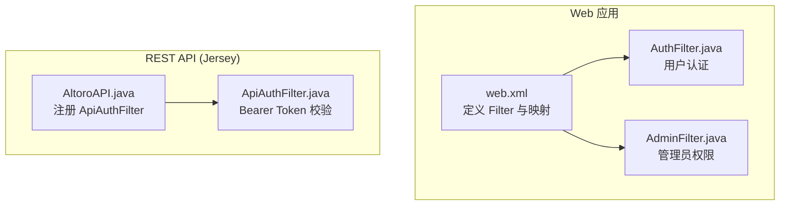
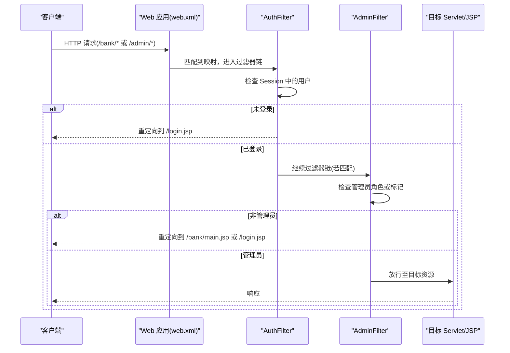
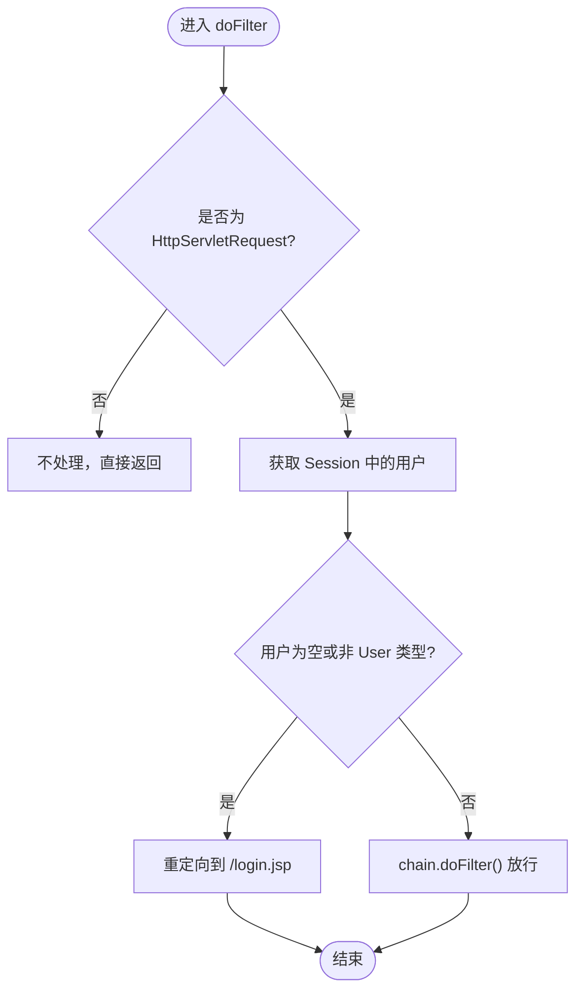
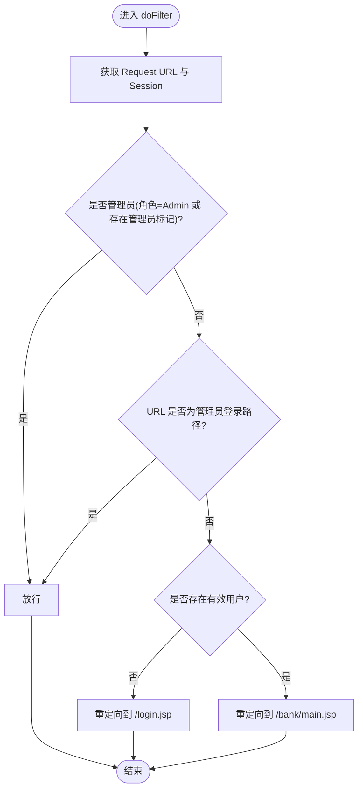
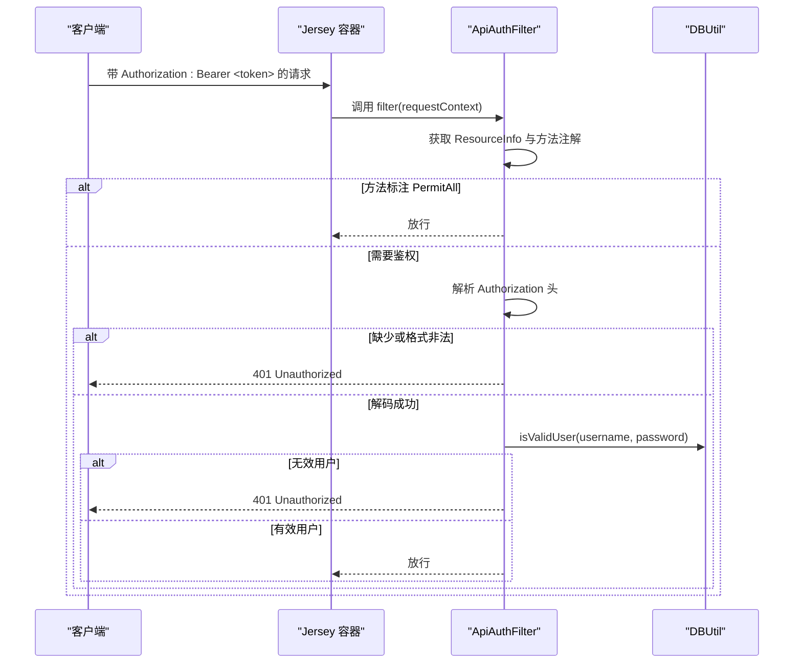
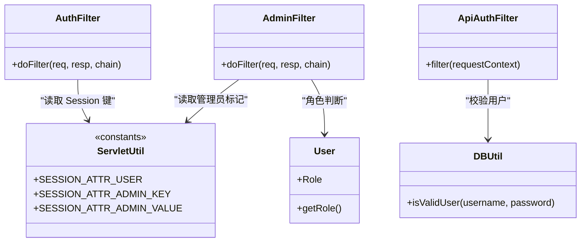

# 过滤器机制详解

<cite>
**本文引用的文件**   
- [web.xml](file://WebContent/WEB-INF/web.xml)
- [AuthFilter.java](file://src/com/ibm/security/appscan/altoromutual/filter/AuthFilter.java)
- [AdminFilter.java](file://src/com/ibm/security/appscan/altoromutual/filter/AdminFilter.java)
- [ApiAuthFilter.java](file://src/com/ibm/security/appscan/altoromutual/filter/ApiAuthFilter.java)
- [ServletUtil.java](file://src/com/ibm/security/appscan/altoromutual/util/ServletUtil.java)
- [User.java](file://src/com/ibm/security/appscan/altoromutual/model/User.java)
- [AltoroAPI.java](file://src/com/ibm/security/appscan/altoromutual/api/AltoroAPI.java)
</cite>

## 目录
1. [简介](#简介)
2. [项目结构](#项目结构)
3. [核心组件](#核心组件)
4. [架构总览](#架构总览)
5. [详细组件分析](#详细组件分析)
6. [依赖关系分析](#依赖关系分析)
7. [性能与优化建议](#性能与优化建议)
8. [故障排查指南](#故障排查指南)
9. [结论](#结论)
10. [附录：自定义过滤器与配置示例](#附录自定义过滤器与配置示例)

## 简介
本文面向 AltoroJ 的过滤器机制，系统性说明 Servlet Filter 的工作原理、拦截链执行顺序，以及三类关键过滤器的实现与策略：
- AuthFilter：用户认证过滤器（会话校验）
- AdminFilter：管理员权限过滤器（角色与访问控制）
- ApiAuthFilter：API 认证过滤器（Bearer Token 验证）

同时给出过滤器链的配置方式、优先级说明、常见问题与性能优化建议，并提供自定义过滤器的实践路径。

## 项目结构
本项目的过滤器相关代码集中在 filter 包中，并通过 web.xml 对 Web 请求进行拦截；REST API 使用 Jersey 容器，通过 Application 注册 ContainerRequestFilter 完成 API 级鉴权。

图表来源
- [web.xml:12-59](file://WebContent/WEB-INF/web.xml#L12-L59)
- [AltoroAPI.java:9-14](file://src/com/ibm/security/appscan/altoromutual/api/AltoroAPI.java#L9-L14)

章节来源
- [web.xml:12-59](file://WebContent/WEB-INF/web.xml#L12-L59)
- [AltoroAPI.java:9-14](file://src/com/ibm/security/appscan/altoromutual/api/AltoroAPI.java#L9-L14)

## 核心组件
- AuthFilter：基于 Session 的用户认证检查，未登录则重定向到登录页。
- AdminFilter：在已认证基础上，进一步校验管理员角色或特定 session 标记，决定放行或重定向。
- ApiAuthFilter：针对 REST API 的 ContainerRequestFilter，解析 Authorization 头中的 Bearer Token，解码并校验用户有效性。

章节来源
- [AuthFilter.java:34-70](file://src/com/ibm/security/appscan/altoromutual/filter/AuthFilter.java#L34-L70)
- [AdminFilter.java:35-80](file://src/com/ibm/security/appscan/altoromutual/filter/AdminFilter.java#L35-L80)
- [ApiAuthFilter.java:20-74](file://src/com/ibm/security/appscan/altoromutual/filter/ApiAuthFilter.java#L20-L74)

## 架构总览
下图展示 Web 请求与 API 请求分别经过的过滤器链路。

图表来源
- [web.xml:28-59](file://WebContent/WEB-INF/web.xml#L28-L59)
- [AuthFilter.java:58-70](file://src/com/ibm/security/appscan/altoromutual/filter/AuthFilter.java#L58-L70)
- [AdminFilter.java:58-80](file://src/com/ibm/security/appscan/altoromutual/filter/AdminFilter.java#L58-L80)

## 详细组件分析

### AuthFilter：用户认证过滤器
职责
- 从 Session 中读取用户对象，判断是否已登录。
- 未登录时重定向到登录页面；已登录则放行。

关键点
- 依赖 ServletUtil.SESSION_ATTR_USER 常量作为 Session 键。
- 仅处理 HttpServletRequest 类型请求。
- 放行通过 FilterChain.doFilter 传递到后续过滤器或目标资源。

图表来源
- [AuthFilter.java:58-70](file://src/com/ibm/security/appscan/altoromutual/filter/AuthFilter.java#L58-L70)
- [ServletUtil.java:60-62](file://src/com/ibm/security/appscan/altoromutual/util/ServletUtil.java#L60-L62)

章节来源
- [AuthFilter.java:34-70](file://src/com/ibm/security/appscan/altoromutual/filter/AuthFilter.java#L34-L70)
- [ServletUtil.java:60-62](file://src/com/ibm/security/appscan/altoromutual/util/ServletUtil.java#L60-L62)

### AdminFilter：管理员权限过滤器
职责
- 在已认证基础上，校验管理员权限。
- 支持两种管理员判定：
  - 用户角色为 Admin
  - Session 中存在特定管理员标记键值
- 允许管理员登录入口路径直接放行。
- 非管理员且已登录时重定向到银行主页；未登录则重定向到登录页。

关键点
- 使用 ServletUtil.SESSION_ATTR_ADMIN_KEY 和 SESSION_ATTR_ADMIN_VALUE 作为管理员标记。
- 使用 User.Role.Admin 进行角色判断。
- 对 /admin/login.jsp 与 /admin/doAdminLogin 做白名单放行。

图表来源
- [AdminFilter.java:58-80](file://src/com/ibm/security/appscan/altoromutual/filter/AdminFilter.java#L58-L80)
- [ServletUtil.java:60-62](file://src/com/ibm/security/appscan/altoromutual/util/ServletUtil.java#L60-L62)
- [User.java:34-54](file://src/com/ibm/security/appscan/altoromutual/model/User.java#L34-L54)

章节来源
- [AdminFilter.java:35-80](file://src/com/ibm/security/appscan/altoromutual/filter/AdminFilter.java#L35-L80)
- [ServletUtil.java:60-62](file://src/com/ibm/security/appscan/altoromutual/util/ServletUtil.java#L60-L62)
- [User.java:34-54](file://src/com/ibm/security/appscan/altoromutual/model/User.java#L34-L54)

### ApiAuthFilter：API 认证过滤器（Bearer Token）
职责
- 针对 Jersey 容器中的 JAX-RS 资源方法，校验 Authorization 头中的 Bearer Token。
- 若方法标注 PermitAll，则跳过鉴权。
- 解析 Token：去除前缀后 Base64 解码，期望格式为“用户名:密码”的双段结构。
- 调用 DBUtil.isValidUser 校验用户有效性，失败返回 401，数据库异常返回 500。

关键点
- 通过 ResourceInfo 获取当前资源方法以检查注解。
- 使用 javax.annotation.security.PermitAll 注解豁免鉴权。
- 错误响应统一封装为 JSON-like 文本，便于前端识别。

图表来源
- [ApiAuthFilter.java:29-74](file://src/com/ibm/security/appscan/altoromutual/filter/ApiAuthFilter.java#L29-L74)
- [AltoroAPI.java:9-14](file://src/com/ibm/security/appscan/altoromutual/api/AltoroAPI.java#L9-L14)

章节来源
- [ApiAuthFilter.java:20-74](file://src/com/ibm/security/appscan/altoromutual/filter/ApiAuthFilter.java#L20-L74)
- [AltoroAPI.java:9-14](file://src/com/ibm/security/appscan/altoromutual/api/AltoroAPI.java#L9-L14)

## 依赖关系分析
- AuthFilter 依赖：
  - ServletUtil.SESSION_ATTR_USER：用于读取 Session 中的用户对象
  - User 模型：用于类型判断
- AdminFilter 依赖：
  - ServletUtil.SESSION_ATTR_ADMIN_KEY / SESSION_ATTR_ADMIN_VALUE：管理员标记
  - User.Role：角色枚举
- ApiAuthFilter 依赖：
  - ResourceInfo：获取当前 JAX-RS 方法
  - DBUtil.isValidUser：校验用户名和密码
  - Base64：Token 编解码

图表来源
- [AuthFilter.java:58-70](file://src/com/ibm/security/appscan/altoromutual/filter/AuthFilter.java#L58-L70)
- [AdminFilter.java:58-80](file://src/com/ibm/security/appscan/altoromutual/filter/AdminFilter.java#L58-L80)
- [ApiAuthFilter.java:29-74](file://src/com/ibm/security/appscan/altoromutual/filter/ApiAuthFilter.java#L29-L74)
- [ServletUtil.java:60-62](file://src/com/ibm/security/appscan/altoromutual/util/ServletUtil.java#L60-L62)
- [User.java:34-54](file://src/com/ibm/security/appscan/altoromutual/model/User.java#L34-L54)

章节来源
- [AuthFilter.java:58-70](file://src/com/ibm/security/appscan/altoromutual/filter/AuthFilter.java#L58-L70)
- [AdminFilter.java:58-80](file://src/com/ibm/security/appscan/altoromutual/filter/AdminFilter.java#L58-L80)
- [ApiAuthFilter.java:29-74](file://src/com/ibm/security/appscan/altoromutual/filter/ApiAuthFilter.java#L29-L74)
- [ServletUtil.java:60-62](file://src/com/ibm/security/appscan/altoromutual/util/ServletUtil.java#L60-L62)
- [User.java:34-54](file://src/com/ibm/security/appscan/altoromutual/model/User.java#L34-L54)

## 性能与优化建议
- 减少不必要的 Session 访问：
  - 对静态资源与公开接口跳过鉴权，避免无谓的 Session 读取。
- 缓存鉴权结果：
  - 对于高频调用的 API，可考虑短期缓存用户有效性结果，降低数据库压力。
- 合理配置过滤器映射：
  - 精确匹配 URL 模式，避免宽泛匹配导致过多请求进入过滤器链。
- 异步与批量化：
  - 将鉴权逻辑与业务逻辑解耦，必要时采用异步处理提升吞吐。
- 日志与监控：
  - 记录鉴权失败率与耗时，定位瓶颈与异常流量。

[本节为通用指导，不涉及具体文件]

## 故障排查指南
常见问题与定位要点
- 登录后仍被重定向到登录页
  - 检查 Session 中是否写入用户对象，键名是否与 ServletUtil.SESSION_ATTR_USER 一致。
  - 确认请求是否经过 AuthFilter 映射路径。
- 管理员无法访问管理页面
  - 检查用户角色是否为 Admin，或 Session 中是否存在管理员标记键值。
  - 核对 AdminFilter 映射路径是否正确（注意 web.xml 中的拼写）。
- API 请求返回 401
  - 检查 Authorization 头是否包含 Bearer Token，且 Token 格式正确（Base64 编码的“用户名:密码”）。
  - 确认目标方法是否标注 PermitAll，若是则应跳过鉴权。
  - 查看数据库连接与校验逻辑是否正常。

章节来源
- [AuthFilter.java:58-70](file://src/com/ibm/security/appscan/altoromutual/filter/AuthFilter.java#L58-L70)
- [AdminFilter.java:58-80](file://src/com/ibm/security/appscan/altoromutual/filter/AdminFilter.java#L58-L80)
- [ApiAuthFilter.java:29-74](file://src/com/ibm/security/appscan/altoromutual/filter/ApiAuthFilter.java#L29-L74)
- [web.xml:28-59](file://WebContent/WEB-INF/web.xml#L28-L59)

## 结论
AltoroJ 的过滤器机制通过 Servlet Filter 与 JAX-RS ContainerRequestFilter 分层实现：
- Web 层由 AuthFilter 与 AdminFilter 负责会话与角色鉴权。
- API 层由 ApiAuthFilter 负责 Bearer Token 校验与用户有效性验证。
通过合理的 web.xml 映射与 Jersey Application 注册，形成清晰的鉴权边界与可扩展的拦截链。建议在保持现有架构的基础上，引入更细粒度的权限控制与缓存策略，以提升安全性与性能。

[本节为总结性内容，不涉及具体文件]

## 附录：自定义过滤器与配置示例

### 自定义 Servlet Filter 步骤
- 创建类实现 javax.servlet.Filter，并在 doFilter 中实现鉴权逻辑。
- 在 web.xml 中声明 filter 与 filter-mapping，指定 url-pattern 与 dispatcher。
- 如需区分转发、包含、请求、错误等分发类型，显式配置 dispatcher。

参考路径
- [AuthFilter.java:34-70](file://src/com/ibm/security/appscan/altoromutual/filter/AuthFilter.java#L34-L70)
- [web.xml:12-59](file://WebContent/WEB-INF/web.xml#L12-L59)

### 自定义 JAX-RS ContainerRequestFilter 步骤
- 创建类实现 ContainerRequestFilter，在 filter 中解析请求头并进行鉴权。
- 在 Application 子类中 register 该过滤器。
- 使用 PermitAll 注解对无需鉴权的资源方法进行豁免。

参考路径
- [ApiAuthFilter.java:20-74](file://src/com/ibm/security/appscan/altoromutual/filter/ApiAuthFilter.java#L20-L74)
- [AltoroAPI.java:9-14](file://src/com/ibm/security/appscan/altoromutual/api/AltoroAPI.java#L9-L14)

### 过滤器链的执行顺序与优先级
- 多个 Filter 按 web.xml 中声明的顺序依次执行。
- 每个 Filter 可在 doFilter 前后插入横切逻辑（如日志、计时、安全头设置）。
- 若某个 Filter 提前返回（如重定向），后续 Filter 与目标资源不再执行。

参考路径
- [web.xml:12-59](file://WebContent/WEB-INF/web.xml#L12-L59)