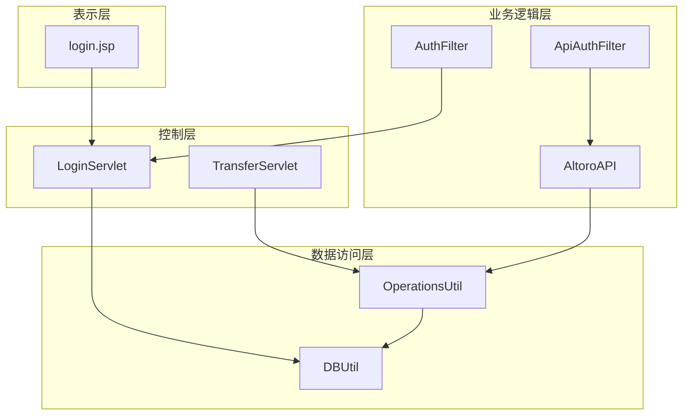
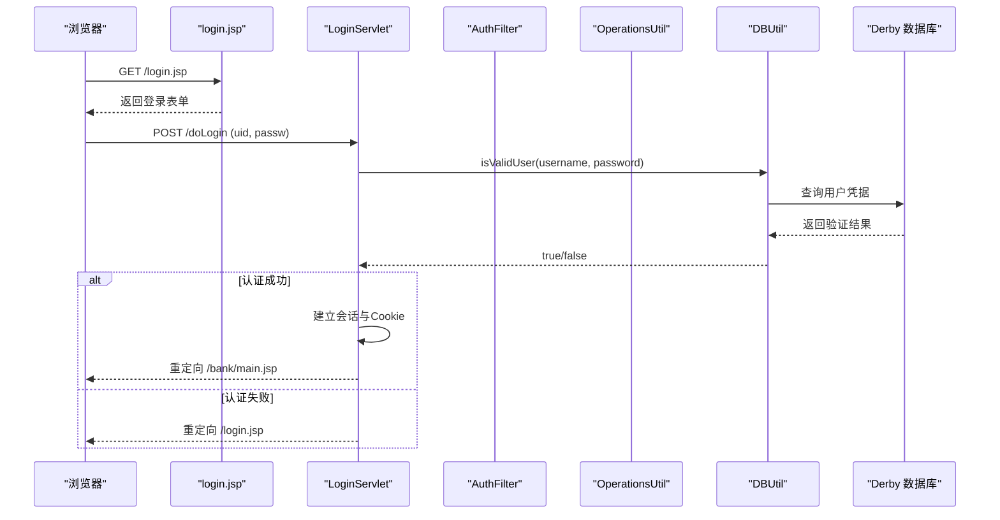
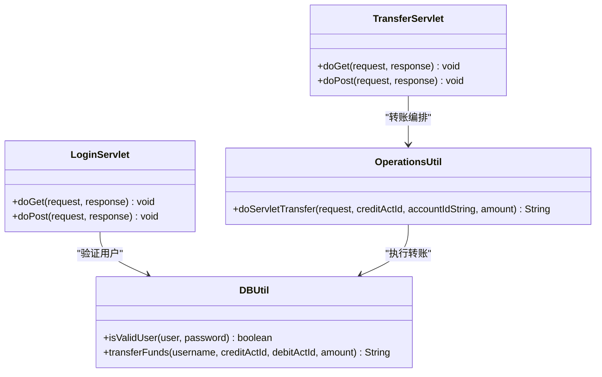
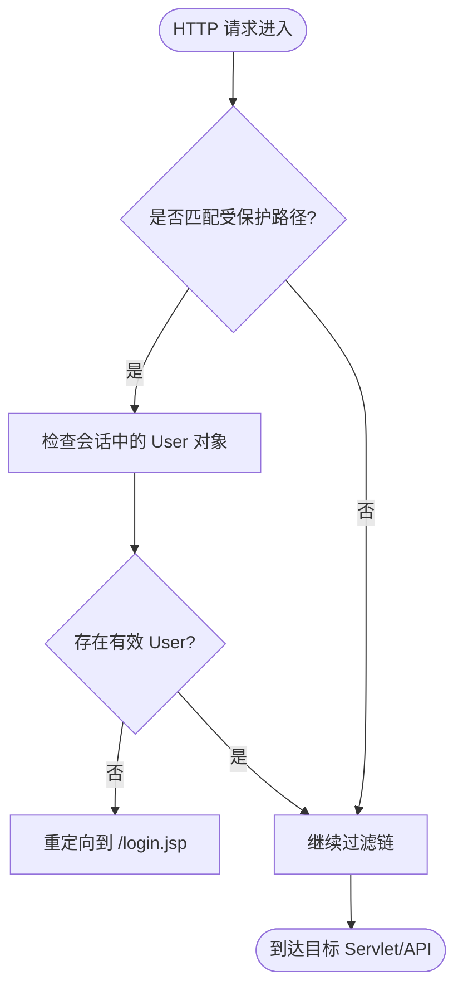
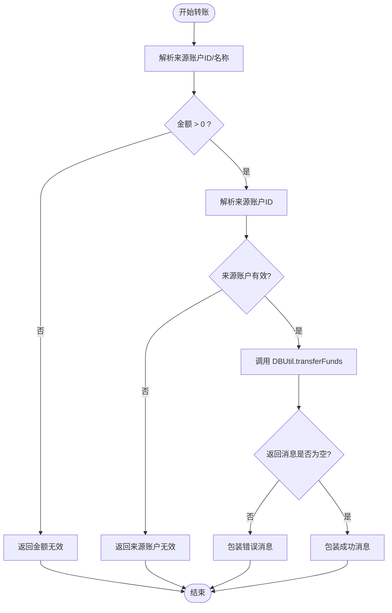
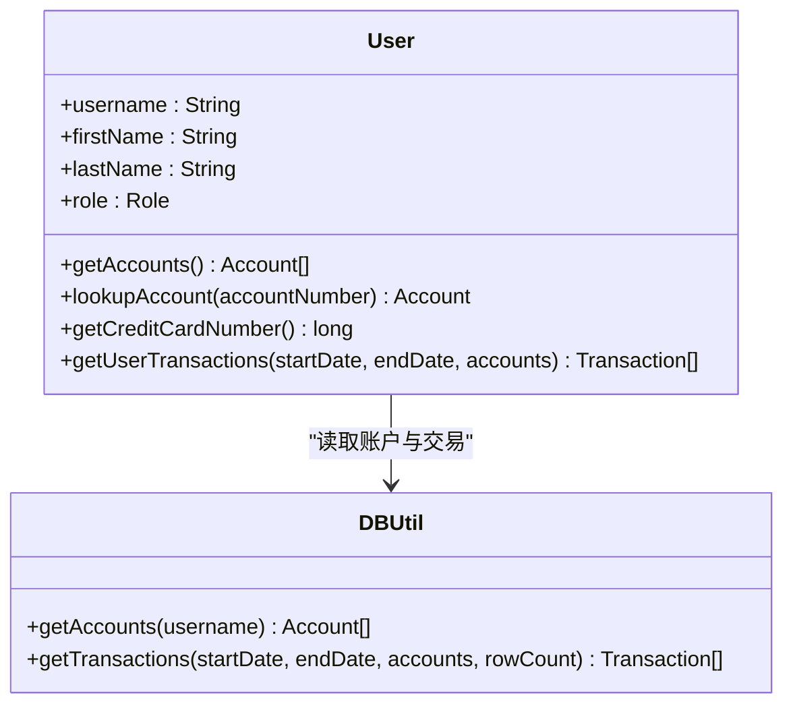
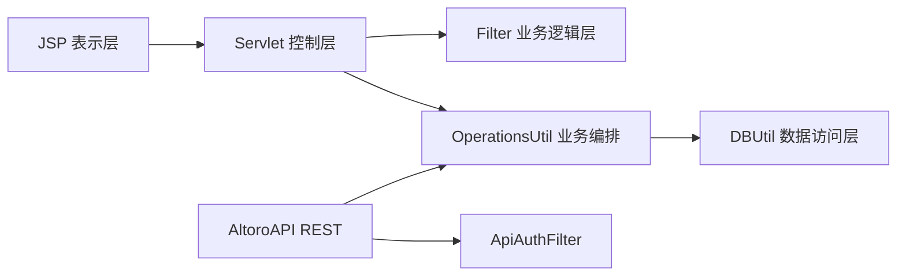

# 分层架构详解

<cite>
**本文引用的文件**   
- [README.md](file://README.md)
- [web.xml](file://WebContent/WEB-INF/web.xml)
- [LoginServlet.java](file://src/com/ibm/security/appscan/altoromutual/servlet/LoginServlet.java)
- [TransferServlet.java](file://src/com/ibm/security/appscan/altoromutual/servlet/TransferServlet.java)
- [AuthFilter.java](file://src/com/ibm/security/appscan/altoromutual/filter/AuthFilter.java)
- [AltoroAPI.java](file://src/com/ibm/security/appscan/altoromutual/api/AltoroAPI.java)
- [ApiAuthFilter.java](file://src/com/ibm/security/appscan/altoromutual/filter/ApiAuthFilter.java)
- [DBUtil.java](file://src/com/ibm/security/appscan/altoromutual/util/DBUtil.java)
- [OperationsUtil.java](file://src/com/ibm/security/appscan/altoromutual/util/OperationsUtil.java)
- [User.java](file://src/com/ibm/security/appscan/altoromutual/model/User.java)
- [login.jsp](file://WebContent/login.jsp)
</cite>

## 目录
1. [简介](#简介)
2. [项目结构](#项目结构)
3. [核心组件](#核心组件)
4. [架构总览](#架构总览)
5. [详细组件分析](#详细组件分析)
6. [依赖关系分析](#依赖关系分析)
7. [性能与可扩展性](#性能与可扩展性)
8. [故障排查指南](#故障排查指南)
9. [结论](#结论)

## 简介
本文件为 AltoroJ 的分层架构提供系统化、可操作的文档，围绕四层架构展开：表示层（JSP）、控制层（Servlet）、业务逻辑层（Filter 与 REST API）、数据访问层（DBUtil）。文档重点说明每层的职责、组件关系、数据流向、层间通信机制与接口契约，并通过登录与转账两个典型请求序列展示各层如何协作。同时解释该分层如何帮助隔离与安全演示漏洞。

## 项目结构
AltoroJ 采用传统 J2EE Web 应用组织方式：
- 表示层：JSP 页面（如 login.jsp）负责用户界面与表单提交。
- 控制层：Servlet（如 LoginServlet、TransferServlet）接收 HTTP 请求、解析参数、调用业务工具并转发结果。
- 业务逻辑层：Filter（AuthFilter、ApiAuthFilter）实现跨切面的鉴权与访问控制；REST API（AltoroAPI 及其资源类）暴露 JSON 接口。
- 数据访问层：DBUtil 封装 JDBC 连接、初始化与 SQL 操作；OperationsUtil 封装跨层复用逻辑（如转账流程、反馈存储等）。

图表来源
- [web.xml:10-67](file://WebContent/WEB-INF/web.xml#L10-L67)
- [LoginServlet.java:38-107](file://src/com/ibm/security/appscan/altoromutual/servlet/LoginServlet.java#L38-L107)
- [TransferServlet.java:38-70](file://src/com/ibm/security/appscan/altoromutual/servlet/TransferServlet.java#L38-L70)
- [AuthFilter.java:40-79](file://src/com/ibm/security/appscan/altoromutual/filter/AuthFilter.java#L40-L79)
- [ApiAuthFilter.java:20-76](file://src/com/ibm/security/appscan/altoromutual/filter/ApiAuthFilter.java#L20-L76)
- [AltoroAPI.java:9-15](file://src/com/ibm/security/appscan/altoromutual/api/AltoroAPI.java#L9-L15)
- [DBUtil.java:45-138](file://src/com/ibm/security/appscan/altoromutual/util/DBUtil.java#L45-L138)
- [OperationsUtil.java:16-155](file://src/com/ibm/security/appscan/altoromutual/util/OperationsUtil.java#L16-L155)

章节来源
- [README.md:1-63](file://README.md#L1-L63)
- [web.xml:1-227](file://WebContent/WEB-INF/web.xml#L1-L227)

## 核心组件
- 表示层（JSP）
  - login.jsp：呈现登录表单，将用户名与密码提交到 /doLogin。
- 控制层（Servlet）
  - LoginServlet：处理登录与登出，校验凭据、建立会话、设置 Cookie，并重定向至银行主页。
  - TransferServlet：校验登录状态，解析转账参数，委托 OperationsUtil 执行转账，再转发回 transfer.jsp。
- 业务逻辑层（Filter + API）
  - AuthFilter：对受保护路径（/bank/*、/admin/* 等）进行会话鉴权，未认证则重定向到登录页。
  - ApiAuthFilter：对 REST API 的 Bearer Token 进行鉴权，拒绝未认证或无效令牌请求。
  - AltoroAPI：Jersey 应用入口，注册 API 包与 ApiAuthFilter。
- 数据访问层（DBUtil + OperationsUtil）
  - DBUtil：管理 Derby 数据库连接、初始化表结构与数据，提供用户验证、账户查询、转账、交易记录等 DAO 方法。
  - OperationsUtil：封装跨层复用的业务编排逻辑，如转账流程、反馈存储、基于 Authorization 头的用户解析。

章节来源
- [login.jsp:24-72](file://WebContent/login.jsp#L24-L72)
- [LoginServlet.java:51-107](file://src/com/ibm/security/appscan/altoromutual/servlet/LoginServlet.java#L51-L107)
- [TransferServlet.java:51-68](file://src/com/ibm/security/appscan/altoromutual/servlet/TransferServlet.java#L51-L68)
- [AuthFilter.java:58-70](file://src/com/ibm/security/appscan/altoromutual/filter/AuthFilter.java#L58-L70)
- [ApiAuthFilter.java:30-74](file://src/com/ibm/security/appscan/altoromutual/filter/ApiAuthFilter.java#L30-L74)
- [AltoroAPI.java:9-15](file://src/com/ibm/security/appscan/altoromutual/api/AltoroAPI.java#L9-L15)
- [DBUtil.java:99-138](file://src/com/ibm/security/appscan/altoromutual/util/DBUtil.java#L99-L138)
- [OperationsUtil.java:18-117](file://src/com/ibm/security/appscan/altoromutual/util/OperationsUtil.java#L18-L117)

## 架构总览
下图展示了从浏览器到数据库的完整请求流，以及 Filter 在请求链中的拦截位置。

图表来源
- [login.jsp:45-72](file://WebContent/login.jsp#L45-L72)
- [LoginServlet.java:67-107](file://src/com/ibm/security/appscan/altoromutual/servlet/LoginServlet.java#L67-L107)
- [DBUtil.java:212-232](file://src/com/ibm/security/appscan/altoromutual/util/DBUtil.java#L212-L232)

## 详细组件分析

### 表示层（JSP）
- 职责
  - 渲染用户界面，收集输入，发起 HTTP 请求。
- 关键交互
  - login.jsp 将表单提交到 /doLogin，由 LoginServlet 处理。
- 安全要点
  - 前端仅做基础校验，真正的合法性检查在后端完成。

章节来源
- [login.jsp:45-72](file://WebContent/login.jsp#L45-L72)

### 控制层（Servlet）
- LoginServlet
  - 功能：处理登录与登出；调用 DBUtil.isValidUser 验证用户；成功后建立会话并设置 Cookie；失败时返回错误信息并重定向到登录页。
  - 关键点：使用 ServletUtil 建立会话与 Cookie；通过 response.sendRedirect 控制导航。
- TransferServlet
  - 功能：校验登录状态；解析 fromAccount、toAccount、transferAmount；调用 OperationsUtil.doServletTransfer 执行转账；转发到 transfer.jsp 显示结果。
  - 关键点：依赖 ServletUtil.isLoggedin 进行会话校验；依赖 OperationsUtil 统一转账逻辑。

图表来源
- [LoginServlet.java:51-107](file://src/com/ibm/security/appscan/altoromutual/servlet/LoginServlet.java#L51-L107)
- [TransferServlet.java:51-68](file://src/com/ibm/security/appscan/altoromutual/servlet/TransferServlet.java#L51-L68)
- [OperationsUtil.java:39-117](file://src/com/ibm/security/appscan/altoromutual/util/OperationsUtil.java#L39-L117)
- [DBUtil.java:303-364](file://src/com/ibm/security/appscan/altoromutual/util/DBUtil.java#L303-L364)

章节来源
- [LoginServlet.java:38-107](file://src/com/ibm/security/appscan/altoromutual/servlet/LoginServlet.java#L38-L107)
- [TransferServlet.java:38-70](file://src/com/ibm/security/appscan/altoromutual/servlet/TransferServlet.java#L38-L70)

### 业务逻辑层（Filter 与 API）
- AuthFilter
  - 作用：对 /bank/*、/admin/* 等路径进行会话鉴权；若会话中无有效 User 对象，则重定向到登录页。
  - 配置：web.xml 中 filter-mapping 指定 URL 模式与 dispatcher。
- ApiAuthFilter
  - 作用：对 REST API 的 Bearer Token 进行鉴权；解析 Authorization 头，解码 token，校验用户有效性；未认证或无效则返回 401。
  - 集成：AltoroAPI 注册该过滤器。
- AltoroAPI
  - 作用：Jersey 应用入口，声明 @ApplicationPath("api")，扫描 api 包并注册 ApiAuthFilter。

图表来源
- [AuthFilter.java:58-70](file://src/com/ibm/security/appscan/altoromutual/filter/AuthFilter.java#L58-L70)
- [web.xml:28-59](file://WebContent/WEB-INF/web.xml#L28-L59)

章节来源
- [AuthFilter.java:40-79](file://src/com/ibm/security/appscan/altoromutual/filter/AuthFilter.java#L40-L79)
- [ApiAuthFilter.java:20-76](file://src/com/ibm/security/appscan/altoromutual/filter/ApiAuthFilter.java#L20-L76)
- [AltoroAPI.java:9-15](file://src/com/ibm/security/appscan/altoromutual/api/AltoroAPI.java#L9-L15)
- [web.xml:12-67](file://WebContent/WEB-INF/web.xml#L12-L67)

### 数据访问层（DBUtil 与 OperationsUtil）
- DBUtil
  - 连接管理：支持外部 DataSource 或内嵌 Derby；首次连接自动初始化数据库与样例数据。
  - 核心方法：isValidUser、getUserInfo、getAccounts、transferFunds、getTransactions、addAccount/addUser/changePassword/storeFeedback 等。
  - 事务与原子性：当前转账逻辑分多条语句更新余额与插入交易记录，注释指出应作为原子操作。
- OperationsUtil
  - 转账编排：doServletTransfer 解析来源账户（支持 ID 或名称），校验金额与账户有效性，调用 DBUtil.transferFunds 并包装结果消息。
  - API 用户解析：getUser 从 Authorization 头解析 Basic 凭证并获取用户信息。
  - 反馈存储：sendFeedback 根据配置决定是否持久化反馈内容。

图表来源
- [OperationsUtil.java:39-117](file://src/com/ibm/security/appscan/altoromutual/util/OperationsUtil.java#L39-L117)
- [DBUtil.java:303-364](file://src/com/ibm/security/appscan/altoromutual/util/DBUtil.java#L303-L364)

章节来源
- [DBUtil.java:99-138](file://src/com/ibm/security/appscan/altoromutual/util/DBUtil.java#L99-L138)
- [DBUtil.java:212-232](file://src/com/ibm/security/appscan/altoromutual/util/DBUtil.java#L212-L232)
- [DBUtil.java:303-364](file://src/com/ibm/security/appscan/altoromutual/util/DBUtil.java#L303-L364)
- [OperationsUtil.java:39-117](file://src/com/ibm/security/appscan/altoromutual/util/OperationsUtil.java#L39-L117)

### 模型层（User）
- 职责：封装用户基本信息、角色、最近访问时间；提供账户列表、信用卡账号查找、交易查询等便捷方法。
- 依赖：通过 DBUtil 获取账户与交易数据。

图表来源
- [User.java:76-106](file://src/com/ibm/security/appscan/altoromutual/model/User.java#L76-L106)
- [DBUtil.java:275-293](file://src/com/ibm/security/appscan/altoromutual/util/DBUtil.java#L275-L293)
- [DBUtil.java:375-427](file://src/com/ibm/security/appscan/altoromutual/util/DBUtil.java#L375-L427)

章节来源
- [User.java:30-108](file://src/com/ibm/security/appscan/altoromutual/model/User.java#L30-L108)

## 依赖关系分析
- 层间依赖
  - 表示层 -> 控制层：JSP 表单提交到 Servlet。
  - 控制层 -> 业务逻辑层：Servlet 调用 Filter（通过容器）与 OperationsUtil。
  - 业务逻辑层 -> 数据访问层：OperationsUtil 与 API 调用 DBUtil。
- 外部依赖
  - Jersey（REST API 框架）：由 web.xml 启动 ServletContainer，AltoroAPI 注册资源与过滤器。
  - Apache Derby：内嵌数据库，首次连接自动初始化。
- 配置驱动
  - web.xml 定义 Filter、Servlet、映射与欢迎页；AltoroAPI 定义 API 根路径。

图表来源
- [web.xml:10-67](file://WebContent/WEB-INF/web.xml#L10-L67)
- [AltoroAPI.java:9-15](file://src/com/ibm/security/appscan/altoromutual/api/AltoroAPI.java#L9-L15)
- [OperationsUtil.java:18-117](file://src/com/ibm/security/appscan/altoromutual/util/OperationsUtil.java#L18-L117)
- [DBUtil.java:99-138](file://src/com/ibm/security/appscan/altoromutual/util/DBUtil.java#L99-L138)

章节来源
- [web.xml:1-227](file://WebContent/WEB-INF/web.xml#L1-L227)
- [AltoroAPI.java:9-15](file://src/com/ibm/security/appscan/altoromutual/api/AltoroAPI.java#L9-L15)

## 性能与可扩展性
- 连接管理
  - DBUtil 单例维护连接，支持外部 DataSource；建议在生产环境启用连接池以提升并发性能。
- 事务与原子性
  - 转账涉及多步更新与插入，当前非原子；建议引入事务边界确保一致性。
- 鉴权开销
  - ApiAuthFilter 每次请求解码与校验 token；可考虑缓存用户信息以减少 DB 查询。
- 扩展点
  - 新增 API：在 api 包下添加资源类并由 AltoroAPI 自动扫描。
  - 新增 Filter：在 web.xml 中注册并映射 URL 模式。

[本节为通用指导，不直接分析具体文件]

## 故障排查指南
- 登录失败
  - 现象：登录后被重定向回登录页。
  - 可能原因：DBUtil.isValidUser 返回 false；日志记录登录失败。
  - 定位：检查 LoginServlet 的错误属性与重定向逻辑。
- 转账失败
  - 现象：转账后返回“来源账户无效”“目标账户无效”或“金额无效”。
  - 可能原因：参数解析失败、账户不在用户名下、金额为负或零。
  - 定位：检查 TransferServlet 参数解析与 OperationsUtil.doServletTransfer 的校验分支。
- 数据库初始化失败
  - 现象：首次登录提示无法创建数据库。
  - 可能原因：权限不足或 user.home 不可写。
  - 参考：README 中的故障排查说明。

章节来源
- [LoginServlet.java:82-101](file://src/com/ibm/security/appscan/altoromutual/servlet/LoginServlet.java#L82-L101)
- [OperationsUtil.java:94-117](file://src/com/ibm/security/appscan/altoromutual/util/OperationsUtil.java#L94-L117)
- [README.md:44-57](file://README.md#L44-L57)

## 结论
AltoroJ 的分层架构清晰地将表示、控制、业务与数据访问解耦：
- 表示层专注 UI 与交互；
- 控制层负责请求路由与会话管理；
- 业务逻辑层通过 Filter 与 API 提供统一的鉴权与接口能力；
- 数据访问层集中管理数据库连接与 SQL 操作。

该分层不仅提升了代码的可维护性与可测试性，也为安全漏洞的隔离与演示提供了天然边界：例如，SQL 注入风险集中在 DBUtil 的拼接语句处，XSS 风险集中在 JSP 输出，越权访问可通过 Filter 与 API 鉴权策略统一管控。通过明确层间契约与依赖，开发者可在不破坏整体结构的前提下修复漏洞与增强安全性。