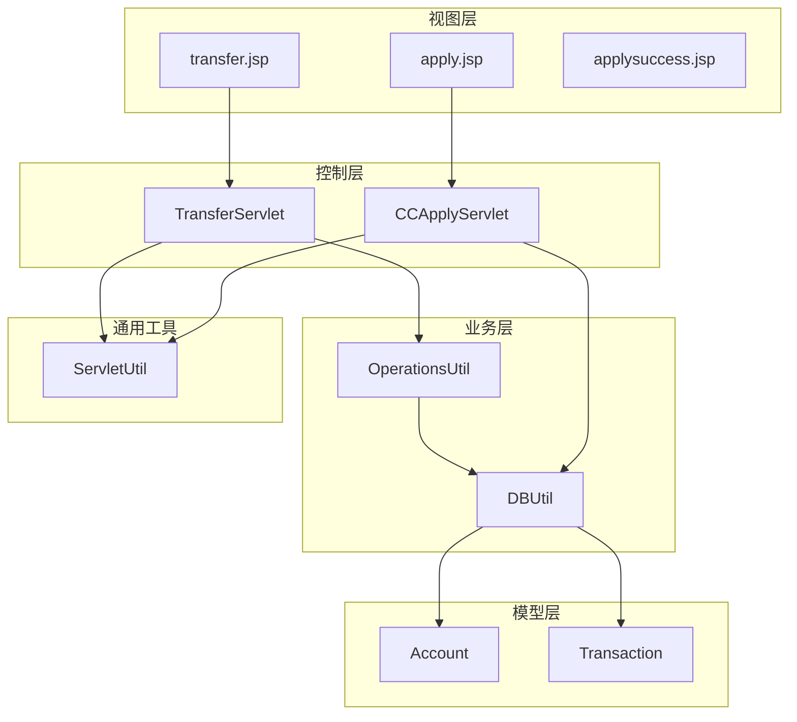
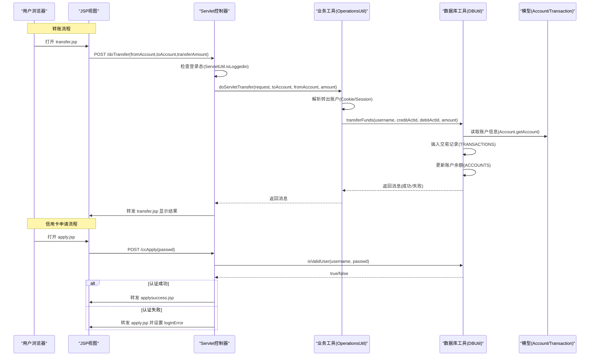
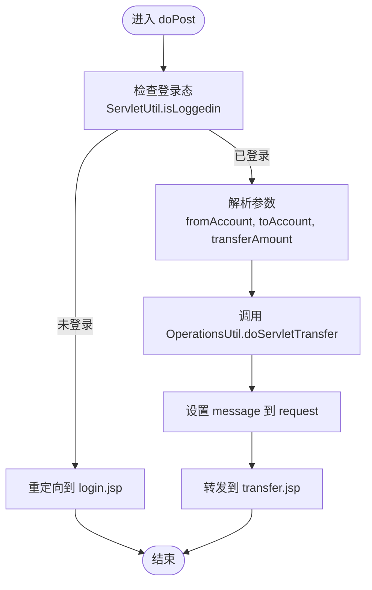
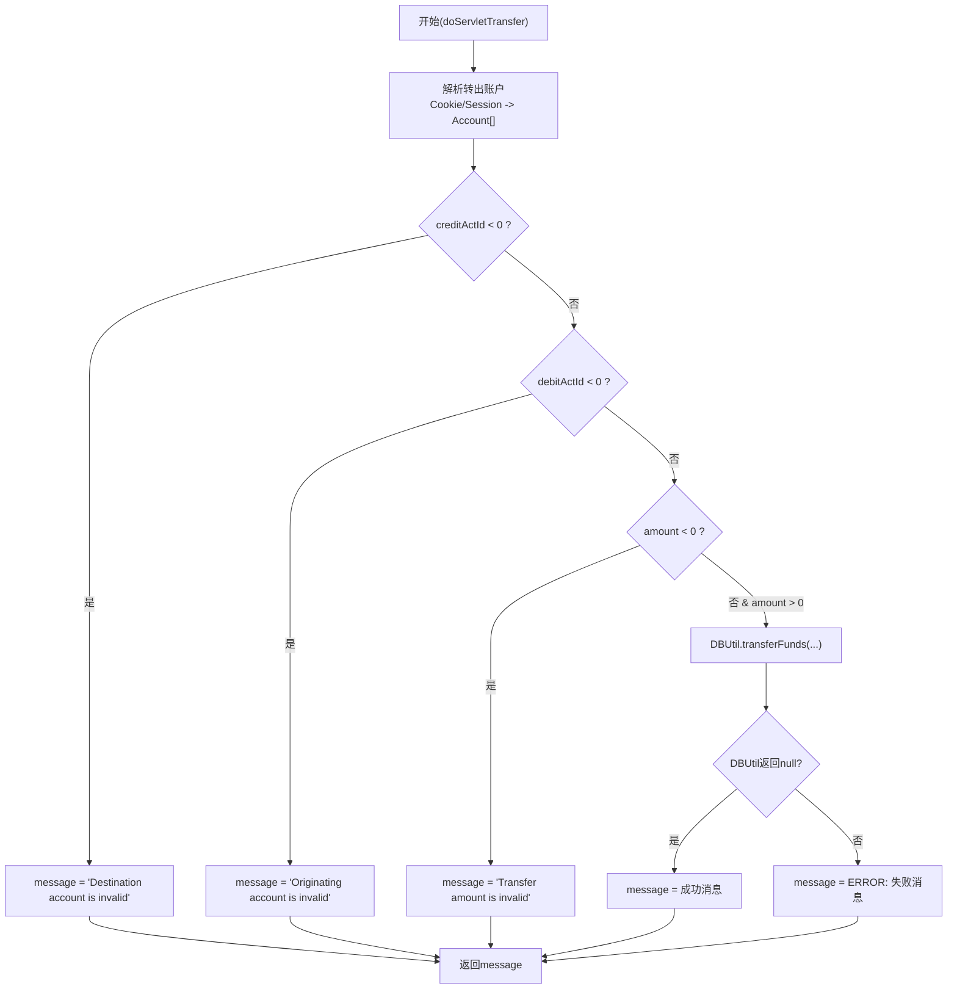
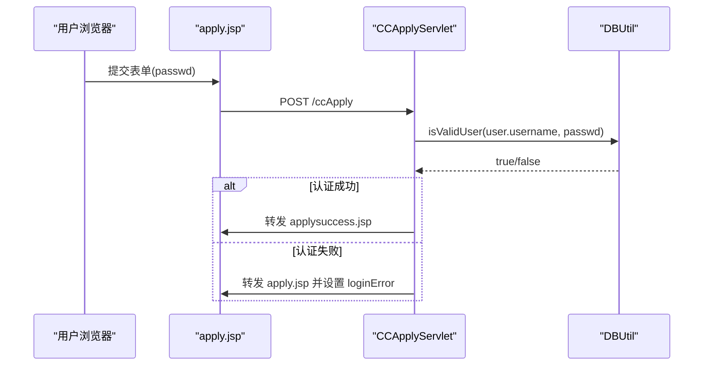
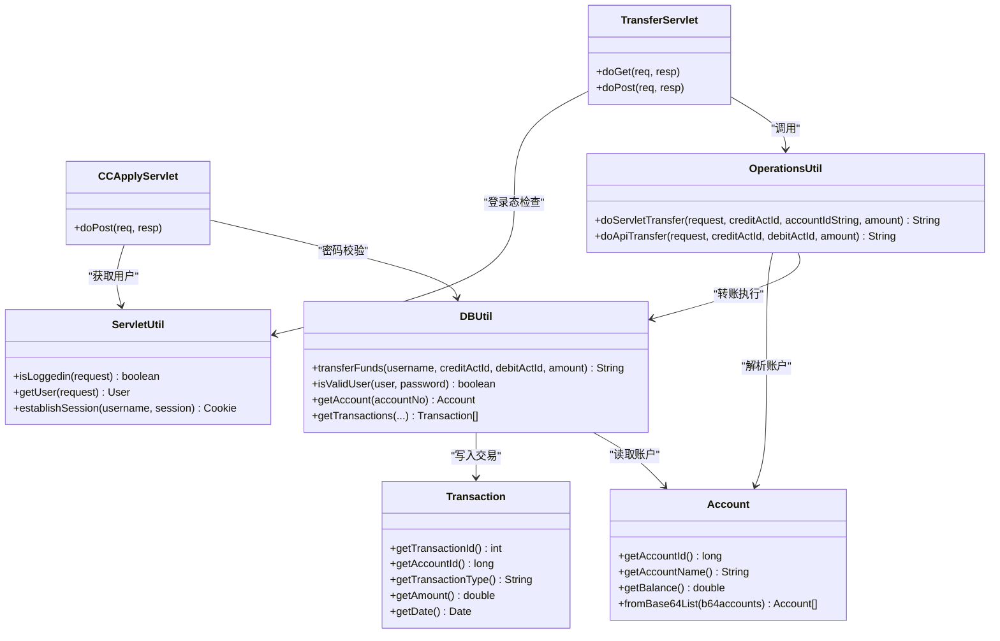

# 交易处理Servlet

<cite>
**本文引用的文件**   
- [TransferServlet.java](file://src/com/ibm/security/appscan/altoromutual/servlet/TransferServlet.java)
- [CCApplyServlet.java](file://src/com/ibm/security/appscan/altoromutual/servlet/CCApplyServlet.java)
- [OperationsUtil.java](file://src/com/ibm/security/appscan/altoromutual/util/OperationsUtil.java)
- [DBUtil.java](file://src/com/ibm/security/appscan/altoromutual/util/DBUtil.java)
- [ServletUtil.java](file://src/com/ibm/security/appscan/altoromutual/util/ServletUtil.java)
- [Account.java](file://src/com/ibm/security/appscan/altoromutual/model/Account.java)
- [Transaction.java](file://src/com/ibm/security/appscan/altoromutual/model/Transaction.java)
- [transfer.jsp](file://WebContent/bank/transfer.jsp)
- [apply.jsp](file://WebContent/bank/apply.jsp)
- [applysuccess.jsp](file://WebContent/bank/applysuccess.jsp)
</cite>

## 目录
1. [简介](#简介)
2. [项目结构](#项目结构)
3. [核心组件](#核心组件)
4. [架构总览](#架构总览)
5. [详细组件分析](#详细组件分析)
6. [依赖关系分析](#依赖关系分析)
7. [性能与一致性考虑](#性能与一致性考虑)
8. [故障排查指南](#故障排查指南)
9. [结论](#结论)

## 简介
本文件聚焦于交易处理相关的两个 Servlet：
- TransferServlet：实现账户间转账功能，包括前端表单交互、参数校验、资金转移逻辑、交易记录写入与结果反馈。
- CCApplyServlet：实现信用卡申请流程，包含密码验证、状态管理与成功/失败页面跳转。

文档将深入解析转账业务流程、资金转移逻辑、事务处理机制、安全性验证；并完整记录信用卡申请的表单提交、验证、状态管理。同时提供关键代码路径与流程图，帮助读者理解系统行为与潜在风险点。

## 项目结构
与交易处理相关的主要文件分布如下：
- Servlet 层：TransferServlet、CCApplyServlet
- 业务工具层：OperationsUtil（封装转账业务）、DBUtil（数据库访问）
- 模型层：Account、Transaction
- 视图层：transfer.jsp、apply.jsp、applysuccess.jsp
- 通用工具：ServletUtil（会话、用户、Cookie 等）

图表来源
- [TransferServlet.java:51-67](file://src/com/ibm/security/appscan/altoromutual/servlet/TransferServlet.java#L51-L67)
- [CCApplyServlet.java:42-64](file://src/com/ibm/security/appscan/altoromutual/servlet/CCApplyServlet.java#L42-L64)
- [OperationsUtil.java:39-117](file://src/com/ibm/security/appscan/altoromutual/util/OperationsUtil.java#L39-L117)
- [DBUtil.java:303-364](file://src/com/ibm/security/appscan/altoromutual/util/DBUtil.java#L303-L364)
- [Account.java:37-48](file://src/com/ibm/security/appscan/altoromutual/model/Account.java#L37-L48)
- [Transaction.java:28-63](file://src/com/ibm/security/appscan/altoromutual/model/Transaction.java#L28-L63)
- [ServletUtil.java:355-373](file://src/com/ibm/security/appscan/altoromutual/util/ServletUtil.java#L355-L373)

章节来源
- [TransferServlet.java:32-67](file://src/com/ibm/security/appscan/altoromutual/servlet/TransferServlet.java#L32-L67)
- [CCApplyServlet.java:32-64](file://src/com/ibm/security/appscan/altoromutual/servlet/CCApplyServlet.java#L32-L64)

## 核心组件
- TransferServlet：负责接收转账请求，进行登录态检查，调用 OperationsUtil 完成转账，并将结果回显到 transfer.jsp。
- CCApplyServlet：负责接收信用卡申请表单，校验用户密码，成功后跳转到 applysuccess.jsp，失败则返回 apply.jsp 并设置错误信息。
- OperationsUtil：封装转账业务逻辑，从 Cookie 或 Session 中解析转出账户，校验参数后调用 DBUtil.transferFunds。
- DBUtil：数据库操作工具类，提供转账、查询账户、查询交易等功能；转账方法内执行插入交易记录与更新余额。
- Account/Transaction：数据模型，分别表示账户与交易记录。
- ServletUtil：提供会话、用户获取、登录态判断等通用能力。

章节来源
- [TransferServlet.java:32-67](file://src/com/ibm/security/appscan/altoromutual/servlet/TransferServlet.java#L32-L67)
- [CCApplyServlet.java:32-64](file://src/com/ibm/security/appscan/altoromutual/servlet/CCApplyServlet.java#L32-L64)
- [OperationsUtil.java:39-117](file://src/com/ibm/security/appscan/altoromutual/util/OperationsUtil.java#L39-L117)
- [DBUtil.java:303-364](file://src/com/ibm/security/appscan/altoromutual/util/DBUtil.java#L303-L364)
- [Account.java:32-48](file://src/com/ibm/security/appscan/altoromutual/model/Account.java#L32-L48)
- [Transaction.java:28-63](file://src/com/ibm/security/appscan/altoromutual/model/Transaction.java#L28-L63)
- [ServletUtil.java:355-373](file://src/com/ibm/security/appscan/altoromutual/util/ServletUtil.java#L355-L373)

## 架构总览
转账与信用卡申请的整体交互如下：

图表来源
- [TransferServlet.java:51-67](file://src/com/ibm/security/appscan/altoromutual/servlet/TransferServlet.java#L51-L67)
- [OperationsUtil.java:39-117](file://src/com/ibm/security/appscan/altoromutual/util/OperationsUtil.java#L39-L117)
- [DBUtil.java:303-364](file://src/com/ibm/security/appscan/altoromutual/util/DBUtil.java#L303-L364)
- [CCApplyServlet.java:42-64](file://src/com/ibm/security/appscan/altoromutual/servlet/CCApplyServlet.java#L42-L64)

## 详细组件分析

### TransferServlet 转账功能
- 入口与路由：GET 直接委托给 POST；POST 处理转账请求。
- 安全校验：通过 ServletUtil.isLoggedin 检查登录态，未登录重定向至 login.jsp。
- 参数处理：从请求中获取 fromAccount、toAccount、transferAmount。
- 业务调用：调用 OperationsUtil.doServletTransfer 完成转账逻辑。
- 结果展示：将 message 放入 request 属性并转发到 transfer.jsp。

图表来源
- [TransferServlet.java:51-67](file://src/com/ibm/security/appscan/altoromutual/servlet/TransferServlet.java#L51-L67)
- [ServletUtil.java:355-368](file://src/com/ibm/security/appscan/altoromutual/util/ServletUtil.java#L355-L368)

章节来源
- [TransferServlet.java:32-67](file://src/com/ibm/security/appscan/altoromutual/servlet/TransferServlet.java#L32-L67)

#### 转账业务逻辑（OperationsUtil + DBUtil）
- 转出账户解析：优先从 Cookie AltoroAccounts 中解析账户列表，否则从 Session 中的 User.getAccounts() 获取。
- 转出账户匹配：支持按 accountId 或 accountName 匹配，得到 debitActId。
- 参数校验：对 creditActId、debitActId、amount 进行基本合法性检查。
- 转账执行：调用 DBUtil.transferFunds，内部执行：
  - 读取借方与贷方账户信息（Account.getAccount）。
  - 根据是否为信用卡账户调整金额符号与类型（Withdrawal/Cash Advance/Payment/Deposit）。
  - 插入两条交易记录（借方与贷方各一条），若为信用卡借出则追加现金预支费用记录。
  - 更新两账户的余额。
- 返回值：成功返回 null，失败返回错误消息字符串。

图表来源
- [OperationsUtil.java:39-117](file://src/com/ibm/security/appscan/altoromutual/util/OperationsUtil.java#L39-L117)
- [DBUtil.java:303-364](file://src/com/ibm/security/appscan/altoromutual/util/DBUtil.java#L303-L364)

章节来源
- [OperationsUtil.java:39-117](file://src/com/ibm/security/appscan/altoromutual/util/OperationsUtil.java#L39-L117)
- [DBUtil.java:303-364](file://src/com/ibm/security/appscan/altoromutual/util/DBUtil.java#L303-L364)

#### 转账前端交互（transfer.jsp）
- 表单字段：fromAccount（下拉选择用户账户）、toAccount（下拉选择目标账户）、transferAmount（文本输入）。
- 客户端校验：禁止转出与转入账户相同；金额必须大于 0。
- 服务端消息：通过 request.getAttribute("message") 显示转账结果。

章节来源
- [transfer.jsp:35-52](file://WebContent/bank/transfer.jsp#L35-L52)
- [transfer.jsp:58-104](file://WebContent/bank/transfer.jsp#L58-L104)

### CCApplyServlet 信用卡申请功能
- 入口与路由：POST /ccApply 处理申请表单。
- 参数处理：从请求中获取 passwd。
- 身份验证：使用 DBUtil.isValidUser 校验用户名与密码（用户名来自 Session 中的 User）。
- 结果处理：
  - 认证成功：转发到 applysuccess.jsp。
  - 认证失败：在 Session 中设置 loginError，并转发回 apply.jsp。

图表来源
- [CCApplyServlet.java:42-64](file://src/com/ibm/security/appscan/altoromutual/servlet/CCApplyServlet.java#L42-L64)
- [DBUtil.java:212-232](file://src/com/ibm/security/appscan/altoromutual/util/DBUtil.java#L212-L232)

章节来源
- [CCApplyServlet.java:32-64](file://src/com/ibm/security/appscan/altoromutual/servlet/CCApplyServlet.java#L32-L64)
- [DBUtil.java:212-232](file://src/com/ibm/security/appscan/altoromutual/util/DBUtil.java#L212-L232)

#### 申请表单与成功页（apply.jsp / applysuccess.jsp）
- apply.jsp：展示“Altoro Mutual Gold Visa Application”，要求输入密码；若存在 loginError 则显示错误信息。
- applysuccess.jsp：认证成功后展示“您的新卡将在邮寄中”的提示。

章节来源
- [apply.jsp:29-42](file://WebContent/bank/apply.jsp#L29-L42)
- [applysuccess.jsp:29-34](file://WebContent/bank/applysuccess.jsp#L29-L34)

## 依赖关系分析
- TransferServlet 依赖：
  - ServletUtil：登录态检查、用户获取。
  - OperationsUtil：转账业务封装。
  - RequestDispatcher：转发到 transfer.jsp。
- CCApplyServlet 依赖：
  - ServletUtil：从 Session 获取 User。
  - DBUtil：用户密码校验。
  - RequestDispatcher：转发到 applysuccess.jsp 或 apply.jsp。
- OperationsUtil 依赖：
  - ServletUtil：获取用户与会话。
  - Account：从 Base64 Cookie 解析账户列表。
  - DBUtil：执行转账。
- DBUtil 依赖：
  - Account/Transaction：数据模型。
  - Log4AltoroJ：日志记录。
  - JDBC：连接数据库、执行 SQL。

图表来源
- [TransferServlet.java:51-67](file://src/com/ibm/security/appscan/altoromutual/servlet/TransferServlet.java#L51-L67)
- [CCApplyServlet.java:42-64](file://src/com/ibm/security/appscan/altoromutual/servlet/CCApplyServlet.java#L42-L64)
- [OperationsUtil.java:39-117](file://src/com/ibm/security/appscan/altoromutual/util/OperationsUtil.java#L39-L117)
- [DBUtil.java:303-364](file://src/com/ibm/security/appscan/altoromutual/util/DBUtil.java#L303-L364)
- [Account.java:37-48](file://src/com/ibm/security/appscan/altoromutual/model/Account.java#L37-L48)
- [Transaction.java:28-63](file://src/com/ibm/security/appscan/altoromutual/model/Transaction.java#L28-L63)
- [ServletUtil.java:355-373](file://src/com/ibm/security/appscan/altoromutual/util/ServletUtil.java#L355-L373)

章节来源
- [TransferServlet.java:32-67](file://src/com/ibm/security/appscan/altoromutual/servlet/TransferServlet.java#L32-L67)
- [CCApplyServlet.java:32-64](file://src/com/ibm/security/appscan/altoromutual/servlet/CCApplyServlet.java#L32-L64)
- [OperationsUtil.java:39-117](file://src/com/ibm/security/appscan/altoromutual/util/OperationsUtil.java#L39-L117)
- [DBUtil.java:303-364](file://src/com/ibm/security/appscan/altoromutual/util/DBUtil.java#L303-L364)

## 性能与一致性考虑
- 转账事务一致性：
  - DBUtil.transferFunds 中注释指出“真实场景应作为原子操作”，但当前实现分步执行插入交易记录与更新余额，未使用数据库事务包裹，存在部分成功导致数据不一致的风险。
  - 建议：使用数据库事务（如 Connection.setAutoCommit(false)、commit/rollback）确保插入交易与更新余额的原子性。
- 并发与锁：
  - 当前无行级锁或乐观锁机制，高并发下可能出现竞态条件。
  - 建议：引入行级锁（SELECT ... FOR UPDATE）或版本号字段进行乐观锁控制。
- 查询与索引：
  - ACCOUNTS.TRANSACTION_ID 自增主键，TRANSACTIONS.ACCOUNTID 可加索引以优化交易查询。
- 日志与审计：
  - DBUtil 使用 Log4AltoroJ 记录转账日志，有助于审计与排障。

章节来源
- [DBUtil.java:324-357](file://src/com/ibm/security/appscan/altoromutual/util/DBUtil.java#L324-L357)

## 故障排查指南
- 转账失败常见原因：
  - 转出账户无效：可能由于 Cookie 中账户列表缺失或名称不匹配。
  - 转入账户无效：toAccount 不在允许范围内。
  - 金额为负数或零：前端校验通过后仍可能被后端拒绝。
  - 数据库异常：SQL 错误或连接问题导致抛出 SQLException。
- 信用卡申请失败：
  - 密码错误：DBUtil.isValidUser 返回 false，需检查用户密码或硬编码逻辑（jsmith/demo1234）。
  - Session 中用户为空：确认登录流程是否正确设置 SESSION_ATTR_USER。
- 调试建议：
  - 查看 transfer.jsp 显示的 message 内容。
  - 检查 apply.jsp 的 loginError 会话属性。
  - 查看应用日志（Log4AltoroJ）与数据库 TRANSACTIONS/ACCOUNTS 表变更情况。

章节来源
- [OperationsUtil.java:94-117](file://src/com/ibm/security/appscan/altoromutual/util/OperationsUtil.java#L94-L117)
- [DBUtil.java:361-363](file://src/com/ibm/security/appscan/altoromutual/util/DBUtil.java#L361-L363)
- [CCApplyServlet.java:50-64](file://src/com/ibm/security/appscan/altoromutual/servlet/CCApplyServlet.java#L50-L64)

## 结论
- TransferServlet 与 CCApplyServlet 分别承担转账与信用卡申请的核心职责，配合 OperationsUtil、DBUtil 与模型层完成业务闭环。
- 转账流程具备基本的参数校验与结果反馈，但事务一致性尚未通过数据库事务保证，存在数据不一致风险。
- 信用卡申请流程简洁，依赖 DBUtil.isValidUser 进行密码校验，成功/失败路径清晰。
- 建议在后续迭代中引入事务管理、并发控制与更严格的输入校验，以提升系统的健壮性与安全性。