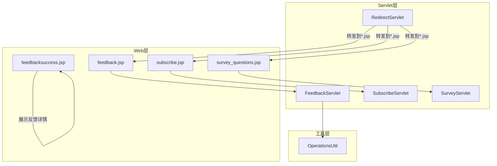
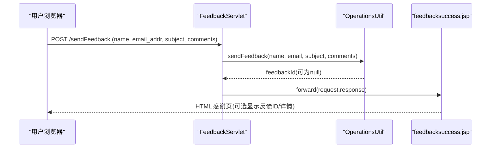
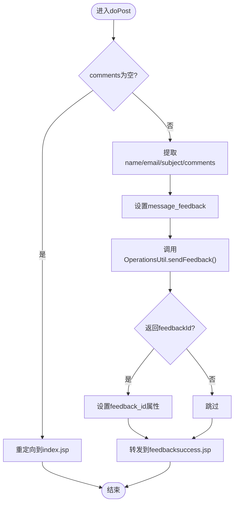
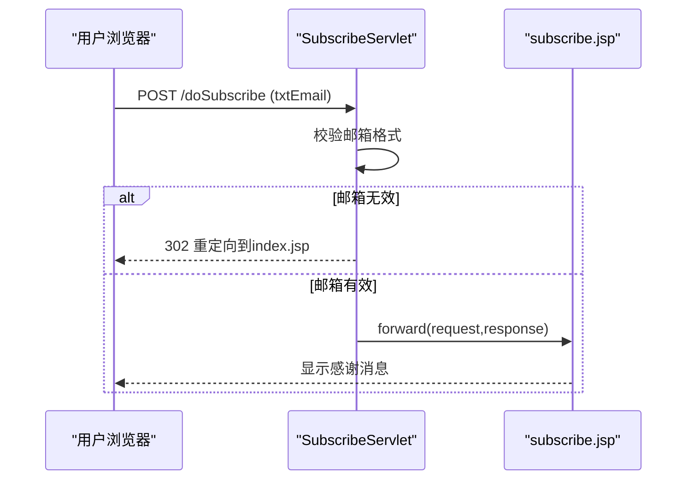
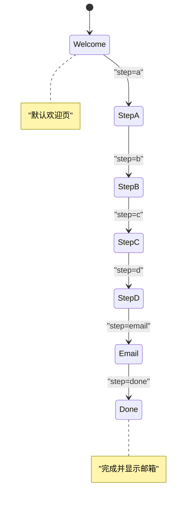
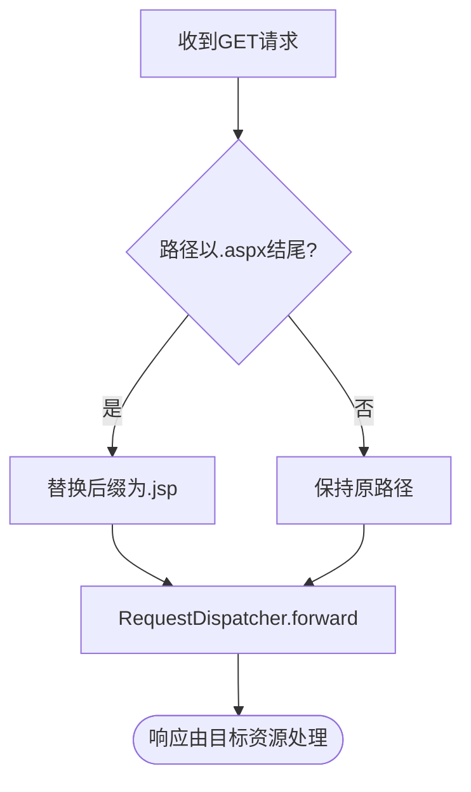
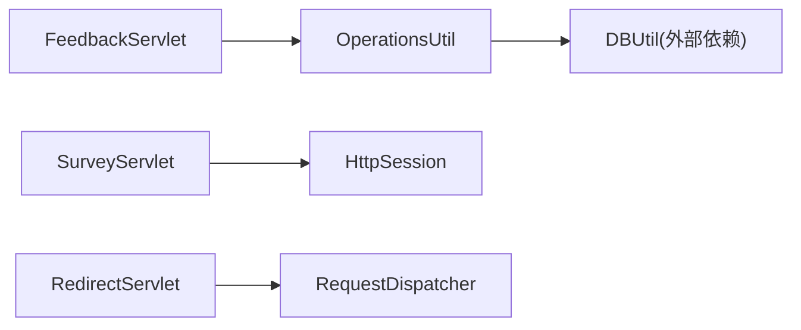

# 工具类Servlet

<cite>
**本文引用的文件**   
- [FeedbackServlet.java](file://src/com/ibm/security/appscan/altoromutual/servlet/FeedbackServlet.java)
- [SubscribeServlet.java](file://src/com/ibm/security/appscan/altoromutual/servlet/SubscribeServlet.java)
- [SurveyServlet.java](file://src/com/ibm/security/appscan/altoromutual/servlet/SurveyServlet.java)
- [RedirectServlet.java](file://src/com/ibm/security/appscan/altoromutual/servlet/RedirectServlet.java)
- [OperationsUtil.java](file://src/com/ibm/security/appscan/altoromutual/util/OperationsUtil.java)
- [feedback.jsp](file://WebContent/feedback.jsp)
- [subscribe.jsp](file://WebContent/subscribe.jsp)
- [survey_questions.jsp](file://WebContent/survey_questions.jsp)
- [feedbacksuccess.jsp](file://WebContent/feedbacksuccess.jsp)
- [index.jsp](file://WebContent/index.jsp)
</cite>

## 目录
1. [引言](#引言)
2. [项目结构](#项目结构)
3. [核心组件](#核心组件)
4. [架构总览](#架构总览)
5. [详细组件分析](#详细组件分析)
6. [依赖关系分析](#依赖关系分析)
7. [性能与可扩展性](#性能与可扩展性)
8. [故障排查指南](#故障排查指南)
9. [结论](#结论)

## 引言
本文件面向“工具类Servlet”的完整技术文档，聚焦以下四个辅助功能：
- FeedbackServlet：反馈收集与提交处理
- SubscribeServlet：邮件订阅管理
- SurveyServlet：多步调查流程
- RedirectServlet：静态页面重定向适配

文档将说明各Servlet的职责边界、请求处理流程、数据流转、错误处理策略与用户体验优化点，并给出关键流程的图示与代码路径引用。

## 项目结构
围绕工具类Servlet的相关文件分布如下：
- Servlet实现位于 src/com/ibm/security/appscan/altoromutual/servlet
- 通用业务工具在 util/OperationsUtil.java
- 前端JSP页面位于 WebContent 下对应路径

图表来源
- [FeedbackServlet.java:42-68](file://src/com/ibm/security/appscan/altoromutual/servlet/FeedbackServlet.java#L42-L68)
- [SubscribeServlet.java:42-53](file://src/com/ibm/security/appscan/altoromutual/servlet/SubscribeServlet.java#L42-L53)
- [SurveyServlet.java:45-104](file://src/com/ibm/security/appscan/altoromutual/servlet/SurveyServlet.java#L45-L104)
- [RedirectServlet.java:49-56](file://src/com/ibm/security/appscan/altoromutual/servlet/RedirectServlet.java#L49-L56)
- [OperationsUtil.java:119-132](file://src/com/ibm/security/appscan/altoromutual/util/OperationsUtil.java#L119-L132)

章节来源
- [FeedbackServlet.java:1-70](file://src/com/ibm/security/appscan/altoromutual/servlet/FeedbackServlet.java#L1-L70)
- [SubscribeServlet.java:1-56](file://src/com/ibm/security/appscan/altoromutual/servlet/SubscribeServlet.java#L1-L56)
- [SurveyServlet.java:1-106](file://src/com/ibm/security/appscan/altoromutual/servlet/SurveyServlet.java#L1-L106)
- [RedirectServlet.java:1-58](file://src/com/ibm/security/appscan/altoromutual/servlet/RedirectServlet.java#L1-L58)

## 核心组件
- FeedbackServlet：接收用户反馈表单POST，校验必要字段，调用工具方法存储反馈（受配置开关控制），转发至成功页。
- SubscribeServlet：校验邮箱格式，设置订阅成功消息，回显订阅页。
- SurveyServlet：基于step参数的多步调查状态机，维护会话步骤，校验Referer与会话一致性，输出HTML内容。
- RedirectServlet：将.aspx请求转换为同名.jsp进行内部转发，兼容旧版静态页面。

章节来源
- [FeedbackServlet.java:35-68](file://src/com/ibm/security/appscan/altoromutual/servlet/FeedbackServlet.java#L35-L68)
- [SubscribeServlet.java:35-53](file://src/com/ibm/security/appscan/altoromutual/servlet/SubscribeServlet.java#L35-L53)
- [SurveyServlet.java:32-104](file://src/com/ibm/security/appscan/altoromutual/servlet/SurveyServlet.java#L32-L104)
- [RedirectServlet.java:36-56](file://src/com/ibm/security/appscan/altoromutual/servlet/RedirectServlet.java#L36-L56)

## 架构总览
工具类Servlet整体遵循“表单/请求 -> Servlet处理 -> 工具层持久化/校验 -> JSP渲染”的模式。SurveyServlet为纯服务端状态机，直接响应HTML；其他Servlet通过RequestDispatcher转发到JSP。

图表来源
- [FeedbackServlet.java:42-68](file://src/com/ibm/security/appscan/altoromutual/servlet/FeedbackServlet.java#L42-L68)
- [OperationsUtil.java:119-132](file://src/com/ibm/security/appscan/altoromutual/util/OperationsUtil.java#L119-L132)
- [feedbacksuccess.jsp:40-91](file://WebContent/feedbacksuccess.jsp#L40-L91)

## 详细组件分析

### FeedbackServlet（反馈收集）
职责
- 接收反馈表单POST
- 校验comments是否为空
- 提取name/email/subject/comments
- 调用OperationsUtil.sendFeedback存储反馈（受配置开关控制）
- 将feedback_id放入request属性
- 转发至feedbacksuccess.jsp

数据处理逻辑
- 当comments为空时，直接重定向到首页
- 当存在name时，设置message_feedback属性
- 根据配置决定是否持久化反馈数据

用户交互流程
- 用户在feedback.jsp填写表单并提交
- 成功后进入feedbacksuccess.jsp，可看到感谢语与可选的反馈详情

错误处理与体验优化
- 缺少comments时快速失败并重定向
- 成功页对邮箱有效性进行提示，并在开启保留功能时展示反馈详情

图表来源
- [FeedbackServlet.java:42-68](file://src/com/ibm/security/appscan/altoromutual/servlet/FeedbackServlet.java#L42-L68)
- [OperationsUtil.java:119-132](file://src/com/ibm/security/appscan/altoromutual/util/OperationsUtil.java#L119-L132)

章节来源
- [FeedbackServlet.java:42-68](file://src/com/ibm/security/appscan/altoromutual/servlet/FeedbackServlet.java#L42-L68)
- [OperationsUtil.java:119-132](file://src/com/ibm/security/appscan/altoromutual/util/OperationsUtil.java#L119-L132)
- [feedback.jsp:46-77](file://WebContent/feedback.jsp#L46-L77)
- [feedbacksuccess.jsp:40-91](file://WebContent/feedbacksuccess.jsp#L40-L91)

### SubscribeServlet（订阅管理）
职责
- 接收订阅表单POST
- 使用正则表达式校验邮箱格式
- 设置订阅成功消息
- 转发回subscribe.jsp以展示结果

数据处理逻辑
- 若email为空或不符合正则，则重定向到首页
- 否则设置message_subscribe属性并回显订阅页

用户交互流程
- 用户在subscribe.jsp输入邮箱并点击订阅
- 后端校验通过后，再次渲染subscribe.jsp并显示感谢信息

错误处理与体验优化
- 前端JS与后端正则双重校验邮箱格式
- 失败时快速重定向避免无效提交

图表来源
- [SubscribeServlet.java:42-53](file://src/com/ibm/security/appscan/altoromutual/servlet/SubscribeServlet.java#L42-L53)
- [subscribe.jsp:36-57](file://WebContent/subscribe.jsp#L36-L57)

章节来源
- [SubscribeServlet.java:35-53](file://src/com/ibm/security/appscan/altoromutual/servlet/SubscribeServlet.java#L35-L53)
- [subscribe.jsp:31-57](file://WebContent/subscribe.jsp#L31-L57)

### SurveyServlet（调查功能）
职责
- 基于step参数驱动的多步调查状态机
- 维护会话中的当前步骤
- 校验Referer与会话步骤一致性，防止跳步或重复
- 直接生成HTML响应

数据处理逻辑
- step取值包括：a/b/c/d/email/done及默认欢迎页
- 每次请求更新session中的surveyStep
- 校验referrer是否来自允许的上一页URL且与session一致

用户交互流程
- 从survey_questions.jsp进入，按步骤选择答案
- 最后一步要求输入邮箱并确认完成

错误处理与体验优化
- 若检测到跳步或重复访问，返回“顺序错误”提示并要求重新开始
- 使用会话保持步骤状态，减少跨页状态丢失风险

图表来源
- [SurveyServlet.java:45-104](file://src/com/ibm/security/appscan/altoromutual/servlet/SurveyServlet.java#L45-L104)

章节来源
- [SurveyServlet.java:45-104](file://src/com/ibm/security/appscan/altoromutual/servlet/SurveyServlet.java#L45-L104)
- [survey_questions.jsp:24-26](file://WebContent/survey_questions.jsp#L24-L26)

### RedirectServlet（重定向处理）
职责
- 将.aspx请求转换为同名.jsp进行内部转发
- 用于兼容旧版.NET静态页面

数据处理逻辑
- 若请求路径以.aspx结尾，替换为同名.jsp
- 使用RequestDispatcher.forward转发

用户交互流程
- 外部链接指向.aspx资源时，自动转为.jsp资源加载

错误处理与体验优化
- 非.aspx请求原样转发，不影响现有路由

图表来源
- [RedirectServlet.java:49-56](file://src/com/ibm/security/appscan/altoromutual/servlet/RedirectServlet.java#L49-L56)

章节来源
- [RedirectServlet.java:49-56](file://src/com/ibm/security/appscan/altoromutual/servlet/RedirectServlet.java#L49-L56)

## 依赖关系分析
- FeedbackServlet依赖OperationsUtil.sendFeedback进行反馈持久化（受配置开关控制）。
- OperationsUtil在启用反馈保留时，对SQL注入防护进行基础转义，并调用DB层存储。
- SurveyServlet依赖HttpSession维持步骤状态，并通过Referer头做简单防跳步校验。
- RedirectServlet仅依赖Servlet API进行路径转换与转发。

图表来源
- [FeedbackServlet.java:57-60](file://src/com/ibm/security/appscan/altoromutual/servlet/FeedbackServlet.java#L57-L60)
- [OperationsUtil.java:119-132](file://src/com/ibm/security/appscan/altoromutual/util/OperationsUtil.java#L119-L132)
- [SurveyServlet.java:89-99](file://src/com/ibm/security/appscan/altoromutual/servlet/SurveyServlet.java#L89-L99)
- [RedirectServlet.java:49-56](file://src/com/ibm/security/appscan/altoromutual/servlet/RedirectServlet.java#L49-L56)

章节来源
- [FeedbackServlet.java:42-68](file://src/com/ibm/security/appscan/altoromutual/servlet/FeedbackServlet.java#L42-L68)
- [OperationsUtil.java:119-132](file://src/com/ibm/security/appscan/altoromutual/util/OperationsUtil.java#L119-L132)
- [SurveyServlet.java:89-99](file://src/com/ibm/security/appscan/altoromutual/servlet/SurveyServlet.java#L89-L99)
- [RedirectServlet.java:49-56](file://src/com/ibm/security/appscan/altoromutual/servlet/RedirectServlet.java#L49-L56)

## 性能与可扩展性
- FeedbackServlet：仅在启用反馈保留时进行数据库写入，未启用时轻量处理，减少IO开销。
- SubscribeServlet：纯内存校验与属性设置，无外部依赖，性能高。
- SurveyServlet：基于会话的状态机，避免频繁数据库访问；建议后续引入缓存或异步任务处理统计。
- RedirectServlet：仅字符串操作与转发，开销极低。

[本节为通用指导，不直接分析具体文件]

## 故障排查指南
常见问题与建议
- 反馈未保存
  - 检查应用配置是否启用反馈保留功能；若未启用，OperationsUtil.sendFeedback将返回null，不会写入数据库。
  - 参考路径：[OperationsUtil.java:119-132](file://src/com/ibm/security/appscan/altoromutual/util/OperationsUtil.java#L119-L132)
- 订阅失败
  - 确认邮箱格式是否符合后端正则；前端JS也会拦截非法邮箱。
  - 参考路径：[SubscribeServlet.java:42-53](file://src/com/ibm/security/appscan/altoromutual/servlet/SubscribeServlet.java#L42-L53), [subscribe.jsp:60-83](file://WebContent/subscribe.jsp#L60-L83)
- 调查被拒绝
  - 若出现“顺序错误”，可能是Referer缺失或不匹配，或会话中步骤不一致。请从头开始。
  - 参考路径：[SurveyServlet.java:89-99](file://src/com/ibm/security/appscan/altoromutual/servlet/SurveyServlet.java#L89-L99)
- 静态页面无法加载
  - 确认请求路径是否正确；RedirectServlet仅对.aspx进行转换。
  - 参考路径：[RedirectServlet.java:49-56](file://src/com/ibm/security/appscan/altoromutual/servlet/RedirectServlet.java#L49-L56)

章节来源
- [OperationsUtil.java:119-132](file://src/com/ibm/security/appscan/altoromutual/util/OperationsUtil.java#L119-L132)
- [SubscribeServlet.java:42-53](file://src/com/ibm/security/appscan/altoromutual/servlet/SubscribeServlet.java#L42-L53)
- [subscribe.jsp:60-83](file://WebContent/subscribe.jsp#L60-L83)
- [SurveyServlet.java:89-99](file://src/com/ibm/security/appscan/altoromutual/servlet/SurveyServlet.java#L89-L99)
- [RedirectServlet.java:49-56](file://src/com/ibm/security/appscan/altoromutual/servlet/RedirectServlet.java#L49-L56)

## 结论
工具类Servlet以清晰职责分工支撑了反馈收集、订阅管理、调查流程与静态页面兼容等辅助能力。其共同模式包括：
- 表单/请求参数校验与快速失败
- 通过RequestDispatcher转发到JSP渲染
- 使用会话或配置开关控制行为
- 在必要时调用工具层进行数据持久化或安全转义

建议在后续迭代中：
- 统一输入校验与错误响应模型
- 将SurveyServlet的状态机抽象为可配置流程引擎
- 增强日志与监控，便于问题定位与性能分析

[本节为总结性内容，不直接分析具体文件]