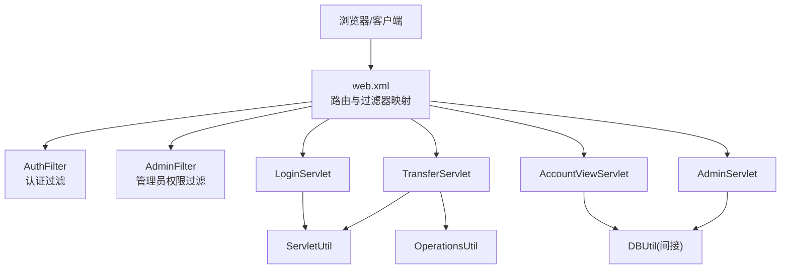
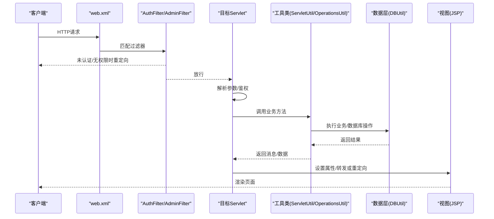
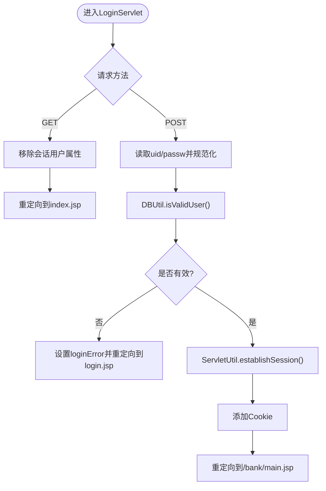
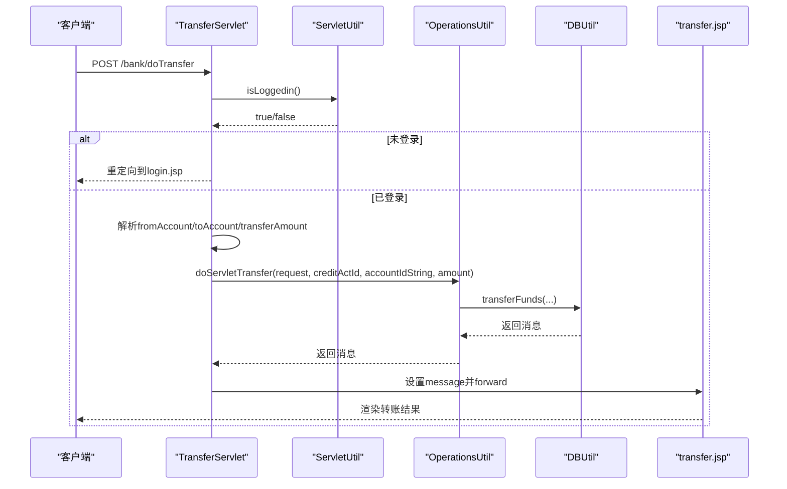
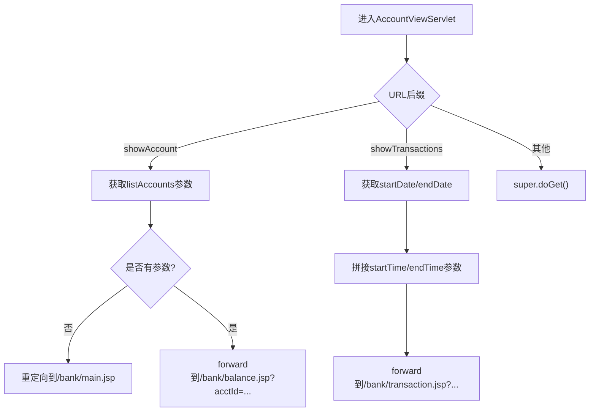
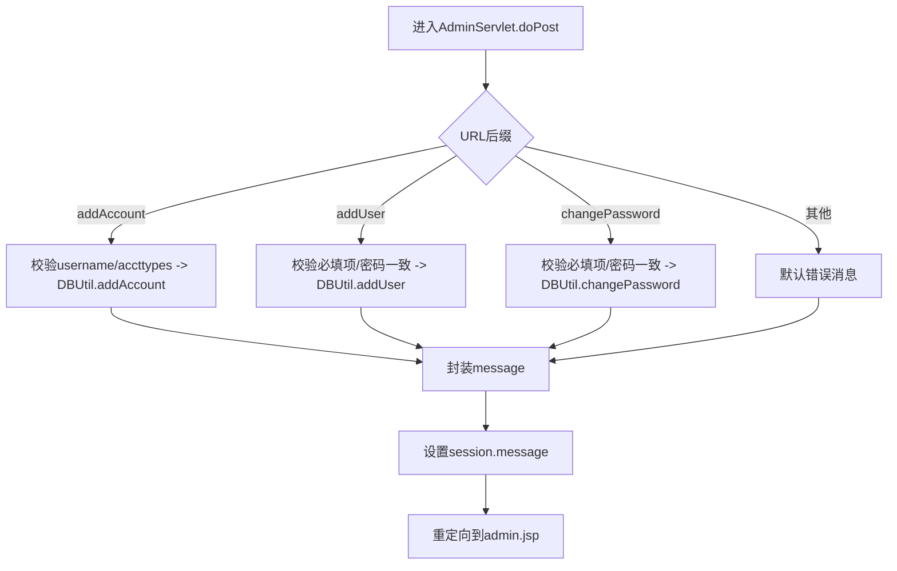
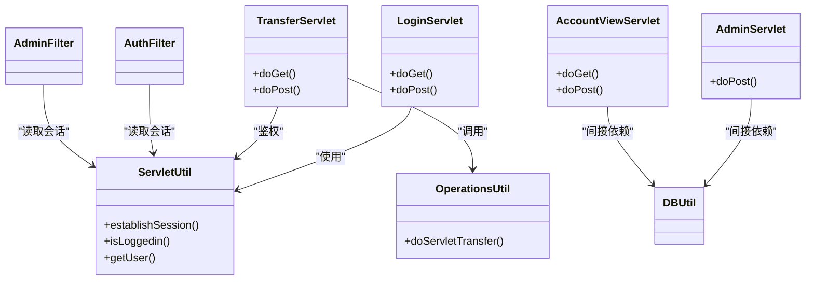

# 控制层（Servlet控制器）

<cite>
**本文引用的文件**   
- [LoginServlet.java](file://src/com/ibm/security/appscan/altoromutual/servlet/LoginServlet.java)
- [TransferServlet.java](file://src/com/ibm/security/appscan/altoromutual/servlet/TransferServlet.java)
- [AccountViewServlet.java](file://src/com/ibm/security/appscan/altoromutual/servlet/AccountViewServlet.java)
- [AdminServlet.java](file://src/com/ibm/security/appscan/altoromutual/servlet/AdminServlet.java)
- [web.xml](file://WebContent/WEB-INF/web.xml)
- [AuthFilter.java](file://src/com/ibm/security/appscan/altoromutual/filter/AuthFilter.java)
- [AdminFilter.java](file://src/com/ibm/security/appscan/altoromutual/filter/AdminFilter.java)
- [ServletUtil.java](file://src/com/ibm/security/appscan/altoromutual/util/ServletUtil.java)
- [OperationsUtil.java](file://src/com/ibm/security/appscan/altoromutual/util/OperationsUtil.java)
</cite>

## 目录
1. [简介](#简介)
2. [项目结构](#项目结构)
3. [核心组件](#核心组件)
4. [架构总览](#架构总览)
5. [详细组件分析](#详细组件分析)
6. [依赖关系分析](#依赖关系分析)
7. [性能与并发注意事项](#性能与并发注意事项)
8. [故障排查指南](#故障排查指南)
9. [结论](#结论)

## 简介
本文面向AltoroJ的控制层，聚焦于基于Servlet的控制器设计模式与请求处理流程。重点覆盖以下Servlet的职责分工与实现要点：
- LoginServlet：用户登录与登出处理
- TransferServlet：转账业务处理
- AccountViewServlet：账户查看与交易查询
- AdminServlet：管理员功能（添加账户、添加用户、修改密码）

文档将说明请求参数解析、业务逻辑调用、响应生成过程，解释Servlet生命周期管理与线程安全问题，并通过流程图展示关键处理路径。

## 项目结构
控制层由一组Servlet组成，配合过滤器完成认证与授权，通过工具类访问数据层与共享会话状态。部署配置集中在web.xml中，定义了Servlet映射、过滤器映射以及全局错误页。

图表来源
- [web.xml:12-50](file://WebContent/WEB-INF/web.xml#L12-L50)
- [web.xml:60-158](file://WebContent/WEB-INF/web.xml#L60-L158)
- [web.xml:159-218](file://WebContent/WEB-INF/web.xml#L159-L218)
- [AuthFilter.java:58-69](file://src/com/ibm/security/appscan/altoromutual/filter/AuthFilter.java#L58-L69)
- [AdminFilter.java:58-80](file://src/com/ibm/security/appscan/altoromutual/filter/AdminFilter.java#L58-L80)

章节来源
- [web.xml:1-227](file://WebContent/WEB-INF/web.xml#L1-L227)

## 核心组件
- LoginServlet：处理GET登出与POST登录；校验用户名/密码，建立会话与Cookie，重定向到银行主页或返回登录页。
- TransferServlet：统一GET/POST处理转账；鉴权后解析参数并调用业务工具类执行转账，转发至转账结果页面。
- AccountViewServlet：根据URL后缀区分“查看账户余额”和“查看交易记录”，组装查询参数并转发至对应JSP。
- AdminServlet：根据URL后缀分发到“添加账户”“添加用户”“修改密码”等管理操作，统一封装消息并跳转管理页面。

章节来源
- [LoginServlet.java:38-107](file://src/com/ibm/security/appscan/altoromutual/servlet/LoginServlet.java#L38-L107)
- [TransferServlet.java:38-70](file://src/com/ibm/security/appscan/altoromutual/servlet/TransferServlet.java#L38-L70)
- [AccountViewServlet.java:35-81](file://src/com/ibm/security/appscan/altoromutual/servlet/AccountViewServlet.java#L35-L81)
- [AdminServlet.java:33-123](file://src/com/ibm/security/appscan/altoromutual/servlet/AdminServlet.java#L33-L123)

## 架构总览
控制层采用经典MVC中的Controller角色：接收HTTP请求、解析参数、调用业务/数据层、设置视图模型并转发或重定向。安全方面通过过滤器在请求到达Servlet前进行认证与授权检查。

图表来源
- [web.xml:12-50](file://WebContent/WEB-INF/web.xml#L12-L50)
- [web.xml:159-218](file://WebContent/WEB-INF/web.xml#L159-L218)
- [AuthFilter.java:58-69](file://src/com/ibm/security/appscan/altoromutual/filter/AuthFilter.java#L58-L69)
- [AdminFilter.java:58-80](file://src/com/ibm/security/appscan/altoromutual/filter/AdminFilter.java#L58-L80)
- [LoginServlet.java:67-101](file://src/com/ibm/security/appscan/altoromutual/servlet/LoginServlet.java#L67-L101)
- [TransferServlet.java:51-67](file://src/com/ibm/security/appscan/altoromutual/servlet/TransferServlet.java#L51-L67)
- [AccountViewServlet.java:48-79](file://src/com/ibm/security/appscan/altoromutual/servlet/AccountViewServlet.java#L48-L79)
- [AdminServlet.java:39-120](file://src/com/ibm/security/appscan/altoromutual/servlet/AdminServlet.java#L39-L120)

## 详细组件分析

### LoginServlet（用户登录/登出）
职责
- GET：清理会话中的用户属性并重定向到首页，实现登出。
- POST：读取表单参数uid/passw，调用DBUtil验证用户；成功后通过ServletUtil建立会话与Cookie，重定向到银行主页；失败时在会话中设置错误信息并重定向回登录页。

关键点
- 会话与会话属性：使用SESSION_ATTR_USER标识已登录用户。
- Cookie：登录后通过establishSession创建包含账户信息的Cookie。
- 异常处理：登录失败抛出异常并在catch中设置loginError；其他异常返回500。

图表来源
- [LoginServlet.java:51-101](file://src/com/ibm/security/appscan/altoromutual/servlet/LoginServlet.java#L51-L101)
- [ServletUtil.java:340-353](file://src/com/ibm/security/appscan/altoromutual/util/ServletUtil.java#L340-L353)

章节来源
- [LoginServlet.java:38-107](file://src/com/ibm/security/appscan/altoromutual/servlet/LoginServlet.java#L38-L107)
- [ServletUtil.java:340-353](file://src/com/ibm/security/appscan/altoromutual/util/ServletUtil.java#L340-L353)

### TransferServlet（转账业务）
职责
- 统一处理GET/POST，先进行登录态检查；解析fromAccount、toAccount、transferAmount；调用OperationsUtil.doServletTransfer执行业务；将消息写入request属性并转发到transfer.jsp。

关键点
- 鉴权：通过ServletUtil.isLoggedin检查会话用户。
- 参数解析：直接解析字符串为long/double；注意潜在的类型转换异常风险。
- 业务委托：转账逻辑封装在OperationsUtil中，便于复用与测试。

图表来源
- [TransferServlet.java:41-67](file://src/com/ibm/security/appscan/altoromutual/servlet/TransferServlet.java#L41-L67)
- [OperationsUtil.java:39-117](file://src/com/ibm/security/appscan/altoromutual/util/OperationsUtil.java#L39-L117)

章节来源
- [TransferServlet.java:38-70](file://src/com/ibm/security/appscan/altoromutual/servlet/TransferServlet.java#L38-L70)
- [OperationsUtil.java:39-117](file://src/com/ibm/security/appscan/altoromutual/util/OperationsUtil.java#L39-L117)

### AccountViewServlet（账户查看与交易查询）
职责
- 根据URL后缀区分两种场景：
  - showAccount：根据listAccounts参数跳转到balance.jsp并携带acctId。
  - showTransactions：根据startDate/endDate参数跳转到transaction.jsp并携带时间范围。

关键点
- URL路由判断：通过endsWith匹配URL后缀决定分支。
- 转发策略：使用RequestDispatcher.forward将请求转发到JSP，并附带查询参数。

图表来源
- [AccountViewServlet.java:48-79](file://src/com/ibm/security/appscan/altoromutual/servlet/AccountViewServlet.java#L48-L79)

章节来源
- [AccountViewServlet.java:35-81](file://src/com/ibm/security/appscan/altoromutual/servlet/AccountViewServlet.java#L35-L81)

### AdminServlet（管理员功能）
职责
- 根据URL后缀分发到三个管理操作：addAccount、addUser、changePassword。
- 对输入进行基本非空校验与密码一致性校验；调用DBUtil执行业务；统一封装消息并跳转admin.jsp。

关键点
- 路由分发：通过endsWith判断具体操作。
- 输入校验：字段非空与密码一致性检查。
- 错误包装：将业务错误以“Error: ...”形式返回给视图。

图表来源
- [AdminServlet.java:39-120](file://src/com/ibm/security/appscan/altoromutual/servlet/AdminServlet.java#L39-L120)

章节来源
- [AdminServlet.java:33-123](file://src/com/ibm/security/appscan/altoromutual/servlet/AdminServlet.java#L33-L123)

## 依赖关系分析
控制层依赖关系如下：
- Servlet之间相互独立，职责清晰。
- 工具类ServletUtil提供会话与Cookie管理、用户信息查询、应用属性初始化等能力。
- OperationsUtil封装转账等业务逻辑，内部依赖DBUtil进行数据操作。
- 过滤器AuthFilter与AdminFilter在请求到达Servlet前进行认证与权限检查。

图表来源
- [LoginServlet.java:38-107](file://src/com/ibm/security/appscan/altoromutual/servlet/LoginServlet.java#L38-L107)
- [TransferServlet.java:38-70](file://src/com/ibm/security/appscan/altoromutual/servlet/TransferServlet.java#L38-L70)
- [AccountViewServlet.java:35-81](file://src/com/ibm/security/appscan/altoromutual/servlet/AccountViewServlet.java#L35-L81)
- [AdminServlet.java:33-123](file://src/com/ibm/security/appscan/altoromutual/servlet/AdminServlet.java#L33-L123)
- [ServletUtil.java:340-373](file://src/com/ibm/security/appscan/altoromutual/util/ServletUtil.java#L340-L373)
- [OperationsUtil.java:39-117](file://src/com/ibm/security/appscan/altoromutual/util/OperationsUtil.java#L39-L117)
- [AuthFilter.java:58-69](file://src/com/ibm/security/appscan/altoromutual/filter/AuthFilter.java#L58-L69)
- [AdminFilter.java:58-80](file://src/com/ibm/security/appscan/altoromutual/filter/AdminFilter.java#L58-L80)

章节来源
- [web.xml:12-50](file://WebContent/WEB-INF/web.xml#L12-L50)
- [web.xml:159-218](file://WebContent/WEB-INF/web.xml#L159-L218)

## 性能与并发注意事项
- Servlet实例化与生命周期
  - 默认情况下容器为每个Servlet维护单例实例，多线程并发处理请求。因此避免在Servlet中使用可变的实例字段保存请求相关状态。
  - 当前各Servlet主要使用局部变量与请求/会话对象，符合线程安全实践。
- 会话与Cookie
  - 登录成功后通过ServletUtil.establishSession设置会话与Cookie；后续请求通过ServletUtil.isLoggedin进行鉴权。
  - 转账操作中从Cookie解析账户列表，若Cookie缺失则回退到会话用户账户列表。
- 参数解析与类型转换
  - TransferServlet直接对参数进行Long.parseDouble与Double.valueOf，存在NumberFormatException风险；建议增加参数校验与异常处理。
- 过滤器链
  - AuthFilter与AdminFilter在请求早期进行鉴权，减少无效请求进入业务逻辑的成本。

[本节为通用指导，不直接分析具体文件]

## 故障排查指南
常见问题与定位思路
- 登录后仍被重定向到登录页
  - 检查AuthFilter是否正确放行；确认会话中是否存在SESSION_ATTR_USER且类型为User。
  - 参考：[AuthFilter.java:58-69](file://src/com/ibm/security/appscan/altoromutual/filter/AuthFilter.java#L58-L69)
- 转账失败或金额无效
  - 检查TransferServlet参数解析是否成功；确认OperationsUtil中creditActId/debitActId/amount校验逻辑。
  - 参考：[TransferServlet.java:51-67](file://src/com/ibm/security/appscan/altoromutual/servlet/TransferServlet.java#L51-L67)、[OperationsUtil.java:94-117](file://src/com/ibm/security/appscan/altoromutual/util/OperationsUtil.java#L94-L117)
- 管理员操作报错
  - 检查AdminServlet输入校验与密码一致性判断；确认DBUtil返回的错误消息。
  - 参考：[AdminServlet.java:43-111](file://src/com/ibm/security/appscan/altoromutual/servlet/AdminServlet.java#L43-L111)
- 账户查看页面未显示数据
  - 检查AccountViewServlet转发参数是否正确；确认JSP端参数读取逻辑。
  - 参考：[AccountViewServlet.java:48-79](file://src/com/ibm/security/appscan/altoromutual/servlet/AccountViewServlet.java#L48-L79)

章节来源
- [AuthFilter.java:58-69](file://src/com/ibm/security/appscan/altoromutual/filter/AuthFilter.java#L58-L69)
- [TransferServlet.java:51-67](file://src/com/ibm/security/appscan/altoromutual/servlet/TransferServlet.java#L51-L67)
- [OperationsUtil.java:94-117](file://src/com/ibm/security/appscan/altoromutual/util/OperationsUtil.java#L94-L117)
- [AdminServlet.java:43-111](file://src/com/ibm/security/appscan/altoromutual/servlet/AdminServlet.java#L43-L111)
- [AccountViewServlet.java:48-79](file://src/com/ibm/security/appscan/altoromutual/servlet/AccountViewServlet.java#L48-L79)

## 结论
AltoroJ的控制层采用清晰的Servlet职责划分，结合过滤器实现统一的认证与授权机制。LoginServlet负责会话建立与Cookie管理，TransferServlet委托业务工具类完成转账，AccountViewServlet按URL路由分发查看请求，AdminServlet集中处理管理员操作。整体架构简洁直观，但在参数校验、异常处理与线程安全方面仍有改进空间。建议在后续迭代中引入更严格的输入校验、统一的异常处理机制与更细粒度的权限控制，以提升系统的健壮性与安全性。