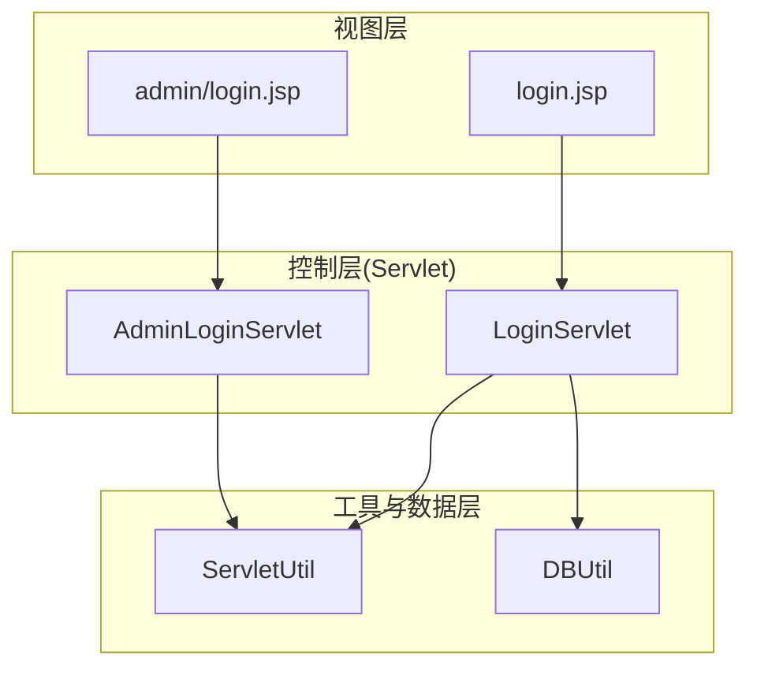
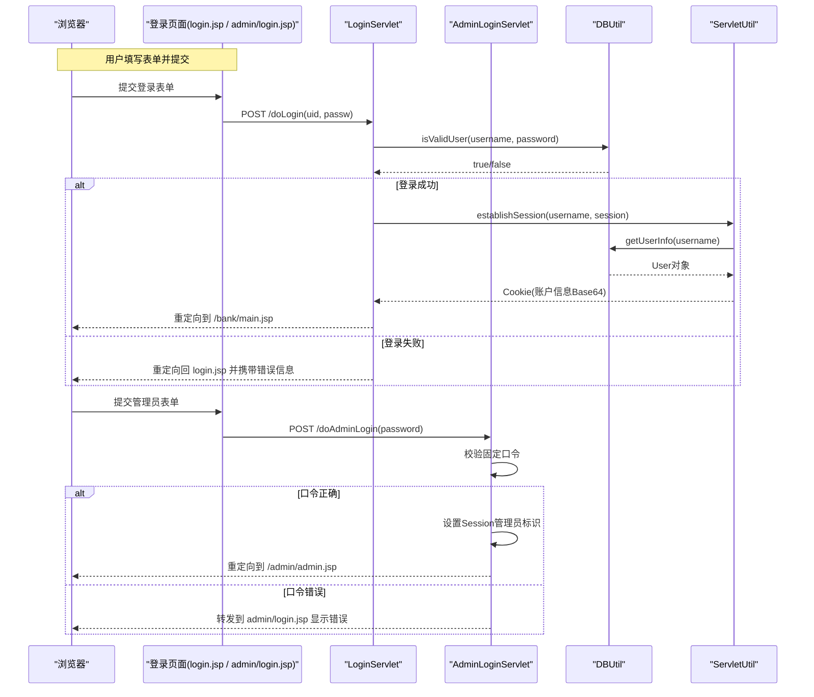
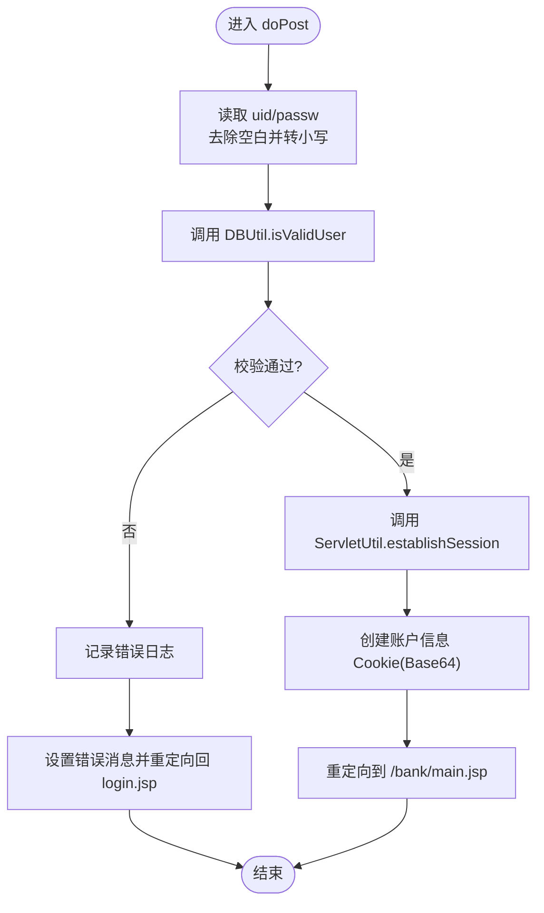
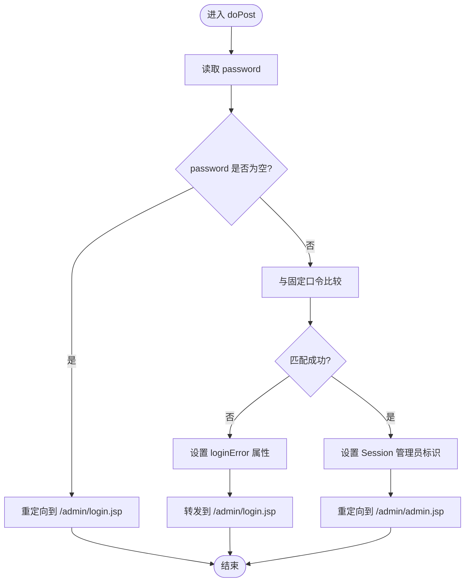
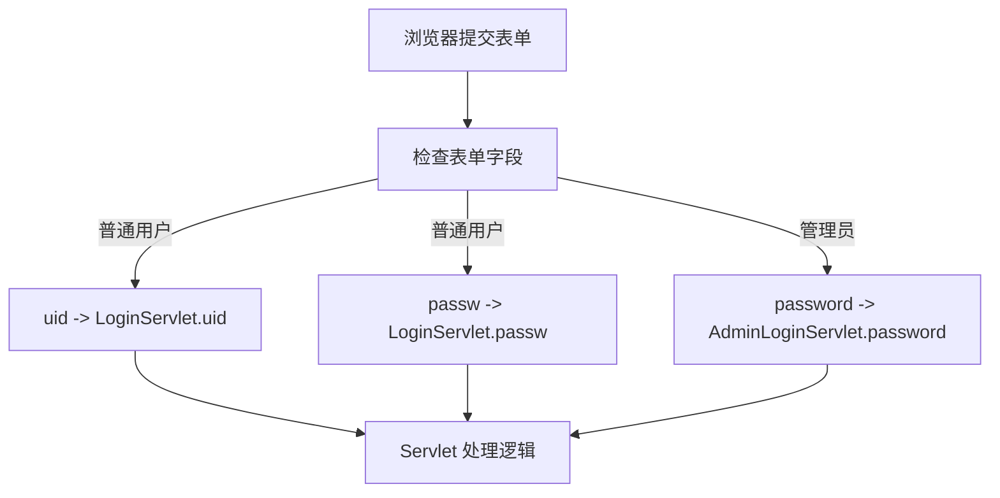
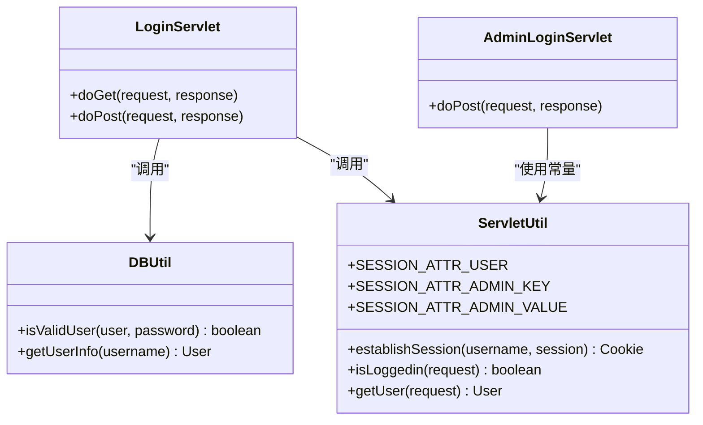

# 用户认证Servlet

<cite>
**本文引用的文件**   
- [LoginServlet.java](file://src/com/ibm/security/appscan/altoromutual/servlet/LoginServlet.java)
- [AdminLoginServlet.java](file://src/com/ibm/security/appscan/altoromutual/servlet/AdminLoginServlet.java)
- [DBUtil.java](file://src/com/ibm/security/appscan/altoromutual/util/DBUtil.java)
- [ServletUtil.java](file://src/com/ibm/security/appscan/altoromutual/util/ServletUtil.java)
- [login.jsp](file://WebContent/login.jsp)
- [admin/login.jsp](file://WebContent/admin/login.jsp)
</cite>

## 目录
1. [简介](#简介)
2. [项目结构](#项目结构)
3. [核心组件](#核心组件)
4. [架构总览](#架构总览)
5. [详细组件分析](#详细组件分析)
6. [依赖关系分析](#依赖关系分析)
7. [性能与可扩展性](#性能与可扩展性)
8. [故障排查指南](#故障排查指南)
9. [结论](#结论)

## 简介
本文件面向用户认证相关的两个 Servlet：普通用户登录的 LoginServlet 与管理员登录的 AdminLoginServlet。文档将深入解释两者的实现机制，包括 HTTP 请求参数处理、用户身份验证流程、会话管理（Session）与 Cookie 设置、重定向逻辑、错误处理与安全注意事项（如密码明文存储、SQL 注入风险、会话劫持防护等）。同时提供流程图与时序图帮助读者理解整体交互过程。

## 项目结构
与用户认证直接相关的代码与页面如下：
- Servlet 层
  - LoginServlet：处理普通用户的登录与登出
  - AdminLoginServlet：处理管理员登录
- 工具与数据访问
  - DBUtil：数据库连接与查询，包含用户校验方法
  - ServletUtil：会话建立、Cookie 操作、登录状态判断等
- 视图层
  - login.jsp：普通用户登录表单
  - admin/login.jsp：管理员登录表单

**图表来源**
- [LoginServlet.java:51-104](file://src/com/ibm/security/appscan/altoromutual/servlet/LoginServlet.java#L51-L104)
- [AdminLoginServlet.java:40-53](file://src/com/ibm/security/appscan/altoromutual/servlet/AdminLoginServlet.java#L40-L53)
- [DBUtil.java:212-232](file://src/com/ibm/security/appscan/altoromutual/util/DBUtil.java#L212-L232)
- [ServletUtil.java:340-353](file://src/com/ibm/security/appscan/altoromutual/util/ServletUtil.java#L340-L353)

**章节来源**
- [LoginServlet.java:33-107](file://src/com/ibm/security/appscan/altoromutual/servlet/LoginServlet.java#L33-L107)
- [AdminLoginServlet.java:30-55](file://src/com/ibm/security/appscan/altoromutual/servlet/AdminLoginServlet.java#L30-L55)
- [DBUtil.java:205-267](file://src/com/ibm/security/appscan/altoromutual/util/DBUtil.java#L205-L267)
- [ServletUtil.java:58-78](file://src/com/ibm/security/appscan/altoromutual/util/ServletUtil.java#L58-L78)

## 核心组件
- LoginServlet
  - doGet：登出逻辑，移除会话中的用户属性并重定向到首页
  - doPost：登录逻辑，读取表单参数，调用 DBUtil 校验用户，成功后通过 ServletUtil 建立会话并返回账户信息 Cookie，最后重定向至银行主页
- AdminLoginServlet
  - doPost：管理员登录逻辑，校验固定口令，通过后在 Session 中写入管理员标识，重定向至管理后台
- DBUtil
  - isValidUser：用户校验，存在硬编码回退逻辑与 SQL 拼接问题
  - getUserInfo：根据用户名获取用户信息
- ServletUtil
  - establishSession：建立用户会话，设置 Session 属性与 Cookie
  - isLoggedin/getUser：会话状态与当前用户读取

**章节来源**
- [LoginServlet.java:51-104](file://src/com/ibm/security/appscan/altoromutual/servlet/LoginServlet.java#L51-L104)
- [AdminLoginServlet.java:40-53](file://src/com/ibm/security/appscan/altoromutual/servlet/AdminLoginServlet.java#L40-L53)
- [DBUtil.java:212-267](file://src/com/ibm/security/appscan/altoromutual/util/DBUtil.java#L212-L267)
- [ServletUtil.java:340-373](file://src/com/ibm/security/appscan/altoromutual/util/ServletUtil.java#L340-L373)

## 架构总览
下图展示了从浏览器提交登录表单到 Servlet 处理、数据库校验、会话建立与重定向的整体流程。

**图表来源**
- [LoginServlet.java:67-104](file://src/com/ibm/security/appscan/altoromutual/servlet/LoginServlet.java#L67-L104)
- [AdminLoginServlet.java:40-53](file://src/com/ibm/security/appscan/altoromutual/servlet/AdminLoginServlet.java#L40-L53)
- [DBUtil.java:212-232](file://src/com/ibm/security/appscan/altoromutual/util/DBUtil.java#L212-L232)
- [ServletUtil.java:340-353](file://src/com/ibm/security/appscan/altoromutual/util/ServletUtil.java#L340-L353)

## 详细组件分析

### LoginServlet 分析
- 功能职责
  - 处理 GET 请求用于登出：移除会话中的用户属性，然后重定向到首页
  - 处理 POST 请求用于登录：读取 uid/passw 参数，进行大小写规范化，调用 DBUtil.isValidUser 校验；成功后通过 ServletUtil.establishSession 建立会话并设置 Cookie，最终重定向到银行主页
- 关键流程
  - 参数处理：uid 去空白并转小写；passw 去空白并转小写（注释说明真实场景通常区分大小写）
  - 用户校验：调用 DBUtil.isValidUser，若失败则记录日志并抛出异常，随后捕获异常设置错误消息并重定向回登录页
  - 会话建立：调用 ServletUtil.establishSession，内部会查询用户信息、生成账户列表 Base64 字符串作为 Cookie，并在 Session 中保存用户对象
  - 重定向：成功后重定向到上下文路径下的 /bank/main.jsp
- 错误处理
  - 登录失败：设置 request/session 的错误属性并重定向回 login.jsp
  - 会话建立异常：打印堆栈并返回 500 错误
- 安全注意
  - 密码以明文形式参与比较（见 DBUtil），存在安全风险
  - Cookie 中包含账户信息的 Base64 字符串，需关注敏感信息泄露风险
  - 未对输入做严格的 SQL 注入防护（见 DBUtil 中的 SQL 拼接）

**图表来源**
- [LoginServlet.java:67-104](file://src/com/ibm/security/appscan/altoromutual/servlet/LoginServlet.java#L67-L104)
- [DBUtil.java:212-232](file://src/com/ibm/security/appscan/altoromutual/util/DBUtil.java#L212-L232)
- [ServletUtil.java:340-353](file://src/com/ibm/security/appscan/altoromutual/util/ServletUtil.java#L340-L353)

**章节来源**
- [LoginServlet.java:51-104](file://src/com/ibm/security/appscan/altoromutual/servlet/LoginServlet.java#L51-L104)
- [DBUtil.java:212-232](file://src/com/ibm/security/appscan/altoromutual/util/DBUtil.java#L212-L232)
- [ServletUtil.java:340-353](file://src/com/ibm/security/appscan/altoromutual/util/ServletUtil.java#L340-L353)

### AdminLoginServlet 分析
- 功能职责
  - 处理管理员登录表单提交，校验固定口令
  - 口令正确：在 Session 中写入管理员标识键值对，重定向到管理后台页面
  - 口令错误或缺失：设置错误消息并通过 RequestDispatcher 转发回管理员登录页
- 关键流程
  - 参数处理：读取 password 参数
  - 口令校验：与固定口令比较
  - 会话设置：设置 SESSION_ATTR_ADMIN_KEY/SESSION_ATTR_ADMIN_VALUE
  - 重定向：成功后跳转到 /admin/admin.jsp
- 错误处理
  - 口令错误或缺失：设置 loginError 属性并转发到 admin/login.jsp

**图表来源**
- [AdminLoginServlet.java:40-53](file://src/com/ibm/security/appscan/altoromutual/servlet/AdminLoginServlet.java#L40-L53)

**章节来源**
- [AdminLoginServlet.java:40-53](file://src/com/ibm/security/appscan/altoromutual/servlet/AdminLoginServlet.java#L40-L53)

### 登录表单与参数映射
- 普通用户登录表单（login.jsp）
  - 表单 action="doLogin"，method="post"
  - 字段名：uid、passw
- 管理员登录表单（admin/login.jsp）
  - 表单 action="doAdminLogin"，method="post"
  - 字段名：password

**图表来源**
- [login.jsp:45-72](file://WebContent/login.jsp#L45-L72)
- [admin/login.jsp:33-40](file://WebContent/admin/login.jsp#L33-L40)

**章节来源**
- [login.jsp:45-72](file://WebContent/login.jsp#L45-L72)
- [admin/login.jsp:33-40](file://WebContent/admin/login.jsp#L33-L40)

## 依赖关系分析
- LoginServlet 依赖
  - DBUtil.isValidUser：用户凭据校验
  - ServletUtil.establishSession：会话建立与 Cookie 生成
- AdminLoginServlet 依赖
  - ServletUtil.SESSION_ATTR_ADMIN_KEY/VALUE：管理员会话标识常量
- DBUtil 依赖
  - 数据库连接与查询（Derby 或外部 DataSource）
  - 用户表 PEOPLE 的结构与数据
- ServletUtil 依赖
  - DBUtil.getUserInfo：获取用户信息
  - Account.toBase64List：账户列表序列化

**图表来源**
- [LoginServlet.java:67-104](file://src/com/ibm/security/appscan/altoromutual/servlet/LoginServlet.java#L67-L104)
- [AdminLoginServlet.java:40-53](file://src/com/ibm/security/appscan/altoromutual/servlet/AdminLoginServlet.java#L40-L53)
- [DBUtil.java:212-267](file://src/com/ibm/security/appscan/altoromutual/util/DBUtil.java#L212-L267)
- [ServletUtil.java:340-373](file://src/com/ibm/security/appscan/altoromutual/util/ServletUtil.java#L340-L373)

**章节来源**
- [LoginServlet.java:33-107](file://src/com/ibm/security/appscan/altoromutual/servlet/LoginServlet.java#L33-L107)
- [AdminLoginServlet.java:30-55](file://src/com/ibm/security/appscan/altoromutual/servlet/AdminLoginServlet.java#L30-L55)
- [DBUtil.java:205-267](file://src/com/ibm/security/appscan/altoromutual/util/DBUtil.java#L205-L267)
- [ServletUtil.java:58-78](file://src/com/ibm/security/appscan/altoromutual/util/ServletUtil.java#L58-L78)

## 性能与可扩展性
- 数据库连接
  - DBUtil 使用单例模式维护连接，支持外部 DataSource 配置；首次连接可能触发数据库初始化
- 会话与 Cookie
  - 每次登录都会查询用户信息与账户列表并生成 Base64 字符串存入 Cookie，频繁登录可能造成额外开销
- 可扩展建议
  - 引入连接池与预编译语句（PreparedStatement）提升安全性与性能
  - 使用更健壮的会话管理机制（如服务器端会话存储、会话超时与固定策略）

[本节为通用指导，不直接分析具体文件]

## 故障排查指南
- 登录失败
  - 现象：重定向回 login.jsp 并显示错误消息
  - 可能原因：DBUtil.isValidUser 返回 false；参数为空或格式不正确
  - 排查步骤：检查 uid/passw 是否传入；确认数据库中存在对应用户与密码
- 管理员登录失败
  - 现象：转发到 admin/login.jsp 并显示“Login failed.”
  - 可能原因：password 为空或与固定口令不一致
  - 排查步骤：确认提交的 password 是否正确；检查 AdminLoginServlet 的口令比较逻辑
- 会话异常
  - 现象：登录成功后出现 500 错误
  - 可能原因：ServletUtil.establishSession 内部抛异常（如数据库查询失败）
  - 排查步骤：查看服务端日志与堆栈；确认数据库可访问且用户信息存在

**章节来源**
- [LoginServlet.java:82-101](file://src/com/ibm/security/appscan/altoromutual/servlet/LoginServlet.java#L82-L101)
- [AdminLoginServlet.java:40-53](file://src/com/ibm/security/appscan/altoromutual/servlet/AdminLoginServlet.java#L40-L53)
- [DBUtil.java:212-232](file://src/com/ibm/security/appscan/altoromutual/util/DBUtil.java#L212-L232)
- [ServletUtil.java:340-353](file://src/com/ibm/security/appscan/altoromutual/util/ServletUtil.java#L340-L353)

## 结论
- LoginServlet 实现了普通用户的登录与登出流程，依赖 DBUtil 进行用户校验，并通过 ServletUtil 建立会话与 Cookie。
- AdminLoginServlet 实现了管理员的简单口令校验与会话标记，适合演示用途但口令强度不足。
- 安全方面需注意：密码明文存储与比较、SQL 注入风险、Cookie 中敏感信息暴露、会话劫持防护不足。建议在后续版本中引入加密存储、参数化查询、安全的会话策略与传输加密。

[本节为总结性内容，不直接分析具体文件]