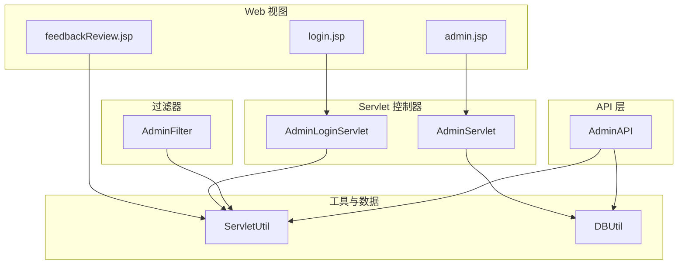
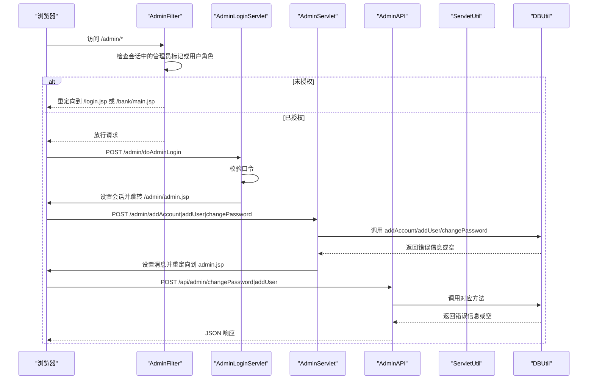
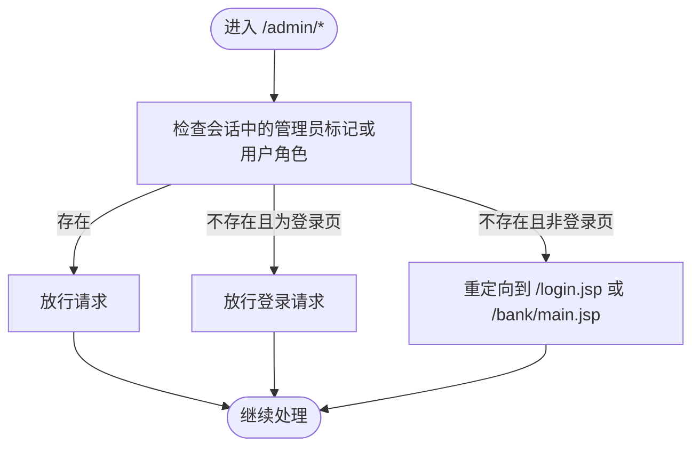
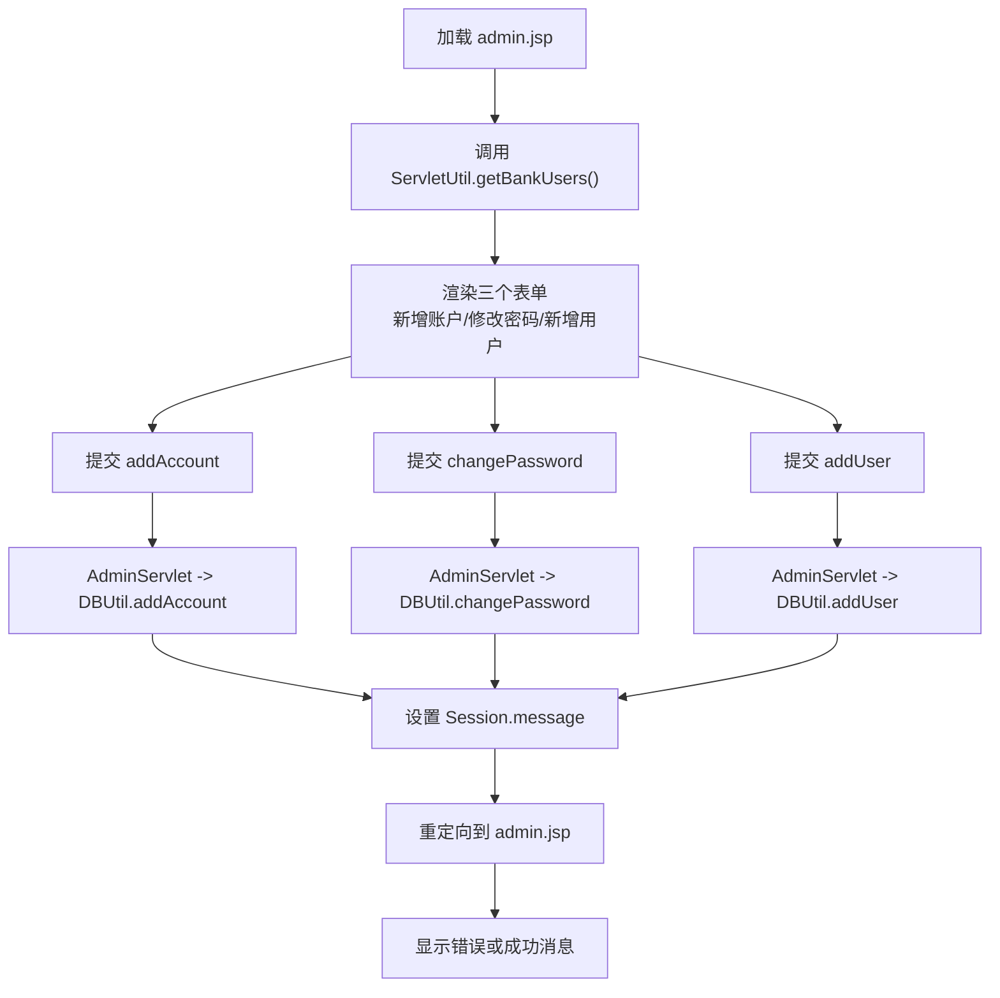
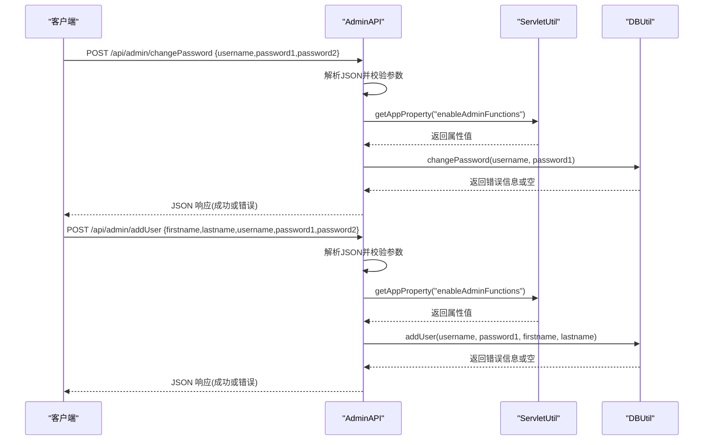
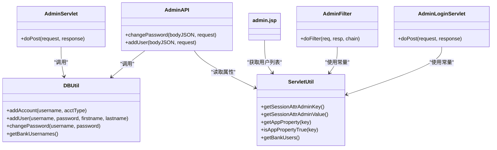

# 管理员Servlet

<cite>
**本文引用的文件**   
- [AdminServlet.java](file://src/com/ibm/security/appscan/altoromutual/servlet/AdminServlet.java)
- [AdminLoginServlet.java](file://src/com/ibm/security/appscan/altoromutual/servlet/AdminLoginServlet.java)
- [AdminFilter.java](file://src/com/ibm/security/appscan/altoromutual/filter/AdminFilter.java)
- [AdminAPI.java](file://src/com/ibm/security/appscan/altoromutual/api/AdminAPI.java)
- [DBUtil.java](file://src/com/ibm/security/appscan/altoromutual/util/DBUtil.java)
- [ServletUtil.java](file://src/com/ibm/security/appscan/altoromutual/util/ServletUtil.java)
- [admin.jsp](file://WebContent/admin/admin.jsp)
- [login.jsp](file://WebContent/admin/login.jsp)
- [feedbackReview.jsp](file://WebContent/admin/feedbackReview.jsp)
</cite>

## 目录
1. [简介](#简介)
2. [项目结构](#项目结构)
3. [核心组件](#核心组件)
4. [架构总览](#架构总览)
5. [详细组件分析](#详细组件分析)
6. [依赖关系分析](#依赖关系分析)
7. [性能与可扩展性](#性能与可扩展性)
8. [故障排查指南](#故障排查指南)
9. [结论](#结论)

## 简介
本文件面向“管理员功能”的 Servlet 及相关组件，系统性梳理并文档化 AltoroJ 的管理员控制台实现。内容涵盖：
- 管理员登录与权限校验流程
- 用户管理（新增用户、修改密码）、账户管理（为用户添加账户）等高级功能
- 管理员界面数据展示与表单交互
- REST API 侧的管理能力（变更密码、新增用户）
- 权限控制机制与安全注意事项
- 操作日志与审计相关现状与建议

## 项目结构
管理员相关代码分布在以下位置：
- Servlet 层：AdminServlet、AdminLoginServlet
- 过滤器层：AdminFilter（统一拦截管理员路径）
- API 层：AdminAPI（RESTful 接口）
- 工具层：DBUtil（数据库访问）、ServletUtil（会话与配置）
- 视图层：admin.jsp、login.jsp、feedbackReview.jsp

图表来源
- [AdminServlet.java:39-120](file://src/com/ibm/security/appscan/altoromutual/servlet/AdminServlet.java#L39-L120)
- [AdminLoginServlet.java:40-53](file://src/com/ibm/security/appscan/altoromutual/servlet/AdminLoginServlet.java#L40-L53)
- [AdminFilter.java:58-80](file://src/com/ibm/security/appscan/altoromutual/filter/AdminFilter.java#L58-L80)
- [AdminAPI.java:17-110](file://src/com/ibm/security/appscan/altoromutual/api/AdminAPI.java#L17-L110)
- [DBUtil.java:472-517](file://src/com/ibm/security/appscan/altoromutual/util/DBUtil.java#L472-L517)
- [ServletUtil.java:200-242](file://src/com/ibm/security/appscan/altoromutual/util/ServletUtil.java#L200-L242)

章节来源
- [AdminServlet.java:1-124](file://src/com/ibm/security/appscan/altoromutual/servlet/AdminServlet.java#L1-L124)
- [AdminLoginServlet.java:1-56](file://src/com/ibm/security/appscan/altoromutual/servlet/AdminLoginServlet.java#L1-L56)
- [AdminFilter.java:1-90](file://src/com/ibm/security/appscan/altoromutual/filter/AdminFilter.java#L1-L90)
- [AdminAPI.java:1-113](file://src/com/ibm/security/appscan/altoromutual/api/AdminAPI.java#L1-L113)
- [DBUtil.java:1-536](file://src/com/ibm/security/appscan/altoromutual/util/DBUtil.java#L1-L536)
- [ServletUtil.java:1-412](file://src/com/ibm/security/appscan/altoromutual/util/ServletUtil.java#L1-L412)
- [admin.jsp:1-193](file://WebContent/admin/admin.jsp#L1-L193)
- [login.jsp:1-59](file://WebContent/admin/login.jsp#L1-L59)
- [feedbackReview.jsp:1-74](file://WebContent/admin/feedbackReview.jsp#L1-L74)

## 核心组件
- AdminServlet：处理管理员控制台的后端表单提交（新增账户、新增用户、修改密码），统一返回消息到 Session 并重定向至 admin.jsp。
- AdminLoginServlet：管理员登录入口，校验硬编码口令并在成功时写入管理员会话标记。
- AdminFilter：对 /admin/* 路径进行访问控制，允许已认证的管理员或具备管理员角色的用户访问，否则重定向到登录页或普通主页。
- AdminAPI：提供 RESTful 接口（POST /api/admin/changePassword、POST /api/admin/addUser），用于程序化管理操作。
- DBUtil：封装数据库连接与基础 CRUD 操作（新增用户、新增账户、修改密码、查询用户列表等）。
- ServletUtil：提供应用属性读取、会话常量、用户列表获取、输出转义等通用能力。
- 视图页面：admin.jsp（管理员控制台主界面）、login.jsp（管理员登录页）、feedbackReview.jsp（反馈查看页）。

章节来源
- [AdminServlet.java:39-120](file://src/com/ibm/security/appscan/altoromutual/servlet/AdminServlet.java#L39-L120)
- [AdminLoginServlet.java:40-53](file://src/com/ibm/security/appscan/altoromutual/servlet/AdminLoginServlet.java#L40-L53)
- [AdminFilter.java:58-80](file://src/com/ibm/security/appscan/altoromutual/filter/AdminFilter.java#L58-L80)
- [AdminAPI.java:20-110](file://src/com/ibm/security/appscan/altoromutual/api/AdminAPI.java#L20-L110)
- [DBUtil.java:429-517](file://src/com/ibm/security/appscan/altoromutual/util/DBUtil.java#L429-L517)
- [ServletUtil.java:200-242](file://src/com/ibm/security/appscan/altoromutual/util/ServletUtil.java#L200-L242)

## 架构总览
管理员控制台采用经典的 MVC 分层：
- 视图层：JSP 负责渲染表单与结果消息
- 控制器层：Servlet 接收请求、参数校验、调用业务逻辑
- 过滤层：AdminFilter 统一拦截管理员路径，执行权限校验
- API 层：AdminAPI 暴露 REST 接口供外部系统调用
- 数据层：DBUtil 直接操作数据库

图表来源
- [AdminFilter.java:58-80](file://src/com/ibm/security/appscan/altoromutual/filter/AdminFilter.java#L58-L80)
- [AdminLoginServlet.java:40-53](file://src/com/ibm/security/appscan/altoromutual/servlet/AdminLoginServlet.java#L40-L53)
- [AdminServlet.java:39-120](file://src/com/ibm/security/appscan/altoromutual/servlet/AdminServlet.java#L39-L120)
- [AdminAPI.java:20-110](file://src/com/ibm/security/appscan/altoromutual/api/AdminAPI.java#L20-L110)
- [DBUtil.java:472-517](file://src/com/ibm/security/appscan/altoromutual/util/DBUtil.java#L472-L517)

## 详细组件分析

### 管理员登录与权限控制
- 登录流程
  - AdminLoginServlet 接收表单 password，若为空则重定向回登录页；若口令不匹配，设置 loginError 并转发到 login.jsp；若匹配，则在会话中写入管理员标记（键值由 ServletUtil 定义），并重定向到 admin.jsp。
- 权限控制
  - AdminFilter 在 doFilter 中检查会话是否包含管理员标记或当前用户为管理员角色；若满足条件则放行；若请求是登录页或登录动作则放行；否则根据用户状态重定向到登录页或银行主页。

图表来源
- [AdminFilter.java:58-80](file://src/com/ibm/security/appscan/altoromutual/filter/AdminFilter.java#L58-L80)
- [AdminLoginServlet.java:40-53](file://src/com/ibm/security/appscan/altoromutual/servlet/AdminLoginServlet.java#L40-L53)
- [ServletUtil.java:60-62](file://src/com/ibm/security/appscan/altoromutual/util/ServletUtil.java#L60-L62)

章节来源
- [AdminLoginServlet.java:40-53](file://src/com/ibm/security/appscan/altoromutual/servlet/AdminLoginServlet.java#L40-L53)
- [AdminFilter.java:58-80](file://src/com/ibm/security/appscan/altoromutual/filter/AdminFilter.java#L58-L80)
- [ServletUtil.java:60-62](file://src/com/ibm/security/appscan/altoromutual/util/ServletUtil.java#L60-L62)

### 管理员控制台（admin.jsp）与表单交互
- 数据展示
  - 通过 ServletUtil.getBankUsers() 获取所有银行用户名，填充下拉框，便于选择目标用户进行操作。
- 表单功能
  - 新增账户：action 指向 addAccount，提交 username 与 accttypes，后端调用 DBUtil.addAccount。
  - 修改密码：action 指向 changePassword，提交 username 与两次密码，前端 JS 校验一致性，后端再次校验。
  - 新增用户：action 指向 addUser，提交 firstname、lastname、username、password1、password2，后端调用 DBUtil.addUser。
- 消息显示
  - 从 Session 中读取 message，若有错误则以红色文本提示；成功则显示“操作完成”。

图表来源
- [admin.jsp:30-186](file://WebContent/admin/admin.jsp#L30-L186)
- [AdminServlet.java:39-120](file://src/com/ibm/security/appscan/altoromutual/servlet/AdminServlet.java#L39-L120)
- [DBUtil.java:472-517](file://src/com/ibm/security/appscan/altoromutual/util/DBUtil.java#L472-L517)
- [ServletUtil.java:240-242](file://src/com/ibm/security/appscan/altoromutual/util/ServletUtil.java#L240-L242)

章节来源
- [admin.jsp:30-186](file://WebContent/admin/admin.jsp#L30-L186)
- [AdminServlet.java:39-120](file://src/com/ibm/security/appscan/altoromutual/servlet/AdminServlet.java#L39-L120)
- [DBUtil.java:472-517](file://src/com/ibm/security/appscan/altoromutual/util/DBUtil.java#L472-L517)
- [ServletUtil.java:240-242](file://src/com/ibm/security/appscan/altoromutual/util/ServletUtil.java#L240-L242)

### 管理员 REST API（AdminAPI）
- 接口定义
  - POST /api/admin/changePassword：解析 JSON body，校验必填字段与密码一致性，调用 DBUtil.changePassword，返回 JSON 响应。
  - POST /api/admin/addUser：解析 JSON body，校验必填字段与密码一致性，调用 DBUtil.addUser，返回 JSON 响应。
- 特性
  - 通过 ServletUtil.getAppProperty("enableAdminFunctions") 控制是否启用管理功能。
  - 错误处理以 HTTP 状态码与 JSON 实体返回。

图表来源
- [AdminAPI.java:20-110](file://src/com/ibm/security/appscan/altoromutual/api/AdminAPI.java#L20-L110)
- [DBUtil.java:495-517](file://src/com/ibm/security/appscan/altoromutual/util/DBUtil.java#L495-L517)
- [ServletUtil.java:200-218](file://src/com/ibm/security/appscan/altoromutual/util/ServletUtil.java#L200-L218)

章节来源
- [AdminAPI.java:20-110](file://src/com/ibm/security/appscan/altoromutual/api/AdminAPI.java#L20-L110)
- [DBUtil.java:495-517](file://src/com/ibm/security/appscan/altoromutual/util/DBUtil.java#L495-L517)
- [ServletUtil.java:200-218](file://src/com/ibm/security/appscan/altoromutual/util/ServletUtil.java#L200-L218)

### 数据库操作（DBUtil）
- 新增账户：addAccount(username, acctType)
- 新增用户：addUser(username, password, firstname, lastname)
- 修改密码：changePassword(username, password)
- 获取银行用户列表：getBankUsernames()

注意：上述 SQL 使用字符串拼接，存在注入风险；建议后续改造为预编译语句与参数绑定。

章节来源
- [DBUtil.java:472-517](file://src/com/ibm/security/appscan/altoromutual/util/DBUtil.java#L472-L517)
- [DBUtil.java:429-449](file://src/com/ibm/security/appscan/altoromutual/util/DBUtil.java#L429-L449)

### 管理员反馈查看（feedbackReview.jsp）
- 当 enableFeedbackRetention 属性为 true 时，展示所有客户反馈条目（ID、姓名、邮箱、主题、内容）。
- 数据来源：ServletUtil.getAllFeedback() -> DBUtil.getFeedback(FEEDBACK_ALL)。

章节来源
- [feedbackReview.jsp:33-69](file://WebContent/admin/feedbackReview.jsp#L33-L69)
- [ServletUtil.java:220-224](file://src/com/ibm/security/appscan/altoromutual/util/ServletUtil.java#L220-L224)
- [DBUtil.java:173-202](file://src/com/ibm/security/appscan/altoromutual/util/DBUtil.java#L173-L202)

## 依赖关系分析
- AdminServlet 依赖 DBUtil 执行数据变更，并通过 Session 传递消息给 admin.jsp。
- AdminLoginServlet 依赖 ServletUtil 提供的会话常量写入管理员标记。
- AdminFilter 依赖 ServletUtil 的会话常量与 User 模型的角色判断。
- AdminAPI 依赖 ServletUtil 的属性读取与 DBUtil 的数据操作。
- admin.jsp 依赖 ServletUtil 获取用户列表。

图表来源
- [AdminServlet.java:39-120](file://src/com/ibm/security/appscan/altoromutual/servlet/AdminServlet.java#L39-L120)
- [AdminLoginServlet.java:40-53](file://src/com/ibm/security/appscan/altoromutual/servlet/AdminLoginServlet.java#L40-L53)
- [AdminFilter.java:58-80](file://src/com/ibm/security/appscan/altoromutual/filter/AdminFilter.java#L58-L80)
- [AdminAPI.java:20-110](file://src/com/ibm/security/appscan/altoromutual/api/AdminAPI.java#L20-L110)
- [DBUtil.java:429-517](file://src/com/ibm/security/appscan/altoromutual/util/DBUtil.java#L429-L517)
- [ServletUtil.java:200-242](file://src/com/ibm/security/appscan/altoromutual/util/ServletUtil.java#L200-L242)

章节来源
- [AdminServlet.java:39-120](file://src/com/ibm/security/appscan/altoromutual/servlet/AdminServlet.java#L39-L120)
- [AdminLoginServlet.java:40-53](file://src/com/ibm/security/appscan/altoromutual/servlet/AdminLoginServlet.java#L40-L53)
- [AdminFilter.java:58-80](file://src/com/ibm/security/appscan/altoromutual/filter/AdminFilter.java#L58-L80)
- [AdminAPI.java:20-110](file://src/com/ibm/security/appscan/altoromutual/api/AdminAPI.java#L20-L110)
- [DBUtil.java:429-517](file://src/com/ibm/security/appscan/altoromutual/util/DBUtil.java#L429-L517)
- [ServletUtil.java:200-242](file://src/com/ibm/security/appscan/altoromutual/util/ServletUtil.java#L200-L242)

## 性能与可扩展性
- 数据库连接
  - DBUtil 支持外部 DataSource 或内置 Derby；可通过 app.properties 控制初始化行为。
- 批量数据处理
  - 当前管理员功能以单条记录为主（新增用户、新增账户、修改密码），未实现批量操作。
- 扩展建议
  - 引入事务与批处理以提升批量操作的原子性与性能。
  - 将 SQL 改为预编译语句，避免注入并提升执行计划复用。
  - 增加分页与索引优化，提高用户列表与反馈列表的查询效率。

[本节为一般性指导，不涉及具体文件分析]

## 故障排查指南
- 管理员无法访问 /admin/*
  - 检查 AdminFilter 是否正确放行；确认会话中是否存在管理员标记或用户角色是否为管理员。
  - 确认 AdminLoginServlet 的口令校验逻辑与 ServletUtil 的会话常量一致。
- 表单提交后无效果
  - 检查 AdminServlet 的请求 URL 后缀匹配（addAccount/addUser/changePassword）。
  - 检查 DBUtil 对应方法的返回值是否为 null；若返回错误字符串，会在 admin.jsp 中以“Error: ...”形式显示。
- REST API 报错
  - 检查请求体是否为合法 JSON；确保必填字段齐全且密码一致。
  - 检查 enableAdminFunctions 属性是否开启；若关闭，API 不会执行数据变更。
- 反馈页面空白
  - 检查 enableFeedbackRetention 属性是否开启；确认 ServletUtil.getAllFeedback() 能正确返回数据。

章节来源
- [AdminFilter.java:58-80](file://src/com/ibm/security/appscan/altoromutual/filter/AdminFilter.java#L58-L80)
- [AdminLoginServlet.java:40-53](file://src/com/ibm/security/appscan/altoromutual/servlet/AdminLoginServlet.java#L40-L53)
- [AdminServlet.java:39-120](file://src/com/ibm/security/appscan/altoromutual/servlet/AdminServlet.java#L39-L120)
- [AdminAPI.java:20-110](file://src/com/ibm/security/appscan/altoromutual/api/AdminAPI.java#L20-L110)
- [feedbackReview.jsp:33-69](file://WebContent/admin/feedbackReview.jsp#L33-L69)

## 结论
AltoroJ 的管理员控制台通过 Servlet 与 Filter 组合实现了基本的管理员登录与权限控制，并提供用户管理、账户管理与反馈查看等功能。REST API 进一步暴露了变更密码与新增用户的接口。当前实现存在若干安全与可维护性问题（如口令硬编码、SQL 拼接、缺少审计日志等），建议在后续迭代中引入更严格的身份认证、参数化查询、操作审计与批量处理能力，以提升安全性与可运维性。

[本节为总结性内容，不涉及具体文件分析]