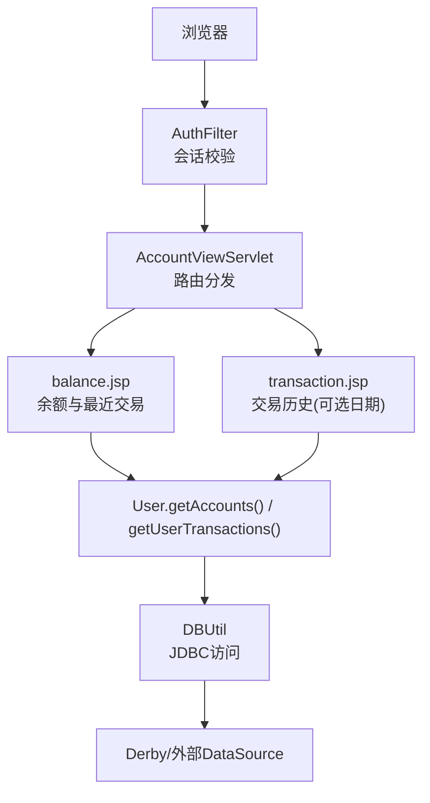
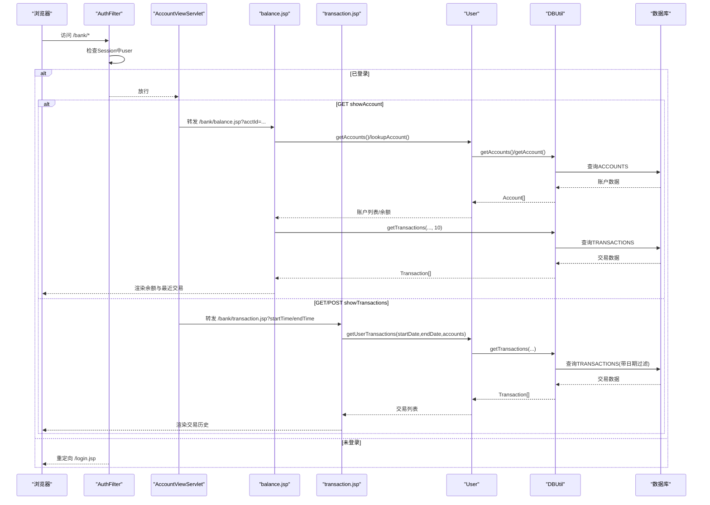
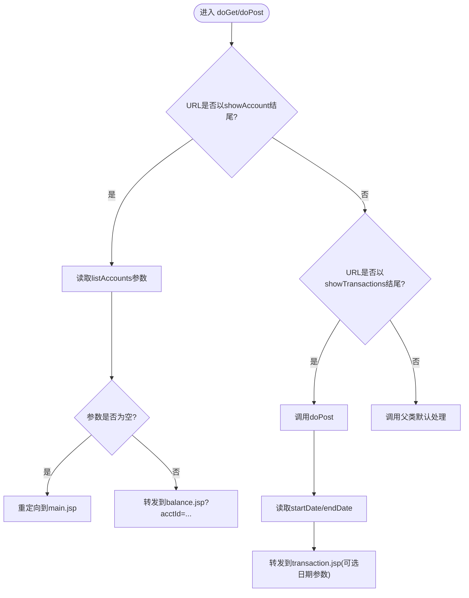
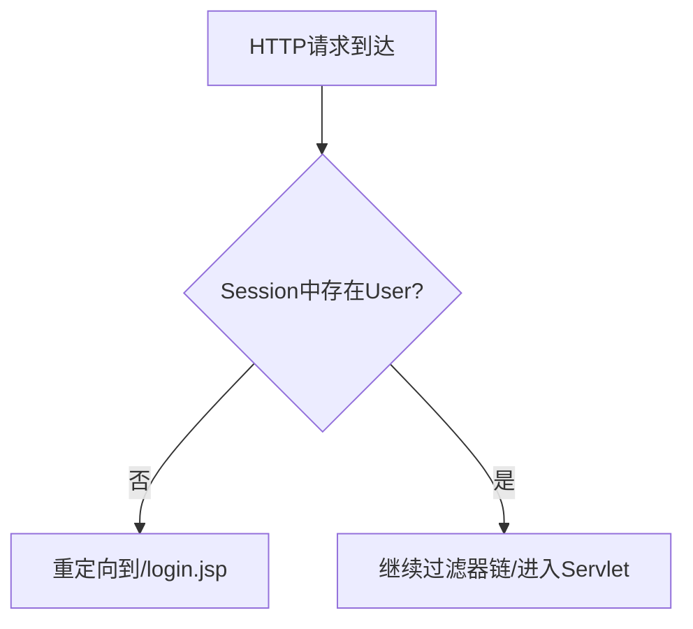
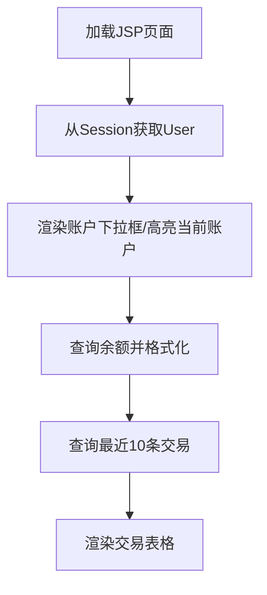
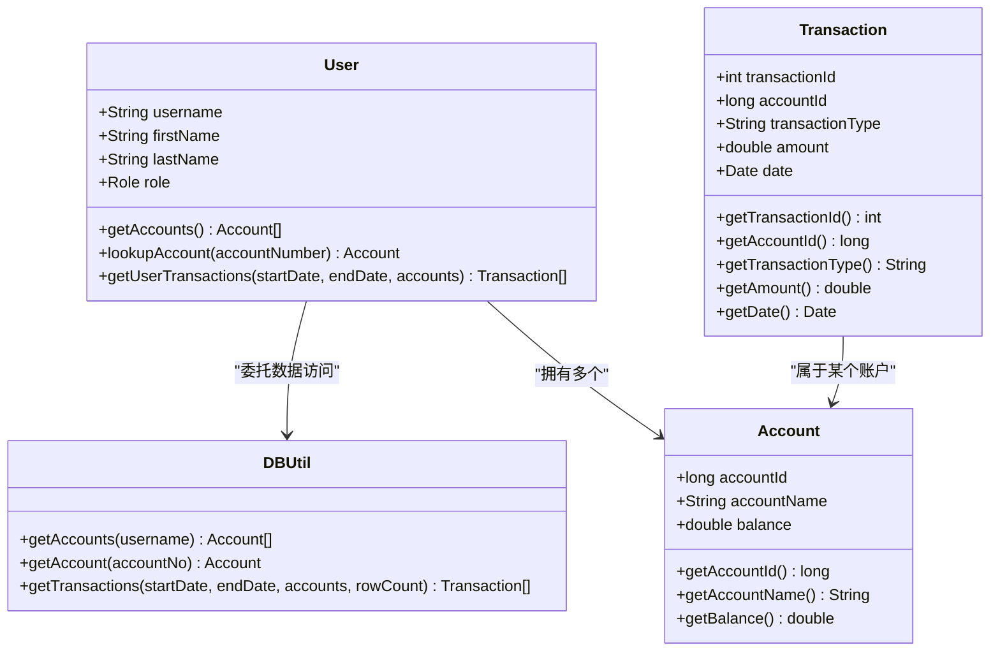
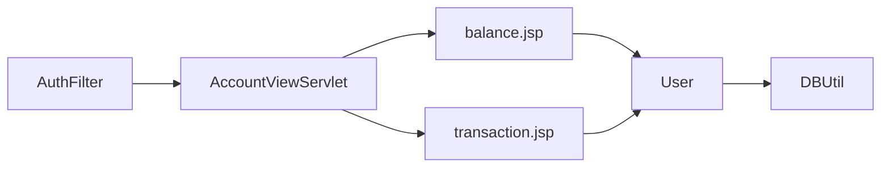

# 账户管理Servlet

<cite>
**本文引用的文件**   
- [AccountViewServlet.java](file://src/com/ibm/security/appscan/altoromutual/servlet/AccountViewServlet.java)
- [User.java](file://src/com/ibm/security/appscan/altoromutual/model/User.java)
- [Account.java](file://src/com/ibm/security/appscan/altoromutual/model/Account.java)
- [Transaction.java](file://src/com/ibm/security/appscan/altoromutual/model/Transaction.java)
- [DBUtil.java](file://src/com/ibm/security/appscan/altoromutual/util/DBUtil.java)
- [AuthFilter.java](file://src/com/ibm/security/appscan/altoromutual/filter/AuthFilter.java)
- [balance.jsp](file://WebContent/bank/balance.jsp)
- [transaction.jsp](file://WebContent/bank/transaction.jsp)
</cite>

## 目录
1. [简介](#简介)
2. [项目结构](#项目结构)
3. [核心组件](#核心组件)
4. [架构总览](#架构总览)
5. [详细组件分析](#详细组件分析)
6. [依赖关系分析](#依赖关系分析)
7. [性能与缓存](#性能与缓存)
8. [故障排查指南](#故障排查指南)
9. [结论](#结论)

## 简介
本文件面向“账户管理”相关 Servlet 的技术文档，重点解析 AccountViewServlet 的功能实现，包括：
- 账户信息查看（余额展示）
- 交易历史显示（按日期范围筛选）
- 从数据库获取账户数据、处理用户权限验证、生成 JSP 视图页面
- 数据访问模式、业务逻辑调用和数据格式化过程
- 分页显示现状与优化建议
- 性能优化策略与缓存机制建议

## 项目结构
围绕账户查看与交易查询的核心路径如下：
- 控制层：AccountViewServlet 负责请求分发与参数转发
- 模型层：User、Account、Transaction 描述领域对象
- 数据访问层：DBUtil 封装 JDBC 操作与连接管理
- 视图层：balance.jsp、transaction.jsp 渲染账户余额与交易列表
- 安全层：AuthFilter 统一拦截未登录访问并跳转登录页

图表来源
- [AccountViewServlet.java:48-79](file://src/com/ibm/security/appscan/altoromutual/servlet/AccountViewServlet.java#L48-L79)
- [AuthFilter.java:58-69](file://src/com/ibm/security/appscan/altoromutual/filter/AuthFilter.java#L58-L69)
- [balance.jsp:37-52](file://WebContent/bank/balance.jsp#L37-L52)
- [transaction.jsp:38-49](file://WebContent/bank/transaction.jsp#L38-L49)
- [User.java:76-105](file://src/com/ibm/security/appscan/altoromutual/model/User.java#L76-L105)
- [DBUtil.java:452-470](file://src/com/ibm/security/appscan/altoromutual/util/DBUtil.java#L452-L470)

章节来源
- [AccountViewServlet.java:48-79](file://src/com/ibm/security/appscan/altoromutual/servlet/AccountViewServlet.java#L48-L79)
- [AuthFilter.java:58-69](file://src/com/ibm/security/appscan/altoromutual/filter/AuthFilter.java#L58-L69)
- [balance.jsp:37-52](file://WebContent/bank/balance.jsp#L37-L52)
- [transaction.jsp:38-49](file://WebContent/bank/transaction.jsp#L38-L49)
- [User.java:76-105](file://src/com/ibm/security/appscan/altoromutual/model/User.java#L76-L105)
- [DBUtil.java:452-470](file://src/com/ibm/security/appscan/altoromutual/util/DBUtil.java#L452-L470)

## 核心组件
- AccountViewServlet：接收 showAccount 与 showTransactions 两类请求，进行参数校验后转发到对应 JSP。
- User：封装当前登录用户的账户集合与交易查询方法，内部委托 DBUtil 完成数据访问。
- Account：账户实体，提供基础属性与 Base64 序列化辅助方法。
- Transaction：交易记录实体，包含时间、金额、类型等字段。
- DBUtil：JDBC 工具类，负责连接管理、建库初始化、账户与交易查询等。
- AuthFilter：在访问银行功能前检查 Session 中的用户对象，未登录则重定向至登录页。
- balance.jsp：展示指定账户的余额与最近10条交易，支持账户切换下拉框。
- transaction.jsp：根据起止日期查询并展示交易历史，前端做日期合法性校验。

章节来源
- [AccountViewServlet.java:48-79](file://src/com/ibm/security/appscan/altoromutual/servlet/AccountViewServlet.java#L48-L79)
- [User.java:76-105](file://src/com/ibm/security/appscan/altoromutual/model/User.java#L76-L105)
- [Account.java:32-48](file://src/com/ibm/security/appscan/altoromutual/model/Account.java#L32-L48)
- [Transaction.java:28-63](file://src/com/ibm/security/appscan/altoromutual/model/Transaction.java#L28-L63)
- [DBUtil.java:452-470](file://src/com/ibm/security/appscan/altoromutual/util/DBUtil.java#L452-L470)
- [AuthFilter.java:58-69](file://src/com/ibm/security/appscan/altoromutual/filter/AuthFilter.java#L58-L69)
- [balance.jsp:37-52](file://WebContent/bank/balance.jsp#L37-L52)
- [transaction.jsp:38-49](file://WebContent/bank/transaction.jsp#L38-L49)

## 架构总览
下图展示了从浏览器发起请求到最终渲染页面的完整流程，以及关键的数据流向。

图表来源
- [AuthFilter.java:58-69](file://src/com/ibm/security/appscan/altoromutual/filter/AuthFilter.java#L58-L69)
- [AccountViewServlet.java:48-79](file://src/com/ibm/security/appscan/altoromutual/servlet/AccountViewServlet.java#L48-L79)
- [balance.jsp:37-52](file://WebContent/bank/balance.jsp#L37-L52)
- [transaction.jsp:38-49](file://WebContent/bank/transaction.jsp#L38-L49)
- [User.java:76-105](file://src/com/ibm/security/appscan/altoromutual/model/User.java#L76-L105)
- [DBUtil.java:375-427](file://src/com/ibm/security/appscan/altoromutual/util/DBUtil.java#L375-L427)

## 详细组件分析

### AccountViewServlet 分析
职责与行为：
- GET /showAccount：校验 listAccounts 参数是否存在；若缺失则重定向到主页面；否则将 acctId 作为查询参数转发到 balance.jsp。
- GET /showTransactions：直接委派给 doPost 处理。
- POST /showTransactions：读取 startDate、endDate 参数，转发到 transaction.jsp 并携带可选的日期参数。

关键点：
- 使用 RequestDispatcher.forward 进行服务端转发，避免客户端二次请求开销。
- 对缺失参数的防御性处理，防止空参导致异常或错误视图。

图表来源
- [AccountViewServlet.java:48-79](file://src/com/ibm/security/appscan/altoromutual/servlet/AccountViewServlet.java#L48-L79)

章节来源
- [AccountViewServlet.java:48-79](file://src/com/ibm/security/appscan/altoromutual/servlet/AccountViewServlet.java#L48-L79)

### 用户权限验证（AuthFilter）
- 在访问银行模块前，检查 Session 中是否存在有效的 User 对象。
- 若不存在或未登录，统一重定向到登录页。
- 通过过滤器集中处理鉴权，降低各 Servlet 的重复代码。

图表来源
- [AuthFilter.java:58-69](file://src/com/ibm/security/appscan/altoromutual/filter/AuthFilter.java#L58-L69)

章节来源
- [AuthFilter.java:58-69](file://src/com/ibm/security/appscan/altoromutual/filter/AuthFilter.java#L58-L69)

### 数据访问模式（DBUtil）
- 连接管理：优先使用外部 DataSource（可通过配置启用），否则回退到内置 Derby 数据库；支持启动时自动初始化表结构与测试数据。
- 账户查询：
  - getAccounts(username)：返回某用户的所有账户数组。
  - getAccount(accountNo)：根据账号查询单个账户信息。
- 交易查询：
  - getTransactions(startDate, endDate, accounts, rowCount)：支持多账户 OR 条件、可选日期范围过滤、结果排序与行数限制。
- 其他：用户信息查询、转账、反馈存储等。

复杂度与注意事项：
- 查询语句为字符串拼接，存在 SQL 注入风险（示例代码注释也指出）。
- 使用 Statement 而非 PreparedStatement，不利于预编译与参数化查询。
- 大结果集场景下需结合 rowCount 限制与分页策略。

章节来源
- [DBUtil.java:99-138](file://src/com/ibm/security/appscan/altoromutual/util/DBUtil.java#L99-L138)
- [DBUtil.java:143-167](file://src/com/ibm/security/appscan/altoromutual/util/DBUtil.java#L143-L167)
- [DBUtil.java:275-293](file://src/com/ibm/security/appscan/altoromutual/util/DBUtil.java#L275-L293)
- [DBUtil.java:375-427](file://src/com/ibm/security/appscan/altoromutual/util/DBUtil.java#L375-L427)
- [DBUtil.java:452-470](file://src/com/ibm/security/appscan/altoromutual/util/DBUtil.java#L452-L470)

### 视图层渲染（balance.jsp 与 transaction.jsp）
- balance.jsp：
  - 从 Session 中取出 User，遍历其账户列表，定位当前选中账户并置顶显示。
  - 使用 Account.getAccount(paramName) 获取余额，并进行货币格式化。
  - 调用 DBUtil.getTransactions 获取最近10条交易并渲染表格。
- transaction.jsp：
  - 从 Session 中取出 User，读取 startTime、endTime 参数。
  - 调用 user.getUserTransactions(startDate, endDate, accounts) 获取交易列表。
  - 前端脚本对日期输入进行基本合法性校验，后端再交由 DBUtil 执行 SQL 过滤。

图表来源
- [balance.jsp:37-52](file://WebContent/bank/balance.jsp#L37-L52)
- [balance.jsp:74-77](file://WebContent/bank/balance.jsp#L74-L77)
- [balance.jsp:103-113](file://WebContent/bank/balance.jsp#L103-L113)
- [transaction.jsp:38-49](file://WebContent/bank/transaction.jsp#L38-L49)

章节来源
- [balance.jsp:37-52](file://WebContent/bank/balance.jsp#L37-L52)
- [balance.jsp:74-77](file://WebContent/bank/balance.jsp#L74-L77)
- [balance.jsp:103-113](file://WebContent/bank/balance.jsp#L103-L113)
- [transaction.jsp:38-49](file://WebContent/bank/transaction.jsp#L38-L49)

### 模型层（User、Account、Transaction）
- User：
  - getAccounts()：委托 DBUtil 获取当前用户所有账户。
  - lookupAccount(Long)：在本地账户列表中查找指定账号。
  - getUserTransactions(String,String,Account[])：委托 DBUtil 获取交易列表。
- Account：
  - 提供账户ID、名称、余额等属性。
  - 提供 Base64 序列化工具方法用于跨层传输（非本次核心流程）。
- Transaction：
  - 交易ID、账户ID、类型、金额、时间等字段。

图表来源
- [User.java:76-105](file://src/com/ibm/security/appscan/altoromutual/model/User.java#L76-L105)
- [Account.java:32-48](file://src/com/ibm/security/appscan/altoromutual/model/Account.java#L32-L48)
- [Transaction.java:28-63](file://src/com/ibm/security/appscan/altoromutual/model/Transaction.java#L28-L63)
- [DBUtil.java:275-293](file://src/com/ibm/security/appscan/altoromutual/util/DBUtil.java#L275-L293)
- [DBUtil.java:375-427](file://src/com/ibm/security/appscan/altoromutual/util/DBUtil.java#L375-L427)
- [DBUtil.java:452-470](file://src/com/ibm/security/appscan/altoromutual/util/DBUtil.java#L452-L470)

章节来源
- [User.java:76-105](file://src/com/ibm/security/appscan/altoromutual/model/User.java#L76-L105)
- [Account.java:32-48](file://src/com/ibm/security/appscan/altoromutual/model/Account.java#L32-L48)
- [Transaction.java:28-63](file://src/com/ibm/security/appscan/altoromutual/model/Transaction.java#L28-L63)
- [DBUtil.java:275-293](file://src/com/ibm/security/appscan/altoromutual/util/DBUtil.java#L275-L293)
- [DBUtil.java:375-427](file://src/com/ibm/security/appscan/altoromutual/util/DBUtil.java#L375-L427)
- [DBUtil.java:452-470](file://src/com/ibm/security/appscan/altoromutual/util/DBUtil.java#L452-L470)

## 依赖关系分析
- AccountViewServlet 依赖：
  - 视图：balance.jsp、transaction.jsp
  - 模型：User（间接通过 JSP 调用）
- 视图层依赖：
  - User 提供账户与交易数据
  - DBUtil 提供底层数据访问
- 安全层依赖：
  - AuthFilter 在 Servlet 之前执行，确保用户已登录

图表来源
- [AccountViewServlet.java:48-79](file://src/com/ibm/security/appscan/altoromutual/servlet/AccountViewServlet.java#L48-L79)
- [balance.jsp:37-52](file://WebContent/bank/balance.jsp#L37-L52)
- [transaction.jsp:38-49](file://WebContent/bank/transaction.jsp#L38-L49)
- [User.java:76-105](file://src/com/ibm/security/appscan/altoromutual/model/User.java#L76-L105)
- [DBUtil.java:275-293](file://src/com/ibm/security/appscan/altoromutual/util/DBUtil.java#L275-L293)
- [AuthFilter.java:58-69](file://src/com/ibm/security/appscan/altoromutual/filter/AuthFilter.java#L58-L69)

章节来源
- [AccountViewServlet.java:48-79](file://src/com/ibm/security/appscan/altoromutual/servlet/AccountViewServlet.java#L48-L79)
- [balance.jsp:37-52](file://WebContent/bank/balance.jsp#L37-L52)
- [transaction.jsp:38-49](file://WebContent/bank/transaction.jsp#L38-L49)
- [User.java:76-105](file://src/com/ibm/security/appscan/altoromutual/model/User.java#L76-L105)
- [DBUtil.java:275-293](file://src/com/ibm/security/appscan/altoromutual/util/DBUtil.java#L275-L293)
- [AuthFilter.java:58-69](file://src/com/ibm/security/appscan/altoromutual/filter/AuthFilter.java#L58-L69)

## 性能与缓存
现状与瓶颈：
- 每次请求均通过 JDBC 直连数据库，无连接池复用（除 DataSource 外）。
- 余额与交易查询未引入缓存，频繁访问可能带来数据库压力。
- 交易查询使用字符串拼接构建 SQL，无法利用预编译优势。
- 前端仅固定显示最近10条交易，交易历史页有 TODO 标记的分页但未实现。

优化建议：
- 连接与资源管理
  - 在生产环境启用容器提供的 DataSource 连接池，避免每次新建连接。
  - 将 DBUtil 的连接获取逻辑改为单例+连接池，减少连接创建开销。
- 查询优化
  - 将 Statement 替换为 PreparedStatement，避免 SQL 注入并提升执行计划重用。
  - 为 ACCOUNTS.ACCOUNT_ID、TRANSACTIONS.ACCOUNTID、TRANSACTIONS.DATE 建立索引，加速查询。
  - 对交易查询增加分页（offset/limit）与合理默认 pageSize（如 20/50）。
- 缓存策略
  - 账户余额缓存：对热点账户余额设置短 TTL 缓存（如 30-60 秒），降低读放大。
  - 交易历史缓存：按账户+日期范围维度缓存查询结果，TTL 可更长（如 5-10 分钟）。
  - 用户账户列表缓存：对用户账户列表进行短期缓存，减少重复查询。
- 视图层优化
  - 将余额与交易数据的格式化逻辑下沉到服务层，减少 JSP 脚本片段。
  - 使用模板引擎替代 JSP 脚本，提高可维护性与性能。

[本节为通用指导，不直接分析具体文件]

## 故障排查指南
常见问题与定位要点：
- 未登录访问被重定向
  - 检查 AuthFilter 是否正确拦截，确认 Session 中是否存在 User 对象。
  - 参考：[AuthFilter.java:58-69](file://src/com/ibm/security/appscan/altoromutual/filter/AuthFilter.java#L58-L69)
- 余额页面空白或报错
  - 检查 acctId 参数是否传递正确，balance.jsp 是否能从 Session 获取 User。
  - 参考：[balance.jsp:37-52](file://WebContent/bank/balance.jsp#L37-L52)
- 交易历史为空或日期无效
  - 检查 transaction.jsp 前端日期校验逻辑与后端 DBUtil 日期格式要求。
  - 参考：[transaction.jsp:38-49](file://WebContent/bank/transaction.jsp#L38-L49)、[DBUtil.java:375-427](file://src/com/ibm/security/appscan/altoromutual/util/DBUtil.java#L375-L427)
- 数据库连接失败
  - 检查 DBUtil 的 DataSource 配置或 Derby 初始化逻辑，确认数据库是否可用。
  - 参考：[DBUtil.java:99-138](file://src/com/ibm/security/appscan/altoromutual/util/DBUtil.java#L99-L138)、[DBUtil.java:143-167](file://src/com/ibm/security/appscan/altoromutual/util/DBUtil.java#L143-L167)

章节来源
- [AuthFilter.java:58-69](file://src/com/ibm/security/appscan/altoromutual/filter/AuthFilter.java#L58-L69)
- [balance.jsp:37-52](file://WebContent/bank/balance.jsp#L37-L52)
- [transaction.jsp:38-49](file://WebContent/bank/transaction.jsp#L38-L49)
- [DBUtil.java:99-138](file://src/com/ibm/security/appscan/altoromutual/util/DBUtil.java#L99-L138)
- [DBUtil.java:143-167](file://src/com/ibm/security/appscan/altoromutual/util/DBUtil.java#L143-L167)
- [DBUtil.java:375-427](file://src/com/ibm/security/appscan/altoromutual/util/DBUtil.java#L375-L427)

## 结论
AccountViewServlet 作为账户查看与交易查询的入口，配合 AuthFilter 的安全校验、User/Account/Transaction 的领域建模、DBUtil 的数据访问能力，以及 balance.jsp/transaction.jsp 的视图渲染，共同实现了账户余额查看与交易历史展示的核心功能。当前实现简洁直观，但在安全性（SQL 注入）、性能（连接与缓存）、可维护性（JSP 脚本）方面仍有改进空间。建议优先推进连接池与索引优化、引入缓存与分页、并将 SQL 改写为参数化查询，以提升系统稳定性与可扩展性。