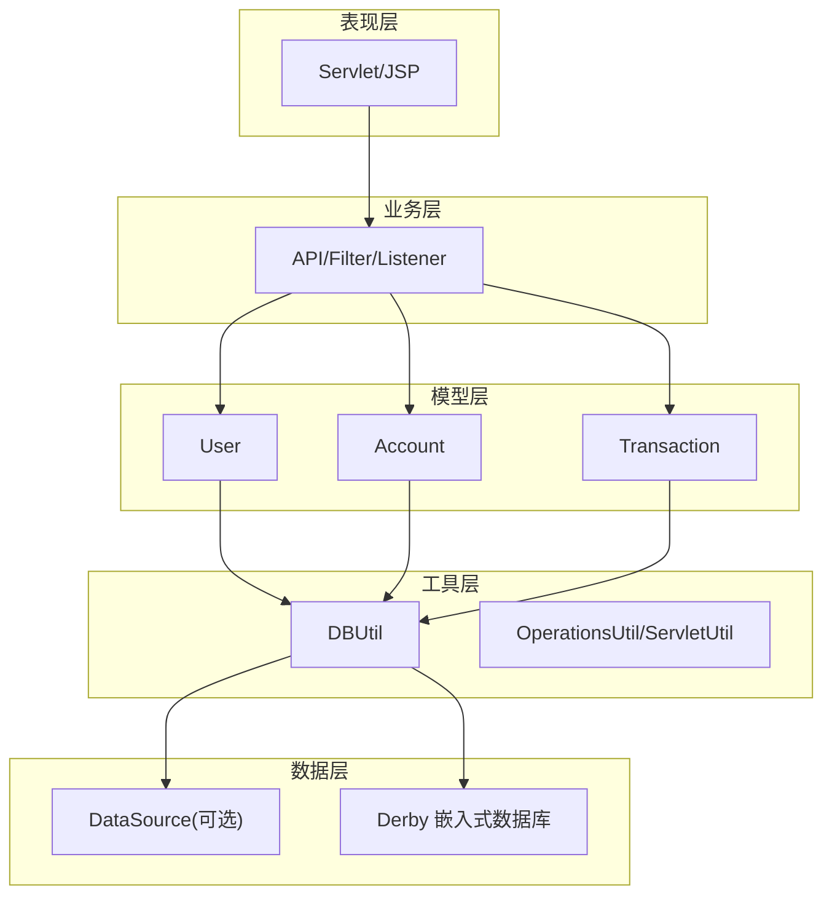
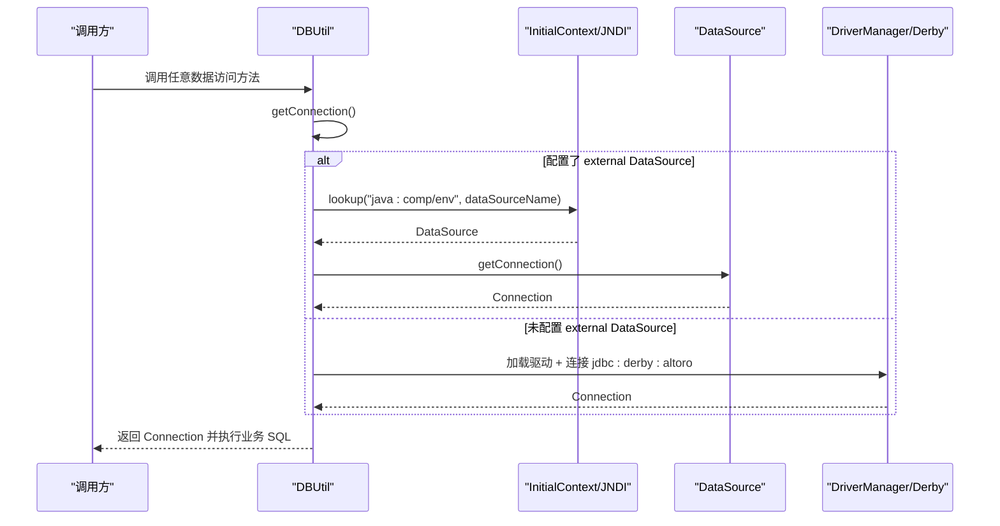
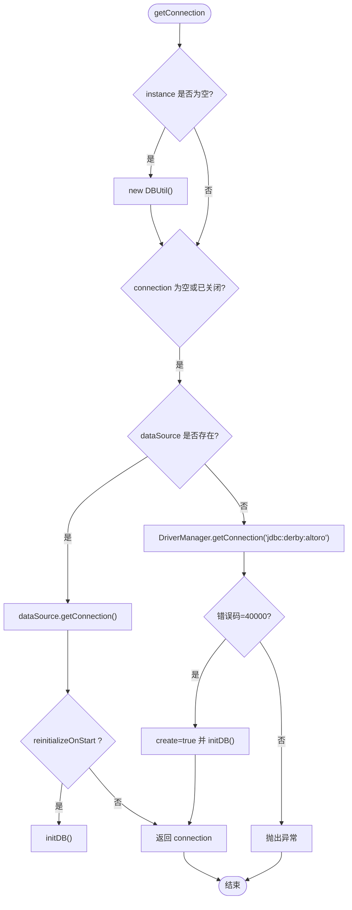
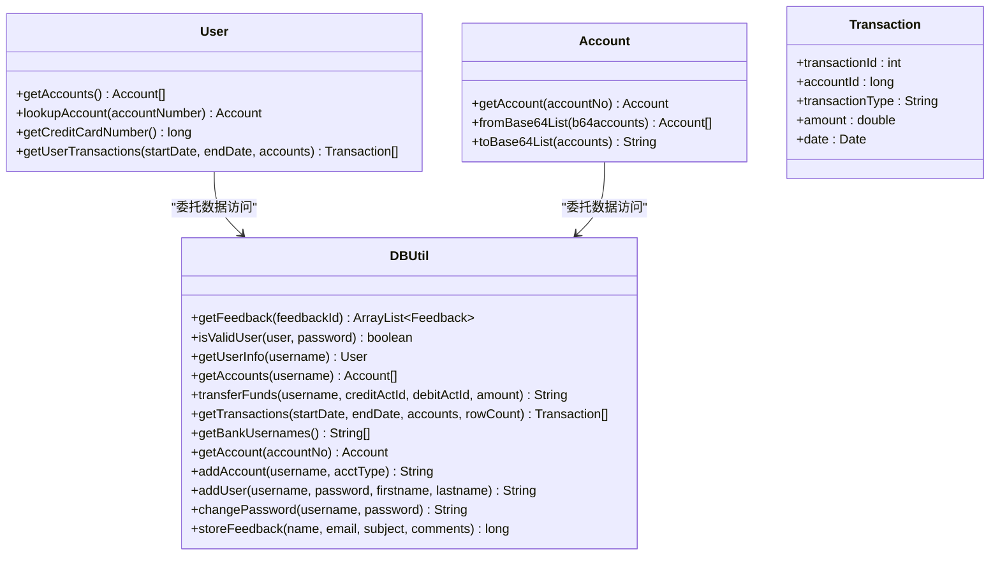
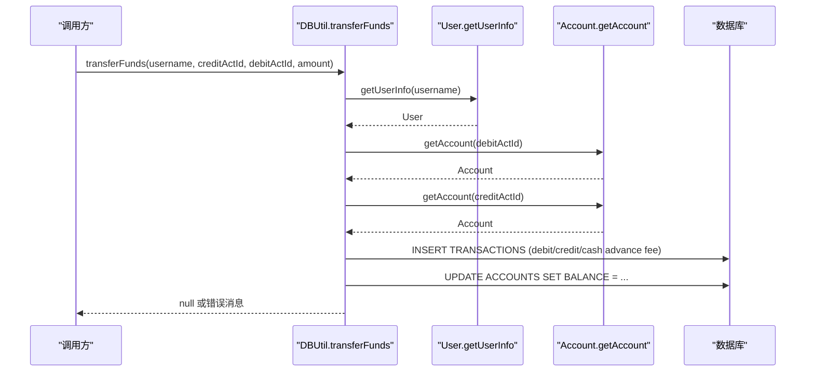
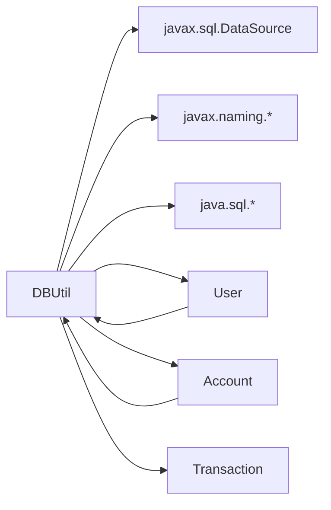
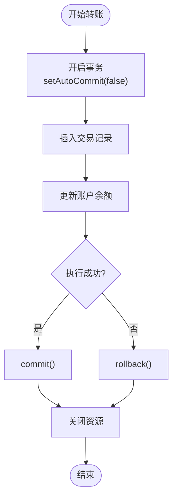
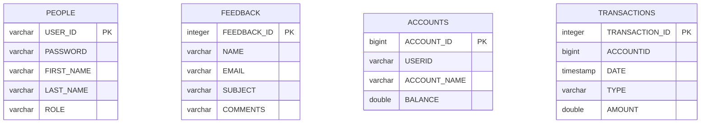

# 数据访问层（DBUtil工具类）

<cite>
**本文引用的文件**   
- [DBUtil.java](file://src/com/ibm/security/appscan/altoromutual/util/DBUtil.java)
- [app.properties](file://WebContent/WEB-INF/app.properties)
- [User.java](file://src/com/ibm/security/appscan/altoromutual/model/User.java)
- [Account.java](file://src/com/ibm/security/appscan/altoromutual/model/Account.java)
- [Transaction.java](file://src/com/ibm/security/appscan/altoromutual/model/Transaction.java)
</cite>

## 目录
1. [简介](#简介)
2. [项目结构](#项目结构)
3. [核心组件](#核心组件)
4. [架构总览](#架构总览)
5. [详细组件分析](#详细组件分析)
6. [依赖关系分析](#依赖关系分析)
7. [性能与连接池优化](#性能与连接池优化)
8. [事务与资源管理](#事务与资源管理)
9. [安全性与加固建议](#安全性与加固建议)
10. [数据库初始化与表结构](#数据库初始化与表结构)
11. [常见问题排查](#常见问题排查)
12. [结论](#结论)

## 简介
本文件聚焦于 AltoroJ 的数据访问层，重点解析 DBUtil 工具类的数据库连接管理、SQL 操作封装、CRUD 方法实现以及安全与性能注意事项。文档同时涵盖连接池配置、事务处理现状与改进建议、结果集处理模式、SQL 注入防护策略和数据加密实践，并给出基于现有代码的可视化架构图和流程图。

## 项目结构
AltoroJ 采用典型的 Web 应用分层：
- 表现层：Servlet/JSP
- 业务层：API/Filter/Listener
- 模型层：User、Account、Transaction、Feedback
- 工具层：DBUtil、OperationsUtil、ServletUtil
- 配置：app.properties、web.xml

DBUtil 位于 util 包，作为统一的数据访问入口，提供用户认证、账户查询、转账、交易记录查询等能力，并通过 JNDI DataSource 或内嵌 Derby 进行连接管理。

图表来源
- [DBUtil.java:45-138](file://src/com/ibm/security/appscan/altoromutual/util/DBUtil.java#L45-L138)
- [User.java:76-106](file://src/com/ibm/security/appscan/altoromutual/model/User.java#L76-L106)
- [Account.java:37-48](file://src/com/ibm/security/appscan/altoromutual/model/Account.java#L37-L48)

章节来源
- [DBUtil.java:1-536](file://src/com/ibm/security/appscan/altoromutual/util/DBUtil.java#L1-L536)
- [app.properties:57-74](file://WebContent/WEB-INF/app.properties#L57-L74)

## 核心组件
- DBUtil：统一的 JDBC 访问封装，负责连接获取、数据库初始化、CRUD 方法实现。
- User/Account/Transaction：领域模型，部分方法委托给 DBUtil 完成数据访问。
- app.properties：外部化配置，控制是否使用外部 DataSource 及启动时是否重建数据库。

章节来源
- [DBUtil.java:45-138](file://src/com/ibm/security/appscan/altoromutual/util/DBUtil.java#L45-L138)
- [User.java:76-106](file://src/com/ibm/security/appscan/altoromutual/model/User.java#L76-L106)
- [Account.java:37-48](file://src/com/ibm/security/appscan/altoromutual/model/Account.java#L37-L48)
- [app.properties:57-74](file://WebContent/WEB-INF/app.properties#L57-L74)

## 架构总览
DBUtil 在首次使用时通过单例模式创建实例，并根据配置选择两种连接路径：
- 外部 DataSource（JNDI）：从应用服务器上下文查找配置的 DataSource，由容器管理连接池。
- 内嵌 Derby：通过 DriverManager 直接连接，必要时自动创建数据库并执行初始化脚本。

图表来源
- [DBUtil.java:71-138](file://src/com/ibm/security/appscan/altoromutual/util/DBUtil.java#L71-L138)

## 详细组件分析

### DBUtil 连接管理与初始化
- 单例与字段
  - instance：DBUtil 单例
  - connection：当前连接（非线程安全）
  - dataSource：JNDI DataSource（可选）
- 构造逻辑
  - 读取配置 database.alternateDataSource
  - 若存在则通过 JNDI 获取 DataSource；否则设置 derby.system.home 并加载 EmbeddedDriver
- 连接获取
  - 优先使用 DataSource.getConnection()
  - 若为 Derby，尝试连接；若错误码 40000（不存在），则以 create=true 方式创建并初始化
  - 当配置 database.reinitializeOnStart 为真时，每次启动都会重建数据库

图表来源
- [DBUtil.java:99-138](file://src/com/ibm/security/appscan/altoromutual/util/DBUtil.java#L99-L138)

章节来源
- [DBUtil.java:56-138](file://src/com/ibm/security/appscan/altoromutual/util/DBUtil.java#L56-L138)
- [app.properties:57-74](file://WebContent/WEB-INF/app.properties#L57-L74)

### CRUD 方法与业务操作
- 反馈查询 getFeedback(feedbackId)
  - 支持按 ID 查询或全部查询
  - 将 ResultSet 映射为 Feedback 对象列表
- 用户认证 isValidUser(user, password)
  - 对 jsmith 做了硬编码回退校验
  - 使用 Statement 拼接 SQL（存在 SQL 注入风险）
- 用户信息查询 getUserInfo(username)
  - 查询 FIRST_NAME/LAST_NAME/ROLE 并映射到 User
- 账户查询 getAccounts(username)/getAccount(accountNo)
  - 根据用户名或账号查询账户信息
- 转账 transferFunds(username, creditActId, debitActId, amount)
  - 计算借/贷金额，信用卡账户特殊处理
  - 插入交易记录，更新余额
  - 未使用事务，存在并发一致性风险
- 交易记录查询 getTransactions(startDate, endDate, accounts, rowCount)
  - 动态拼装条件，支持日期范围和多账户 OR 条件
  - 设置 maxRows 限制返回行数
- 其他辅助方法
  - getBankUsernames()：列出所有用户
  - addAccount()/addUser()/changePassword()/storeFeedback()：基础增改查

图表来源
- [DBUtil.java:173-535](file://src/com/ibm/security/appscan/altoromutual/util/DBUtil.java#L173-L535)
- [User.java:76-106](file://src/com/ibm/security/appscan/altoromutual/model/User.java#L76-L106)
- [Account.java:37-48](file://src/com/ibm/security/appscan/altoromutual/model/Account.java#L37-L48)

章节来源
- [DBUtil.java:173-535](file://src/com/ibm/security/appscan/altoromutual/util/DBUtil.java#L173-L535)
- [User.java:76-106](file://src/com/ibm/security/appscan/altoromutual/model/User.java#L76-L106)
- [Account.java:37-48](file://src/com/ibm/security/appscan/altoromutual/model/Account.java#L37-L48)

### 关键流程时序示例：转账

图表来源
- [DBUtil.java:303-364](file://src/com/ibm/security/appscan/altoromutual/util/DBUtil.java#L303-L364)

## 依赖关系分析
- DBUtil 依赖
  - javax.sql.DataSource、javax.naming.Context/InitialContext（JNDI）
  - java.sql.*（Connection/Statement/ResultSet）
  - 模型类：User、Account、Transaction、Feedback
  - 日志：Log4AltoroJ
  - 配置：ServletUtil.getAppProperty/isAppPropertyTrue
- 模型类依赖
  - User/Account 通过静态方法委托给 DBUtil 完成数据访问
  - Account 使用 Base64 编解码用于序列化账户列表

图表来源
- [DBUtil.java:21-38](file://src/com/ibm/security/appscan/altoromutual/util/DBUtil.java#L21-L38)
- [User.java:23-24](file://src/com/ibm/security/appscan/altoromutual/model/User.java#L23-L24)
- [Account.java:24-26](file://src/com/ibm/security/appscan/altoromutual/model/Account.java#L24-L26)

章节来源
- [DBUtil.java:21-38](file://src/com/ibm/security/appscan/altoromutual/util/DBUtil.java#L21-L38)
- [User.java:23-24](file://src/com/ibm/security/appscan/altoromutual/model/User.java#L23-L24)
- [Account.java:24-26](file://src/com/ibm/security/appscan/altoromutual/model/Account.java#L24-L26)

## 性能与连接池优化
- 当前状态
  - 使用内嵌 Derby 时通过 DriverManager 直连，无连接池
  - 使用外部 DataSource 时由容器管理连接池
- 优化建议
  - 生产环境务必启用外部 DataSource（如 Tomcat JNDI DataSource），利用连接池复用连接
  - 避免在高频路径中重复创建 Statement；可考虑 PreparedStatement 缓存（注意参数化）
  - 合理设置查询最大行数（已有 setMaxRows 用法）
  - 减少不必要的 SELECT *，仅选择必要列
  - 对热点查询增加索引（例如 ACCOUNTID、DATE、USERID）

章节来源
- [DBUtil.java:99-138](file://src/com/ibm/security/appscan/altoromutual/util/DBUtil.java#L99-L138)
- [DBUtil.java:375-427](file://src/com/ibm/security/appscan/altoromutual/util/DBUtil.java#L375-L427)

## 事务与资源管理
- 事务现状
  - transferFunds 中多次 INSERT/UPDATE 未包裹在事务中，存在部分成功导致数据不一致的风险
  - 建议在关键写操作中使用 Connection.setAutoCommit(false)，并在 finally 中 commit/rollback
- 资源释放
  - 当前方法中 Statement/ResultSet 未显式关闭，可能引发连接泄漏
  - 建议使用 try-with-resources 或在 finally 中关闭 Statement 和 ResultSet
- 并发安全
  - 单例 DBUtil 持有单一 Connection，非线程安全；在高并发场景下应改为每请求获取独立连接或使用连接池

图表来源
- [DBUtil.java:303-364](file://src/com/ibm/security/appscan/altoromutual/util/DBUtil.java#L303-L364)

章节来源
- [DBUtil.java:303-364](file://src/com/ibm/security/appscan/altoromutual/util/DBUtil.java#L303-L364)

## 安全性与加固建议
- SQL 注入防护
  - 多处使用 Statement 拼接用户输入，存在 SQL 注入风险（如 isValidUser、getUserInfo、getAccounts、getAccount、addUser/changePassword/addAccount/storeFeedback 等）
  - 建议全面替换为 PreparedStatement，并对输入做白名单校验与长度限制
- 密码存储
  - 明文存储 PASSWORD，建议哈希加盐（如 bcrypt/scrypt）
- 敏感数据传输
  - 传输层使用 HTTPS；避免在 URL/日志中输出敏感信息
- 数据加密
  - 对敏感字段（如信用卡号）在入库前加密，出库后解密；密钥管理使用专用密钥管理服务
- 最小权限原则
  - 数据库账户仅授予必要权限，禁止 DDL/DML 滥用
- 审计与日志
  - 记录关键操作的审计日志（脱敏），便于追踪与合规

章节来源
- [DBUtil.java:212-232](file://src/com/ibm/security/appscan/altoromutual/util/DBUtil.java#L212-L232)
- [DBUtil.java:241-267](file://src/com/ibm/security/appscan/altoromutual/util/DBUtil.java#L241-L267)
- [DBUtil.java:275-293](file://src/com/ibm/security/appscan/altoromutual/util/DBUtil.java#L275-L293)
- [DBUtil.java:452-470](file://src/com/ibm/security/appscan/altoromutual/util/DBUtil.java#L452-L470)
- [DBUtil.java:472-535](file://src/com/ibm/security/appscan/altoromutual/util/DBUtil.java#L472-L535)

## 数据库初始化与表结构
- 初始化时机
  - 首次连接 Derby 且数据库不存在时自动创建
  - 当配置 database.reinitializeOnStart 为真时，每次启动都会重建数据库
- 表结构
  - PEOPLE：用户基本信息（USER_ID/PASSWORD/FIRST_NAME/LAST_NAME/ROLE）
  - FEEDBACK：反馈信息（FEEDBACK_ID/NAME/EMAIL/SUBJECT/COMMENTS）
  - ACCOUNTS：账户信息（ACCOUNT_ID/USERID/ACCOUNT_NAME/BALANCE）
  - TRANSACTIONS：交易记录（TRANSACTION_ID/ACCOUNTID/DATE/TYPE/AMOUNT）
- 初始数据
  - 预置若干用户、账户与交易记录，便于演示

图表来源
- [DBUtil.java:143-167](file://src/com/ibm/security/appscan/altoromutual/util/DBUtil.java#L143-L167)

章节来源
- [DBUtil.java:143-167](file://src/com/ibm/security/appscan/altoromutual/util/DBUtil.java#L143-L167)

## 常见问题排查
- 无法连接外部 DataSource
  - 检查 app.properties 中 database.alternateDataSource 是否与 Tomcat context.xml 一致
  - 确认已部署对应 JDBC 驱动 JAR
- 首次运行数据缺失
  - 首次使用外部 DB 需设置 database.reinitializeOnStart=true 并登录一次以触发初始化
- Derby 数据库不存在
  - 程序会自动以 create=true 创建；若失败请检查 derby.system.home 路径与权限
- 转账后余额不一致
  - 当前未使用事务，建议升级至事务管理；同时检查并发访问与锁竞争

章节来源
- [app.properties:57-74](file://WebContent/WEB-INF/app.properties#L57-L74)
- [DBUtil.java:117-133](file://src/com/ibm/security/appscan/altoromutual/util/DBUtil.java#L117-L133)
- [DBUtil.java:303-364](file://src/com/ibm/security/appscan/altoromutual/util/DBUtil.java#L303-L364)

## 结论
DBUtil 提供了 AltoroJ 的核心数据访问能力，支持外部 DataSource 与内嵌 Derby 双模式。当前实现简洁直观，但存在若干在生产环境不可接受的安全与稳定性问题：SQL 注入、明文密码、缺少事务与资源释放、单连接非线程安全等。建议优先引入 PreparedStatement、事务管理、连接池与安全的密码存储方案，并结合审计与加密机制提升整体安全性与可靠性。