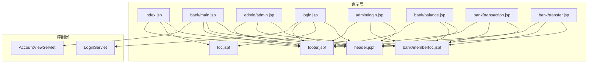
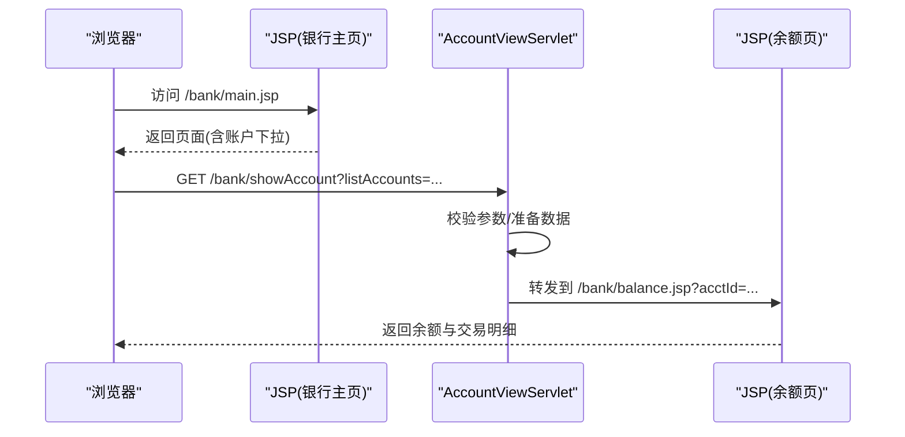
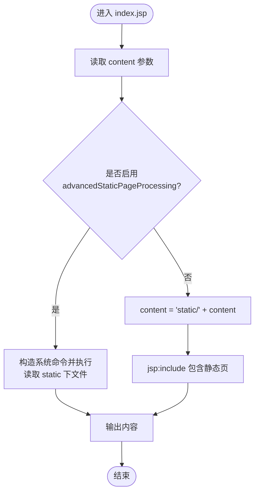
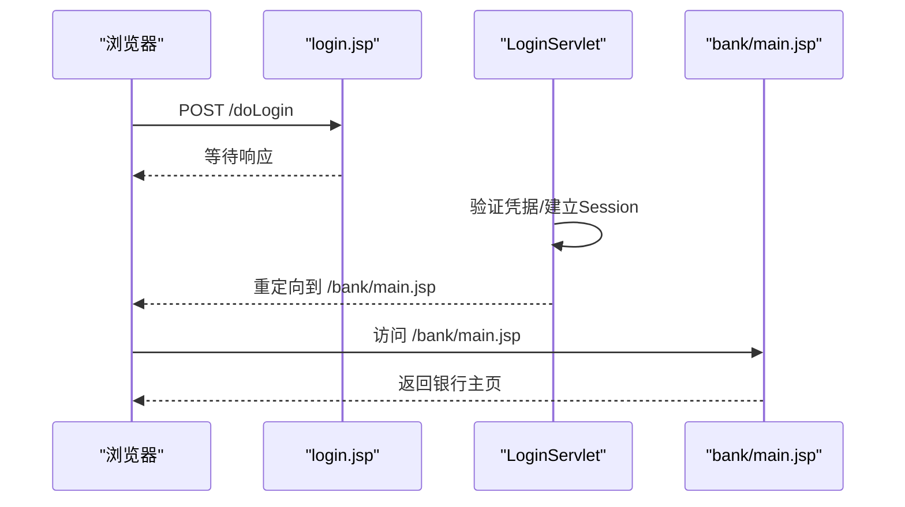
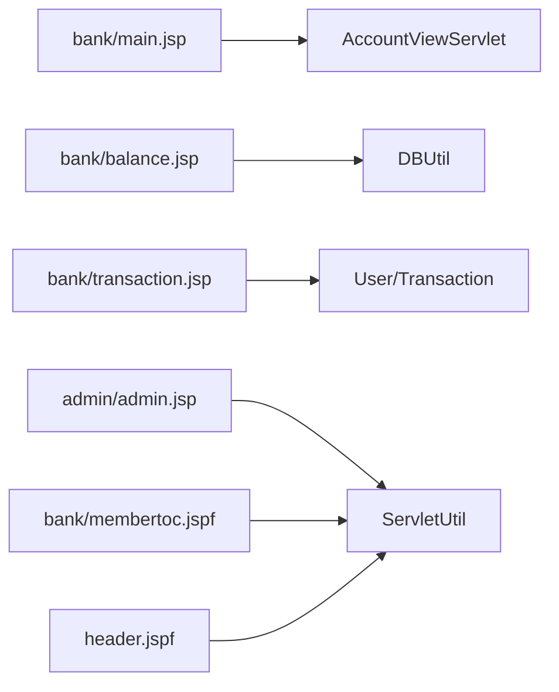

# 表示层（JSP页面）

<cite>
**本文引用的文件**   
- [index.jsp](file://WebContent/index.jsp)
- [header.jspf](file://WebContent/header.jspf)
- [footer.jspf](file://WebContent/footer.jspf)
- [toc.jspf](file://WebContent/toc.jspf)
- [bank/main.jsp](file://WebContent/bank/main.jsp)
- [bank/membertoc.jspf](file://WebContent/bank/membertoc.jspf)
- [admin/admin.jsp](file://WebContent/admin/admin.jsp)
- [login.jsp](file://WebContent/login.jsp)
- [admin/login.jsp](file://WebContent/admin/login.jsp)
- [bank/balance.jsp](file://WebContent/bank/balance.jsp)
- [bank/transaction.jsp](file://WebContent/bank/transaction.jsp)
- [bank/transfer.jsp](file://WebContent/bank/transfer.jsp)
- [AccountViewServlet.java](file://src/com/ibm/security/appscan/altoromutual/servlet/AccountViewServlet.java)
- [LoginServlet.java](file://src/com/ibm/security/appscan/altoromutual/servlet/LoginServlet.java)
- [web.xml](file://WebContent/WEB-INF/web.xml)
- [ServletUtil.java](file://src/com/ibm/security/appscan/altoromutual/util/ServletUtil.java)
</cite>

## 目录
1. [简介](#简介)
2. [项目结构](#项目结构)
3. [核心组件](#核心组件)
4. [架构总览](#架构总览)
5. [详细组件分析](#详细组件分析)
6. [依赖关系分析](#依赖关系分析)
7. [性能考虑](#性能考虑)
8. [故障排查指南](#故障排查指南)
9. [结论](#结论)

## 简介
本文件聚焦于 AltoroJ 的表示层，系统梳理 JSP 页面的组织结构、模板机制与用户界面设计；详细说明主页面 index.jsp、银行主页 bank/main.jsp、管理页面 admin/admin.jsp 等职责；记录 JSP 与 Servlet 的交互方式、数据展示逻辑与表单处理机制；解释 .jspf 模板的重用策略与页面布局；并给出从控制层获取数据并渲染到页面的具体示例路径。同时总结前端安全注意事项与 XSS 防护措施。

## 项目结构
AltoroJ 的表示层位于 WebContent 目录下，采用“页面 + 片段”的组织方式：
- 页面：以 .jsp 结尾，承载业务视图与少量脚本逻辑
- 片段：以 .jspf 结尾，用于复用公共布局与导航（如 header.jspf、footer.jspf、toc.jspf、membertoc.jspf）
- 静态资源：static 目录存放静态 HTML/CSS/JS 等
- 配置：WEB-INF/web.xml 定义 Servlet 映射，控制请求路由

图表来源
- [index.jsp:28-105](file://WebContent/index.jsp#L28-L105)
- [bank/main.jsp:24-68](file://WebContent/bank/main.jsp#L24-L68)
- [admin/admin.jsp:23-193](file://WebContent/admin/admin.jsp#L23-L193)
- [login.jsp:24-104](file://WebContent/login.jsp#L24-L104)
- [admin/login.jsp:24-59](file://WebContent/admin/login.jsp#L24-L59)
- [bank/balance.jsp:26-132](file://WebContent/bank/balance.jsp#L26-L132)
- [bank/transaction.jsp:27-162](file://WebContent/bank/transaction.jsp#L27-L162)
- [bank/transfer.jsp:24-112](file://WebContent/bank/transfer.jsp#L24-L112)
- [AccountViewServlet.java:48-66](file://src/com/ibm/security/appscan/altoromutual/servlet/AccountViewServlet.java#L48-L66)
- [LoginServlet.java:51-70](file://src/com/ibm/security/appscan/altoromutual/servlet/LoginServlet.java#L51-L70)

章节来源
- [index.jsp:28-105](file://WebContent/index.jsp#L28-L105)
- [web.xml:158-199](file://WebContent/WEB-INF/web.xml#L158-L199)

## 核心组件
- 首页入口 index.jsp：根据 content 参数动态包含静态内容或执行高级静态页处理；统一引入 header.jspf、toc.jspf、footer.jspf
- 银行主页 bank/main.jsp：展示欢迎信息、账户下拉列表，提交至 showAccount
- 管理页面 admin/admin.jsp：提供添加账户、修改密码、新增用户等管理功能，受应用属性开关控制
- 登录页面 login.jsp：用户登录表单，提交至 doLogin
- 管理员登录 admin/login.jsp：管理员登录表单，提交至 doAdminLogin
- 账户余额 bank/balance.jsp：显示指定账户的余额与最近交易
- 交易查询 bank/transaction.jsp：按时间范围查询交易
- 转账 bank/transfer.jsp：账户间转账表单

章节来源
- [index.jsp:28-105](file://WebContent/index.jsp#L28-L105)
- [bank/main.jsp:24-68](file://WebContent/bank/main.jsp#L24-L68)
- [admin/admin.jsp:23-193](file://WebContent/admin/admin.jsp#L23-L193)
- [login.jsp:24-104](file://WebContent/login.jsp#L24-L104)
- [admin/login.jsp:24-59](file://WebContent/admin/login.jsp#L24-L59)
- [bank/balance.jsp:26-132](file://WebContent/bank/balance.jsp#L26-L132)
- [bank/transaction.jsp:27-162](file://WebContent/bank/transaction.jsp#L27-L162)
- [bank/transfer.jsp:24-112](file://WebContent/bank/transfer.jsp#L24-L112)

## 架构总览
表示层通过 JSP 组合模板片段构建页面，使用 jsp:include 复用 header.jspf、footer.jspf、toc.jspf、membertoc.jspf。业务数据由 Session 中的 User 对象提供，或由 Servlet 转发后在 JSP 中读取。表单提交通过 web.xml 映射到对应 Servlet，Servlet 完成校验与业务处理后，再转发回 JSP 展示结果。

图表来源
- [bank/main.jsp:43-56](file://WebContent/bank/main.jsp#L43-L56)
- [AccountViewServlet.java:48-66](file://src/com/ibm/security/appscan/altoromutual/servlet/AccountViewServlet.java#L48-L66)
- [bank/balance.jsp:37-57](file://WebContent/bank/balance.jsp#L37-L57)

## 详细组件分析

### 首页 index.jsp
- 功能职责
  - 解析 content 参数，决定加载静态内容或启用高级静态页处理
  - 统一引入 header.jspf、toc.jspf、footer.jspf
- 关键流程
  - 若开启 advancedStaticPageProcessing，则根据操作系统调用系统命令读取 static 目录下的文件
  - 否则将 content 前缀为 static/ 并通过 jsp:include 包含
- 安全注意
  - 直接拼接 content 参数构造系统命令存在严重风险，应禁用该模式或在服务端严格白名单校验

图表来源
- [index.jsp:33-105](file://WebContent/index.jsp#L33-L105)

章节来源
- [index.jsp:28-105](file://WebContent/index.jsp#L28-L105)

### 银行主页 bank/main.jsp
- 功能职责
  - 展示用户欢迎信息与账户选择表单
  - 提交到 showAccount 查看账户详情
- 数据展示
  - 从 Session 中获取 User，遍历 user.getAccounts() 生成下拉选项
- 交互
  - 表单 action="showAccount"，method="get"

章节来源
- [bank/main.jsp:24-68](file://WebContent/bank/main.jsp#L24-L68)

### 管理页面 admin/admin.jsp
- 功能职责
  - 提供“为用户添加账户”“修改密码”“新增用户”三个表单
  - 通过 ServletUtil.getAppProperty("enableAdminFunctions") 控制功能开关
- 数据展示
  - 使用 ServletUtil.getBankUsers() 获取用户列表填充下拉框
  - 从 Session 中读取 message 属性显示错误提示
- 交互
  - 各表单 action 动态绑定到 addAccount/changePass/addUser

章节来源
- [admin/admin.jsp:23-193](file://WebContent/admin/admin.jsp#L23-L193)
- [ServletUtil.java:201-218](file://src/com/ibm/security/appscan/altoromutual/util/ServletUtil.java#L201-L218)
- [ServletUtil.java:240-242](file://src/com/ibm/security/appscan/altoromutual/util/ServletUtil.java#L240-L242)

### 登录页面 login.jsp
- 功能职责
  - 用户登录表单，提交到 doLogin
  - 显示来自 Session 的 loginError 消息
- 交互
  - onsubmit 前端校验用户名/密码非空

章节来源
- [login.jsp:24-104](file://WebContent/login.jsp#L24-L104)

### 管理员登录 admin/login.jsp
- 功能职责
  - 管理员登录表单，提交到 doAdminLogin
  - 显示来自 Request 属性的 loginError 消息

章节来源
- [admin/login.jsp:24-59](file://WebContent/admin/login.jsp#L24-L59)

### 账户余额 bank/balance.jsp
- 功能职责
  - 显示指定账户的余额与最近交易
- 数据展示
  - 从 Session 获取 User，根据 acctId 筛选当前账户
  - 使用 DBUtil.getTransactions(...) 获取最近交易
  - 金额与日期格式化输出
- 交互
  - 账户切换表单提交到 showAccount

章节来源
- [bank/balance.jsp:26-132](file://WebContent/bank/balance.jsp#L26-L132)

### 交易查询 bank/transaction.jsp
- 功能职责
  - 支持按开始/结束日期查询交易
- 数据展示
  - 从 Session 获取 User，调用 user.getUserTransactions(...) 获取交易数组
  - 限制最多显示 100 条
- 交互
  - 前端日期校验，提交到 showTransactions

章节来源
- [bank/transaction.jsp:27-162](file://WebContent/bank/transaction.jsp#L27-L162)

### 转账 bank/transfer.jsp
- 功能职责
  - 账户间转账表单
- 数据展示
  - 从 Session 获取 User，遍历 user.getAccounts() 生成转出/转入账户下拉
- 交互
  - 前端校验转出/转入账户不同且金额大于 0
  - 提交到 doTransfer

章节来源
- [bank/transfer.jsp:24-112](file://WebContent/bank/transfer.jsp#L24-L112)

### 模板机制与页面布局
- header.jspf
  - 定义文档头、站点 Logo、搜索框、登录/登出链接、主导航
  - 根据 Session 中是否存在 user 决定显示“登录/登出”
- footer.jspf
  - 定义页脚版权、隐私与安全声明、状态检查与 REST API 入口
- toc.jspf
  - 面向未登录用户的站点目录（个人/小企业/内部）
- membertoc.jspf
  - 面向已登录用户的会员目录（查看账户、交易、转账、新闻搜索、语言定制）
  - 对管理员角色额外显示“编辑用户”“反馈审核”等管理入口

章节来源
- [header.jspf:22-64](file://WebContent/header.jspf#L22-L64)
- [footer.jspf:21-54](file://WebContent/footer.jspf#L21-L54)
- [toc.jspf:21-57](file://WebContent/toc.jspf#L21-L57)
- [bank/membertoc.jspf:23-57](file://WebContent/bank/membertoc.jspf#L23-L57)

### JSP 与 Servlet 的交互
- 登录流程
  - login.jsp 提交到 doLogin，由 LoginServlet 处理登录/登出
- 账户查看流程
  - bank/main.jsp 提交到 showAccount，由 AccountViewServlet 转发到 bank/balance.jsp
- 路由配置
  - web.xml 中定义了 doLogin、logout.jsp、bank/showAccount、bank/doTransfer、bank/showTransactions 等映射

图表来源
- [login.jsp:45-72](file://WebContent/login.jsp#L45-L72)
- [LoginServlet.java:51-70](file://src/com/ibm/security/appscan/altoromutual/servlet/LoginServlet.java#L51-L70)
- [web.xml:158-166](file://WebContent/WEB-INF/web.xml#L158-L166)

章节来源
- [web.xml:158-199](file://WebContent/WEB-INF/web.xml#L158-L199)
- [LoginServlet.java:51-70](file://src/com/ibm/security/appscan/altoromutual/servlet/LoginServlet.java#L51-L70)
- [AccountViewServlet.java:48-66](file://src/com/ibm/security/appscan/altoromutual/servlet/AccountViewServlet.java#L48-L66)

### 从控制层获取数据并渲染到页面（示例路径）
- 示例一：在银行主页渲染用户账户列表
  - 数据来源：Session 中的 User 对象
  - 渲染位置：bank/main.jsp 中遍历 user.getAccounts() 生成 <option>
  - 参考路径：[bank/main.jsp:49-53](file://WebContent/bank/main.jsp#L49-L53)
- 示例二：在余额页渲染最近交易
  - 数据来源：DBUtil.getTransactions(...)
  - 渲染位置：bank/balance.jsp 中循环输出交易行
  - 参考路径：[bank/balance.jsp:103-112](file://WebContent/bank/balance.jsp#L103-L112)
- 示例三：在转账页渲染账户下拉
  - 数据来源：Session 中的 User 对象
  - 渲染位置：bank/transfer.jsp 中分别生成 fromAccount/toAccount 下拉
  - 参考路径：[bank/transfer.jsp:67-85](file://WebContent/bank/transfer.jsp#L67-L85)

章节来源
- [bank/main.jsp:49-53](file://WebContent/bank/main.jsp#L49-L53)
- [bank/balance.jsp:103-112](file://WebContent/bank/balance.jsp#L103-L112)
- [bank/transfer.jsp:67-85](file://WebContent/bank/transfer.jsp#L67-L85)

## 依赖关系分析
- 页面与模板
  - 所有主要页面均通过 jsp:include 引入 header.jspf、footer.jspf
  - 普通页面引入 toc.jspf，会员页面引入 membertoc.jspf
- 页面与工具类
  - admin/admin.jsp 依赖 ServletUtil 获取用户列表与应用属性
  - membertoc.jspf 依赖 ServletUtil 读取特殊链接配置
- 页面与 Servlet
  - bank/main.jsp -> AccountViewServlet -> bank/balance.jsp
  - login.jsp -> LoginServlet
  - bank/transfer.jsp -> TransferServlet（由 web.xml 映射）
  - bank/transaction.jsp -> AccountViewServlet（showTransactions）

图表来源
- [bank/main.jsp:43-56](file://WebContent/bank/main.jsp#L43-L56)
- [AccountViewServlet.java:48-66](file://src/com/ibm/security/appscan/altoromutual/servlet/AccountViewServlet.java#L48-L66)
- [bank/balance.jsp:103-112](file://WebContent/bank/balance.jsp#L103-L112)
- [bank/transaction.jsp:38-49](file://WebContent/bank/transaction.jsp#L38-L49)
- [admin/admin.jsp:28-33](file://WebContent/admin/admin.jsp#L28-L33)
- [bank/membertoc.jspf:40-42](file://WebContent/bank/membertoc.jspf#L40-L42)
- [header.jspf:1-2](file://WebContent/header.jspf#L1-L2)

章节来源
- [web.xml:158-199](file://WebContent/WEB-INF/web.xml#L158-L199)
- [ServletUtil.java:201-218](file://src/com/ibm/security/appscan/altoromutual/util/ServletUtil.java#L201-L218)
- [ServletUtil.java:240-242](file://src/com/ibm/security/appscan/altoromutual/util/ServletUtil.java#L240-L242)

## 性能考虑
- 模板复用
  - 使用 .jspf 减少重复代码，提升可维护性
- 数据量控制
  - 交易列表限制最多显示 100 条，避免大表渲染导致卡顿
- 缓存控制
  - membertoc.jspf 设置 Expires/Cache-Control/Pragma 为不缓存，确保会员菜单实时性
- 静态内容加载
  - index.jsp 的高级静态页处理会执行系统命令，应避免在生产环境启用

章节来源
- [bank/transaction.jsp:137-149](file://WebContent/bank/transaction.jsp#L137-L149)
- [bank/membertoc.jspf:23-27](file://WebContent/bank/membertoc.jspf#L23-L27)
- [index.jsp:40-94](file://WebContent/index.jsp#L40-L94)

## 故障排查指南
- 登录失败
  - 检查 login.jsp 的 loginError 是否在 Session 中正确设置与清除
  - 确认 web.xml 中 /doLogin 映射到 LoginServlet
- 账户详情无法显示
  - 检查 bank/main.jsp 的 listAccounts 参数是否正确传递
  - 确认 AccountViewServlet 的 showAccount 分支能正确转发到 balance.jsp
- 管理功能不可用
  - 检查 ServletUtil.getAppProperty("enableAdminFunctions") 是否为 true
- 余额与交易为空
  - 检查 Session 中 User 是否存在
  - 检查 DBUtil 是否能正常获取账户与交易数据

章节来源
- [login.jsp:34-43](file://WebContent/login.jsp#L34-L43)
- [web.xml:158-166](file://WebContent/WEB-INF/web.xml#L158-L166)
- [bank/main.jsp:43-56](file://WebContent/bank/main.jsp#L43-L56)
- [AccountViewServlet.java:48-66](file://src/com/ibm/security/appscan/altoromutual/servlet/AccountViewServlet.java#L48-L66)
- [admin/admin.jsp:70-70](file://WebContent/admin/admin.jsp#L70-L70)
- [ServletUtil.java:201-218](file://src/com/ibm/security/appscan/altoromutual/util/ServletUtil.java#L201-L218)

## 结论
AltoroJ 的表示层通过 JSP + .jspf 模板实现清晰的页面组织与复用；银行与管理页面职责明确，表单与 Servlet 交互清晰；数据展示集中在 JSP 中，结合 ServletUtil 与模型对象完成渲染。生产环境中需重点修复 index.jsp 的系统命令执行风险，并对所有用户输入进行严格的 XSS 防护与输出编码。建议逐步将 JSP 脚本逻辑迁移至控制器或标签库，以提升可测试性与安全性。