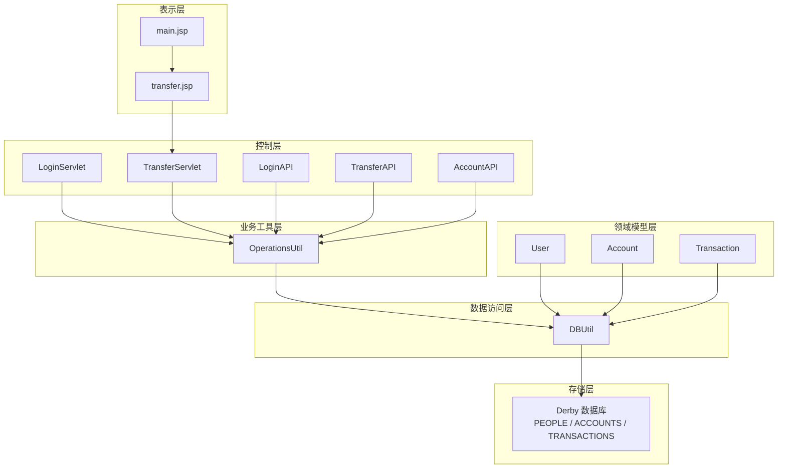
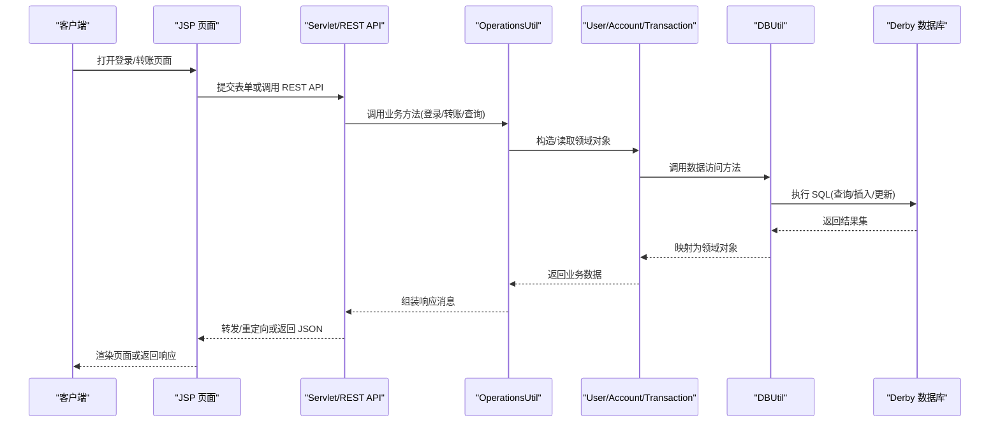
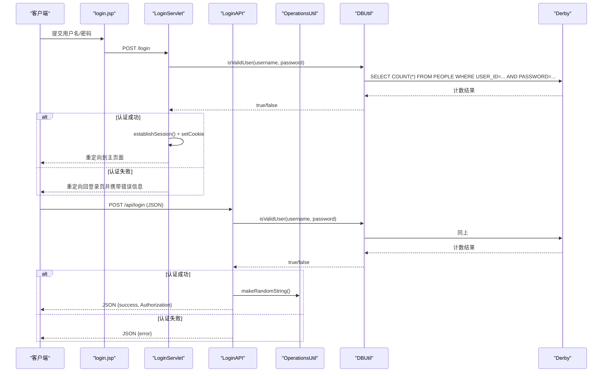
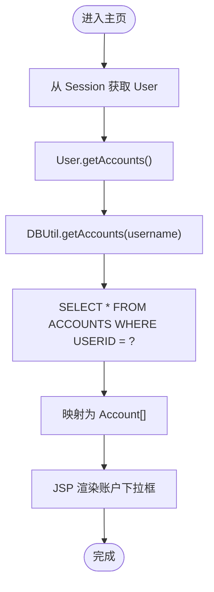
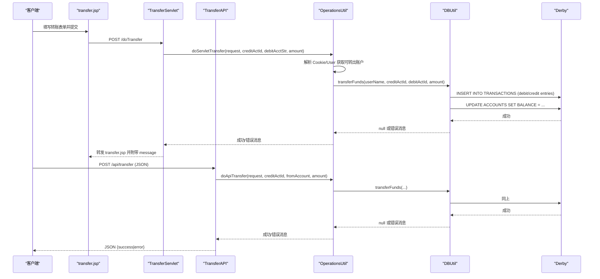
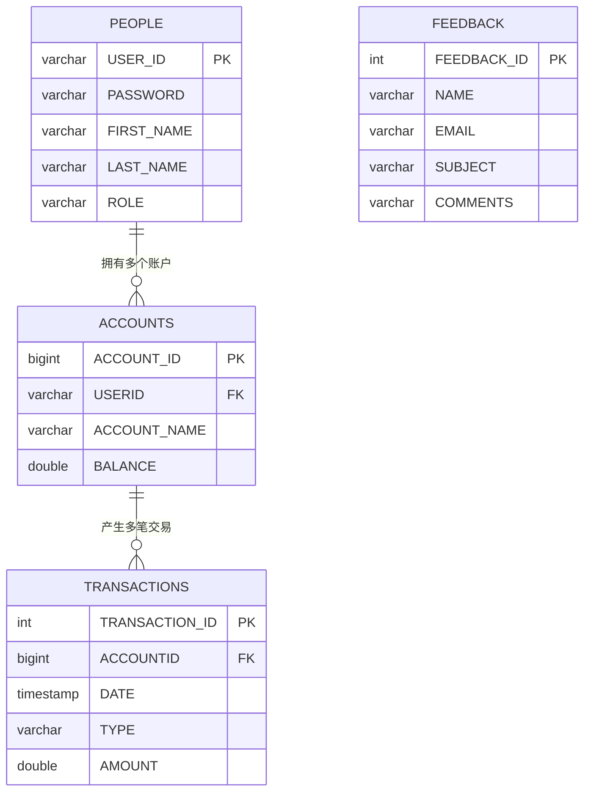
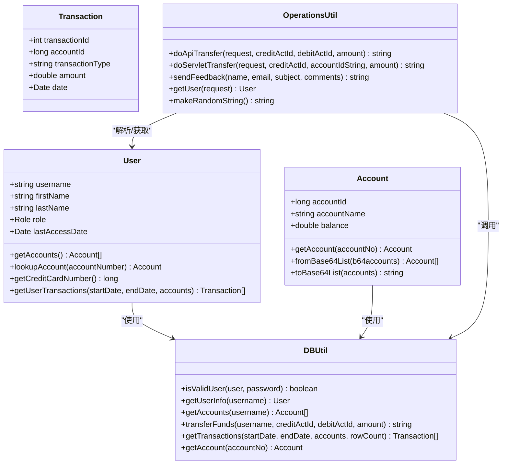
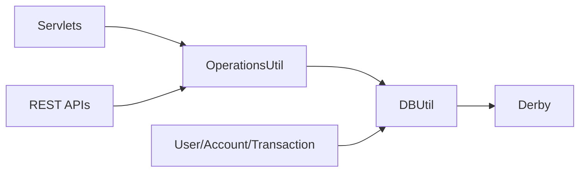

# 数据流分析

<cite>
**本文引用的文件**   
- [README.md](file://README.md)
- [User.java](file://src/com/ibm/security/appscan/altoromutual/model/User.java)
- [Account.java](file://src/com/ibm/security/appscan/altoromutual/model/Account.java)
- [Transaction.java](file://src/com/ibm/security/appscan/altoromutual/model/Transaction.java)
- [DBUtil.java](file://src/com/ibm/security/appscan/altoromutual/util/DBUtil.java)
- [OperationsUtil.java](file://src/com/ibm/security/appscan/altoromutual/util/OperationsUtil.java)
- [LoginServlet.java](file://src/com/ibm/security/appscan/altoromutual/servlet/LoginServlet.java)
- [TransferServlet.java](file://src/com/ibm/security/appscan/altoromutual/servlet/TransferServlet.java)
- [LoginAPI.java](file://src/com/ibm/security/appscan/altoromutual/api/LoginAPI.java)
- [TransferAPI.java](file://src/com/ibm/security/appscan/altoromutual/api/TransferAPI.java)
- [AccountAPI.java](file://src/com/ibm/security/appscan/altoromutual/api/AccountAPI.java)
- [main.jsp](file://WebContent/bank/main.jsp)
- [transfer.jsp](file://WebContent/bank/transfer.jsp)
</cite>

## 目录
1. [引言](#引言)
2. [项目结构](#项目结构)
3. [核心组件](#核心组件)
4. [架构总览](#架构总览)
5. [详细组件分析](#详细组件分析)
6. [依赖关系分析](#依赖关系分析)
7. [性能与一致性考虑](#性能与一致性考虑)
8. [故障排查指南](#故障排查指南)
9. [结论](#结论)

## 引言
本文件为 AltoroJ 应用的数据流分析文档，聚焦典型业务流程中的数据流转路径：用户认证、账户查询、资金转账等。文档说明数据在各层之间的传递格式、转换过程与持久化方式，记录数据的生命周期管理、事务处理与一致性保证机制，并配套数据流图、实体关系图与序列图，帮助读者理解数据模型在不同组件间如何保持一致性与完整性。

## 项目结构
AltoroJ 是一个基于 J2EE 的示例银行 Web 应用，包含以下关键层次：
- 表示层（JSP）：提供用户界面与表单交互
- 控制层（Servlet/REST API）：接收请求、校验参数、编排业务逻辑
- 业务工具层（OperationsUtil）：封装跨层复用逻辑（如转账流程、鉴权解析）
- 领域模型层（User/Account/Transaction）：承载业务对象
- 数据访问层（DBUtil）：统一数据库连接、初始化与 SQL 操作
- 存储层（Apache Derby 内嵌数据库）：持久化用户、账户、交易等数据

图表来源
- [main.jsp:24-68](file://WebContent/bank/main.jsp#L24-L68)
- [transfer.jsp:24-112](file://WebContent/bank/transfer.jsp#L24-L112)
- [LoginServlet.java:38-108](file://src/com/ibm/security/appscan/altoromutual/servlet/LoginServlet.java#L38-L108)
- [TransferServlet.java:38-71](file://src/com/ibm/security/appscan/altoromutual/servlet/TransferServlet.java#L38-L71)
- [LoginAPI.java:19-84](file://src/com/ibm/security/appscan/altoromutual/api/LoginAPI.java#L19-L84)
- [TransferAPI.java:14-45](file://src/com/ibm/security/appscan/altoromutual/api/TransferAPI.java#L14-L45)
- [AccountAPI.java:23-238](file://src/com/ibm/security/appscan/altoromutual/api/AccountAPI.java#L23-L238)
- [OperationsUtil.java:16-155](file://src/com/ibm/security/appscan/altoromutual/util/OperationsUtil.java#L16-L155)
- [DBUtil.java:45-536](file://src/com/ibm/security/appscan/altoromutual/util/DBUtil.java#L45-L536)

章节来源
- [README.md:1-63](file://README.md#L1-L63)

## 核心组件
- 领域模型
  - User：用户信息、角色、最近访问时间；提供获取账户列表、查找账户、信用卡号识别、查询交易等方法
  - Account：账户标识、名称、余额；提供按账号查询、Base64 序列化/反序列化方法
  - Transaction：交易记录，含交易ID、账户ID、类型、金额、时间
- 数据访问
  - DBUtil：数据库连接管理、初始化表结构与种子数据；提供用户校验、用户信息查询、账户查询、转账、交易查询等静态方法
- 业务工具
  - OperationsUtil：封装跨层复用的转账逻辑、反馈提交、从请求头解析用户信息等
- 控制层
  - LoginServlet：处理登录/登出，建立会话与 Cookie
  - TransferServlet：处理转账页面展示与转账提交
  - LoginAPI/TransferAPI/AccountAPI：REST API 入口，负责 JSON 解析与响应构建

章节来源
- [User.java:30-108](file://src/com/ibm/security/appscan/altoromutual/model/User.java#L30-L108)
- [Account.java:32-122](file://src/com/ibm/security/appscan/altoromutual/model/Account.java#L32-L122)
- [Transaction.java:28-64](file://src/com/ibm/security/appscan/altoromutual/model/Transaction.java#L28-L64)
- [DBUtil.java:45-536](file://src/com/ibm/security/appscan/altoromutual/util/DBUtil.java#L45-L536)
- [OperationsUtil.java:16-155](file://src/com/ibm/security/appscan/altoromutual/util/OperationsUtil.java#L16-L155)
- [LoginServlet.java:38-108](file://src/com/ibm/security/appscan/altoromutual/servlet/LoginServlet.java#L38-L108)
- [TransferServlet.java:38-71](file://src/com/ibm/security/appscan/altoromutual/servlet/TransferServlet.java#L38-L71)
- [LoginAPI.java:19-84](file://src/com/ibm/security/appscan/altoromutual/api/LoginAPI.java#L19-L84)
- [TransferAPI.java:14-45](file://src/com/ibm/security/appscan/altoromutual/api/TransferAPI.java#L14-L45)
- [AccountAPI.java:23-238](file://src/com/ibm/security/appscan/altoromutual/api/AccountAPI.java#L23-L238)

## 架构总览
下图展示了典型业务流程中的端到端数据流：客户端发起请求，经过 Servlet/REST API 进入业务工具层，调用数据访问层进行数据库读写，最终返回结果给表示层或客户端。

图表来源
- [LoginServlet.java:67-108](file://src/com/ibm/security/appscan/altoromutual/servlet/LoginServlet.java#L67-L108)
- [TransferServlet.java:51-71](file://src/com/ibm/security/appscan/altoromutual/servlet/TransferServlet.java#L51-L71)
- [LoginAPI.java:29-84](file://src/com/ibm/security/appscan/altoromutual/api/LoginAPI.java#L29-L84)
- [TransferAPI.java:17-45](file://src/com/ibm/security/appscan/altoromutual/api/TransferAPI.java#L17-L45)
- [AccountAPI.java:27-238](file://src/com/ibm/security/appscan/altoromutual/api/AccountAPI.java#L27-L238)
- [OperationsUtil.java:18-155](file://src/com/ibm/security/appscan/altoromutual/util/OperationsUtil.java#L18-L155)
- [DBUtil.java:212-536](file://src/com/ibm/security/appscan/altoromutual/util/DBUtil.java#L212-L536)

## 详细组件分析

### 用户认证数据流
- 输入与校验
  - 表单登录：LoginServlet 从请求参数中获取用户名与密码，进行基础清洗（trim、小写），调用 DBUtil.isValidUser 校验
  - REST 登录：LoginAPI 解析 JSON body，校验字段存在性，调用 DBUtil.isValidUser
- 会话与令牌
  - Servlet 登录成功后通过 ServletUtil.establishSession 建立会话并设置 Cookie
  - REST 登录成功后生成 Authorization 令牌（Base64 编码的用户名、密码与随机串）
- 数据流向
  - 用户名/密码 -> 控制层 -> 数据访问层 -> 数据库 PEOPLE 表 -> 返回布尔结果
  - 成功时：会话/Cookie 或 Authorization 令牌返回客户端

图表来源
- [LoginServlet.java:67-108](file://src/com/ibm/security/appscan/altoromutual/servlet/LoginServlet.java#L67-L108)
- [LoginAPI.java:29-84](file://src/com/ibm/security/appscan/altoromutual/api/LoginAPI.java#L29-L84)
- [DBUtil.java:212-232](file://src/com/ibm/security/appscan/altoromutual/util/DBUtil.java#L212-L232)

章节来源
- [LoginServlet.java:67-108](file://src/com/ibm/security/appscan/altoromutual/servlet/LoginServlet.java#L67-L108)
- [LoginAPI.java:29-84](file://src/com/ibm/security/appscan/altoromutual/api/LoginAPI.java#L29-L84)
- [DBUtil.java:212-232](file://src/com/ibm/security/appscan/altoromutual/util/DBUtil.java#L212-L232)

### 账户查询数据流
- 页面展示
  - main.jsp 从 Session 中取出 User 对象，调用 user.getAccounts() 获取账户列表并渲染下拉框
- 后端实现
  - User.getAccounts() 调用 DBUtil.getAccounts(username)，将 ResultSet 映射为 Account[]
  - Account.getAccount(accountNo) 直接调用 DBUtil.getAccount(accountNo)
- 数据流向
  - 用户会话 -> User -> DBUtil -> ACCOUNTS 表 -> Account[] -> JSP 渲染

图表来源
- [main.jsp:32-54](file://WebContent/bank/main.jsp#L32-L54)
- [User.java:76-83](file://src/com/ibm/security/appscan/altoromutual/model/User.java#L76-L83)
- [DBUtil.java:275-293](file://src/com/ibm/security/appscan/altoromutual/util/DBUtil.java#L275-L293)

章节来源
- [main.jsp:32-54](file://WebContent/bank/main.jsp#L32-L54)
- [User.java:76-83](file://src/com/ibm/security/appscan/altoromutual/model/User.java#L76-L83)
- [DBUtil.java:275-293](file://src/com/ibm/security/appscan/altoromutual/util/DBUtil.java#L275-L293)

### 资金转账数据流
- 前端交互
  - transfer.jsp 提供“转出账户”、“转入账户”、“转账金额”表单，并在前端做简单校验
- 控制层处理
  - TransferServlet.doPost 检查登录状态，提取 fromAccount/toAccount/transferAmount，调用 OperationsUtil.doServletTransfer
  - TransferAPI 解析 JSON 参数，调用 OperationsUtil.doApiTransfer
- 业务工具层
  - OperationsUtil.doServletTransfer：从 Cookie 或 User 获取可转出的账户列表，解析转出账户 ID/名称，校验目标账户与金额合法性，调用 DBUtil.transferFunds
  - OperationsUtil.doApiTransfer：从 Authorization 头解析用户，调用 DBUtil.transferFunds
- 数据访问层
  - DBUtil.transferFunds：查询用户与账户，计算借方/贷方金额（信用卡特殊处理），插入两条交易记录，必要时插入现金预支费用记录，更新两个账户余额
- 数据流向
  - 表单/JSON -> Servlet/API -> OperationsUtil -> DBUtil -> ACCOUNTS/TRANSACTIONS -> 返回消息

图表来源
- [transfer.jsp:58-105](file://WebContent/bank/transfer.jsp#L58-L105)
- [TransferServlet.java:51-71](file://src/com/ibm/security/appscan/altoromutual/servlet/TransferServlet.java#L51-L71)
- [TransferAPI.java:17-45](file://src/com/ibm/security/appscan/altoromutual/api/TransferAPI.java#L17-L45)
- [OperationsUtil.java:39-117](file://src/com/ibm/security/appscan/altoromutual/util/OperationsUtil.java#L39-L117)
- [DBUtil.java:303-364](file://src/com/ibm/security/appscan/altoromutual/util/DBUtil.java#L303-L364)

章节来源
- [transfer.jsp:58-105](file://WebContent/bank/transfer.jsp#L58-L105)
- [TransferServlet.java:51-71](file://src/com/ibm/security/appscan/altoromutual/servlet/TransferServlet.java#L51-L71)
- [TransferAPI.java:17-45](file://src/com/ibm/security/appscan/altoromutual/api/TransferAPI.java#L17-L45)
- [OperationsUtil.java:39-117](file://src/com/ibm/security/appscan/altoromutual/util/OperationsUtil.java#L39-L117)
- [DBUtil.java:303-364](file://src/com/ibm/security/appscan/altoromutual/util/DBUtil.java#L303-L364)

### 实体关系图（ERD）

图表来源
- [DBUtil.java:143-167](file://src/com/ibm/security/appscan/altoromutual/util/DBUtil.java#L143-L167)

章节来源
- [DBUtil.java:143-167](file://src/com/ibm/security/appscan/altoromutual/util/DBUtil.java#L143-L167)

### 类图（领域模型与工具）

图表来源
- [User.java:30-108](file://src/com/ibm/security/appscan/altoromutual/model/User.java#L30-L108)
- [Account.java:32-122](file://src/com/ibm/security/appscan/altoromutual/model/Account.java#L32-L122)
- [Transaction.java:28-64](file://src/com/ibm/security/appscan/altoromutual/model/Transaction.java#L28-L64)
- [DBUtil.java:212-536](file://src/com/ibm/security/appscan/altoromutual/util/DBUtil.java#L212-L536)
- [OperationsUtil.java:16-155](file://src/com/ibm/security/appscan/altoromutual/util/OperationsUtil.java#L16-L155)

## 依赖关系分析
- 耦合关系
  - Servlet/REST API 依赖 OperationsUtil 进行业务编排
  - OperationsUtil 依赖 DBUtil 进行数据访问
  - 领域模型 User/Account/Transaction 依赖 DBUtil 进行数据加载
- 外部依赖
  - Apache Derby 内嵌数据库
  - Base64 编解码用于令牌与账户列表序列化
- 潜在循环依赖
  - 当前代码未发现明显循环依赖；主要依赖方向为 控制层 -> 业务工具层 -> 数据访问层 -> 存储层

图表来源
- [LoginServlet.java:38-108](file://src/com/ibm/security/appscan/altoromutual/servlet/LoginServlet.java#L38-L108)
- [TransferServlet.java:38-71](file://src/com/ibm/security/appscan/altoromutual/servlet/TransferServlet.java#L38-L71)
- [LoginAPI.java:19-84](file://src/com/ibm/security/appscan/altoromutual/api/LoginAPI.java#L19-L84)
- [TransferAPI.java:14-45](file://src/com/ibm/security/appscan/altoromutual/api/TransferAPI.java#L14-L45)
- [AccountAPI.java:23-238](file://src/com/ibm/security/appscan/altoromutual/api/AccountAPI.java#L23-L238)
- [OperationsUtil.java:16-155](file://src/com/ibm/security/appscan/altoromutual/util/OperationsUtil.java#L16-L155)
- [DBUtil.java:45-536](file://src/com/ibm/security/appscan/altoromutual/util/DBUtil.java#L45-L536)

## 性能与一致性考虑
- 连接管理
  - DBUtil 采用单例模式维护 Connection，支持外部 DataSource 或内嵌 Derby；首次连接失败时自动创建数据库并初始化表结构
- 事务处理
  - 转账逻辑在 DBUtil.transferFunds 中注释指出应作为原子操作执行，但当前实现未显式开启事务或使用 PreparedStatement，存在并发与一致性问题风险
- 数据一致性
  - 转账过程中先插入交易记录再更新账户余额，若中途异常可能导致不一致；建议引入事务边界与锁机制
- 性能优化机会
  - 使用 PreparedStatement 替代字符串拼接 SQL，提升安全性与执行计划重用
  - 对频繁查询的账户列表进行缓存（例如基于用户 ID 的本地缓存）
  - 批量写入交易记录时使用批处理语句

[本节为通用指导，不直接分析具体文件]

## 故障排查指南
- 数据库初始化失败
  - 现象：登录时报错无法创建数据库
  - 原因：权限不足或 user.home 不可写
  - 解决：确保运行用户对 user.home 有读写权限，或通过 JVM 参数修改 derby.system.home
- 转账失败
  - 现象：转账后提示错误或余额未更新
  - 原因：SQL 执行异常或账户无效
  - 排查：检查 DBUtil.transferFunds 的日志与异常分支，确认账户是否存在且属于当前用户
- 登录失败
  - 现象：登录被拒绝
  - 原因：用户名/密码不存在或参数缺失
  - 排查：检查 LoginServlet/LoginAPI 的参数解析与 DBUtil.isValidUser 返回值

章节来源
- [README.md:44-57](file://README.md#L44-L57)
- [DBUtil.java:124-133](file://src/com/ibm/security/appscan/altoromutual/util/DBUtil.java#L124-L133)
- [DBUtil.java:303-364](file://src/com/ibm/security/appscan/altoromutual/util/DBUtil.java#L303-L364)
- [LoginServlet.java:74-101](file://src/com/ibm/security/appscan/altoromutual/servlet/LoginServlet.java#L74-L101)
- [LoginAPI.java:31-81](file://src/com/ibm/security/appscan/altoromutual/api/LoginAPI.java#L31-L81)

## 结论
AltoroJ 的数据流遵循清晰的分层架构：表示层负责交互，控制层负责编排，业务工具层封装复用逻辑，领域模型承载业务语义，数据访问层统一数据库操作。典型流程包括用户认证、账户查询与资金转账，数据在层间以对象与 JSON 形式传递，并通过 DBUtil 持久化到 Derby 数据库。当前实现存在事务与 SQL 注入方面的改进空间，建议在转账等关键路径引入事务管理与参数化查询，以提升一致性与安全性。