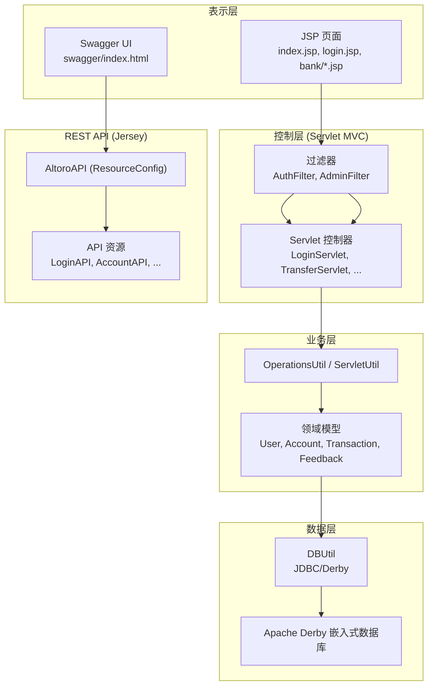
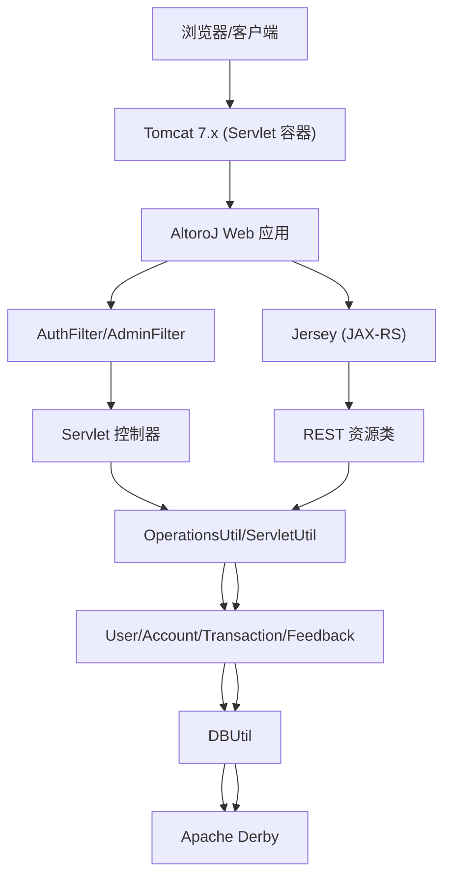
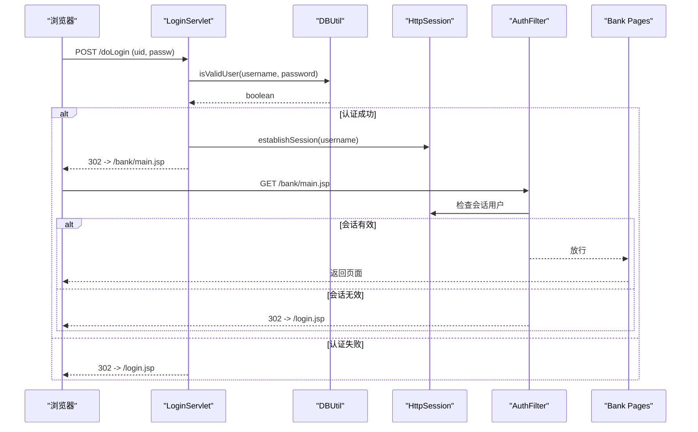
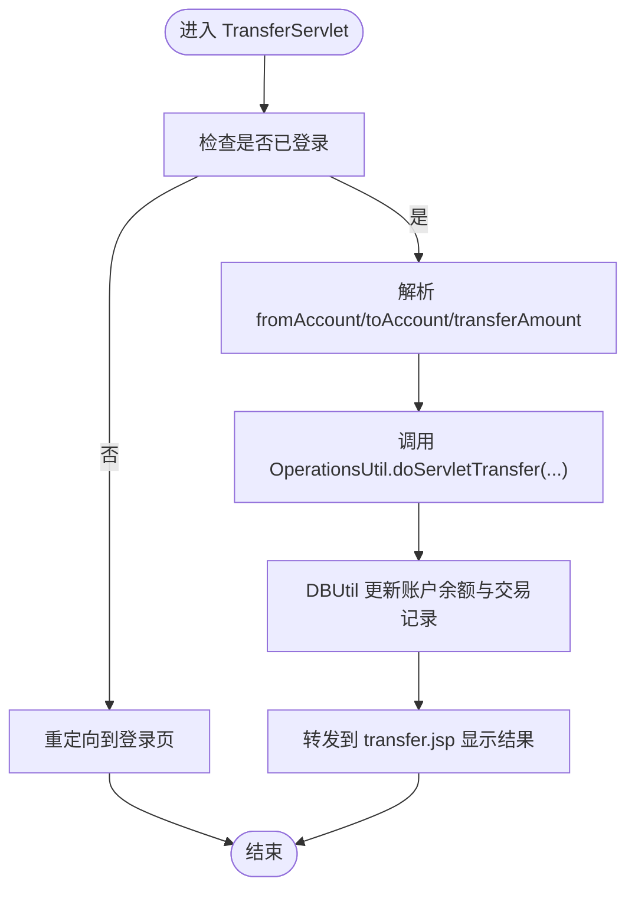
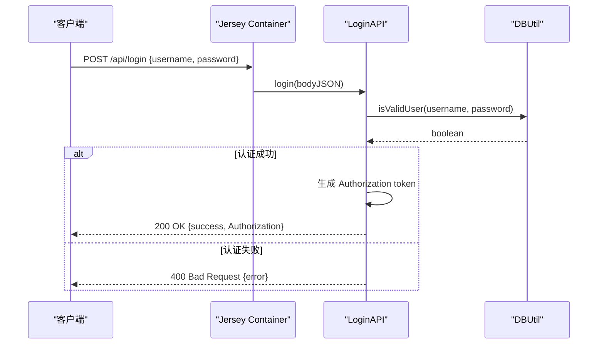
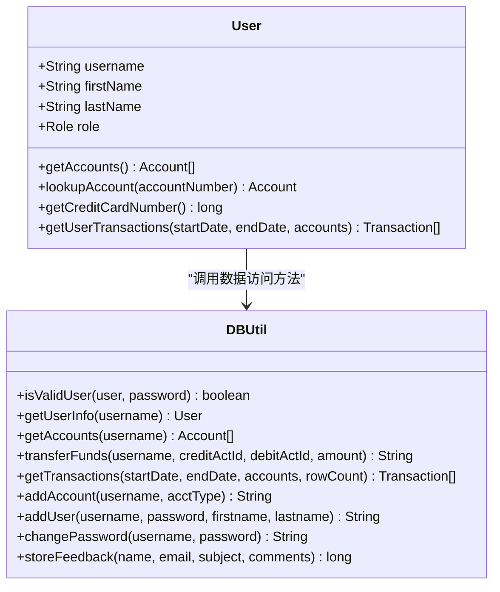
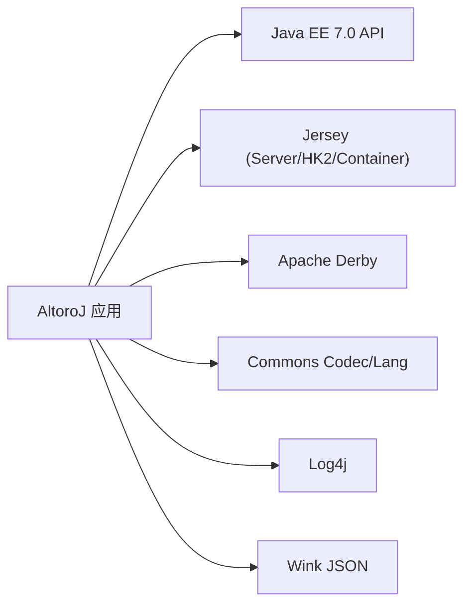

# 整体架构设计

<cite>
**本文引用的文件**   
- [README.md](file://README.md)
- [web.xml](file://WebContent/WEB-INF/web.xml)
- [build.gradle](file://build.gradle)
- [AltoroAPI.java](file://src/com/ibm/security/appscan/altoromutual/api/AltoroAPI.java)
- [AuthFilter.java](file://src/com/ibm/security/appscan/altoromutual/filter/AuthFilter.java)
- [LoginServlet.java](file://src/com/ibm/security/appscan/altoromutual/servlet/LoginServlet.java)
- [TransferServlet.java](file://src/com/ibm/security/appscan/altoromutual/servlet/TransferServlet.java)
- [DBUtil.java](file://src/com/ibm/security/appscan/altoromutual/util/DBUtil.java)
- [User.java](file://src/com/ibm/security/appscan/altoromutual/model/User.java)
- [app.properties](file://WebContent/WEB-INF/app.properties)
</cite>

## 目录
1. [引言](#引言)
2. [项目结构](#项目结构)
3. [核心组件](#核心组件)
4. [架构总览](#架构总览)
5. [详细组件分析](#详细组件分析)
6. [依赖关系分析](#依赖关系分析)
7. [性能与可扩展性](#性能与可扩展性)
8. [故障排查指南](#故障排查指南)
9. [结论](#结论)
10. [附录：部署与技术决策说明](#附录部署与技术决策说明)

## 引言
本文件为 AltoroJ 的整体架构设计文档。AltoroJ 是一个用于安全教学与漏洞演示的银行示例 Web 应用，采用传统的三层架构（表示层、业务层、数据层）并结合 Servlet MVC 模式组织请求处理流程；同时通过 Jersey 提供 REST API，便于以程序化方式触发和演示各类安全问题。系统默认使用 Apache Derby 嵌入式数据库，简化部署与初始化过程，使学习者专注于安全原理而非框架复杂性。

## 项目结构
AltoroJ 遵循典型的 Java EE Web 工程布局：
- WebContent：静态页面、JSP、Swagger UI、过滤器与监听器配置等
- src：Java 源代码，按包划分职责
  - api：基于 JAX-RS/Jersey 的 REST 资源类
  - filter：Servlet 过滤器（认证、鉴权）
  - servlet：MVC 控制器（登录、转账、反馈、订阅、调查、管理功能等）
  - model：领域模型（用户、账户、交易、反馈）
  - util：工具类（数据库连接、通用操作、Servlet 辅助）

图表来源
- [web.xml:1-227](file://WebContent/WEB-INF/web.xml#L1-L227)
- [AltoroAPI.java:1-16](file://src/com/ibm/security/appscan/altoromutual/api/AltoroAPI.java#L1-L16)
- [AuthFilter.java:1-79](file://src/com/ibm/security/appscan/altoromutual/filter/AuthFilter.java#L1-L79)
- [LoginServlet.java:1-108](file://src/com/ibm/security/appscan/altoromutual/servlet/LoginServlet.java#L1-L108)
- [TransferServlet.java:1-71](file://src/com/ibm/security/appscan/altoromutual/servlet/TransferServlet.java#L1-L71)
- [DBUtil.java:1-536](file://src/com/ibm/security/appscan/altoromutual/util/DBUtil.java#L1-L536)

章节来源
- [web.xml:1-227](file://WebContent/WEB-INF/web.xml#L1-L227)
- [build.gradle:1-43](file://build.gradle#L1-L43)

## 核心组件
- 表示层
  - JSP 页面负责渲染用户界面，包含银行主页、登录页、转账页、反馈页等
  - Swagger UI 提供 REST API 的可视化交互入口
- 控制层
  - Servlet 作为 MVC 的 Controller，接收 HTTP 请求，调用业务逻辑，转发到视图
  - 过滤器统一拦截受保护路径，进行会话认证与权限校验
- REST API
  - 基于 JAX-RS 与 Jersey，暴露 /api 下的资源接口，支持 JSON 交互
- 业务层
  - 领域模型封装实体对象（用户、账户、交易、反馈）
  - 工具类封装跨模块复用逻辑（如会话建立、转账编排）
- 数据层
  - DBUtil 统一管理 JDBC 连接、数据库初始化、CRUD 操作
  - 默认使用 Apache Derby 嵌入式数据库，支持可选的外部 DataSource

章节来源
- [README.md:1-63](file://README.md#L1-L63)
- [web.xml:1-227](file://WebContent/WEB-INF/web.xml#L1-L227)
- [AltoroAPI.java:1-16](file://src/com/ibm/security/appscan/altoromutual/api/AltoroAPI.java#L1-L16)
- [AuthFilter.java:1-79](file://src/com/ibm/security/appscan/altoromutual/filter/AuthFilter.java#L1-L79)
- [DBUtil.java:1-536](file://src/com/ibm/security/appscan/altoromutual/util/DBUtil.java#L1-L536)

## 架构总览
AltoroJ 采用“传统三层 + Servlet MVC + JAX-RS/Jersey”的组合架构：
- 表示层：JSP/Swagger UI
- 控制层：Servlet + Filter
- 业务层：Model + Util
- 数据层：DBUtil + Derby

图表来源
- [web.xml:1-227](file://WebContent/WEB-INF/web.xml#L1-L227)
- [build.gradle:23-37](file://build.gradle#L23-L37)
- [AltoroAPI.java:1-16](file://src/com/ibm/security/appscan/altoromutual/api/AltoroAPI.java#L1-L16)

## 详细组件分析

### 认证与会话流程（Servlet MVC）
该流程展示用户登录、会话建立与受保护资源访问的典型链路：
- 用户提交登录表单至 LoginServlet
- LoginServlet 调用 DBUtil 验证用户
- 成功后通过 ServletUtil 建立会话并设置 Cookie
- 后续访问 /bank/* 或 /admin/* 被 AuthFilter 拦截，校验会话中的用户信息
- 未认证则重定向到登录页

图表来源
- [LoginServlet.java:67-105](file://src/com/ibm/security/appscan/altoromutual/servlet/LoginServlet.java#L67-L105)
- [AuthFilter.java:58-70](file://src/com/ibm/security/appscan/altoromutual/filter/AuthFilter.java#L58-L70)
- [DBUtil.java:212-232](file://src/com/ibm/security/appscan/altoromutual/util/DBUtil.java#L212-L232)

章节来源
- [LoginServlet.java:1-108](file://src/com/ibm/security/appscan/altoromutual/servlet/LoginServlet.java#L1-L108)
- [AuthFilter.java:1-79](file://src/com/ibm/security/appscan/altoromutual/filter/AuthFilter.java#L1-L79)
- [DBUtil.java:212-232](file://src/com/ibm/security/appscan/altoromutual/util/DBUtil.java#L212-L232)

### 转账业务流程（Servlet MVC）
转账由 TransferServlet 处理，调用 OperationsUtil 完成业务编排，最终通过 DBUtil 更新账户余额与交易记录：
- 校验登录状态
- 解析参数（转出账户、转入账户、金额）
- 调用业务方法执行转账
- 转发到转账结果页面

图表来源
- [TransferServlet.java:51-68](file://src/com/ibm/security/appscan/altoromutual/servlet/TransferServlet.java#L51-L68)
- [DBUtil.java:303-364](file://src/com/ibm/security/appscan/altoromutual/util/DBUtil.java#L303-L364)

章节来源
- [TransferServlet.java:1-71](file://src/com/ibm/security/appscan/altoromutual/servlet/TransferServlet.java#L1-L71)
- [DBUtil.java:303-364](file://src/com/ibm/security/appscan/altoromutual/util/DBUtil.java#L303-L364)

### REST API 认证流程（Jersey）
REST API 通过 Jersey 暴露登录接口，返回基础授权令牌（Base64 编码的用户名、密码与随机串），便于自动化测试与安全演示：
- 客户端发送 JSON 用户名/密码
- LoginAPI 校验参数合法性
- 调用 DBUtil.isValidUser 验证用户
- 成功则生成 Authorization 头值并返回

图表来源
- [AltoroAPI.java:9-14](file://src/com/ibm/security/appscan/altoromutual/api/AltoroAPI.java#L9-L14)
- [LoginAPI.java:19-83](file://src/com/ibm/security/appscan/altoromutual/api/LoginAPI.java#L19-L83)
- [DBUtil.java:212-232](file://src/com/ibm/security/appscan/altoromutual/util/DBUtil.java#L212-L232)

章节来源
- [AltoroAPI.java:1-16](file://src/com/ibm/security/appscan/altoromutual/api/AltoroAPI.java#L1-L16)
- [LoginAPI.java:1-84](file://src/com/ibm/security/appscan/altoromutual/api/LoginAPI.java#L1-L84)

### 领域模型与数据访问
- User 模型封装用户基本信息与角色，并提供获取账户、查找信用卡账户、查询交易等方法
- DBUtil 提供统一的数据库访问能力，包括连接管理、初始化、CRUD 操作
- 模型与工具类解耦了具体 SQL 实现，便于扩展与维护

图表来源
- [User.java:30-107](file://src/com/ibm/security/appscan/altoromutual/model/User.java#L30-L107)
- [DBUtil.java:45-536](file://src/com/ibm/security/appscan/altoromutual/util/DBUtil.java#L45-L536)

章节来源
- [User.java:1-108](file://src/com/ibm/security/appscan/altoromutual/model/User.java#L1-L108)
- [DBUtil.java:1-536](file://src/com/ibm/security/appscan/altoromutual/util/DBUtil.java#L1-L536)

## 依赖关系分析
- 构建与运行时依赖
  - Java EE 7.0 API（providedCompile）
  - Jersey Server/HK2/Container-Servlet（REST API）
  - Apache Derby（嵌入式数据库）
  - Commons Codec/Lang（编解码与字符串工具）
  - Log4j（日志）
  - Wink JSON（JSON 处理）
- 部署依赖
  - Tomcat 7.x（Servlet 容器）
  - Gradle（构建脚本）

图表来源
- [build.gradle:23-37](file://build.gradle#L23-L37)

章节来源
- [build.gradle:1-43](file://build.gradle#L1-L43)

## 性能与可扩展性
- 连接管理
  - DBUtil 单例维护连接，支持外部 DataSource 注入，便于替换为生产级数据库
  - 支持在启动时重新初始化数据库，便于演示环境快速重置
- 可扩展点
  - 通过 app.properties 切换行为开关（如启用管理员功能、反馈持久化、高级静态页面处理）
  - 可配置 external DataSource，对接企业级数据库（如 DB2）
- 建议优化
  - 引入连接池（如 HikariCP）提升并发性能
  - 使用 PreparedStatement 防止 SQL 注入（当前多处拼接 SQL，存在安全风险）
  - 对敏感操作增加事务边界与幂等性保障

[本节为通用指导，不直接分析具体文件]

## 故障排查指南
- 数据库创建失败
  - 现象：登录时报错“Failed to create database 'altoro'”
  - 原因：user.home 目录无写权限导致 Derby 无法创建数据库
  - 解决：授予运行用户对 user.home 的读写权限，或通过 JVM 参数 -Duser.home=新路径指定数据库位置
- 编译错误
  - 现象：在 Tomcat 上部署时报编译错误
  - 原因：Eclipse 构建路径缺失第三方库
  - 解决：使用 Gradle 构建以自动下载依赖并编译
- 外部数据库初始化
  - 现象：使用外部 DataSource 后首次登录失败
  - 原因：未启用 reinitializeOnStart 导致表结构与初始数据未创建
  - 解决：首次运行设置 database.reinitializeOnStart=true，登录后再关闭

章节来源
- [README.md:44-57](file://README.md#L44-L57)
- [app.properties:57-74](file://WebContent/WEB-INF/app.properties#L57-L74)

## 结论
AltoroJ 采用清晰的三层架构与 Servlet MVC 模式，结合 Jersey REST API，既满足教学演示的可读性与可控性，又提供了程序化接口以支撑自动化安全测试。通过 Apache Derby 的嵌入式特性与可配置的 DataSource，系统在本地演示与企业集成之间取得平衡。其架构选择的核心目标是降低学习门槛、突出安全问题本质，并为后续现代化改造提供明确的演进路径。

[本节为总结性内容，不直接分析具体文件]

## 附录：部署与技术决策说明
- 技术栈选择背景
  - Java EE 7.0：标准、稳定，适合教学与演示
  - Jersey：轻量 JAX-RS 实现，便于暴露 REST API
  - Apache Derby：嵌入式数据库，零配置、易部署，适合教学环境
  - Tomcat 7.x：广泛使用的 Servlet 容器，兼容性好
- 系统边界与外部依赖
  - 内部边界：Servlet 控制器、过滤器、REST 资源、领域模型、工具类
  - 外部依赖：Tomcat、Derby、第三方库（Jersey、Commons、Log4j、Wink）
- 为什么选择这种架构
  - 简单直观：避免复杂框架干扰，聚焦安全漏洞原理
  - 易于演示：内置数据库与简单配置，快速搭建演示环境
  - 可扩展性强：支持外部 DataSource 与行为开关，便于扩展新功能与攻击面

[本节为概念性说明，不直接分析具体文件]