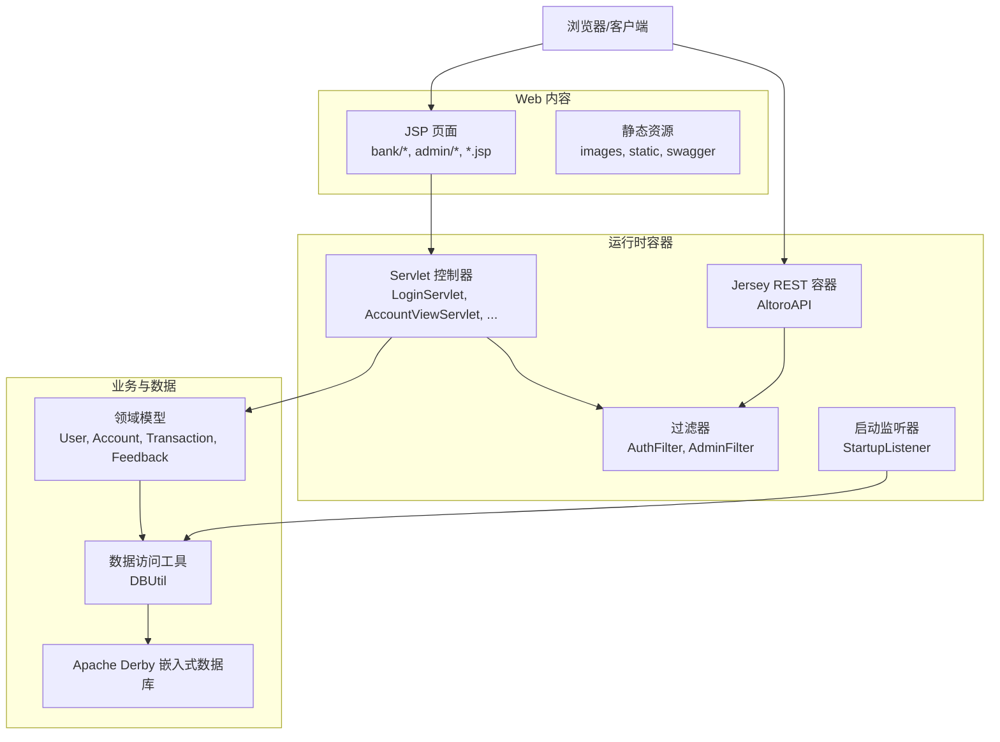
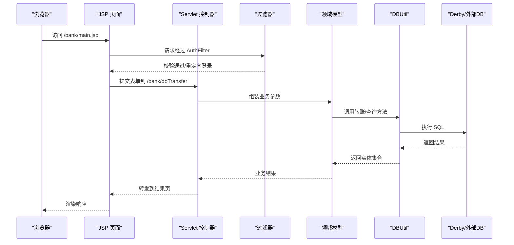
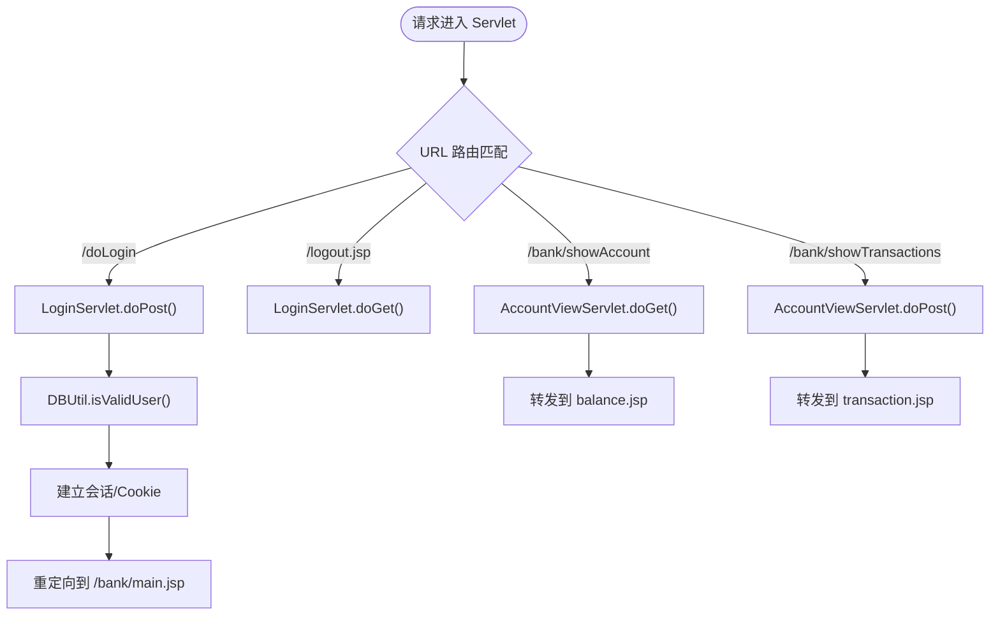
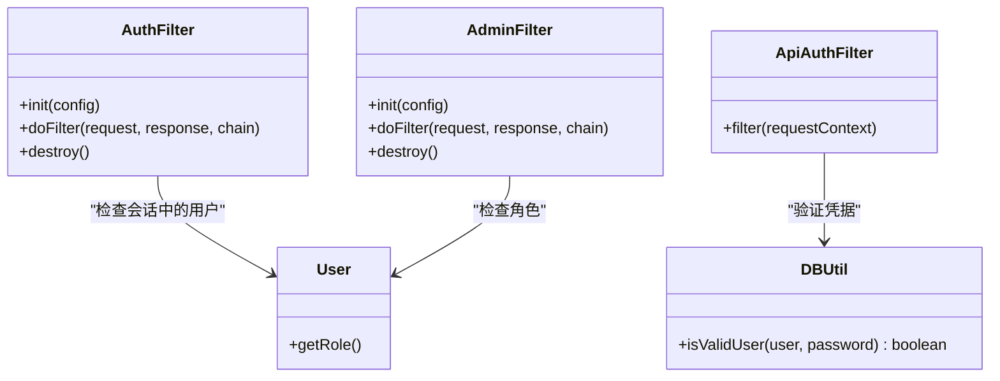
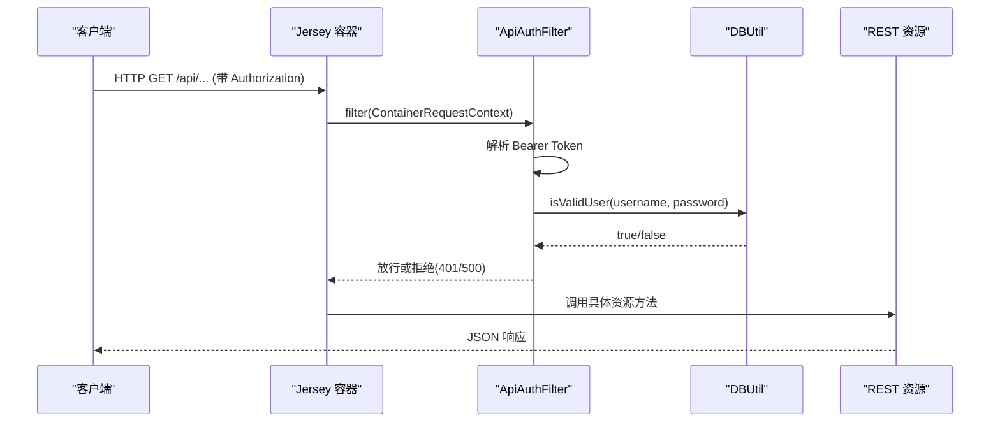
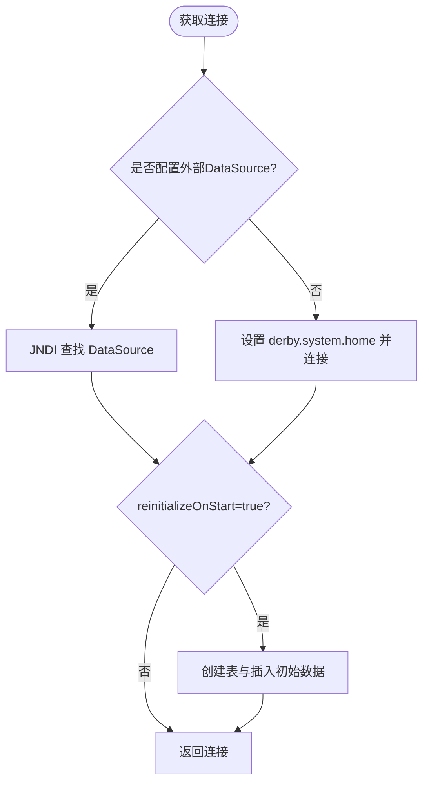
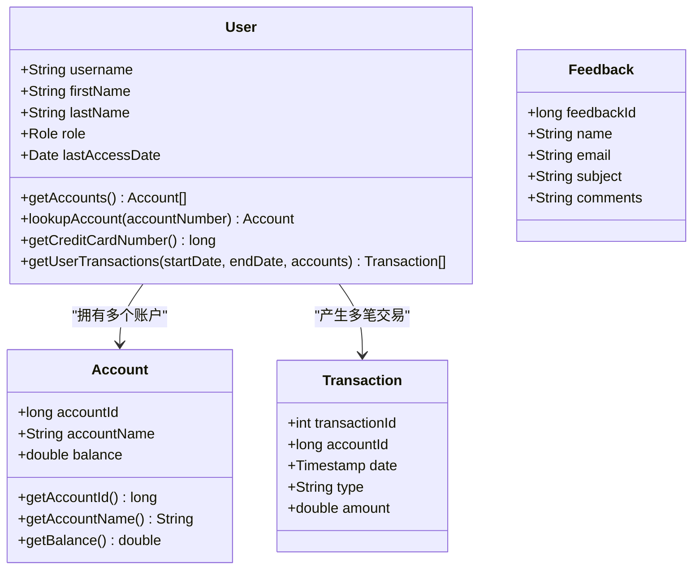
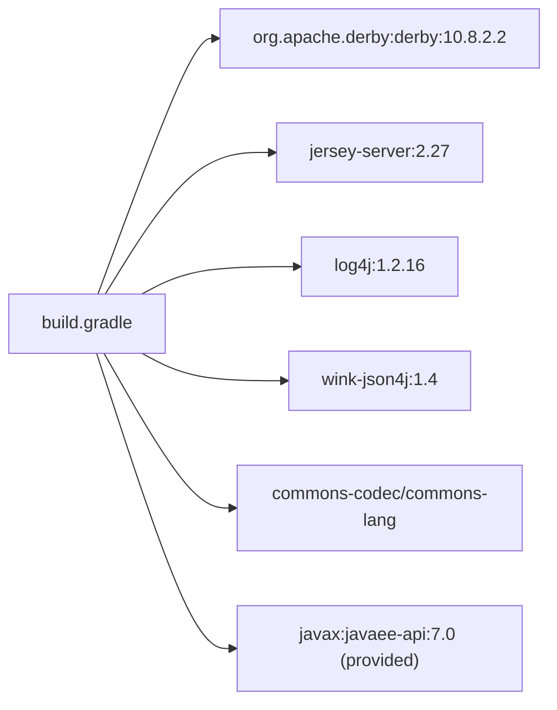
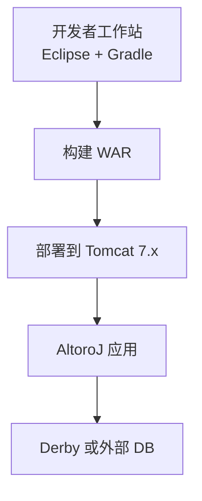

# 系统架构

<cite>
**本文引用的文件**   
- [README.md](file://README.md)
- [build.gradle](file://build.gradle)
- [web.xml](file://WebContent/WEB-INF/web.xml)
- [app.properties](file://WebContent/WEB-INF/app.properties)
- [StartupListener.java](file://src/com/ibm/security/appscan/altoromutual/listener/StartupListener.java)
- [AuthFilter.java](file://src/com/ibm/security/appscan/altoromutual/filter/AuthFilter.java)
- [AdminFilter.java](file://src/com/ibm/security/appscan/altoromutual/filter/AdminFilter.java)
- [ApiAuthFilter.java](file://src/com/ibm/security/appscan/altoromutual/filter/ApiAuthFilter.java)
- [AltoroAPI.java](file://src/com/ibm/security/appscan/altoromutual/api/AltoroAPI.java)
- [LoginServlet.java](file://src/com/ibm/security/appscan/altoromutual/servlet/LoginServlet.java)
- [AccountViewServlet.java](file://src/com/ibm/security/appscan/altoromutual/servlet/AccountViewServlet.java)
- [DBUtil.java](file://src/com/ibm/security/appscan/altoromutual/util/DBUtil.java)
- [User.java](file://src/com/ibm/security/appscan/altoromutual/model/User.java)
</cite>

## 目录
1. [引言](#引言)
2. [项目结构](#项目结构)
3. [核心组件](#核心组件)
4. [架构总览](#架构总览)
5. [详细组件分析](#详细组件分析)
6. [依赖关系分析](#依赖关系分析)
7. [性能与可扩展性](#性能与可扩展性)
8. [横切关注点：安全、监控与灾难恢复](#横切关注点安全监控与灾难恢复)
9. [部署拓扑与环境要求](#部署拓扑与环境要求)
10. [故障排查指南](#故障排查指南)
11. [结论](#结论)

## 引言
本架构文档面向 AltoroJ 这一基于 J2EE 的示例银行 Web 应用，聚焦其高层设计、分层架构（Servlet MVC）、组件交互、数据流与集成模式，并说明技术决策、约束与权衡。同时给出基础设施要求、可扩展性考虑、部署拓扑以及安全性、监控与灾难恢复等横切关注点的实践建议。

## 项目结构
AltoroJ 采用传统 Java Web 工程组织方式：
- WebContent：静态资源、JSP 页面、Swagger UI 与 WEB-INF 配置
- src：Java 源码，按包划分表示层（servlet）、控制与过滤器（filter）、REST API（api）、领域模型（model）与工具类（util）
- build.gradle：Gradle 构建脚本，声明 WAR 打包与依赖
- web.xml：Servlet、Filter、Listener 与 URL 映射的核心配置

图表来源
- [web.xml:1-227](file://WebContent/WEB-INF/web.xml#L1-L227)
- [build.gradle:1-43](file://build.gradle#L1-L43)
- [StartupListener.java:1-32](file://src/com/ibm/security/appscan/altoromutual/listener/StartupListener.java#L1-L32)

章节来源
- [web.xml:1-227](file://WebContent/WEB-INF/web.xml#L1-L227)
- [build.gradle:1-43](file://build.gradle#L1-L43)

## 核心组件
- 表示层（JSP）：用户界面与展示逻辑，位于 WebContent 下各功能目录（如 bank、admin）。
- 控制层（Servlet）：处理 HTTP 请求、调用业务与数据访问、转发到 JSP。
- 过滤层（Filter）：统一鉴权与权限校验（AuthFilter、AdminFilter），以及 REST API 鉴权（ApiAuthFilter）。
- API 层（Jersey REST）：通过 AltoroAPI 暴露 REST 接口，使用 ApiAuthFilter 进行认证。
- 数据访问层（DBUtil）：封装 JDBC 连接、初始化与 CRUD 操作，支持内置 Derby 或外部 DataSource。
- 领域模型（Model）：User、Account、Transaction、Feedback 等实体对象。
- 启动监听器（StartupListener）：应用启动时初始化属性、日志、数据库与 REST API。

章节来源
- [LoginServlet.java:1-108](file://src/com/ibm/security/appscan/altoromutual/servlet/LoginServlet.java#L1-L108)
- [AccountViewServlet.java:1-82](file://src/com/ibm/security/appscan/altoromutual/servlet/AccountViewServlet.java#L1-L82)
- [AuthFilter.java:1-79](file://src/com/ibm/security/appscan/altoromutual/filter/AuthFilter.java#L1-L79)
- [AdminFilter.java:1-90](file://src/com/ibm/security/appscan/altoromutual/filter/AdminFilter.java#L1-L90)
- [ApiAuthFilter.java:1-76](file://src/com/ibm/security/appscan/altoromutual/filter/ApiAuthFilter.java#L1-L76)
- [AltoroAPI.java:1-16](file://src/com/ibm/security/appscan/altoromutual/api/AltoroAPI.java#L1-L16)
- [DBUtil.java:1-536](file://src/com/ibm/security/appscan/altoromutual/util/DBUtil.java#L1-L536)
- [User.java:1-108](file://src/com/ibm/security/appscan/altoromutual/model/User.java#L1-L108)
- [StartupListener.java:1-32](file://src/com/ibm/security/appscan/altoromutual/listener/StartupListener.java#L1-L32)

## 架构总览
AltoroJ 采用 Servlet MVC 分层架构：
- 表示层：JSP 负责渲染视图，包含银行主页、账户余额、交易查询、反馈表单等。
- 控制层：Servlet 接收请求、解析参数、调用业务与数据访问，再转发至对应 JSP。
- 过滤层：在请求进入 Servlet 前进行身份与权限校验；REST API 通过 ContainerRequestFilter 做认证。
- 数据访问层：DBUtil 提供统一的数据库访问能力，支持内嵌 Derby 或外部 DataSource（如 Tomcat JNDI）。
- 启动阶段：StartupListener 初始化应用属性、日志、数据库与 REST API。

图表来源
- [web.xml:159-223](file://WebContent/WEB-INF/web.xml#L159-L223)
- [LoginServlet.java:67-104](file://src/com/ibm/security/appscan/altoromutual/servlet/LoginServlet.java#L67-L104)
- [AccountViewServlet.java:48-79](file://src/com/ibm/security/appscan/altoromutual/servlet/AccountViewServlet.java#L48-L79)
- [DBUtil.java:212-232](file://src/com/ibm/security/appscan/altoromutual/util/DBUtil.java#L212-L232)

## 详细组件分析

### 表示层（JSP）
- 职责：呈现用户界面，收集输入，触发 Servlet 动作。
- 关键页面：银行模块（bank/*.jsp）、管理模块（admin/*.jsp）、通用页面（index.jsp、login.jsp、feedback.jsp 等）。
- 行为：通过表单 POST 到 Servlet 路径（如 /bank/doTransfer、/sendFeedback），或通过链接 GET 到显示型 Servlet（如 /bank/showAccount）。

章节来源
- [web.xml:220-226](file://WebContent/WEB-INF/web.xml#L220-L226)

### 控制层（Servlet）
- LoginServlet：处理登录与登出，验证用户凭据，建立会话与 Cookie，重定向到银行主页。
- AccountViewServlet：根据 URL 后缀分发到“查看账户余额”或“查看交易记录”，将参数传递给 JSP。
- 其他 Servlet：订阅、反馈、信用卡申请、调查等，遵循相同 MVC 流程。

图表来源
- [LoginServlet.java:51-104](file://src/com/ibm/security/appscan/altoromutual/servlet/LoginServlet.java#L51-L104)
- [AccountViewServlet.java:48-79](file://src/com/ibm/security/appscan/altoromutual/servlet/AccountViewServlet.java#L48-L79)

章节来源
- [LoginServlet.java:1-108](file://src/com/ibm/security/appscan/altoromutual/servlet/LoginServlet.java#L1-L108)
- [AccountViewServlet.java:1-82](file://src/com/ibm/security/appscan/altoromutual/servlet/AccountViewServlet.java#L1-L82)

### 过滤层（Filter）
- AuthFilter：对 /bank/*、/admin/* 等受保护路径进行会话校验，未登录则重定向到登录页。
- AdminFilter：对管理路径进行角色校验，仅允许管理员或特定会话标记访问。
- ApiAuthFilter：Jersey 容器的 ContainerRequestFilter，对 REST API 进行 Bearer Token 认证，校验用户名密码并通过 DBUtil 验证。

图表来源
- [AuthFilter.java:40-70](file://src/com/ibm/security/appscan/altoromutual/filter/AuthFilter.java#L40-L70)
- [AdminFilter.java:40-80](file://src/com/ibm/security/appscan/altoromutual/filter/AdminFilter.java#L40-L80)
- [ApiAuthFilter.java:20-74](file://src/com/ibm/security/appscan/altoromutual/filter/ApiAuthFilter.java#L20-L74)
- [User.java:30-54](file://src/com/ibm/security/appscan/altoromutual/model/User.java#L30-L54)
- [DBUtil.java:212-232](file://src/com/ibm/security/appscan/altoromutual/util/DBUtil.java#L212-L232)

章节来源
- [AuthFilter.java:1-79](file://src/com/ibm/security/appscan/altoromutual/filter/AuthFilter.java#L1-L79)
- [AdminFilter.java:1-90](file://src/com/ibm/security/appscan/altoromutual/filter/AdminFilter.java#L1-L90)
- [ApiAuthFilter.java:1-76](file://src/com/ibm/security/appscan/altoromutual/filter/ApiAuthFilter.java#L1-L76)

### API 层（Jersey REST）
- AltoroAPI：注册 REST 资源包并挂载 ApiAuthFilter。
- ApiAuthFilter：从 Authorization 头解析 Bearer Token，解码后校验用户名密码，调用 DBUtil 验证用户有效性。

图表来源
- [AltoroAPI.java:9-14](file://src/com/ibm/security/appscan/altoromutual/api/AltoroAPI.java#L9-L14)
- [ApiAuthFilter.java:29-74](file://src/com/ibm/security/appscan/altoromutual/filter/ApiAuthFilter.java#L29-L74)
- [DBUtil.java:212-232](file://src/com/ibm/security/appscan/altoromutual/util/DBUtil.java#L212-L232)

章节来源
- [AltoroAPI.java:1-16](file://src/com/ibm/security/appscan/altoromutual/api/AltoroAPI.java#L1-L16)
- [ApiAuthFilter.java:1-76](file://src/com/ibm/security/appscan/altoromutual/filter/ApiAuthFilter.java#L1-L76)

### 数据访问层（DBUtil）
- 连接管理：优先使用外部 DataSource（Tomcat JNDI），否则使用内嵌 Derby；支持首次连接自动创建数据库。
- 初始化：可按配置在启动时重建表结构与初始数据。
- 业务方法：用户认证、用户信息、账户列表、转账、交易查询、反馈存储、用户管理等。

图表来源
- [DBUtil.java:61-138](file://src/com/ibm/security/appscan/altoromutual/util/DBUtil.java#L61-L138)
- [DBUtil.java:143-167](file://src/com/ibm/security/appscan/altoromutual/util/DBUtil.java#L143-L167)

章节来源
- [DBUtil.java:1-536](file://src/com/ibm/security/appscan/altoromutual/util/DBUtil.java#L1-L536)

### 领域模型（Model）
- User：封装用户基本信息、角色、最后访问时间，并提供账户与交易查询的便捷方法。
- Account、Transaction、Feedback：对应数据库表结构的实体对象。

图表来源
- [User.java:30-107](file://src/com/ibm/security/appscan/altoromutual/model/User.java#L30-L107)

章节来源
- [User.java:1-108](file://src/com/ibm/security/appscan/altoromutual/model/User.java#L1-L108)

### 启动监听器（StartupListener）
- 作用：应用启动时初始化应用属性、日志、数据库（触发一次认证以预热连接）、REST API。
- 异常处理：捕获初始化异常并记录日志。

章节来源
- [StartupListener.java:1-32](file://src/com/ibm/security/appscan/altoromutual/listener/StartupListener.java#L1-L32)

## 依赖关系分析
- 构建与依赖：
  - Gradle 构建 WAR，目标 Java 版本为 1.7。
  - 第三方库包括 Apache Derby、Jersey 2.27、Log4j 1.2.16、Wink JSON4J、Commons Codec/Lang 等。
  - 提供编译期依赖 javax:javaee-api:7.0。
- 运行时依赖：
  - Servlet/JSP 容器（Tomcat 7.x）。
  - Jersey 作为 REST 容器。
  - Derby 嵌入式数据库或外部 DataSource（如 DB2）。

图表来源
- [build.gradle:23-36](file://build.gradle#L23-L36)

章节来源
- [build.gradle:1-43](file://build.gradle#L1-L43)

## 性能与可扩展性
- 连接池与外部 DataSource：通过 app.properties 配置 external DataSource，可接入企业级数据库与连接池，提升并发与稳定性。
- 数据库初始化策略：reinitializeOnStart 用于开发/测试环境快速重置数据，生产环境应谨慎启用。
- 缓存与状态：当前无显式缓存层，热点数据（如账户余额）可通过引入缓存（如 Ehcache/Redis）优化读取性能。
- 水平扩展：Servlet 无状态化良好，适合多实例部署；需确保共享会话（如集群会话复制或外部会话存储）。
- I/O 与事务：转账涉及多表更新，建议使用事务边界与批量操作，避免多次独立 SQL 导致的性能问题与一致性风险。

[本节为通用指导，不直接分析具体文件]

## 横切关注点：安全、监控与灾难恢复
- 安全性
  - 会话与权限：AuthFilter 与 AdminFilter 实现基础的身份与角色控制；ApiAuthFilter 对 REST API 进行 Bearer Token 校验。
  - 输入校验：DBUtil 中存在字符串拼接 SQL 的风险（注释标注 BAD），需替换为参数化查询与严格输入校验。
  - 敏感信息：默认账号密码与硬编码逻辑需谨慎处理，避免泄露。
- 监控
  - 日志：StartupListener 初始化日志，DBUtil 与 LoginServlet 使用 Log4AltoroJ 记录错误与交易事件。
  - 指标：建议增加请求耗时、错误率、数据库连接池指标采集。
- 灾难恢复
  - 备份与恢复：定期备份 Derby 数据文件或外部数据库快照。
  - 重启策略：reinitializeOnStart 可用于测试环境快速恢复，生产环境应结合迁移脚本与灰度发布。
  - 高可用：多实例部署配合负载均衡与健康检查，确保服务可用性。

章节来源
- [AuthFilter.java:58-70](file://src/com/ibm/security/appscan/altoromutual/filter/AuthFilter.java#L58-L70)
- [AdminFilter.java:58-80](file://src/com/ibm/security/appscan/altoromutual/filter/AdminFilter.java#L58-L80)
- [ApiAuthFilter.java:29-74](file://src/com/ibm/security/appscan/altoromutual/filter/ApiAuthFilter.java#L29-L74)
- [DBUtil.java:212-232](file://src/com/ibm/security/appscan/altoromutual/util/DBUtil.java#L212-L232)
- [LoginServlet.java:82-89](file://src/com/ibm/security/appscan/altoromutual/servlet/LoginServlet.java#L82-L89)

## 部署拓扑与环境要求
- 运行环境
  - Java 8（IDE 推荐），应用目标兼容 Java 1.7。
  - Tomcat 7.x（或兼容的 J2EE 容器）。
  - Gradle 3.0+ 用于构建。
- 数据库
  - 默认使用 Apache Derby 嵌入式数据库，首次登录自动初始化。
  - 可选外部 DataSource（如 DB2），需在 Tomcat context.xml 中配置 JNDI 并在 app.properties 指定名称。
- 构建产物
  - 输出 altoromutual.war，排除已编译类与 lib 下的 jar（由容器或外部依赖管理）。

图表来源
- [README.md:16-25](file://README.md#L16-L25)
- [build.gradle:1-43](file://build.gradle#L1-L43)
- [app.properties:57-73](file://WebContent/WEB-INF/app.properties#L57-L73)

章节来源
- [README.md:16-25](file://README.md#L16-L25)
- [build.gradle:1-43](file://build.gradle#L1-L43)
- [app.properties:57-73](file://WebContent/WEB-INF/app.properties#L57-L73)

## 故障排查指南
- 数据库无法创建
  - 现象：登录时报错“Failed to create database 'altoro'”。
  - 原因：user.home 目录权限不足导致 Derby 无法创建数据库。
  - 解决：授予 Tomcat 运行用户对 user.home 的读写权限，或在 JVM 参数中设置 -Duser.home 指向有写权限的路径。
- 编译失败
  - 现象：在 Tomcat 上部署时报编译错误。
  - 原因：Java 构建路径缺失第三方依赖。
  - 解决：执行 Gradle 构建以下载依赖并编译。

章节来源
- [README.md:44-56](file://README.md#L44-L56)

## 结论
AltoroJ 采用经典的 Servlet MVC 分层架构，通过 Filter 实现统一鉴权，Jersey 提供 REST API，DBUtil 抽象数据访问，便于演示与教学。在生产环境中，应重点修复 SQL 注入风险、引入连接池与缓存、完善监控与告警，并结合外部数据库与高可用部署策略提升稳定性与可扩展性。