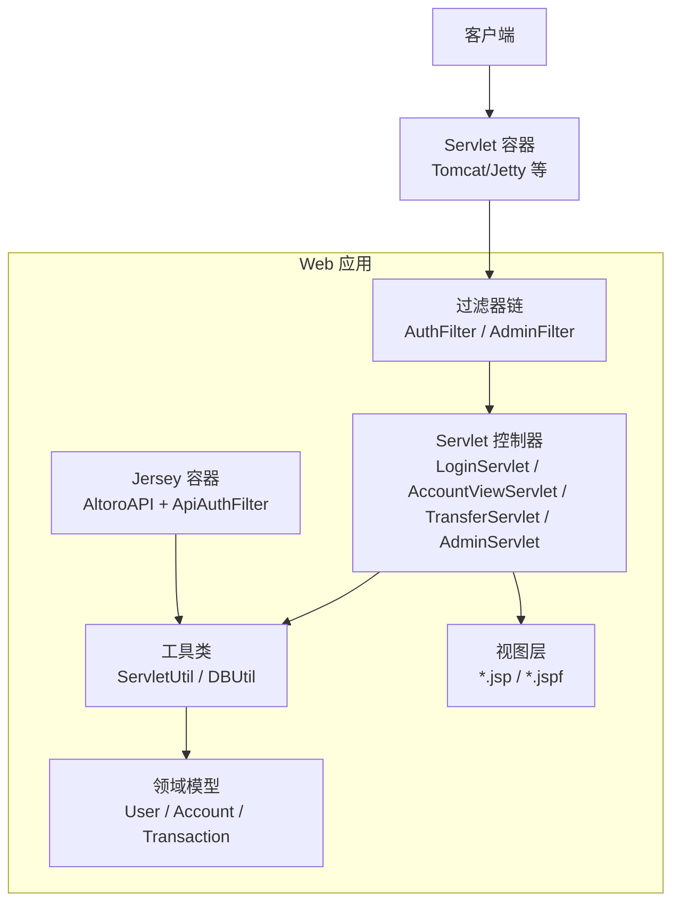
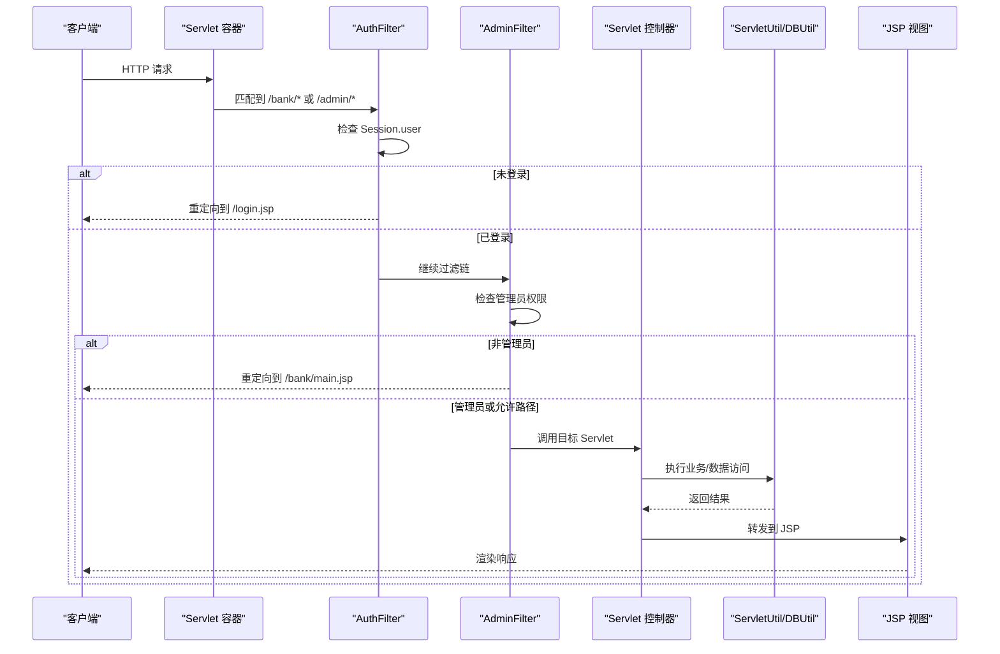
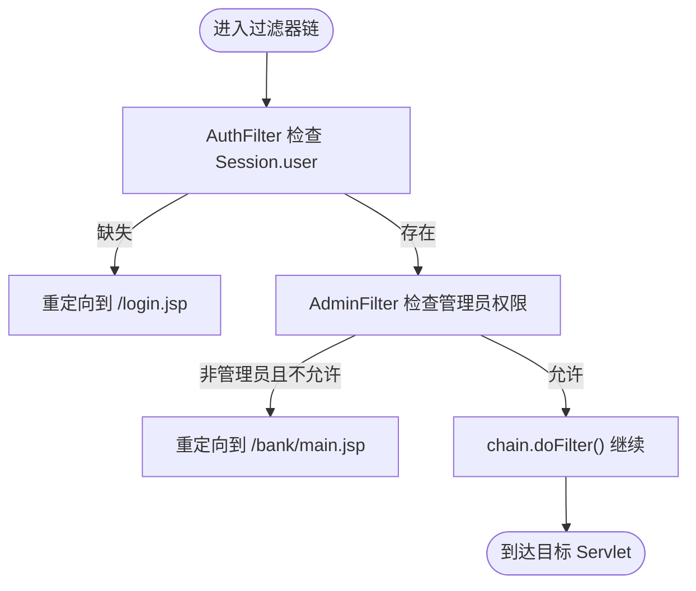
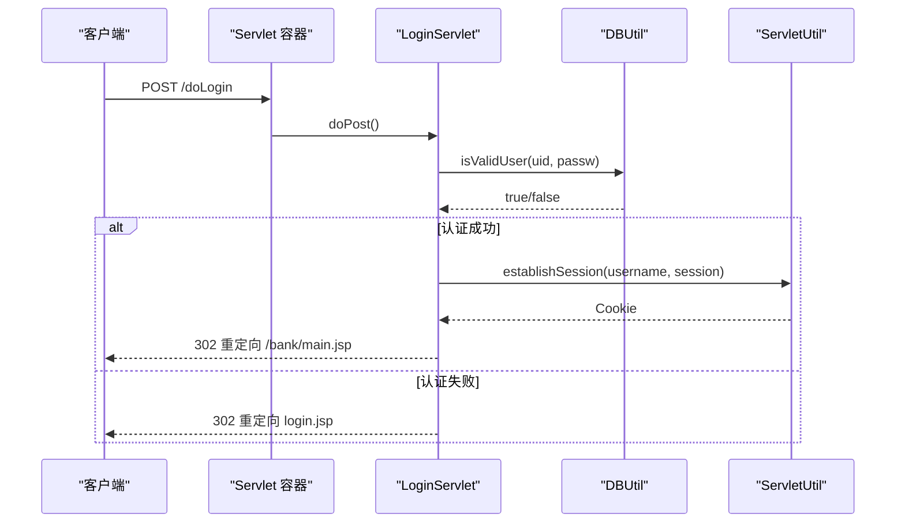
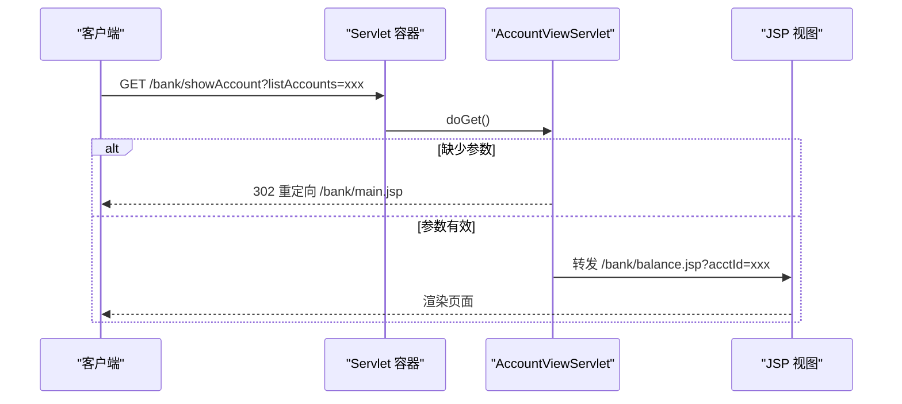
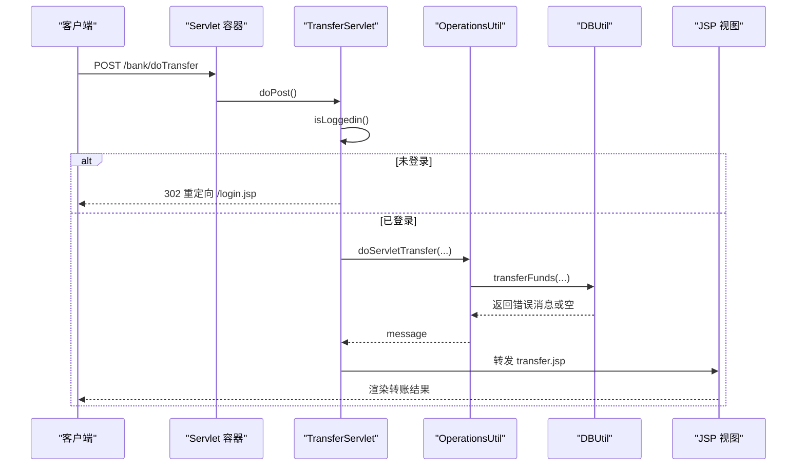
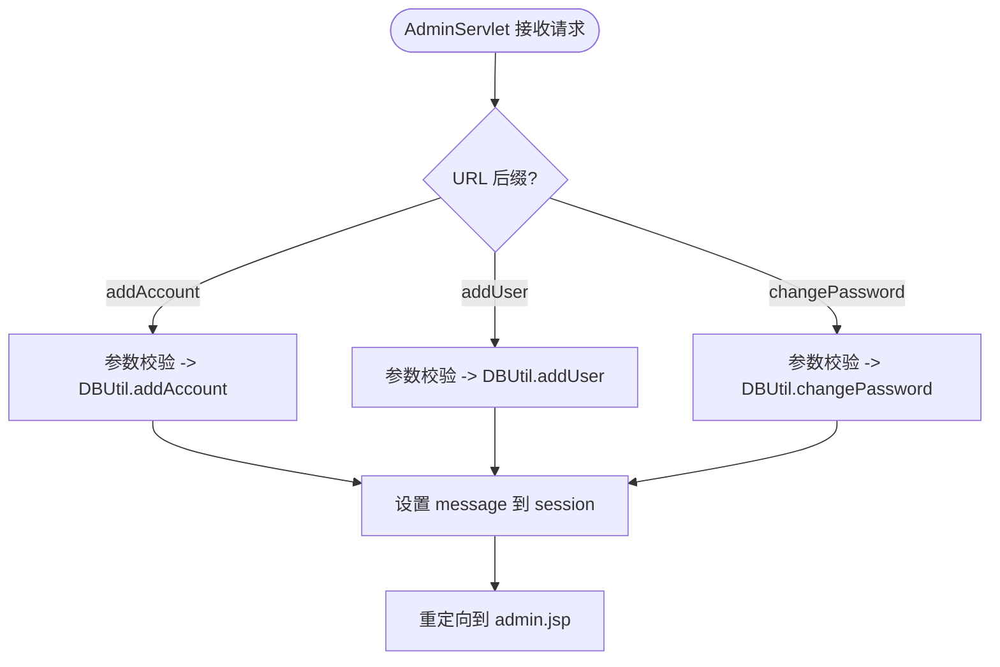
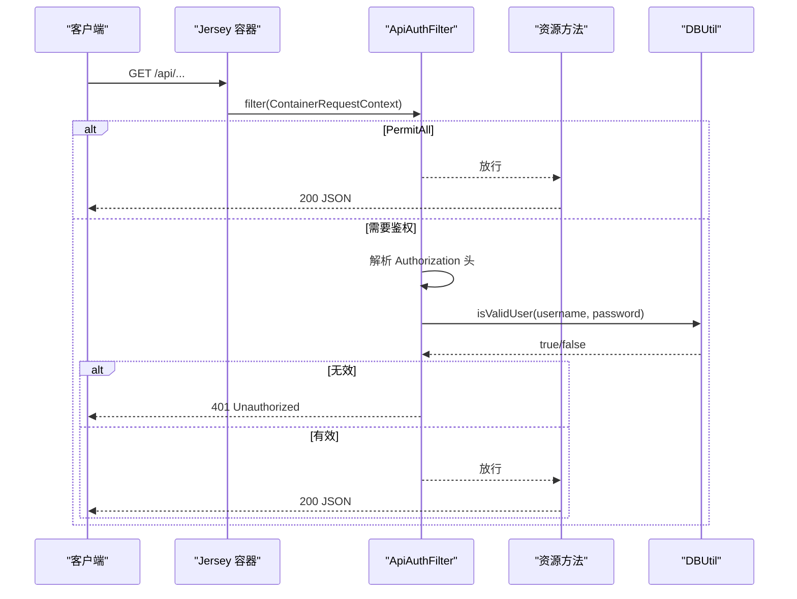
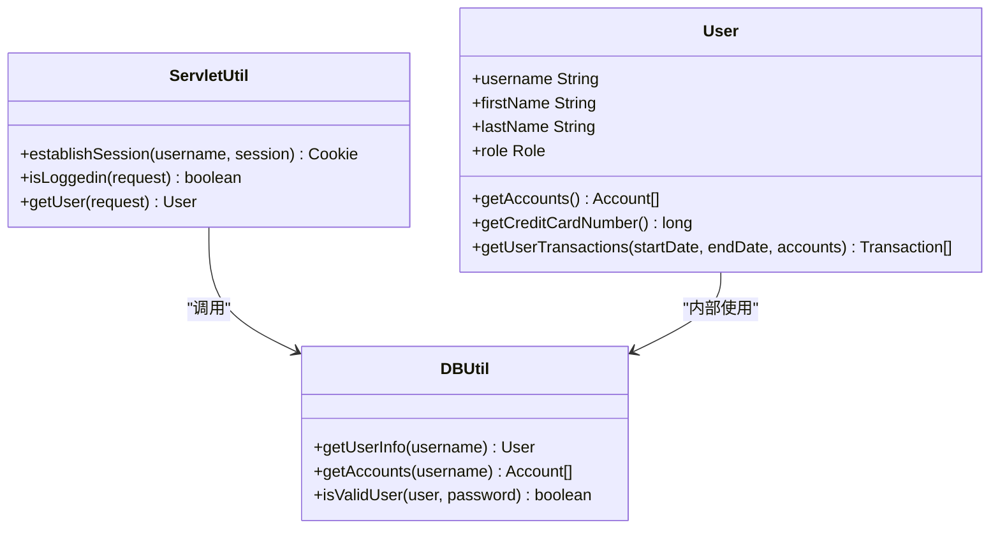
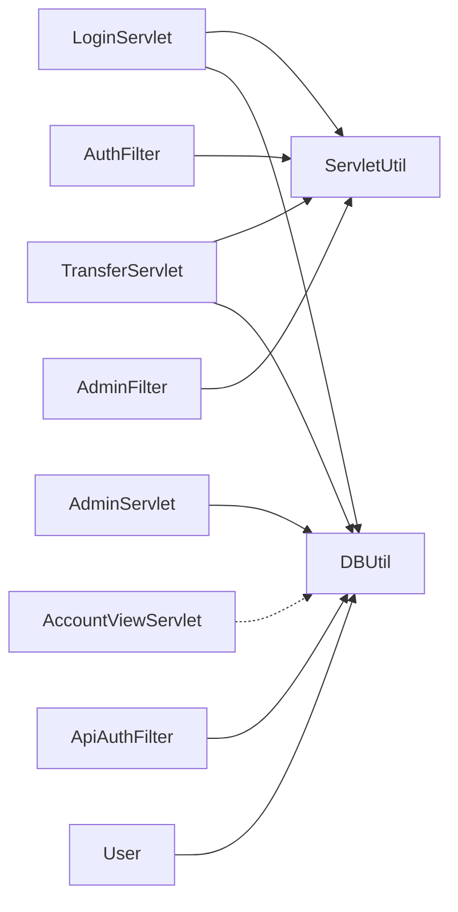

# 组件交互关系

<cite>
**本文引用的文件**   
- [web.xml](file://WebContent/WEB-INF/web.xml)
- [AuthFilter.java](file://src/com/ibm/security/appscan/altoromutual/filter/AuthFilter.java)
- [AdminFilter.java](file://src/com/ibm/security/appscan/altoromutual/filter/AdminFilter.java)
- [ApiAuthFilter.java](file://src/com/ibm/security/appscan/altoromutual/filter/ApiAuthFilter.java)
- [AltoroAPI.java](file://src/com/ibm/security/appscan/altoromutual/api/AltoroAPI.java)
- [LoginServlet.java](file://src/com/ibm/security/appscan/altoromutual/servlet/LoginServlet.java)
- [AccountViewServlet.java](file://src/com/ibm/security/appscan/altoromutual/servlet/AccountViewServlet.java)
- [TransferServlet.java](file://src/com/ibm/security/appscan/altoromutual/servlet/TransferServlet.java)
- [AdminServlet.java](file://src/com/ibm/security/appscan/altoromutual/servlet/AdminServlet.java)
- [DBUtil.java](file://src/com/ibm/security/appscan/altoromutual/util/DBUtil.java)
- [ServletUtil.java](file://src/com/ibm/security/appscan/altoromutual/util/ServletUtil.java)
- [User.java](file://src/com/ibm/security/appscan/altoromutual/model/User.java)
</cite>

## 目录
1. [引言](#引言)
2. [项目结构](#项目结构)
3. [核心组件](#核心组件)
4. [架构总览](#架构总览)
5. [详细组件分析](#详细组件分析)
6. [依赖关系分析](#依赖关系分析)
7. [性能与可扩展性](#性能与可扩展性)
8. [故障排查指南](#故障排查指南)
9. [结论](#结论)

## 引言
本文面向 AltoroJ 的组件交互关系，聚焦于 Servlet 容器、过滤器链、Servlet 控制器、业务逻辑组件与数据访问组件之间的协作模式。文档将描述从 HTTP 请求进入至响应返回的完整生命周期，给出组件间的依赖关系图、时序图与状态转换图，并解释过滤器链的执行顺序与拦截机制。

## 项目结构
AltoroJ 采用传统 Java Web 应用结构：
- 配置入口：web.xml 定义 Filter、Servlet、Listener 及映射关系
- 过滤器层：AuthFilter、AdminFilter（Web 认证与授权），ApiAuthFilter（REST API 鉴权）
- 控制器层：LoginServlet、AccountViewServlet、TransferServlet、AdminServlet 等
- 工具与模型：ServletUtil、DBUtil、User 等
- REST API：通过 Jersey 的 ServletContainer 暴露，由 AltoroAPI 注册 ApiAuthFilter

图表来源
- [web.xml:12-67](file://WebContent/WEB-INF/web.xml#L12-L67)
- [AltoroAPI.java:9-14](file://src/com/ibm/security/appscan/altoromutual/api/AltoroAPI.java#L9-L14)

章节来源
- [web.xml:1-227](file://WebContent/WEB-INF/web.xml#L1-L227)

## 核心组件
- Servlet 容器：根据 web.xml 加载 Listener、Filter、Servlet，并处理请求分发
- 过滤器：
  - AuthFilter：对 /bank/*、/admin/*、/account.jsp 进行登录态校验
  - AdminFilter：对 /adimn/* 进行管理员权限校验（注意映射路径为 /adimn/*）
  - ApiAuthFilter：对 /api 下的资源进行 Bearer Token 鉴权
- Servlet 控制器：
  - LoginServlet：处理登录/登出
  - AccountViewServlet：查看账户余额与交易列表
  - TransferServlet：转账操作
  - AdminServlet：管理员增删改用户/账户/密码
- 工具与数据访问：
  - ServletUtil：会话建立、属性读取、Swagger 初始化等
  - DBUtil：数据库连接、CRUD、转账事务逻辑
- 领域模型：
  - User：用户信息、角色、账户集合、信用卡号识别等

章节来源
- [AuthFilter.java:40-79](file://src/com/ibm/security/appscan/altoromutual/filter/AuthFilter.java#L40-L79)
- [AdminFilter.java:40-90](file://src/com/ibm/security/appscan/altoromutual/filter/AdminFilter.java#L40-L90)
- [ApiAuthFilter.java:20-76](file://src/com/ibm/security/appscan/altoromutual/filter/ApiAuthFilter.java#L20-L76)
- [LoginServlet.java:38-108](file://src/com/ibm/security/appscan/altoromutual/servlet/LoginServlet.java#L38-L108)
- [AccountViewServlet.java:35-82](file://src/com/ibm/security/appscan/altoromutual/servlet/AccountViewServlet.java#L35-L82)
- [TransferServlet.java:38-71](file://src/com/ibm/security/appscan/altoromutual/servlet/TransferServlet.java#L38-L71)
- [AdminServlet.java:33-124](file://src/com/ibm/security/appscan/altoromutual/servlet/AdminServlet.java#L33-L124)
- [DBUtil.java:45-536](file://src/com/ibm/security/appscan/altoromutual/util/DBUtil.java#L45-L536)
- [ServletUtil.java:58-412](file://src/com/ibm/security/appscan/altoromutual/util/ServletUtil.java#L58-L412)
- [User.java:30-108](file://src/com/ibm/security/appscan/altoromutual/model/User.java#L30-L108)

## 架构总览
整体请求流遵循“容器 -> 过滤器链 -> Servlet 控制器 -> 工具/数据访问 -> 视图”的分层模式；REST API 走 Jersey 容器，经 ApiAuthFilter 鉴权后到达具体资源方法。

图表来源
- [web.xml:28-59](file://WebContent/WEB-INF/web.xml#L28-L59)
- [AuthFilter.java:58-70](file://src/com/ibm/security/appscan/altoromutual/filter/AuthFilter.java#L58-L70)
- [AdminFilter.java:58-81](file://src/com/ibm/security/appscan/altoromutual/filter/AdminFilter.java#L58-L81)

## 详细组件分析

### 过滤器链执行顺序与拦截机制
- 映射规则
  - AuthFilter：/bank/*、/admin/*、/account.jsp，支持 REQUEST/FORWARD/INCLUDE/ERROR
  - AdminFilter：/adimn/*（注意拼写），同样支持多种 dispatcher
- 执行顺序
  - 按 web.xml 中 filter-mapping 出现顺序依次执行
  - 每个过滤器决定是否调用 chain.doFilter() 继续传递
- 拦截逻辑
  - AuthFilter：若 Session 中不存在有效 User，则重定向到 /login.jsp
  - AdminFilter：若当前用户不是管理员且不在允许路径，则重定向到 /login.jsp 或 /bank/main.jsp

图表来源
- [web.xml:28-59](file://WebContent/WEB-INF/web.xml#L28-L59)
- [AuthFilter.java:58-70](file://src/com/ibm/security/appscan/altoromutual/filter/AuthFilter.java#L58-L70)
- [AdminFilter.java:58-81](file://src/com/ibm/security/appscan/altoromutual/filter/AdminFilter.java#L58-L81)

章节来源
- [web.xml:12-59](file://WebContent/WEB-INF/web.xml#L12-L59)
- [AuthFilter.java:40-79](file://src/com/ibm/security/appscan/altoromutual/filter/AuthFilter.java#L40-L79)
- [AdminFilter.java:40-90](file://src/com/ibm/security/appscan/altoromutual/filter/AdminFilter.java#L40-L90)

### 登录/登出流程（LoginServlet）
- 登录（POST /doLogin）
  - 参数 uid/passw 经 trim 后校验
  - 调用 DBUtil.isValidUser 验证用户
  - 成功：通过 ServletUtil.establishSession 建立会话与 Cookie，并重定向到 /bank/main.jsp
  - 失败：设置错误消息并重定向回 login.jsp
- 登出（GET /logout.jsp）
  - 移除 Session 中的 user 属性，重定向到 index.jsp

图表来源
- [LoginServlet.java:67-105](file://src/com/ibm/security/appscan/altoromutual/servlet/LoginServlet.java#L67-L105)
- [DBUtil.java:212-232](file://src/com/ibm/security/appscan/altoromutual/util/DBUtil.java#L212-L232)
- [ServletUtil.java:340-353](file://src/com/ibm/security/appscan/altoromutual/util/ServletUtil.java#L340-L353)

章节来源
- [LoginServlet.java:38-108](file://src/com/ibm/security/appscan/altoromutual/servlet/LoginServlet.java#L38-L108)
- [DBUtil.java:212-232](file://src/com/ibm/security/appscan/altoromutual/util/DBUtil.java#L212-L232)
- [ServletUtil.java:340-353](file://src/com/ibm/security/appscan/altoromutual/util/ServletUtil.java#L340-L353)

### 账户查看与交易查询（AccountViewServlet）
- GET /bank/showAccount
  - 校验 listAccounts 参数，为空则重定向到 /bank/main.jsp
  - 使用 RequestDispatcher 转发到 /bank/balance.jsp?acctId=...
- GET/POST /bank/showTransactions
  - 获取 startDate/endDate 参数
  - 转发到 /bank/transaction.jsp 携带时间范围参数

图表来源
- [AccountViewServlet.java:48-66](file://src/com/ibm/security/appscan/altoromutual/servlet/AccountViewServlet.java#L48-L66)

章节来源
- [AccountViewServlet.java:35-82](file://src/com/ibm/security/appscan/altoromutual/servlet/AccountViewServlet.java#L35-L82)

### 转账流程（TransferServlet）
- 统一走 doPost（doGet 委托给 doPost）
- 先检查是否已登录（ServletUtil.isLoggedin），未登录则重定向到 /login.jsp
- 解析 fromAccount、toAccount、transferAmount
- 调用 OperationsUtil.doServletTransfer 执行业务逻辑（内部会调用 DBUtil.transferFunds）
- 将 message 写入 request 属性，转发到 transfer.jsp

图表来源
- [TransferServlet.java:51-68](file://src/com/ibm/security/appscan/altoromutual/servlet/TransferServlet.java#L51-L68)
- [DBUtil.java:303-364](file://src/com/ibm/security/appscan/altoromutual/util/DBUtil.java#L303-L364)

章节来源
- [TransferServlet.java:38-71](file://src/com/ibm/security/appscan/altoromutual/servlet/TransferServlet.java#L38-L71)
- [DBUtil.java:303-364](file://src/com/ibm/security/appscan/altoromutual/util/DBUtil.java#L303-L364)

### 管理员操作（AdminServlet）
- 路由判断依据 URL 后缀：addAccount、addUser、changePassword
- 参数校验与一致性检查（如两次密码一致）
- 调用 DBUtil.addAccount/addUser/changePassword
- 将 message 写入 session，重定向到 admin.jsp

图表来源
- [AdminServlet.java:39-120](file://src/com/ibm/security/appscan/altoromutual/servlet/AdminServlet.java#L39-L120)
- [DBUtil.java:472-517](file://src/com/ibm/security/appscan/altoromutual/util/DBUtil.java#L472-L517)

章节来源
- [AdminServlet.java:33-124](file://src/com/ibm/security/appscan/altoromutual/servlet/AdminServlet.java#L33-L124)
- [DBUtil.java:472-517](file://src/com/ibm/security/appscan/altoromutual/util/DBUtil.java#L472-L517)

### REST API 鉴权（ApiAuthFilter + AltoroAPI）
- AltoroAPI 注册 Jersey ApplicationPath 为 /api，并注册 ApiAuthFilter
- ApiAuthFilter 在容器层面拦截所有 /api 请求：
  - 若方法标注 PermitAll，直接放行
  - 否则要求 Authorization 头包含 Bearer Token
  - Token 解码后需符合用户名:密码格式，并通过 DBUtil.isValidUser 校验
  - 校验失败返回 401，异常返回 500

图表来源
- [AltoroAPI.java:9-14](file://src/com/ibm/security/appscan/altoromutual/api/AltoroAPI.java#L9-L14)
- [ApiAuthFilter.java:29-74](file://src/com/ibm/security/appscan/altoromutual/filter/ApiAuthFilter.java#L29-L74)
- [DBUtil.java:212-232](file://src/com/ibm/security/appscan/altoromutual/util/DBUtil.java#L212-L232)

章节来源
- [AltoroAPI.java:1-16](file://src/com/ibm/security/appscan/altoromutual/api/AltoroAPI.java#L1-L16)
- [ApiAuthFilter.java:1-76](file://src/com/ibm/security/appscan/altoromutual/filter/ApiAuthFilter.java#L1-L76)

### 会话与用户模型
- ServletUtil.establishSession：
  - 通过 DBUtil.getUserInfo 获取用户信息
  - 获取用户账户列表，生成 Base64 编码的 Cookie
  - 将 User 对象放入 Session 的 SESSION_ATTR_USER
- User 模型：
  - 提供 getAccounts、getCreditCardNumber、getUserTransactions 等方法
  - 角色枚举 Role.User/Admin

图表来源
- [ServletUtil.java:340-353](file://src/com/ibm/security/appscan/altoromutual/util/ServletUtil.java#L340-L353)
- [User.java:76-106](file://src/com/ibm/security/appscan/altoromutual/model/User.java#L76-L106)
- [DBUtil.java:241-267](file://src/com/ibm/security/appscan/altoromutual/util/DBUtil.java#L241-L267)

章节来源
- [ServletUtil.java:340-353](file://src/com/ibm/security/appscan/altoromutual/util/ServletUtil.java#L340-L353)
- [User.java:30-108](file://src/com/ibm/security/appscan/altoromutual/model/User.java#L30-L108)
- [DBUtil.java:241-267](file://src/com/ibm/security/appscan/altoromutual/util/DBUtil.java#L241-L267)

## 依赖关系分析
- 控制器依赖工具类：
  - LoginServlet -> ServletUtil、DBUtil
  - TransferServlet -> ServletUtil、OperationsUtil（间接依赖 DBUtil）
  - AdminServlet -> DBUtil
  - AccountViewServlet -> 主要做转发，不直接依赖 DBUtil
- 过滤器依赖模型与工具：
  - AuthFilter -> ServletUtil（常量）、User（类型）
  - AdminFilter -> ServletUtil、User.Role
  - ApiAuthFilter -> DBUtil
- 模型依赖数据访问：
  - User -> DBUtil（获取账户、交易等）

图表来源
- [LoginServlet.java:67-105](file://src/com/ibm/security/appscan/altoromutual/servlet/LoginServlet.java#L67-L105)
- [TransferServlet.java:51-68](file://src/com/ibm/security/appscan/altoromutual/servlet/TransferServlet.java#L51-L68)
- [AdminServlet.java:39-120](file://src/com/ibm/security/appscan/altoromutual/servlet/AdminServlet.java#L39-L120)
- [AuthFilter.java:58-70](file://src/com/ibm/security/appscan/altoromutual/filter/AuthFilter.java#L58-L70)
- [AdminFilter.java:58-81](file://src/com/ibm/security/appscan/altoromutual/filter/AdminFilter.java#L58-L81)
- [ApiAuthFilter.java:65-73](file://src/com/ibm/security/appscan/altoromutual/filter/ApiAuthFilter.java#L65-L73)
- [User.java:76-106](file://src/com/ibm/security/appscan/altoromutual/model/User.java#L76-L106)

章节来源
- [web.xml:60-223](file://WebContent/WEB-INF/web.xml#L60-L223)

## 性能与可扩展性
- 数据库连接
  - DBUtil 单例维护 Connection，优先使用外部 DataSource，否则使用嵌入式 Derby
  - 建议在生产环境启用连接池（如 HikariCP）替代直连
- 会话管理
  - ServletUtil.establishSession 每次登录都会查询用户与账户，可考虑缓存热点用户信息
- 鉴权优化
  - ApiAuthFilter 每次请求都进行 Base64 解码与 DB 校验，可引入短期令牌缓存或签名校验减少 DB 压力
- 视图渲染
  - 大量 JSP 转发可能带来模板开销，可逐步迁移到服务端模板引擎或前后端分离

[本节为通用指导，不涉及具体文件分析]

## 故障排查指南
- 无法访问受保护页面
  - 检查 AuthFilter 是否正确拦截 /bank/*、/admin/*
  - 确认 Session 中存在有效的 User 对象
- 管理员功能不可用
  - 检查 AdminFilter 的路径映射是否为 /adimn/*（注意拼写）
  - 确认用户角色为 Admin 或具备管理员会话标记
- REST API 401 错误
  - 检查 Authorization 头是否包含 Bearer Token
  - 确认 Token 解码后的用户名:密码格式正确且用户有效
- 登录失败
  - 检查 DBUtil.isValidUser 逻辑与数据库内容
  - 确认表单字段 uid/passw 名称与大小写

章节来源
- [AuthFilter.java:58-70](file://src/com/ibm/security/appscan/altoromutual/filter/AuthFilter.java#L58-L70)
- [AdminFilter.java:58-81](file://src/com/ibm/security/appscan/altoromutual/filter/AdminFilter.java#L58-L81)
- [ApiAuthFilter.java:42-73](file://src/com/ibm/security/appscan/altoromutual/filter/ApiAuthFilter.java#L42-L73)
- [LoginServlet.java:67-105](file://src/com/ibm/security/appscan/altoromutual/servlet/LoginServlet.java#L67-L105)
- [DBUtil.java:212-232](file://src/com/ibm/security/appscan/altoromutual/util/DBUtil.java#L212-L232)

## 结论
AltoroJ 的请求处理链路清晰分层：Servlet 容器负责调度，过滤器链承担认证与授权，Servlet 控制器编排业务流程，工具与数据访问组件封装持久化逻辑，模型承载领域概念。通过 web.xml 的映射与过滤器链的顺序控制，系统实现了统一的访问控制策略；REST API 通过 Jersey 容器与 ApiAuthFilter 实现集中鉴权。建议在后续演进中引入连接池、令牌缓存与更完善的错误处理，以提升性能与可观测性。