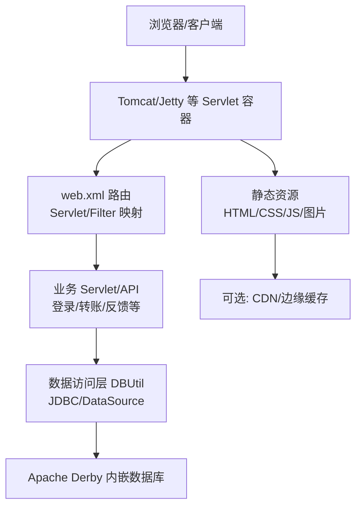
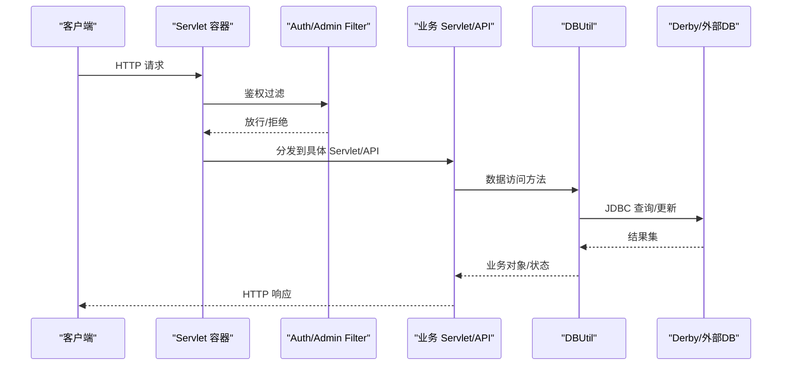
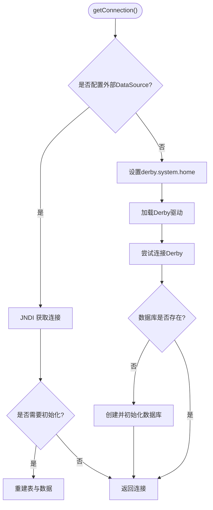
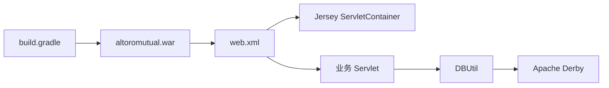

# 性能调优

<cite>
**本文引用的文件**   
- [README.md](file://README.md)
- [build.gradle](file://build.gradle)
- [web.xml](file://WebContent/WEB-INF/web.xml)
- [app.properties](file://WebContent/WEB-INF/app.properties)
- [ibm-web-ext.xml](file://WebContent/WEB-INF/ibm-web-ext.xml)
- [DBUtil.java](file://src/com/ibm/security/appscan/altoromutual/util/DBUtil.java)
- [ServletUtil.java](file://src/com/ibm/security/appscan/altoromutual/util/ServletUtil.java)
- [index.jsp](file://WebContent/index.jsp)
</cite>

## 目录
1. [简介](#简介)
2. [项目结构](#项目结构)
3. [核心组件](#核心组件)
4. [架构总览](#架构总览)
5. [详细组件分析](#详细组件分析)
6. [依赖关系分析](#依赖关系分析)
7. [性能考虑](#性能考虑)
8. [故障排查指南](#故障排查指南)
9. [结论](#结论)
10. [附录](#附录)

## 简介
本文件面向 AltoroJ 的性能调优，围绕 JVM 参数优化、内存与垃圾回收策略、数据库连接池与查询优化、索引策略、Servlet 容器与线程池配置、请求处理优化、缓存与静态资源优化、CDN 集成、性能测试方法与监控指标、高并发优化建议与容量规划等方面提供系统化指导。文档在给出通用最佳实践的同时，结合代码库中的实际实现（如 Derby 内嵌数据库、JDBC 直连、Jersey REST API、过滤器与 Servlet 映射等）进行针对性分析与改进建议。

## 项目结构
AltoroJ 是一个基于 JSP/Servlet 的示例银行 Web 应用，使用 Apache Derby 作为默认内嵌数据库，通过 Jersey 暴露 REST API，并通过 web.xml 注册 Servlet、Filter 与监听器。构建系统采用 Gradle，打包为 WAR。

图表来源
- [web.xml:1-227](file://WebContent/WEB-INF/web.xml#L1-L227)
- [DBUtil.java:45-138](file://src/com/ibm/security/appscan/altoromutual/util/DBUtil.java#L45-L138)
- [build.gradle:1-43](file://build.gradle#L1-L43)

章节来源
- [README.md:1-63](file://README.md#L1-L63)
- [build.gradle:1-43](file://build.gradle#L1-L43)
- [web.xml:1-227](file://WebContent/WEB-INF/web.xml#L1-L227)

## 核心组件
- 数据访问层：DBUtil 负责数据库连接获取、初始化与常用 SQL 操作；支持外部 DataSource 或内嵌 Derby。
- Web 层：web.xml 定义 Servlet、Filter、Listener 与 REST API（Jersey）。
- 配置层：app.properties 提供行为开关与数据库相关属性；ibm-web-ext.xml 提供 IBM WebSphere 扩展配置。
- 工具层：ServletUtil 提供会话、Cookie、应用属性读取等辅助能力。

章节来源
- [DBUtil.java:45-138](file://src/com/ibm/security/appscan/altoromutual/util/DBUtil.java#L45-L138)
- [web.xml:1-227](file://WebContent/WEB-INF/web.xml#L1-L227)
- [app.properties:57-74](file://WebContent/WEB-INF/app.properties#L57-L74)
- [ibm-web-ext.xml:1-15](file://WebContent/WEB-INF/ibm-web-ext.xml#L1-L15)
- [ServletUtil.java:340-378](file://src/com/ibm/security/appscan/altoromutual/util/ServletUtil.java#L340-L378)

## 架构总览
从请求到响应的关键路径包括：Servlet 容器接收请求 → Filter 鉴权 → Servlet/API 处理 → 调用 DBUtil 执行 SQL → 返回结果。REST API 通过 Jersey 的 ServletContainer 暴露。

图表来源
- [web.xml:59-68](file://WebContent/WEB-INF/web.xml#L59-L68)
- [web.xml:12-51](file://WebContent/WEB-INF/web.xml#L12-L51)
- [DBUtil.java:99-138](file://src/com/ibm/security/appscan/altoromutual/util/DBUtil.java#L99-L138)

## 详细组件分析

### 数据访问层（DBUtil）与数据库连接池
- 当前实现要点
  - 单例模式持有 Connection，首次获取时根据 app.properties 判断是否使用外部 DataSource；否则设置 derby.system.home 并加载内嵌 Derby 驱动。
  - getConnection() 中若存在外部 DataSource，则通过 JNDI 获取连接；否则通过 DriverManager 直接连接 Derby。
  - 支持 database.reinitializeOnStart 在启动时重建表结构与初始数据。
- 性能瓶颈与风险
  - 单 Connection 非线程安全，在高并发下会导致竞态条件与异常。
  - 未使用连接池，频繁创建/销毁连接开销大。
  - 大量 SQL 使用 Statement 拼接，易产生全表扫描与锁竞争。
- 优化建议
  - 引入连接池（HikariCP/Druid），替换单 Connection 为池化 DataSource。
  - 将 JNDI DataSource 注入到 DBUtil，避免每次 JNDI lookup。
  - 使用 PreparedStatement 替代字符串拼接，提升解析与执行效率。
  - 对高频查询增加分页与只读事务隔离级别，减少锁竞争。
  - 针对 ACCOUNTS.USERID、TRANSACTIONS.ACCOUNTID、TRANSACTIONS.DATE 建立合适索引。

图表来源
- [DBUtil.java:61-97](file://src/com/ibm/security/appscan/altoromutual/util/DBUtil.java#L61-L97)
- [DBUtil.java:99-138](file://src/com/ibm/security/appscan/altoromutual/util/DBUtil.java#L99-L138)
- [DBUtil.java:143-167](file://src/com/ibm/security/appscan/altoromutual/util/DBUtil.java#L143-L167)

章节来源
- [DBUtil.java:45-138](file://src/com/ibm/security/appscan/altoromutual/util/DBUtil.java#L45-L138)
- [DBUtil.java:143-167](file://src/com/ibm/security/appscan/altoromutual/util/DBUtil.java#L143-L167)
- [app.properties:57-74](file://WebContent/WEB-INF/app.properties#L57-L74)

### Servlet 容器与线程池配置
- 现状
  - web.xml 定义了多个 Servlet 与 Filter，以及 Jersey REST API。
  - ibm-web-ext.xml 包含 reload-interval、enable-reloading 等开发期选项。
- 性能关注点
  - 未显式配置线程池大小、队列长度、超时等，依赖容器默认值。
  - enable-reloading=true 会引入类重载开销，生产环境应关闭。
- 优化建议
  - 调整容器线程池（如 Tomcat 的 maxThreads、minSpareThreads、acceptCount）。
  - 关闭开发期热部署与目录浏览，减少额外开销。
  - 合理设置 JSP 编译与预编译，减少首请求延迟。
  - 对长耗时操作使用异步处理或后台任务，避免阻塞工作线程。

章节来源
- [web.xml:1-227](file://WebContent/WEB-INF/web.xml#L1-L227)
- [ibm-web-ext.xml:1-15](file://WebContent/WEB-INF/ibm-web-ext.xml#L1-L15)

### 查询优化与索引策略
- 现状
  - 多处使用动态 SQL 拼接与 SELECT *，可能引发全表扫描与不必要列传输。
  - 交易查询按账户 ID OR 条件组合，且 ORDER BY DATE DESC，若无索引将导致排序与扫描放大。
- 优化建议
  - 使用 PreparedStatement 与参数绑定，避免重复解析与注入风险。
  - 明确选择所需列，避免 SELECT *。
  - 为常见过滤字段建立复合索引，例如：
    - ACCOUNTS(USERID, ACCOUNT_NAME)
    - TRANSACTIONS(ACCOUNTID, DATE)
  - 对分页查询使用 LIMIT/OFFSET 或游标方式，限制最大行数。
  - 对统计类查询使用物化视图或汇总表，降低实时计算压力。

章节来源
- [DBUtil.java:173-202](file://src/com/ibm/security/appscan/altoromutual/util/DBUtil.java#L173-L202)
- [DBUtil.java:375-427](file://src/com/ibm/security/appscan/altoromutual/util/DBUtil.java#L375-L427)

### 缓存策略设计
- 现状
  - 未发现显式缓存实现；用户信息与会话数据通过 Cookie/Session 传递。
- 优化建议
  - 热点数据（如账户余额、用户基本信息）引入本地缓存（Caffeine/Guava）或分布式缓存（Redis）。
  - 对只读查询结果设置 TTL，配合失效策略（写后失效/定时刷新）。
  - 对静态页面与 Swagger UI 资源启用浏览器缓存与压缩。
  - 对频繁访问的配置项（如功能开关）做应用级缓存，减少 I/O。

### 静态资源优化与 CDN 集成
- 现状
  - 静态资源位于 WebContent/static 与 swagger 目录，由容器直接服务。
- 优化建议
  - 启用 gzip/brotli 压缩，合并与裁剪 JS/CSS，使用版本化文件名。
  - 将静态资源迁移至对象存储 + CDN，减轻应用服务器负载。
  - 设置合理的 Cache-Control/ETag，利用浏览器缓存。
  - 对大体积资源（Swagger UI bundle）按需加载或懒加载。

章节来源
- [index.jsp:33-63](file://WebContent/index.jsp#L33-L63)

### 性能测试方法与基准测试工具
- 推荐工具
  - JMeter、k6、wrk、Gatling 用于压测与基准测试。
  - Prometheus + Grafana 用于指标采集与可视化。
  - APM 工具（如 SkyWalking、Pinpoint、New Relic）用于链路追踪与慢查询定位。
- 测试场景
  - 登录、转账、查询交易、反馈提交等典型路径。
  - 混合负载（读多写少）与突发流量（峰值）场景。
  - 数据库连接池饱和、缓存命中率变化下的表现。
- 指标
  - 吞吐量（RPS）、P95/P99 延迟、错误率、CPU/内存/GC 指标、连接池使用率、慢查询数量。

### 高并发优化建议与容量规划
- 应用层
  - 无状态化设计，便于水平扩展；会话外置（Redis）。
  - 限流与熔断保护后端资源，防止雪崩。
  - 异步化处理非关键路径（如通知、日志落盘）。
- 数据层
  - 读写分离、分库分表（按 USERID/ACCOUNTID 哈希）。
  - 连接池参数按 CPU 核数与 IO 特性调优，避免过度连接。
- 容量规划
  - 以压测结果为依据，确定单机 QPS 与延迟基线。
  - 根据目标 RPS 与 P99 延迟，估算实例数与资源规格。
  - 预留 30%-50% 冗余应对突发与增长。

## 依赖关系分析
- 构建与运行时依赖
  - build.gradle 声明了 Jersey、Derby、Log4j 等依赖，WAR 包名称为 altoromutual.war。
- 运行时依赖
  - web.xml 注册 Jersey ServletContainer 与业务 Servlet/Filter。
  - DBUtil 依赖 Derby 驱动或外部 DataSource。

图表来源
- [build.gradle:23-37](file://build.gradle#L23-L37)
- [web.xml:59-68](file://WebContent/WEB-INF/web.xml#L59-L68)
- [DBUtil.java:47-48](file://src/com/ibm/security/appscan/altoromutual/util/DBUtil.java#L47-L48)

章节来源
- [build.gradle:1-43](file://build.gradle#L1-L43)
- [web.xml:1-227](file://WebContent/WEB-INF/web.xml#L1-L227)
- [DBUtil.java:45-97](file://src/com/ibm/security/appscan/altoromutual/util/DBUtil.java#L45-L97)

## 性能考虑
- JVM 参数优化
  - 堆大小：根据压测结果设置 -Xms/-Xmx，保持相等以减少动态扩容。
  - 新生代/老年代比例：-XX:NewRatio 与 -XX:SurvivorRatio 按对象生命周期调优。
  - GC 日志：-Xloggc 与 -XX:+UseGCLogFileRotation 输出 GC 日志进行分析。
  - 元空间：-XX:MetaspaceSize/-XX:MaxMetaspaceSize 防止类加载导致的 OOM。
- 内存分配策略
  - 减少短生命周期对象创建，复用对象（如 StringBuilder、ByteBuffer）。
  - 避免在热路径上触发 Full GC（如大数组、临时集合）。
- 垃圾回收器选择
  - 低延迟场景优先 G1GC（-XX:+UseG1GC），调整 MaxGCPauseMillis。
  - 大数据量批处理可考虑 ZGC（Java 15+）或 Shenandoah（发行版支持）。
- 数据库连接池
  - HikariCP 推荐参数：maximumPoolSize、minimumIdle、connectionTimeout、idleTimeout、maxLifetime。
  - 根据并发度与数据库承载能力设定池大小，避免连接风暴。
- 查询与索引
  - 使用 EXPLAIN 分析执行计划，消除全表扫描与文件排序。
  - 为高频过滤与排序字段建立索引，注意覆盖索引减少回表。
- Servlet 容器
  - 调整线程池、请求队列、Keep-Alive 与超时参数。
  - 关闭不必要的调试与热部署，减少额外开销。
- 缓存与静态资源
  - 启用浏览器缓存、CDN、压缩与合并。
  - 对热点数据使用多级缓存（本地 + 分布式）。
- 监控与告警
  - 收集 JVM、GC、线程池、连接池、HTTP 延迟与错误率。
  - 设置阈值告警与自动扩缩容策略。

## 故障排查指南
- 常见问题
  - 数据库无法创建：检查 user.home 权限与 derby.system.home 路径。
  - 编译失败：确保 Gradle 构建下载依赖并完成编译。
- 定位步骤
  - 查看容器日志（如 catalina.out）与应用日志（Log4j）。
  - 开启 GC 日志与慢查询日志，分析瓶颈。
  - 使用 APM 工具定位慢接口与数据库慢查询。
- 恢复措施
  - 修正权限与路径，必要时重置数据库。
  - 调整连接池与线程池参数，缓解资源争用。
  - 对热点接口增加缓存与限流。

章节来源
- [README.md:44-57](file://README.md#L44-L57)
- [DBUtil.java:84-97](file://src/com/ibm/security/appscan/altoromutual/util/DBUtil.java#L84-L97)

## 结论
AltoroJ 当前采用内嵌 Derby 与单 Connection 的数据访问模式，适合演示与学习，但在高并发与生产环境下存在明显性能瓶颈。建议优先引入连接池与缓存、优化查询与索引、调整 JVM 与容器参数，并结合监控与压测持续迭代。静态资源迁移至 CDN 与启用压缩/缓存可显著降低应用服务器负载。通过系统化的性能调优与容量规划，可在保证稳定性的同时提升吞吐与延迟表现。

## 附录
- 关键配置文件与入口
  - [web.xml](file://WebContent/WEB-INF/web.xml)
  - [app.properties](file://WebContent/WEB-INF/app.properties)
  - [ibm-web-ext.xml](file://WebContent/WEB-INF/ibm-web-ext.xml)
  - [build.gradle](file://build.gradle)
- 核心源码
  - [DBUtil.java](file://src/com/ibm/security/appscan/altoromutual/util/DBUtil.java)
  - [ServletUtil.java](file://src/com/ibm/security/appscan/altoromutual/util/ServletUtil.java)
  - [index.jsp](file://WebContent/index.jsp)