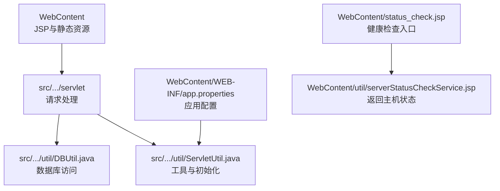
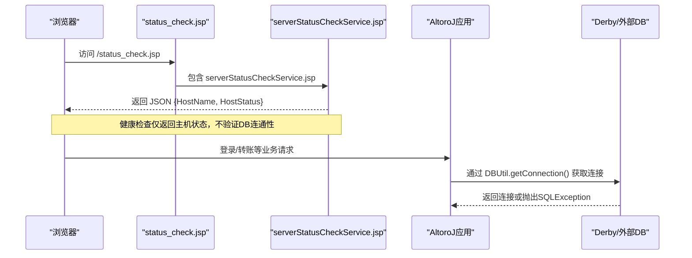
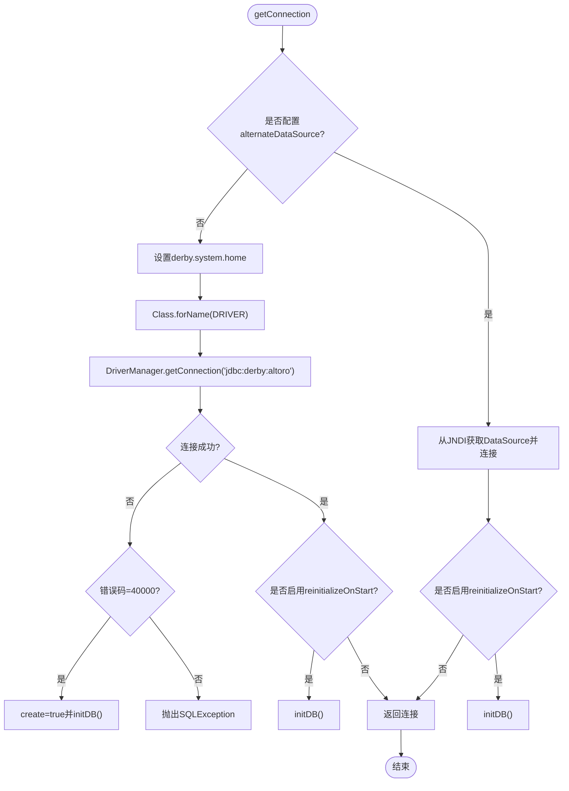
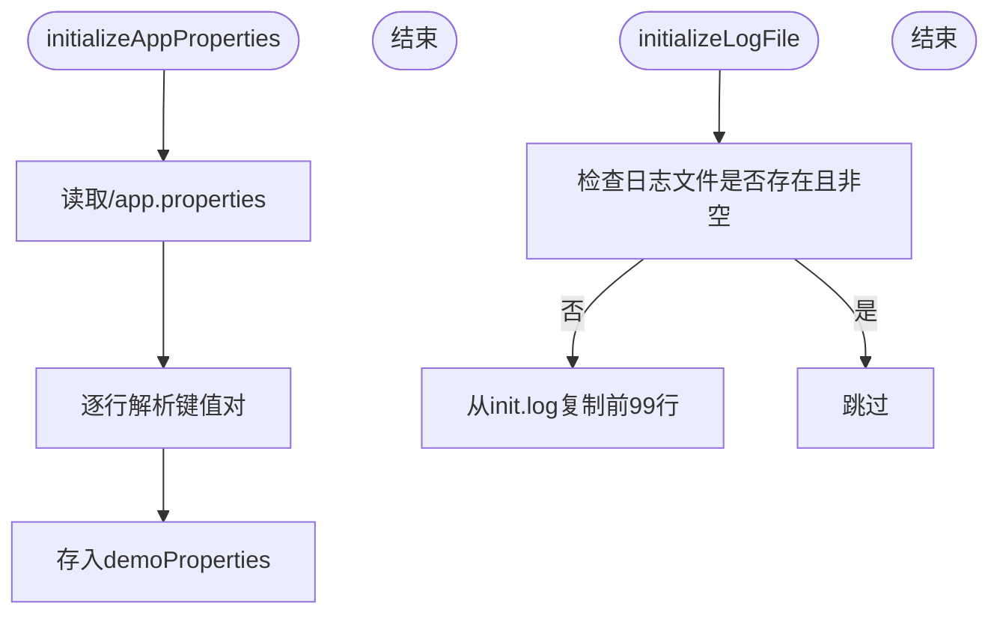
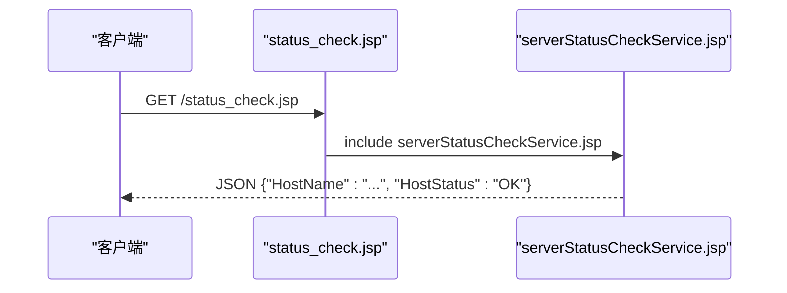
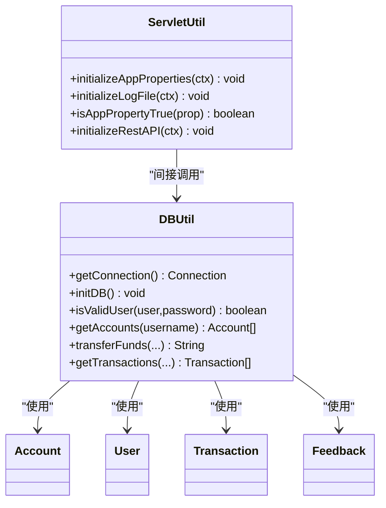
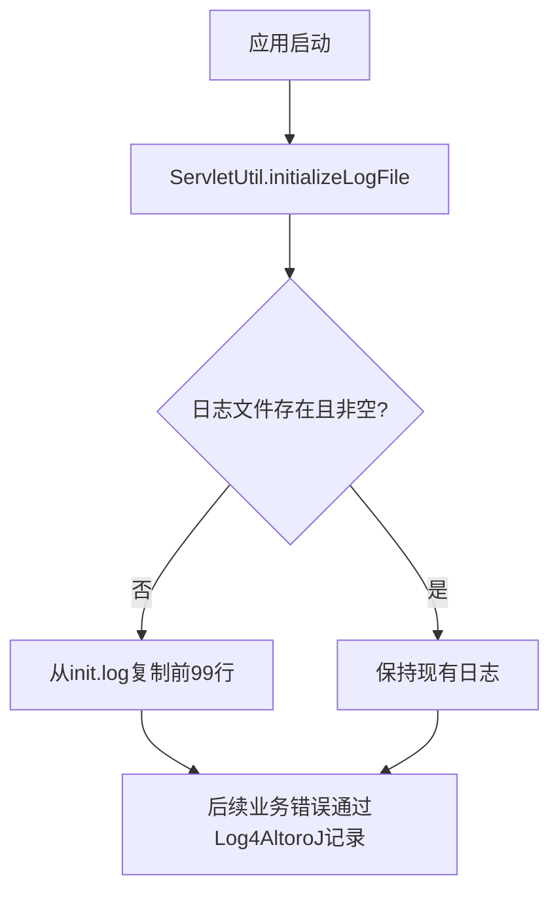
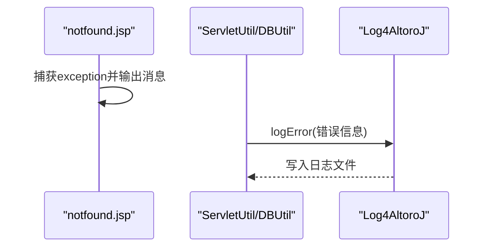
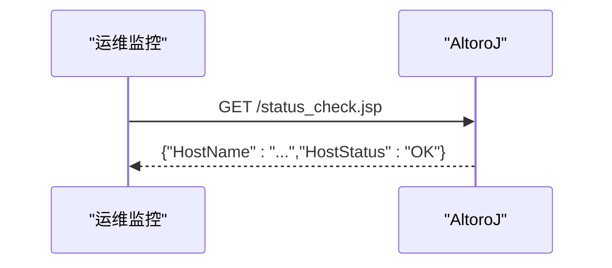

# 故障排除指南

<cite>
**本文引用的文件**   
- [README.md](file://README.md)
- [app.properties](file://WebContent/WEB-INF/app.properties)
- [DBUtil.java](file://src/com/ibm/security/appscan/altoromutual/util/DBUtil.java)
- [ServletUtil.java](file://src/com/ibm/security/appscan/altoromutual/util/ServletUtil.java)
- [serverStatusCheckService.jsp](file://WebContent/util/serverStatusCheckService.jsp)
- [status_check.jsp](file://WebContent/status_check.jsp)
- [footer.jspf](file://WebContent/footer.jspf)
- [notfound.jsp](file://WebContent/notfound.jsp)
</cite>

## 目录
1. [简介](#简介)
2. [项目结构](#项目结构)
3. [核心组件](#核心组件)
4. [架构总览](#架构总览)
5. [详细组件分析](#详细组件分析)
6. [依赖关系分析](#依赖关系分析)
7. [性能与稳定性排查](#性能与稳定性排查)
8. [日志分析与错误堆栈解读](#日志分析与错误堆栈解读)
9. [健康检查与服务器状态监控](#健康检查与服务器状态监控)
10. [备份、恢复与灾难恢复](#备份恢复与灾难恢复)
11. [常见问题速查表](#常见问题速查表)
12. [结论](#结论)

## 简介
本指南面向AltoroJ的运维与开发人员，聚焦于常见部署问题的诊断与解决，包括数据库连接失败、类加载异常、内存溢出、性能瓶颈、线程死锁、垃圾回收问题、日志分析方法、错误堆栈解读、调试技巧，以及备份恢复流程、灾难恢复计划与数据一致性检查。文档内容严格基于仓库中的源码与配置进行分析，并提供可操作的步骤与可视化图示，帮助快速定位和解决问题。

## 项目结构
AltoroJ是一个基于Java/JSP的示例银行应用，使用Apache Derby内嵌数据库（默认），支持通过JNDI DataSource接入外部数据库。关键路径：
- Web层：JSP页面与静态资源位于WebContent下
- 业务逻辑：src/com/ibm/security/appscan/altoromutual下的servlet、filter、model、util等包
- 配置：WebContent/WEB-INF/app.properties用于行为与数据库相关开关
- 健康检查：WebContent/status_check.jsp与WebContent/util/serverStatusCheckService.jsp提供基础健康检查能力

**图表来源**
- [DBUtil.java:45-138](file://src/com/ibm/security/appscan/altoromutual/util/DBUtil.java#L45-L138)
- [ServletUtil.java:256-338](file://src/com/ibm/security/appscan/altoromutual/util/ServletUtil.java#L256-L338)
- [app.properties:57-74](file://WebContent/WEB-INF/app.properties#L57-L74)
- [status_check.jsp:24-30](file://WebContent/status_check.jsp#L24-L30)
- [serverStatusCheckService.jsp:1-6](file://WebContent/util/serverStatusCheckService.jsp#L1-L6)

**章节来源**
- [README.md:1-63](file://README.md#L1-L63)
- [app.properties:57-74](file://WebContent/WEB-INF/app.properties#L57-L74)

## 核心组件
- DBUtil：负责数据库连接、初始化与常用SQL操作；支持Derby内嵌库与JNDI DataSource两种模式；在首次连接或特定错误码时自动创建并初始化数据库。
- ServletUtil：负责应用属性加载、日志文件初始化、Swagger API基路径初始化、会话与用户信息获取等通用功能。
- 健康检查：status_check.jsp作为入口，调用serverStatusCheckService.jsp返回JSON形式的“HostStatus”状态。

**章节来源**
- [DBUtil.java:45-167](file://src/com/ibm/security/appscan/altoromutual/util/DBUtil.java#L45-L167)
- [ServletUtil.java:256-338](file://src/com/ibm/security/appscan/altoromutual/util/ServletUtil.java#L256-L338)
- [status_check.jsp:24-30](file://WebContent/status_check.jsp#L24-L30)
- [serverStatusCheckService.jsp:1-6](file://WebContent/util/serverStatusCheckService.jsp#L1-L6)

## 架构总览
下图展示了从浏览器到数据库的关键交互路径，以及健康检查接口的位置。

**图表来源**
- [status_check.jsp:24-30](file://WebContent/status_check.jsp#L24-L30)
- [serverStatusCheckService.jsp:1-6](file://WebContent/util/serverStatusCheckService.jsp#L1-L6)
- [DBUtil.java:99-138](file://src/com/ibm/security/appscan/altoromutual/util/DBUtil.java#L99-L138)

## 详细组件分析

### 数据库连接与初始化（DBUtil）
- 连接策略：
  - 若配置了external DataSource（database.alternateDataSource），则通过JNDI获取DataSource并建立连接。
  - 否则设置derby.system.home为user.home+"/altoro/"，加载EmbeddedDriver并通过DriverManager连接“jdbc:derby:altoro”。
- 自动建库：
  - 当连接失败且错误码为40000（Derby表示数据库不存在）时，以create=true方式创建并初始化数据库。
- 初始化脚本：
  - initDB会删除并重建PEOPLE、ACCOUNTS、TRANSACTIONS、FEEDBACK表，并插入初始数据。
- 事务与更新：
  - 转账逻辑中有多条INSERT/UPDATE语句，但代码注释指出应作为原子操作执行；当前实现未显式使用事务控制。

**图表来源**
- [DBUtil.java:71-97](file://src/com/ibm/security/appscan/altoromutual/util/DBUtil.java#L71-L97)
- [DBUtil.java:99-138](file://src/com/ibm/security/appscan/altoromutual/util/DBUtil.java#L99-L138)
- [DBUtil.java:143-167](file://src/com/ibm/security/appscan/altoromutual/util/DBUtil.java#L143-L167)

**章节来源**
- [DBUtil.java:45-167](file://src/com/ibm/security/appscan/altoromutual/util/DBUtil.java#L45-L167)

### 应用属性与日志初始化（ServletUtil）
- 应用属性：
  - initializeAppProperties读取WEB-INF/app.properties，解析键值对供运行时使用。
  - isAppPropertyTrue用于判断布尔型开关（如database.reinitializeOnStart）。
- 日志初始化：
  - initializeLogFile在日志文件不存在或为空时，从WEB-INF/init.log复制前99行作为示例日志。
- Swagger初始化：
  - initializeRestAPI根据上下文路径动态写入swagger/properties.json的basePath。

**图表来源**
- [ServletUtil.java:256-299](file://src/com/ibm/security/appscan/altoromutual/util/ServletUtil.java#L256-L299)
- [ServletUtil.java:301-338](file://src/com/ibm/security/appscan/altoromutual/util/ServletUtil.java#L301-L338)

**章节来源**
- [ServletUtil.java:256-338](file://src/com/ibm/security/appscan/altoromutual/util/ServletUtil.java#L256-L338)

### 健康检查接口
- status_check.jsp作为入口，包含serverStatusCheckService.jsp。
- serverStatusCheckService.jsp返回JSON对象，包含HostName与HostStatus字段，当前固定为“OK”。

**图表来源**
- [status_check.jsp:24-30](file://WebContent/status_check.jsp#L24-L30)
- [serverStatusCheckService.jsp:1-6](file://WebContent/util/serverStatusCheckService.jsp#L1-L6)

**章节来源**
- [status_check.jsp:24-30](file://WebContent/status_check.jsp#L24-L30)
- [serverStatusCheckService.jsp:1-6](file://WebContent/util/serverStatusCheckService.jsp#L1-L6)

## 依赖关系分析
- DBUtil依赖：
  - javax.sql.DataSource与javax.naming.Context用于JNDI DataSource查找。
  - com.ibm.security.appscan.Log4AltoroJ用于记录错误与交易日志。
  - model包中的Account、User、Transaction、Feedback用于数据映射。
- ServletUtil依赖：
  - Log4AltoroJ用于记录错误。
  - swagger/properties.json用于REST API基路径配置。
- 配置依赖：
  - app.properties决定行为开关与数据库连接模式。

**图表来源**
- [DBUtil.java:45-167](file://src/com/ibm/security/appscan/altoromutual/util/DBUtil.java#L45-L167)
- [ServletUtil.java:256-338](file://src/com/ibm/security/appscan/altoromutual/util/ServletUtil.java#L256-L338)

**章节来源**
- [DBUtil.java:45-167](file://src/com/ibm/security/appscan/altoromutual/util/DBUtil.java#L45-L167)
- [ServletUtil.java:256-338](file://src/com/ibm/security/appscan/altoromutual/util/ServletUtil.java#L256-L338)

## 性能与稳定性排查

### 性能瓶颈分析
- SQL语句拼接：
  - DBUtil中存在多处字符串拼接SQL（例如转账、查询账户余额等），可能导致性能问题与注入风险。建议改用PreparedStatement并添加索引优化查询。
- 无事务包裹：
  - 转账涉及多步写操作，当前未显式开启事务，存在中间状态不一致的风险。建议在关键路径上统一事务边界。
- 连接管理：
  - DBUtil采用单例Connection，在高并发场景可能成为瓶颈。建议引入连接池（如Tomcat JDBC Pool或HikariCP）。

**章节来源**
- [DBUtil.java:303-364](file://src/com/ibm/security/appscan/altoromutual/util/DBUtil.java#L303-L364)

### 线程死锁检测
- 现象：
  - 高并发转账或批量查询时出现请求阻塞、响应缓慢。
- 检测方法：
  - 使用jstack抓取线程快照，观察是否有BLOCKED状态的线程等待同一锁。
  - 结合应用日志与数据库锁等待情况交叉分析。
- 缓解措施：
  - 减少长事务范围，避免跨多个表的复杂更新在同一事务中。
  - 将频繁读操作与写操作分离，降低锁竞争。

[本节为通用指导，无需具体文件引用]

### 内存溢出与垃圾回收问题
- 现象：
  - 应用启动后逐渐增长至OOM，或频繁Full GC导致停顿。
- 排查步骤：
  - 启用GC日志（-Xloggc、-XX:+PrintGCDetails），分析Young/Old区分配与回收频率。
  - 使用jmap生成堆转储，定位大对象与泄漏点（如未关闭的ResultSet/Statement）。
- 改进建议：
  - 确保所有JDBC资源在finally块中关闭。
  - 避免在循环中创建大量临时对象，必要时复用缓冲区。

[本节为通用指导，无需具体文件引用]

## 日志分析与错误堆栈解读

### 日志初始化与位置
- 日志文件由Log4AltoroJ管理，ServletUtil.initializeLogFile会在首次启动时从WEB-INF/init.log复制示例日志。
- 若日志文件不存在或为空，会自动初始化前99行内容。

**图表来源**
- [ServletUtil.java:301-338](file://src/com/ibm/security/appscan/altoromutful/util/ServletUtil.java#L301-L338)

**章节来源**
- [ServletUtil.java:301-338](file://src/com/ibm/security/appscan/altoromutual/util/ServletUtil.java#L301-L338)

### 错误堆栈解读
- notfound.jsp作为错误页，会输出exception.getMessage并打印到控制台。
- DBUtil与ServletUtil在异常分支中调用Log4AltoroJ记录错误信息。

**图表来源**
- [notfound.jsp:30-42](file://WebContent/notfound.jsp#L30-L42)
- [ServletUtil.java:286-299](file://src/com/ibm/security/appscan/altoromutual/util/ServletUtil.java#L286-L299)
- [DBUtil.java:79-95](file://src/com/ibm/security/appscan/altoromutual/util/DBUtil.java#L79-L95)

**章节来源**
- [notfound.jsp:30-42](file://WebContent/notfound.jsp#L30-L42)
- [ServletUtil.java:286-299](file://src/com/ibm/security/appscan/altoromutual/util/ServletUtil.java#L286-L299)
- [DBUtil.java:79-95](file://src/com/ibm/security/appscan/altoromutual/util/DBUtil.java#L79-L95)

## 健康检查与服务器状态监控

### 健康检查接口使用
- 访问 /status_check.jsp 或 /util/serverStatusCheckService.jsp，返回JSON格式的状态信息。
- 该接口仅返回主机名与固定状态“OK”，不包含数据库连通性或系统指标。

**图表来源**
- [status_check.jsp:24-30](file://WebContent/status_check.jsp#L24-L30)
- [serverStatusCheckService.jsp:1-6](file://WebContent/util/serverStatusCheckService.jsp#L1-L6)

**章节来源**
- [status_check.jsp:24-30](file://WebContent/status_check.jsp#L24-L30)
- [serverStatusCheckService.jsp:1-6](file://WebContent/util/serverStatusCheckService.jsp#L1-L6)

### 服务器状态监控工具
- 建议使用以下工具进行补充监控：
  - jstat：监控JVM内存与GC统计
  - jstack：抓取线程快照，分析死锁与阻塞
  - jmap：生成堆转储，分析内存占用
  - Tomcat Manager：查看应用状态与线程数
  - 自定义健康检查：扩展serverStatusCheckService.jsp以加入DB连通性、磁盘空间、CPU负载等指标

[本节为通用指导，无需具体文件引用]

## 备份、恢复与灾难恢复

### 备份流程
- 内嵌Derby数据库：
  - 默认位于user.home+"/altoro/"目录下，需定期备份该目录。
  - 注意权限问题：确保运行Tomcat的用户对该目录有读写权限。
- 外部数据库：
  - 使用数据库厂商提供的备份工具（如DB2 backup命令）进行全量/增量备份。
  - 同时备份应用配置（app.properties）与Swagger配置（swagger/properties.json）。

**章节来源**
- [DBUtil.java:84-97](file://src/com/ibm/security/appscan/altoromutual/util/DBUtil.java#L84-L97)
- [app.properties:57-74](file://WebContent/WEB-INF/app.properties#L57-L74)

### 恢复流程
- 停止应用服务，恢复数据库目录或导入外部数据库备份。
- 如需重新初始化，启用database.reinitializeOnStart=true并重启应用。
- 校验数据一致性：
  - 检查PEOPLE、ACCOUNTS、TRANSACTIONS、FEEDBACK表结构与数据完整性。
  - 验证转账逻辑与账户余额是否符合预期。

**章节来源**
- [DBUtil.java:143-167](file://src/com/ibm/security/appscan/altoromutual/util/DBUtil.java#L143-L167)
- [app.properties:67-74](file://WebContent/WEB-INF/app.properties#L67-L74)

### 灾难恢复计划
- 制定RTO/RPO目标，明确备份频率与恢复演练周期。
- 准备回滚方案：保留旧版本应用包与配置文件，以便快速回退。
- 监控告警：对健康检查接口、数据库连接、GC与线程状态设置阈值告警。

[本节为通用指导，无需具体文件引用]

## 常见问题速查表

- 数据库连接失败
  - 症状：登录时报“Failed to create database 'altoro'”
  - 原因：Derby数据库目录权限不足或user.home不可写
  - 解决：授予Tomcat用户对user.home目录的读写权限，或通过-Duser.home指定新路径
  - 参考：README.md中的Troubleshooting部分

- 类加载异常
  - 症状：启动时报ClassNotFoundException或NoClassDefFoundError
  - 原因：缺少第三方JAR或未正确构建
  - 解决：使用Gradle构建下载依赖，检查Eclipse Build Path

- 编译错误
  - 症状：部署到Tomcat时报编译错误
  - 原因：Java构建路径缺失依赖
  - 解决：运行Gradle构建以拉取第三方库

- 健康检查不通过
  - 症状：/status_check.jsp返回非OK或无法访问
  - 原因：JSP包含错误或上下文路径不正确
  - 解决：检查footer.jspf中的链接与context path，确认serverStatusCheckService.jsp可访问

**章节来源**
- [README.md:44-57](file://README.md#L44-L57)
- [footer.jspf:21-41](file://WebContent/footer.jspf#L21-L41)

## 结论
本指南基于AltoroJ源码与配置，提供了从数据库连接、健康检查、日志分析到性能与稳定性排查的系统化方法。通过理解DBUtil的连接与初始化逻辑、ServletUtil的属性与日志初始化机制，以及健康检查接口的作用，可以快速定位并解决常见部署问题。同时，建议在生产环境中引入更完善的监控、备份与灾难恢复机制，以提升系统的可用性与可维护性。