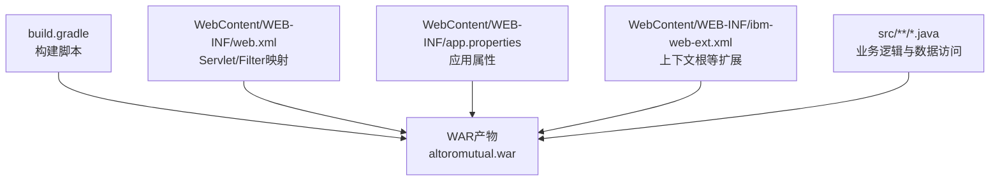
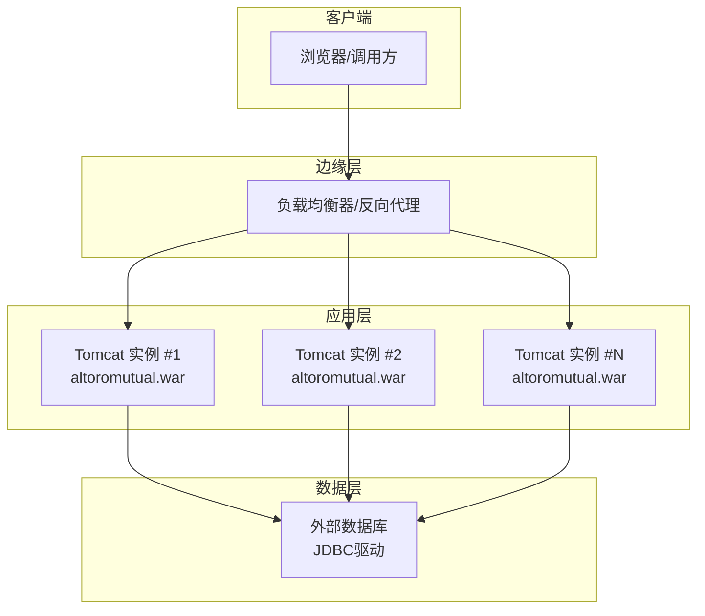
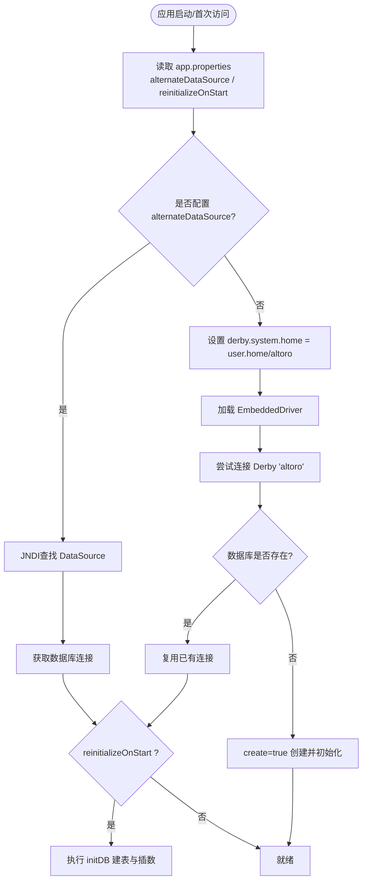
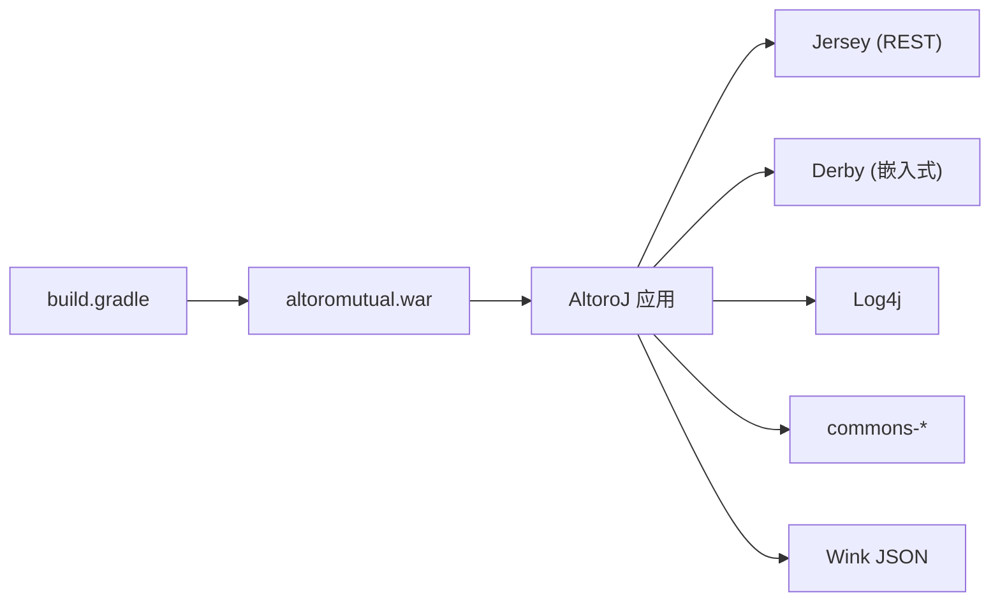

# 生产环境部署

<cite>
**本文引用的文件**   
- [build.gradle](file://build.gradle)
- [README.md](file://README.md)
- [web.xml](file://WebContent/WEB-INF/web.xml)
- [app.properties](file://WebContent/WEB-INF/app.properties)
- [ibm-web-ext.xml](file://WebContent/WEB-INF/ibm-web-ext.xml)
- [DBUtil.java](file://src/com/ibm/security/appscan/altoromutual/util/DBUtil.java)
</cite>

## 目录
1. [简介](#简介)
2. [项目结构](#项目结构)
3. [核心组件](#核心组件)
4. [架构总览](#架构总览)
5. [详细组件分析](#详细组件分析)
6. [依赖分析](#依赖分析)
7. [性能考虑](#性能考虑)
8. [故障排查指南](#故障排查指南)
9. [结论](#结论)
10. [附录](#附录) 

## 简介
本文件面向AltoroJ的生产环境部署，覆盖WAR包构建与部署、Tomcat服务器配置、数据库连接池与内存参数调优、环境变量与安全证书、防火墙规则、负载均衡与会话复制、高可用架构、以及Docker容器化与Kubernetes编排等主题。文档严格基于仓库现有源码与配置文件进行说明，并在需要处给出可操作的步骤与注意事项。

## 项目结构
AltoroJ是一个标准的Java Web应用（WAR），使用Gradle构建，默认打包为altoromutual.war。关键目录与文件：
- WebContent：Web资源与描述符（JSP、静态资源、web.xml、IBM扩展）
- src：Java源代码（Servlet、Filter、Listener、模型、工具类）
- build.gradle：Gradle构建脚本
- README.md：运行前置条件与常见问题

图表来源
- [build.gradle:1-43](file://build.gradle#L1-L43)
- [web.xml:1-227](file://WebContent/WEB-INF/web.xml#L1-L227)
- [app.properties:1-74](file://WebContent/WEB-INF/app.properties#L1-L74)
- [ibm-web-ext.xml:1-16](file://WebContent/WEB-INF/ibm-web-ext.xml#L1-L16)

章节来源
- [build.gradle:1-43](file://build.gradle#L1-L43)
- [README.md:16-25](file://README.md#L16-L25)

## 核心组件
- 构建与打包：Gradle war插件，输出altoromutual.war，排除WEB-INF/classes与lib下的jar（由外部提供或运行时加载）。
- Web容器：Tomcat 7.x（官方推荐），支持标准Servlet/JSP与Jersey REST。
- 数据访问：内置Apache Derby嵌入式数据库，或通过JNDI DataSource接入外部数据库。
- 安全与过滤：AuthFilter/AdminFilter对银行与管理路径进行访问控制；REST API通过Jersey暴露。

章节来源
- [build.gradle:1-43](file://build.gradle#L1-L43)
- [web.xml:1-227](file://WebContent/WEB-INF/web.xml#L1-L227)
- [app.properties:57-73](file://WebContent/WEB-INF/app.properties#L57-L73)
- [DBUtil.java:47-97](file://src/com/ibm/security/appscan/altoromutual/util/DBUtil.java#L47-L97)

## 架构总览
下图展示生产环境典型部署拓扑：前端反向代理/负载均衡器将流量分发到多个Tomcat实例，每个实例运行AltoroJ WAR，并通过JNDI DataSource访问共享的外部数据库。

图表来源
- [web.xml:1-227](file://WebContent/WEB-INF/web.xml#L1-L227)
- [app.properties:57-73](file://WebContent/WEB-INF/app.properties#L57-L73)

## 详细组件分析

### WAR包构建与部署（Gradle）
- 构建目标：执行Gradle的war任务生成altoromutual.war。
- 关键配置：
  - webAppDirName指向WebContent
  - source/target兼容性为Java 1.7
  - 依赖包含Jersey、Derby、Log4j等
  - war任务中排除WEB-INF/classes与lib下jar（便于在容器中统一管理）
- 部署步骤：
  1) 安装Gradle并进入项目根目录
  2) 执行gradle war
  3) 将生成的altoromutual.war复制到Tomcat的webapps目录
  4) 启动Tomcat，WAR自动解压部署

章节来源
- [build.gradle:1-43](file://build.gradle#L1-L43)

### Tomcat服务器配置
- 版本要求：Tomcat 7.x（参考README）
- 应用上下文根：可通过ibm-web-ext.xml设置context-root为altoroj（IBM扩展），或在Tomcat中按WAR名或虚拟主机配置
- 会话复制与分布式：web.xml声明distributable以启用集群会话复制（需配合Tomcat集群配置）
- 建议：
  - 关闭不必要的目录浏览与动态重载
  - 合理配置线程池、连接器超时、最大连接数
  - 使用HTTPS终结于LB或Tomcat（见“安全证书”小节）

章节来源
- [README.md:16-25](file://README.md#L16-L25)
- [web.xml:1-10](file://WebContent/WEB-INF/web.xml#L1-L10)
- [ibm-web-ext.xml:8-13](file://WebContent/WEB-INF/ibm-web-ext.xml#L8-L13)

### 数据库连接与初始化
- 内置Derby模式：
  - 首次登录时自动创建并初始化数据库，位置由derby.system.home决定（默认user.home/altoro）
  - 若不存在则自动create=true创建
- 外部数据库模式：
  - 通过app.properties中的database.alternateDataSource指定JNDI数据源名称
  - 需要在Tomcat context.xml中定义对应DataSource（JNDI）
  - 首次运行需开启database.reinitializeOnStart=true以完成表结构与初始数据初始化
- 连接获取流程（简化）：
  - 读取app.properties中的alternateDataSource
  - 若存在则从JNDI获取DataSource并建立连接
  - 否则设置derby.system.home并使用EmbeddedDriver连接Derby
  - 根据reinitializeOnStart决定是否执行initDB建库与插数

图表来源
- [DBUtil.java:71-97](file://src/com/ibm/security/appscan/altoromutual/util/DBUtil.java#L71-L97)
- [DBUtil.java:99-137](file://src/com/ibm/security/appscan/altoromutual/util/DBUtil.java#L99-L137)
- [DBUtil.java:143-167](file://src/com/ibm/security/appscan/altoromutual/util/DBUtil.java#L143-L167)
- [app.properties:57-73](file://WebContent/WEB-INF/app.properties#L57-L73)

章节来源
- [DBUtil.java:47-167](file://src/com/ibm/security/appscan/altoromutual/util/DBUtil.java#L47-L167)
- [app.properties:57-73](file://WebContent/WEB-INF/app.properties#L57-L73)

### Servlet与过滤器
- Filter：
  - AuthFilter：保护/bank/*与/admin/*等敏感路径
  - AdminFilter：管理相关路径访问控制
- Servlet：
  - Jersey REST：AltoroAPI作为Application类
  - 传统Servlet：LoginServlet、TransferServlet、AccountViewServlet等
- 欢迎页：index.jsp

章节来源
- [web.xml:12-68](file://WebContent/WEB-INF/web.xml#L12-L68)
- [web.xml:69-227](file://WebContent/WEB-INF/web.xml#L69-L227)

### 环境变量与应用属性
- 应用属性（app.properties）：
  - database.alternateDataSource：外部JNDI数据源名
  - database.reinitializeOnStart：首次运行初始化开关
- JVM系统属性（示例）：
  - derby.system.home：Derby数据库目录（代码中设置为user.home/altoro）
- 其他可选属性：enableAdminFunctions、specialLink、advancedStaticPageProcessing、enableFeedbackRetention（用于演示功能，生产环境通常禁用）

章节来源
- [app.properties:25-73](file://WebContent/WEB-INF/app.properties#L25-L73)
- [DBUtil.java:84-97](file://src/com/ibm/security/appscan/altoromutual/util/DBUtil.java#L84-L97)

### 安全证书与HTTPS
- 建议在负载均衡器或网关处终止TLS，减轻后端压力并集中证书管理
- 如需在Tomcat直接启用HTTPS：
  - 准备JKS/PFX证书与私钥
  - 在server.xml配置Connector port="443"并指定keystoreFile/keystorePass
  - 强制HTTP->HTTPS重定向（可在web.xml或反向代理实现）
- 注意：生产环境务必使用强密码与受信任CA签发的证书

[本节为通用实践说明，不直接分析具体文件]

### 防火墙规则
- 仅开放必要端口：
  - 80/443（对外服务）
  - 8009（AJP，如需与Apache集成）
  - 内部数据库端口（仅允许应用服务器访问）
- 限制来源IP：
  - 管理接口与数据库端口仅对运维网段开放
- 出站策略：
  - 仅放行必要的出站端口（如邮件、外部API等）

[本节为通用实践说明，不直接分析具体文件]

### 负载均衡、会话复制与高可用
- 负载均衡：
  - 在LB层做健康检查与权重分配
  - 保持粘性会话或使用无状态会话（结合外部缓存）
- 会话复制：
  - web.xml已声明distributable，需配合Tomcat集群配置（Cluster/Manager）
  - 确保同一集群内节点时间同步
- 高可用：
  - 多实例部署+自动重启（systemd/K8s）
  - 数据库主备/读写分离
  - 日志与监控告警

章节来源
- [web.xml:1-10](file://WebContent/WEB-INF/web.xml#L1-L10)

### Docker容器化部署
- 基础镜像：选择OpenJDK + Tomcat 7.x的官方镜像
- 构建镜像：
  - 将altoromutual.war拷贝至webapps
  - 挂载持久卷存放Derby数据目录（user.home/altoro）或切换到外部数据库
  - 通过环境变量注入JVM参数（如-Xms/-Xmx）
- 运行容器：
  - 暴露8080/443
  - 挂载配置与日志目录
  - 使用Compose或K8s管理多副本

[本节为通用实践说明，不直接分析具体文件]

### Kubernetes编排与云原生部署
- Deployment：
  - 副本数≥2，滚动更新
  - 探针：liveness/readiness
- Service：
  - ClusterIP暴露给Ingress
- Ingress：
  - TLS终止、路径路由、限流
- ConfigMap/Secret：
  - 应用属性、JVM参数、证书
- 存储：
  - 使用PVC持久化Derby数据或迁移至托管数据库
- 水平扩缩容：
  - HPA基于CPU/自定义指标

[本节为通用实践说明，不直接分析具体文件]

## 依赖分析
- 构建依赖：
  - Jersey Server/Container/HK2（REST）
  - Apache Derby（嵌入式数据库）
  - Log4j（日志）
  - Wink JSON（JSON处理）
  - commons-codec/lang（工具库）
- 运行时依赖：
  - Java EE API（providedCompile，由容器提供）
  - 外部JDBC驱动（当使用外部数据库时）

图表来源
- [build.gradle:23-37](file://build.gradle#L23-L37)

章节来源
- [build.gradle:23-37](file://build.gradle#L23-L37)

## 性能考虑
- JVM内存：
  - 根据实例规格设置-Xms/-Xmx，避免频繁GC
  - 调整Metaspace大小，防止元空间溢出
- Tomcat连接器：
  - maxThreads、acceptCount、connectionTimeout按需调优
- 数据库：
  - 优先使用外部数据库与连接池（HikariCP/Tomcat JDBC Pool）
  - 合理设置连接池大小、空闲超时、最大生命周期
- 静态资源：
  - 由CDN或反向代理缓存
- 监控与告警：
  - 采集JVM、Tomcat、数据库指标，设置阈值告警

[本节为通用实践说明，不直接分析具体文件]

## 故障排查指南
- 无法创建Derby数据库：
  - 现象：登录时报错“Failed to create database 'altoro'”
  - 原因：用户home目录权限不足
  - 解决：授予Tomcat运行用户对user.home目录写权限，或设置-Duser.home指向有写权限的路径
- 编译错误导致无法运行：
  - 原因：Eclipse构建路径问题
  - 解决：先执行Gradle构建下载依赖并编译
- 外部数据库未初始化：
  - 现象：首次使用外部DataSource报缺少表或数据
  - 解决：临时开启database.reinitializeOnStart=true并重启，待初始化完成后关闭

章节来源
- [README.md:44-56](file://README.md#L44-L56)
- [app.properties:57-73](file://WebContent/WEB-INF/app.properties#L57-L73)

## 结论
AltoroJ在生产环境部署的关键在于：正确的WAR构建与发布、合理的Tomcat与JVM参数、稳定的数据库连接方案（优先外部数据库）、完善的安全与网络策略、以及可扩展的高可用架构。通过上述步骤与最佳实践，可以在保证稳定性的前提下快速上线并持续演进。

## 附录
- 常用命令（示例）：
  - gradle war
  - systemctl restart tomcat
  - docker run -p 8080:8080 -v /data:/usr/local/tomcat/user.home/altoro tomcat:7-jdk8
- 参考链接：
  - Tomcat JNDI DataSource配置示例（参见app.properties注释）

[本节为补充信息，不直接分析具体文件]