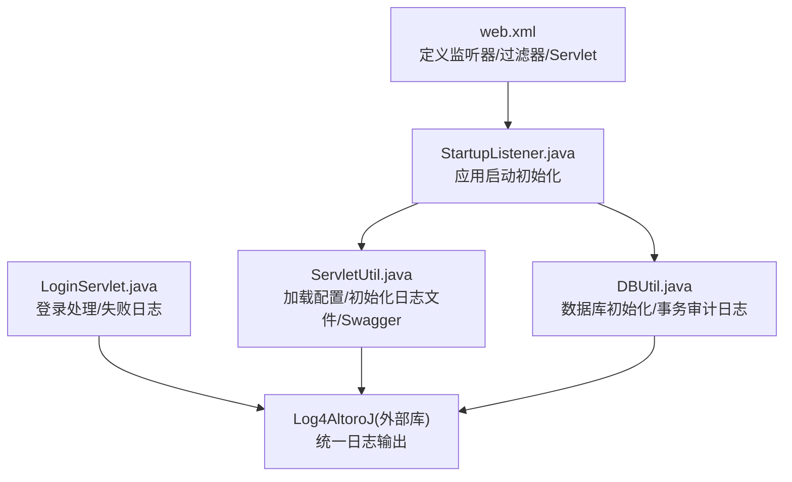
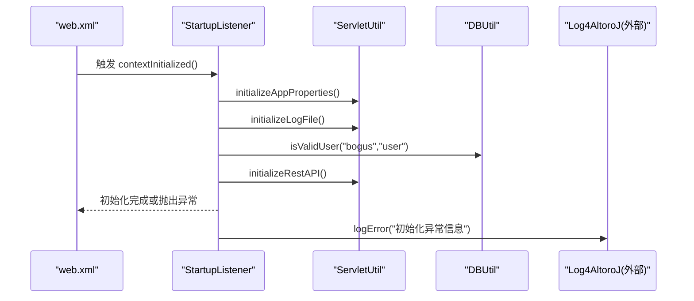
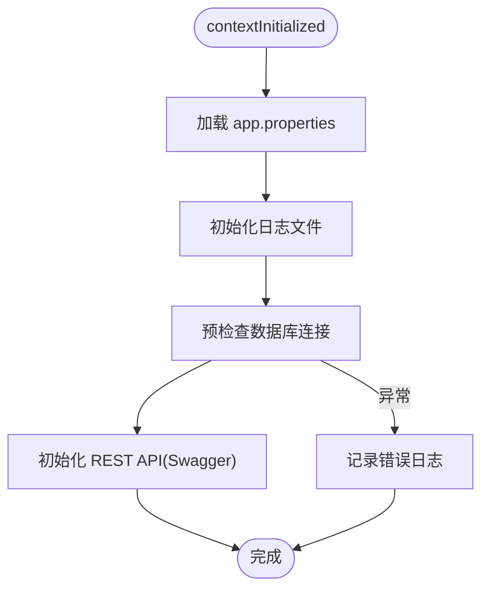
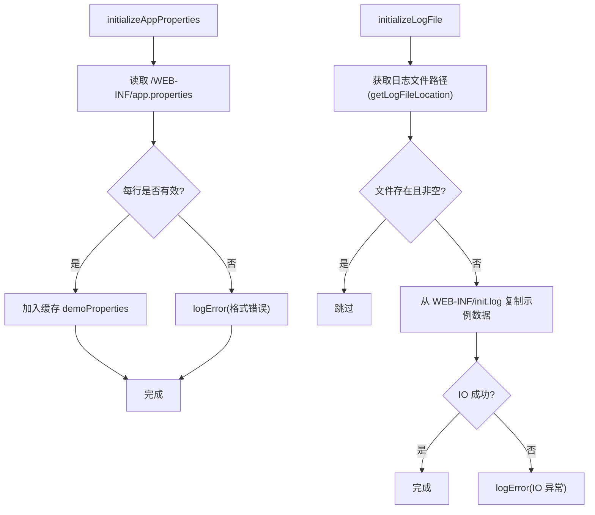
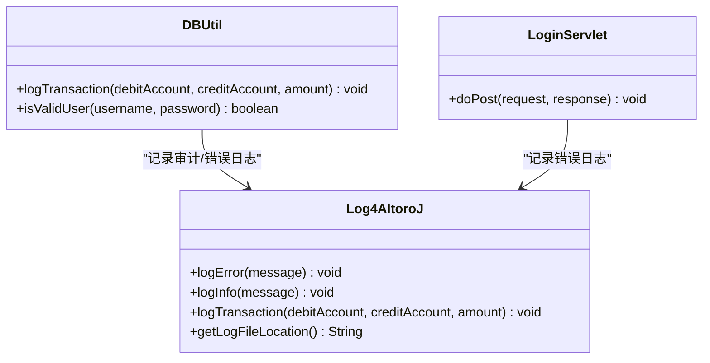
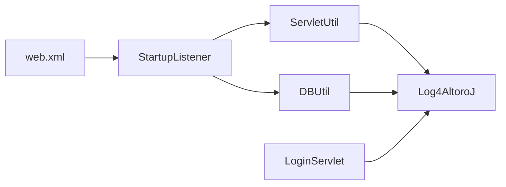

# 监控与日志

<cite>
**本文引用的文件**   
- [web.xml](file://WebContent/WEB-INF/web.xml)
- [StartupListener.java](file://src/com/ibm/security/appscan/altoromutual/listener/StartupListener.java)
- [ServletUtil.java](file://src/com/ibm/security/appscan/altoromutual/util/ServletUtil.java)
- [app.properties](file://WebContent/WEB-INF/app.properties)
- [DBUtil.java](file://src/com/ibm/security/appscan/altoromutual/util/DBUtil.java)
- [LoginServlet.java](file://src/com/ibm/security/appscan/altoromutual/servlet/LoginServlet.java)
</cite>

## 目录
1. [简介](#简介)
2. [项目结构](#项目结构)
3. [核心组件](#核心组件)
4. [架构总览](#架构总览)
5. [详细组件分析](#详细组件分析)
6. [依赖关系分析](#依赖关系分析)
7. [性能与可观测性建议](#性能与可观测性建议)
8. [故障排查指南](#故障排查指南)
9. [结论](#结论)

## 简介
本文件为 AltoroJ 的监控与日志系统提供系统化文档，覆盖以下方面：
- Log4j 配置文件的设置与日志级别管理（基于现有代码路径说明现状与扩展点）
- 应用启动监听器的监控功能与扩展点
- 性能指标收集、应用状态监控、资源使用监控的建议方案
- 日志轮转策略、错误告警机制与审计日志的配置建议
- 监控系统集成（ELK Stack、Prometheus）与可视化仪表板配置指南

注意：当前仓库未包含显式的 Log4j 配置文件；应用通过自定义日志工具类进行日志输出。下文将结合源码给出实现现状与改进建议。

## 项目结构
AltoroJ 是一个 Java Web 应用，关键与监控/日志相关的结构如下：
- WEB-INF/web.xml：声明 ServletContextListener、过滤器与 Servlet 映射
- src/com/ibm/security/appscan/altoromutual/listener/StartupListener.java：应用启动监听器，负责初始化属性、日志文件、数据库连接与 REST API
- src/com/ibm/security/appscan/altoromutual/util/ServletUtil.java：通用工具类，加载 app.properties、初始化日志文件、Swagger 属性等
- WebContent/WEB-INF/app.properties：应用行为与数据库相关配置
- src/com/ibm/security/appscan/altoromutual/util/DBUtil.java：数据库操作与事务审计日志记录
- src/com/ibm/security/appscan/altoromutual/servlet/LoginServlet.java：登录逻辑，包含失败日志记录

图表来源
- [web.xml:9-11](file://WebContent/WEB-INF/web.xml#L9-L11)
- [StartupListener.java:10-24](file://src/com/ibm/security/appscan/altoromutual/listener/StartupListener.java#L10-L24)
- [ServletUtil.java:257-338](file://src/com/ibm/security/appscan/altoromutual/util/ServletUtil.java#L257-L338)
- [DBUtil.java:160-170](file://src/com/ibm/security/appscan/altoromutual/util/DBUtil.java#L160-L170)

章节来源
- [web.xml:1-227](file://WebContent/WEB-INF/web.xml#L1-L227)
- [StartupListener.java:1-32](file://src/com/ibm/security/appscan/altoromutual/listener/StartupListener.java#L1-L32)
- [ServletUtil.java:1-412](file://src/com/ibm/security/appscan/altoromutual/util/ServletUtil.java#L1-L412)
- [app.properties:1-74](file://WebContent/WEB-INF/app.properties#L1-L74)

## 核心组件
- 启动监听器 StartupListener：在应用上下文初始化时执行一系列初始化步骤，包括加载应用属性、初始化日志文件、预检数据库连接、初始化 REST API。异常时通过 Log4AltoroJ 记录错误。
- 工具类 ServletUtil：负责读取并缓存 app.properties、初始化示例日志文件、自动更新 Swagger basePath 等。
- 数据库工具 DBUtil：封装数据库访问，并在关键业务（如转账）中记录审计日志。
- 登录 Servlet LoginServlet：在登录失败时记录错误日志。

章节来源
- [StartupListener.java:12-24](file://src/com/ibm/security/appscan/altoromutual/listener/StartupListener.java#L12-L24)
- [ServletUtil.java:257-338](file://src/com/ibm/security/appscan/altoromutual/util/ServletUtil.java#L257-L338)
- [DBUtil.java:330-360](file://src/com/ibm/security/appscan/altoromutual/util/DBUtil.java#L330-L360)
- [LoginServlet.java:75-90](file://src/com/ibm/security/appscan/altoromutual/servlet/LoginServlet.java#L75-L90)

## 架构总览
下图展示应用启动时的关键流程与日志写入点：

图表来源
- [web.xml:9-11](file://WebContent/WEB-INF/web.xml#L9-L11)
- [StartupListener.java:12-24](file://src/com/ibm/security/appscan/altoromutual/listener/StartupListener.java#L12-L24)
- [ServletUtil.java:257-338](file://src/com/ibm/security/appscan/altoromutual/util/ServletUtil.java#L257-L338)
- [DBUtil.java:160-170](file://src/com/ibm/security/appscan/altoromutual/util/DBUtil.java#L160-L170)

## 详细组件分析

### 启动监听器与初始化流程
- 职责
  - 加载应用属性（app.properties）
  - 初始化日志文件（若不存在则从 init.log 拷贝示例数据）
  - 预检查数据库连接（isValidUser）
  - 初始化 REST API（Swagger basePath 自动修正）
- 扩展点
  - 可在 contextInitialized 中增加健康检查、指标采集、资源预热等逻辑
  - 可在 contextDestroyed 中释放资源、关闭线程池、刷新指标到后端

图表来源
- [StartupListener.java:12-24](file://src/com/ibm/security/appscan/altoromutual/listener/StartupListener.java#L12-L24)
- [ServletUtil.java:257-338](file://src/com/ibm/security/appscan/altoromutual/util/ServletUtil.java#L257-L338)

章节来源
- [StartupListener.java:10-31](file://src/com/ibm/security/appscan/altoromutual/listener/StartupListener.java#L10-L31)
- [ServletUtil.java:257-338](file://src/com/ibm/security/appscan/altoromutual/util/ServletUtil.java#L257-L338)

### 应用属性与日志文件初始化
- 应用属性
  - 通过 ServletUtil.initializeAppProperties 读取 /WEB-INF/app.properties，解析键值对并缓存
  - 支持注释行（以 # 或 // 开头），格式错误会记录错误日志
- 日志文件初始化
  - 通过 ServletUtil.initializeLogFile 获取日志文件路径（由 Log4AltoroJ.getInstance().getLogFileLocation() 提供）
  - 若目标日志文件为空或不存在，则从 WEB-INF/init.log 复制示例内容
  - 该过程可能抛出 IO 异常，并通过 Log4AltoroJ 记录错误

图表来源
- [ServletUtil.java:257-338](file://src/com/ibm/security/appscan/altoromutual/util/ServletUtil.java#L257-L338)

章节来源
- [ServletUtil.java:257-338](file://src/com/ibm/security/appscan/altoromutual/util/ServletUtil.java#L257-L338)
- [app.properties:1-74](file://WebContent/WEB-INF/app.properties#L1-L74)

### 审计日志与错误日志
- 审计日志
  - DBUtil 在转账等关键业务操作中调用 Log4AltoroJ.logTransaction，记录交易双方账户与金额等信息
- 错误日志
  - 登录失败时，LoginServlet 调用 Log4AltoroJ.logError 记录失败详情（用户名、密码等）
  - 初始化阶段异常通过 StartupListener 捕获并记录错误

图表来源
- [DBUtil.java:330-360](file://src/com/ibm/security/appscan/altoromutual/util/DBUtil.java#L330-L360)
- [LoginServlet.java:75-90](file://src/com/ibm/security/appscan/altoromutual/servlet/LoginServlet.java#L75-L90)

章节来源
- [DBUtil.java:330-360](file://src/com/ibm/security/appscan/altoromutual/util/DBUtil.java#L330-L360)
- [LoginServlet.java:75-90](file://src/com/ibm/security/appscan/altoromutual/servlet/LoginServlet.java#L75-L90)

## 依赖关系分析
- web.xml 声明了 StartupListener，作为应用生命周期入口
- StartupListener 依赖 ServletUtil 与 DBUtil
- ServletUtil 依赖 Log4AltoroJ（外部库）用于日志输出
- DBUtil 同样依赖 Log4AltoroJ 进行审计与错误日志记录
- LoginServlet 直接依赖 Log4AltoroJ 记录错误

图表来源
- [web.xml:9-11](file://WebContent/WEB-INF/web.xml#L9-L11)
- [StartupListener.java:10-24](file://src/com/ibm/security/appscan/altoromutual/listener/StartupListener.java#L10-L24)
- [ServletUtil.java:257-338](file://src/com/ibm/security/appscan/altoromutual/util/ServletUtil.java#L257-L338)
- [DBUtil.java:330-360](file://src/com/ibm/security/appscan/altoromutual/util/DBUtil.java#L330-L360)
- [LoginServlet.java:75-90](file://src/com/ibm/security/appscan/altoromutual/servlet/LoginServlet.java#L75-L90)

章节来源
- [web.xml:1-227](file://WebContent/WEB-INF/web.xml#L1-L227)
- [StartupListener.java:1-32](file://src/com/ibm/security/appscan/altoromutual/listener/StartupListener.java#L1-L32)
- [ServletUtil.java:1-412](file://src/com/ibm/security/appscan/altoromutual/util/ServletUtil.java#L1-L412)
- [DBUtil.java:1-600](file://src/com/ibm/security/appscan/altoromutual/util/DBUtil.java#L1-L600)
- [LoginServlet.java:1-120](file://src/com/ibm/security/appscan/altoromutual/servlet/LoginServlet.java#L1-L120)

## 性能与可观测性建议
当前仓库未包含内置的性能指标采集与 Prometheus 集成代码。以下为实施建议（概念性指导，不绑定具体源码）：
- 性能指标收集
  - 引入 Micrometer 或 Dropwizard Metrics，暴露 JVM 与 HTTP 请求指标（QPS、延迟、错误率）
  - 在 Servlet 过滤器中统计请求耗时、响应码分布
  - 在 StartupListener 中注册定时任务，周期性上报系统指标（CPU、内存、GC）
- 应用状态监控
  - 在 StartupListener 中实现健康检查端点（/health），返回数据库连通性、磁盘空间、关键服务状态
  - 在 contextDestroyed 中清理资源并记录停机事件
- 资源使用监控
  - 使用 JMX 或操作系统探针（Node Exporter）采集进程级指标
  - 针对数据库连接池（如 HikariCP）暴露连接数、等待时间等指标

[本节为概念性建议，无需源码引用]

## 故障排查指南
- 初始化失败
  - 现象：应用启动时报错，StartupListener 捕获异常并记录错误日志
  - 排查要点：检查 app.properties 格式、init.log 是否存在、数据库连接参数是否正确
  - 参考位置：
    - [StartupListener.java:12-24](file://src/com/ibm/security/appscan/altoromutual/listener/StartupListener.java#L12-L24)
    - [ServletUtil.java:257-338](file://src/com/ibm/security/appscan/altoromutual/util/ServletUtil.java#L257-L338)
- 日志文件未生成或为空
  - 现象：应用运行后无日志输出
  - 排查要点：确认 Log4AltoroJ.getLogFileLocation() 返回的路径有写权限；检查 WEB-INF/init.log 是否存在
  - 参考位置：
    - [ServletUtil.java:301-338](file://src/com/ibm/security/appscan/altoromutual/util/ServletUtil.java#L301-L338)
- 登录失败日志
  - 现象：登录失败但无法定位原因
  - 排查要点：查看 LoginServlet 的错误日志输出，确认输入参数与数据库校验逻辑
  - 参考位置：
    - [LoginServlet.java:75-90](file://src/com/ibm/security/appscan/altoromutual/servlet/LoginServlet.java#L75-L90)

章节来源
- [StartupListener.java:12-24](file://src/com/ibm/security/appscan/altoromutual/listener/StartupListener.java#L12-L24)
- [ServletUtil.java:301-338](file://src/com/ibm/security/appscan/altoromutual/util/ServletUtil.java#L301-L338)
- [LoginServlet.java:75-90](file://src/com/ibm/security/appscan/altoromutual/servlet/LoginServlet.java#L75-L90)

## 结论
- 当前 AltoroJ 的日志体系通过外部库 Log4AltoroJ 进行统一输出，应用启动监听器负责初始化属性、日志文件与 REST API，数据库工具类负责审计日志记录。
- 仓库未包含显式的 Log4j 配置文件；如需精细控制日志级别与输出目标，建议在项目中引入标准 Log4j 配置并通过适配层桥接到 Log4AltoroJ。
- 建议补充性能指标采集、健康检查与告警机制，并与 ELK/Prometheus 集成以实现集中化监控与可视化。

[本节为总结性内容，无需源码引用]