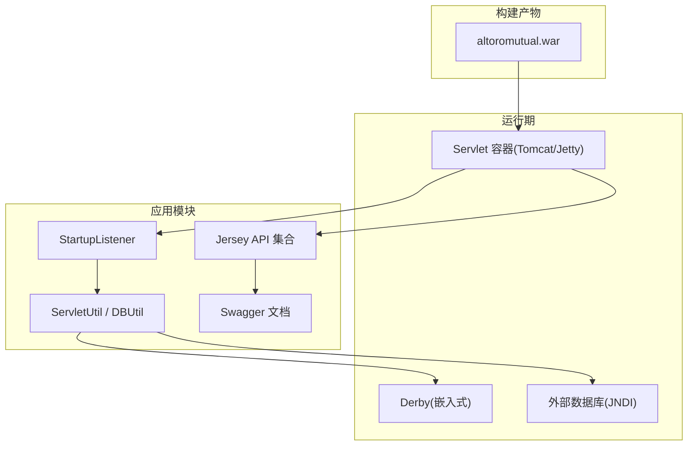
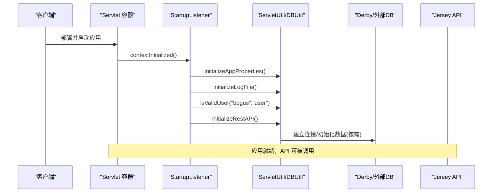
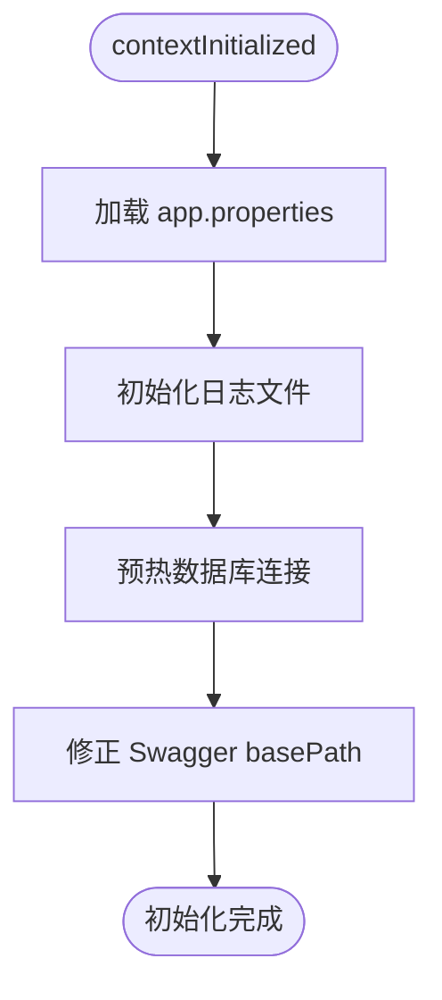
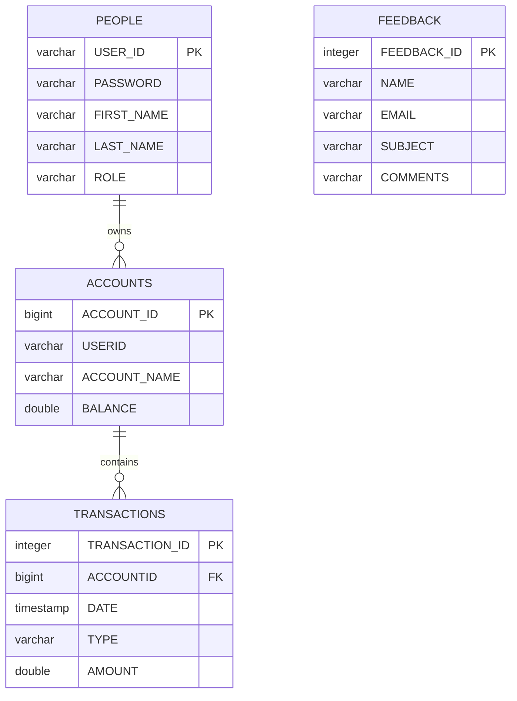
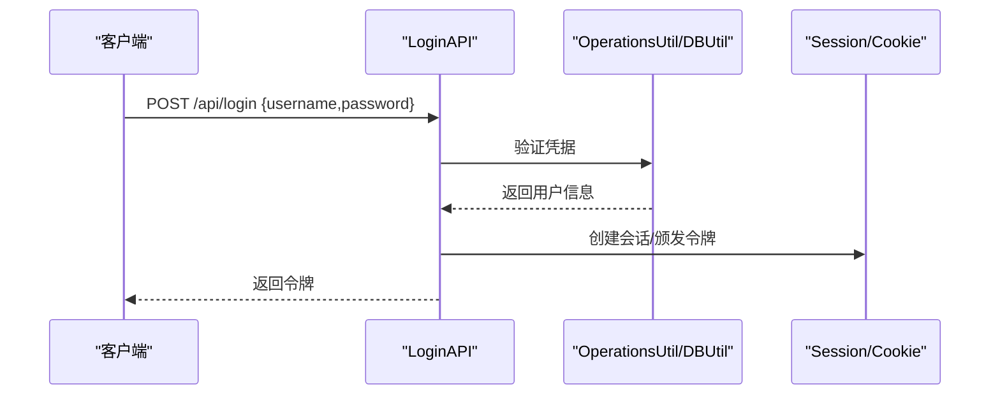
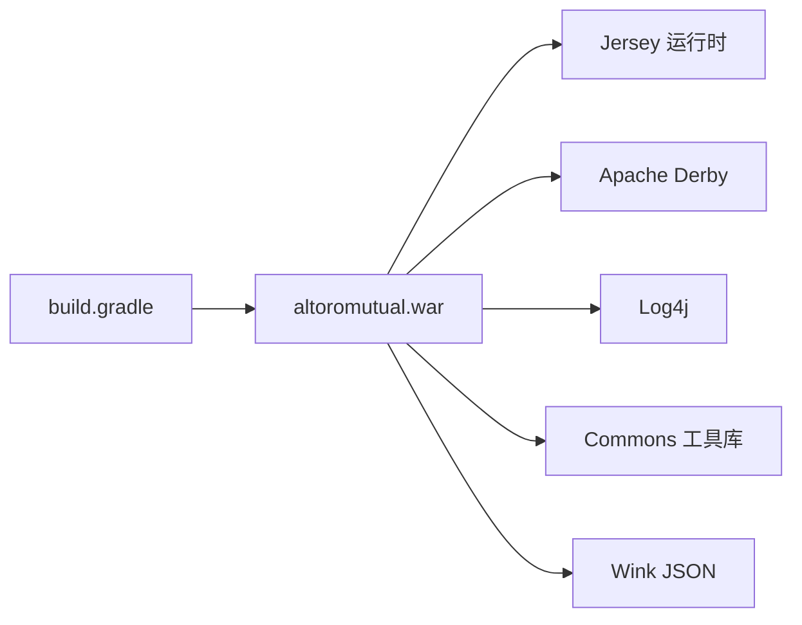

# 部署与运维

<cite>
**本文引用的文件**   
- [README.md](file://README.md)
- [build.gradle](file://build.gradle)
- [web.xml](file://WebContent/WEB-INF/web.xml)
- [app.properties](file://WebContent/WEB-INF/app.properties)
- [StartupListener.java](file://src/com/ibm/security/appscan/altoromutual/listener/StartupListener.java)
- [ServletUtil.java](file://src/com/ibm/security/appscan/altoromutual/util/ServletUtil.java)
- [DBUtil.java](file://src/com/ibm/security/appscan/altoromutual/util/DBUtil.java)
- [AltoroAPI.java](file://src/com/ibm/security/appscan/altoromutual/api/AltoroAPI.java)
- [TransferAPI.java](file://src/com/ibm/security/appscan/altoromutual/api/TransferAPI.java)
- [AccountAPI.java](file://src/com/ibm/security/appscan/altoromutual/api/AccountAPI.java)
- [LoginAPI.java](file://src/com/ibm/security/appscan/altoromutual/api/LoginAPI.java)
- [AdminAPI.java](file://src/com/ibm/security/appscan/altoromutual/api/AdminAPI.java)
- [FeedbackAPI.java](file://src/com/ibm/security/appscan/altoromutual/api/FeedbackAPI.java)
- [serverStatusCheckService.jsp](file://WebContent/util/serverStatusCheckService.jsp)
</cite>

## 目录
1. [简介](#简介)
2. [项目结构](#项目结构)
3. [核心组件](#核心组件)
4. [架构总览](#架构总览)
5. [详细组件分析](#详细组件分析)
6. [依赖关系分析](#依赖关系分析)
7. [性能与资源监控](#性能与资源监控)
8. [故障排除指南](#故障排除指南)
9. [结论](#结论)
10. [附录](#附录)

## 简介
本文件面向生产环境的 AltoroJ 部署与运维，覆盖构建、部署、启动监听器、日志与配置、REST API、Docker 化、CI/CD、环境变量管理、性能调优、监控告警、备份恢复与灾难恢复、以及自动化脚本等主题。AltoroJ 是一个基于 JSP/Servlet 的示例银行应用，默认使用嵌入式 Apache Derby 数据库，并通过 Jersey 提供 REST API。

## 项目结构
- Web 应用：WAR 包，包含 JSP、静态资源、Swagger UI 与配置文件。
- 源码：Java Servlet、Filter、Listener、Model、API 与工具类。
- 构建：Gradle 生成 WAR，依赖通过 Maven Central 和本地 WEB-INF/lib 引入。
- 运行时：Servlet 容器（如 Tomcat），可选外部数据源或嵌入式 Derby。

图表来源
- [build.gradle:39-43](file://build.gradle#L39-L43)
- [web.xml:60-68](file://WebContent/WEB-INF/web.xml#L60-L68)
- [StartupListener.java:12-24](file://src/com/ibm/security/appscan/altoromutual/listener/StartupListener.java#L12-L24)
- [DBUtil.java:71-96](file://src/com/ibm/security/appscan/altoromutual/util/DBUtil.java#L71-L96)

章节来源
- [README.md:16-25](file://README.md#L16-L25)
- [build.gradle:1-43](file://build.gradle#L1-L43)

## 核心组件
- 启动监听器 StartupListener：在应用初始化时加载属性、初始化日志、预热数据库连接、初始化 Swagger 基础路径。
- 配置 app.properties：行为开关与数据库相关设置（如外部数据源名称、是否每次启动重建库）。
- 数据库访问 DBUtil：支持嵌入式 Derby 或通过 JNDI 接入外部数据源，并在需要时执行建库与初始化数据。
- 工具类 ServletUtil：属性读取、日志文件初始化、会话与用户信息处理、Swagger 基础路径自动修正。
- REST API：基于 Jersey 的多个资源类，提供账户、转账、登录、反馈、管理等接口。

章节来源
- [StartupListener.java:12-24](file://src/com/ibm/security/appscan/altoromutual/listener/StartupListener.java#L12-L24)
- [app.properties:57-74](file://WebContent/WEB-INF/app.properties#L57-L74)
- [DBUtil.java:71-167](file://src/com/ibm/security/appscan/altoromutual/util/DBUtil.java#L71-L167)
- [ServletUtil.java:257-338](file://src/com/ibm/security/appscan/altoromutual/util/ServletUtil.java#L257-L338)
- [AltoroAPI.java:9-14](file://src/com/ibm/security/appscan/altoromutual/api/AltoroAPI.java#L9-L14)

## 架构总览
AltoroJ 采用传统 J2EE 架构：
- 请求进入 Servlet 容器后，由 web.xml 注册 Filter、Servlet 与 Listener。
- 启动阶段由 StartupListener 完成属性加载、日志初始化、数据库预热与 Swagger 路径修正。
- 业务逻辑通过 Servlet/Filter 与 REST API 暴露；数据访问统一通过 DBUtil。
- 默认使用嵌入式 Derby，也可通过 JNDI 切换至外部数据库。

图表来源
- [web.xml:9-11](file://WebContent/WEB-INF/web.xml#L9-L11)
- [StartupListener.java:12-24](file://src/com/ibm/security/appscan/altoromutual/listener/StartupListener.java#L12-L24)
- [ServletUtil.java:257-338](file://src/com/ibm/security/appscan/altoromutual/util/ServletUtil.java#L257-L338)
- [DBUtil.java:99-138](file://src/com/ibm/security/appscan/altoromutual/util/DBUtil.java#L99-L138)

## 详细组件分析

### Gradle 构建脚本与自定义方法
- 插件与输出：启用 war 插件，指定 webAppDirName 为 WebContent，目标产物名为 altoromutual.war。
- 源码与资源：Java 与资源均从 src 目录编译打包。
- 依赖管理：从 mavenCentral 拉取第三方依赖，同时包含本地 WEB-INF/lib 下的 jar。
- 版本兼容：source/target 兼容性设置为 1.7。
- 打包策略：war 任务排除已存在的 classes 与 lib，避免重复打包。

建议扩展点
- 增加多环境 profile（dev/test/prod）以切换 app.properties 与 Swagger basePath。
- 集成 SonarQube、SpotBugs、OWASP Dependency Check 等质量与安全扫描。
- 将 Derby 驱动与 Jersey 依赖升级为受支持的版本，并锁定版本号。

章节来源
- [build.gradle:1-43](file://build.gradle#L1-L43)

### 应用启动监听器与扩展点
- 作用：
  - 加载 WEB-INF/app.properties 到内存缓存。
  - 初始化应用日志文件（若不存在则填充示例数据）。
  - 触发首次数据库连接校验，确保 Derby 或外部数据源可用。
  - 根据上下文路径自动修正 Swagger 的 basePath。
- 扩展点：
  - 可在 contextInitialized 中注入更多初始化逻辑（如缓存预热、指标收集器初始化）。
  - 可通过 app.properties 控制行为开关，实现功能门控。

图表来源
- [StartupListener.java:12-24](file://src/com/ibm/security/appscan/altoromutual/listener/StartupListener.java#L12-L24)
- [ServletUtil.java:257-338](file://src/com/ibm/security/appscan/altoromutual/util/ServletUtil.java#L257-L338)

章节来源
- [StartupListener.java:12-24](file://src/com/ibm/security/appscan/altoromutual/listener/StartupListener.java#L12-L24)
- [ServletUtil.java:375-409](file://src/com/ibm/security/appscan/altoromutual/util/ServletUtil.java#L375-L409)

### 配置与环境变量管理
- app.properties（位于 WEB-INF）：
  - 行为开关：enableAdminFunctions、specialLink、advancedStaticPageProcessing、enableFeedbackRetention。
  - 数据库设置：database.alternateDataSource（JNDI 名称）、database.reinitializeOnStart（启动时重建库）。
- 环境变量与系统属性：
  - Derby 位置：derby.system.home（默认 user.home/altoro）。
  - 用户主目录：user.home（用于定位 Derby 数据目录）。
- 建议：
  - 在生产环境中通过容器或平台的环境变量注入替换敏感值（如外部数据源 JNDI 名称、密码等）。
  - 对 app.properties 进行版本化管理，区分不同环境分支或模板。

章节来源
- [app.properties:25-74](file://WebContent/WEB-INF/app.properties#L25-L74)
- [DBUtil.java:84-96](file://src/com/ibm/security/appscan/altoromutual/util/DBUtil.java#L84-L96)

### 数据库与数据模型
- 嵌入式 Derby：
  - 默认路径 derby.system.home = user.home/altoro。
  - 首次连接失败且错误码为 40000 时创建数据库并初始化表结构与样例数据。
- 外部数据源：
  - 通过 JNDI 查找 database.alternateDataSource 指定的 DataSource。
  - 首次运行需开启 database.reinitializeOnStart=true 以完成初始化。
- 数据模型（概念）：
  - PEOPLE（用户）、ACCOUNTS（账户）、TRANSACTIONS（交易）、FEEDBACK（反馈）。

图表来源
- [DBUtil.java:143-167](file://src/com/ibm/security/appscan/altoromutual/util/DBUtil.java#L143-L167)

章节来源
- [DBUtil.java:71-167](file://src/com/ibm/security/appscan/altoromutual/util/DBUtil.java#L71-L167)

### REST API 与认证流程
- 路由与注册：
  - Jersey ApplicationPath 为 api，ResourceConfig 扫描 com.ibm.security.appscan.altoromutual.api 包。
  - 全局过滤器 ApiAuthFilter 用于鉴权。
- 主要端点（示例）：
  - POST /api/login：登录获取令牌。
  - GET /api/account/{accountNo}：查询账户余额与最近交易。
  - POST /api/transfer：转账。
  - POST /api/admin/addUser：管理员添加用户。
  - POST /api/feedback/submit：提交反馈。
- 认证流程（序列图）：

图表来源
- [AltoroAPI.java:9-14](file://src/com/ibm/security/appscan/altoromutual/api/AltoroAPI.java#L9-L14)
- [LoginAPI.java:29-41](file://src/com/ibm/security/appscan/altoromutual/api/LoginAPI.java#L29-L41)
- [TransferAPI.java:17-43](file://src/com/ibm/security/appscan/altoromutual/api/TransferAPI.java#L17-L43)
- [AccountAPI.java:59-92](file://src/com/ibm/security/appscan/altoromutual/api/AccountAPI.java#L59-L92)
- [AdminAPI.java:65-96](file://src/com/ibm/security/appscan/altoromutual/api/AdminAPI.java#L65-L96)
- [FeedbackAPI.java:22-51](file://src/com/ibm/security/appscan/altoromutual/api/FeedbackAPI.java#L22-L51)

章节来源
- [AltoroAPI.java:9-14](file://src/com/ibm/security/appscan/altoromutual/api/AltoroAPI.java#L9-L14)
- [LoginAPI.java:29-41](file://src/com/ibm/security/appscan/altoromutual/api/LoginAPI.java#L29-L41)
- [TransferAPI.java:17-43](file://src/com/ibm/security/appscan/altoromutual/api/TransferAPI.java#L17-L43)
- [AccountAPI.java:59-92](file://src/com/ibm/security/appscan/altoromutual/api/AccountAPI.java#L59-L92)
- [AdminAPI.java:65-96](file://src/com/ibm/security/appscan/altoromutual/api/AdminAPI.java#L65-L96)
- [FeedbackAPI.java:22-51](file://src/com/ibm/security/appscan/altoromutual/api/FeedbackAPI.java#L22-L51)

### 健康检查与监控入口
- 内置健康检查页面：status_check.jsp 调用 util/serverStatusCheckService.jsp 返回主机名与状态。
- 建议在负载均衡或编排层使用该端点进行存活探测与就绪探测。

章节来源
- [serverStatusCheckService.jsp:1-6](file://WebContent/util/serverStatusCheckService.jsp#L1-L6)

## 依赖关系分析
- 构建依赖：
  - Jersey Server、Jersey Container Servlet、Jersey HK2 注入。
  - Apache Derby 嵌入式数据库。
  - Log4j 1.x、Apache Wink JSON、Commons Codec/Lang。
  - Java EE API（providedCompile）。
- 运行时依赖：
  - Servlet 容器（Tomcat 7+）。
  - 可选外部 JDBC 驱动（当使用外部数据源时）。

图表来源
- [build.gradle:23-37](file://build.gradle#L23-L37)

章节来源
- [build.gradle:23-37](file://build.gradle#L23-L37)

## 性能与资源监控
- JVM 与容器参数：
  - 合理设置堆大小、元空间、GC 策略；在 Tomcat 中通过 catalina.sh 或平台服务配置传入。
  - 调整线程池与连接器参数（acceptCount、maxThreads）以匹配负载。
- 应用侧优化：
  - 减少不必要的对象分配与字符串拼接；复用连接与资源。
  - 对频繁读操作考虑引入缓存（如应用级缓存或 CDN 静态资源）。
- 监控与指标：
  - 采集 JVM 指标（CPU、Heap、GC、线程数）与应用指标（QPS、延迟、错误率）。
  - 使用 APM 工具（如 Prometheus + Grafana、ELK）进行可视化与告警。
- 日志与审计：
  - 集中式日志收集（Filebeat/Fluent Bit -> ES/Cloud Logging）。
  - 关键操作审计（登录、转账、管理操作）记录到独立审计日志。

[本节为通用指导，不直接分析具体文件]

## 故障排除指南
- 数据库无法创建或连接失败：
  - 现象：登录时报错“Failed to create database 'altoro'”。
  - 原因：权限不足或 user.home 指向不可写目录。
  - 解决：授予 Tomcat 运行用户对 user.home 对应目录的读写权限；或通过 JVM 参数 -Duser.home=新路径 修改 Derby 数据目录。
- 编译错误或依赖缺失：
  - 现象：在容器中部署时报编译错误或缺少第三方库。
  - 解决：先执行 Gradle 构建以下载依赖并生成 WAR。
- Swagger 基础路径不正确：
  - 现象：Swagger UI 无法正确解析 API 路径。
  - 解决：StartupListener 会尝试自动修正 basePath；若失败，请手动编辑 swagger/properties.json 中的 basePath，使其与上下文路径一致并以 /api 结尾。

章节来源
- [README.md:44-56](file://README.md#L44-L56)
- [DBUtil.java:117-133](file://src/com/ibm/security/appscan/altoromutual/util/DBUtil.java#L117-L133)
- [ServletUtil.java:375-409](file://src/com/ibm/security/appscan/altoromutual/util/ServletUtil.java#L375-L409)

## 结论
AltoroJ 作为教学与演示应用，具备清晰的 J2EE 架构与可扩展的启动流程。在生产环境中，应重点关注安全加固、外部数据源配置、日志与监控体系、以及备份与灾备方案。通过 Gradle 构建与容器化部署，结合 CI/CD 流水线，可实现稳定可靠的交付与运维。

[本节为总结性内容，不直接分析具体文件]

## 附录

### 生产环境部署步骤（建议）
- 准备运行环境：
  - 安装 JDK 8+ 与 Servlet 容器（推荐 Tomcat 7+）。
  - 准备外部数据库（可选）并在容器中配置 JNDI 数据源。
- 构建与发布：
  - 执行 Gradle 构建生成 altoromutual.war。
  - 将 WAR 部署到 Servlet 容器。
- 配置与初始化：
  - 根据需要启用 app.properties 中的选项（谨慎启用危险功能）。
  - 首次运行如需初始化外部数据库，设置 database.reinitializeOnStart=true 并访问应用触发初始化。
- 验证与上线：
  - 访问健康检查端点确认服务就绪。
  - 通过 Swagger UI 验证 API 可用性。

章节来源
- [README.md:16-25](file://README.md#L16-L25)
- [app.properties:57-74](file://WebContent/WEB-INF/app.properties#L57-L74)
- [serverStatusCheckService.jsp:1-6](file://WebContent/util/serverStatusCheckService.jsp#L1-L6)

### Docker 化部署（建议）
- 镜像构建：
  - 使用官方 Tomcat 镜像为基础镜像，复制 WAR 与必要的配置文件。
  - 通过环境变量注入敏感配置（如外部数据源 JNDI 名称、密码等）。
- 运行参数：
  - 设置 JVM 参数（堆大小、GC、日志级别）。
  - 挂载持久卷保存 Derby 数据目录或外部数据库凭证。
- 编排与服务发现：
  - 使用 Kubernetes Deployment/Service 暴露服务，配置探针（liveness/readiness）。
  - 通过 Ingress 或 Service Mesh 管理流量与证书。

[本节为通用指导，不直接分析具体文件]

### CI/CD 流水线（建议）
- 阶段设计：
  - 代码检查：Lint、单元测试、依赖漏洞扫描。
  - 构建与打包：Gradle 构建 WAR。
  - 镜像构建与推送：构建 Docker 镜像并推送到镜像仓库。
  - 部署：灰度/蓝绿部署，自动回滚策略。
- 环境与密钥管理：
  - 使用密钥管理服务（如 Vault、云平台 Secret Manager）注入敏感信息。
  - 通过环境变量或挂载配置文件方式注入 app.properties 与 JNDI 配置。

[本节为通用指导，不直接分析具体文件]

### 备份恢复与灾难恢复（建议）
- 数据备份：
  - Derby：定期归档 user.home/altoro 目录。
  - 外部数据库：按数据库厂商最佳实践进行快照与增量备份。
- 恢复演练：
  - 制定 RTO/RPO 目标，定期进行恢复演练。
  - 准备一键恢复脚本与回滚方案。
- 灾备计划：
  - 多区域部署与数据同步策略。
  - 故障切换与流量重定向流程。

[本节为通用指导，不直接分析具体文件]

### 运维自动化脚本（建议）
- 部署脚本：
  - 拉取最新镜像、滚动更新、健康检查与回滚。
- 监控脚本：
  - 定时采集应用与系统指标，异常时发送告警。
- 清理与维护：
  - 日志轮转与归档、临时文件清理、依赖升级提醒。

[本节为通用指导，不直接分析具体文件]