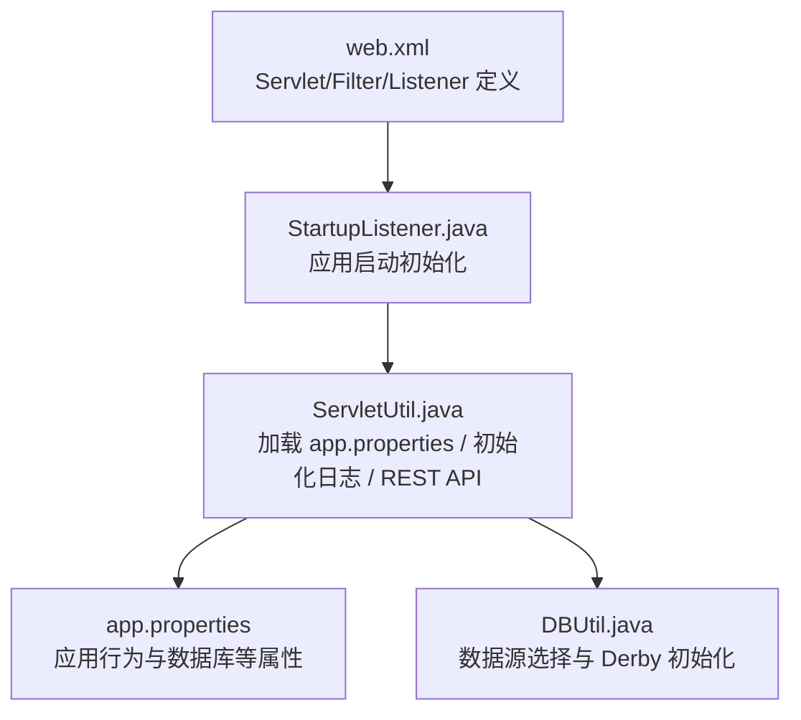
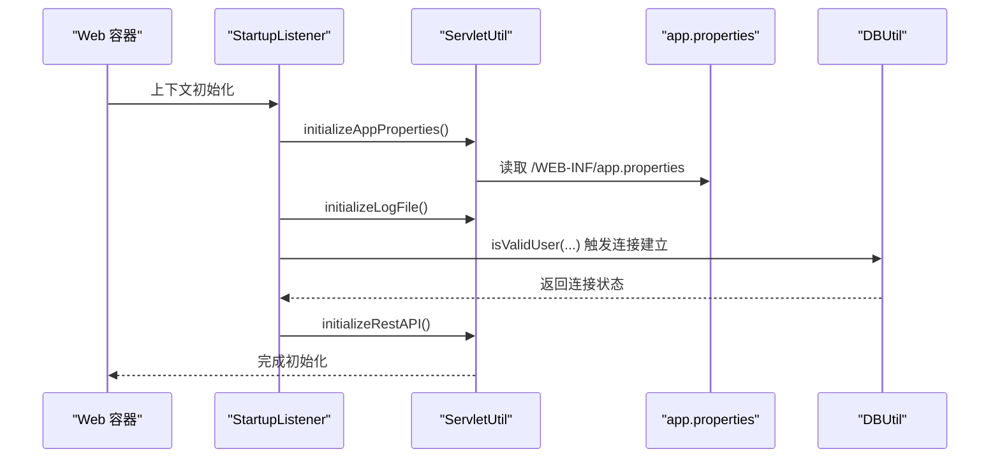
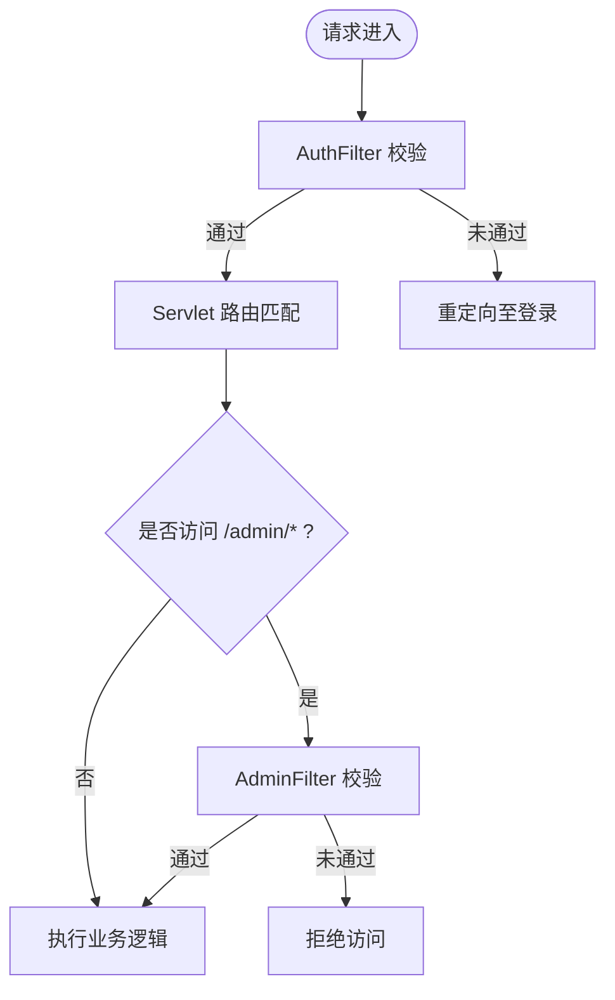
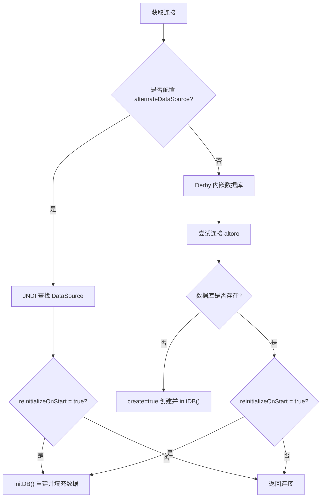
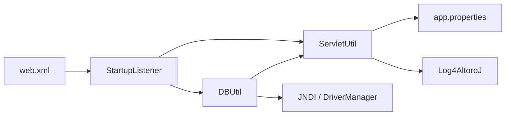

# 配置管理

<cite>
**本文引用的文件**   
- [web.xml](file://WebContent/WEB-INF/web.xml)
- [app.properties](file://WebContent/WEB-INF/app.properties)
- [StartupListener.java](file://src/com/ibm/security/appscan/altoromutual/listener/StartupListener.java)
- [ServletUtil.java](file://src/com/ibm/security/appscan/altoromutual/util/ServletUtil.java)
- [DBUtil.java](file://src/com/ibm/security/appscan/altoromutual/util/DBUtil.java)
</cite>

## 目录
1. [简介](#简介)
2. [项目结构](#项目结构)
3. [核心组件](#核心组件)
4. [架构总览](#架构总览)
5. [详细组件分析](#详细组件分析)
6. [依赖关系分析](#依赖关系分析)
7. [性能与可观测性](#性能与可观测性)
8. [故障排查指南](#故障排查指南)
9. [结论](#结论)
10. [附录：环境模板与最佳实践](#附录环境模板与最佳实践)

## 简介
本文面向 AltoroJ 的配置管理，系统性说明应用配置、数据库配置与日志配置的选项与设置方法；详解 web.xml 中的 Servlet 映射、Filter 配置与 Listener 注册；记录 app.properties 中的应用属性（含高级与安全相关项）；并提供多环境配置模板与最佳实践，以及配置验证、热重载与配置管理的自动化方案建议。

## 项目结构
AltoroJ 的 Web 容器与运行时配置集中在以下位置：
- Web 容器配置：WebContent/WEB-INF/web.xml
- 应用属性：WebContent/WEB-INF/app.properties
- 启动初始化：src/.../listener/StartupListener.java
- 属性读取与工具：src/.../util/ServletUtil.java
- 数据库连接与初始化：src/.../util/DBUtil.java

图表来源
- [web.xml:1-227](file://WebContent/WEB-INF/web.xml#L1-L227)
- [StartupListener.java:10-31](file://src/com/ibm/security/appscan/altoromutual/listener/StartupListener.java#L10-L31)
- [ServletUtil.java:256-338](file://src/com/ibm/security/appscan/altoromutual/util/ServletUtil.java#L256-L338)
- [DBUtil.java:71-137](file://src/com/ibm/security/appscan/altoromutual/util/DBUtil.java#L71-L137)

章节来源
- [web.xml:1-227](file://WebContent/WEB-INF/web.xml#L1-L227)
- [app.properties:1-74](file://WebContent/WEB-INF/app.properties#L1-L74)
- [StartupListener.java:10-31](file://src/com/ibm/security/appscan/altoromutual/listener/StartupListener.java#L10-L31)
- [ServletUtil.java:256-338](file://src/com/ibm/security/appscan/altoromutual/util/ServletUtil.java#L256-L338)
- [DBUtil.java:71-137](file://src/com/ibm/security/appscan/altoromutual/util/DBUtil.java#L71-L137)

## 核心组件
- web.xml：声明 Filter、Servlet、Listener、错误页与欢迎页，完成请求路由与生命周期钩子。
- StartupListener：在上下文初始化时加载应用属性、初始化日志、预热数据库连接、初始化 REST API。
- ServletUtil：提供应用属性读取、日志文件初始化、REST API 基础路径自动修正等工具能力。
- DBUtil：根据 app.properties 决定使用外部 JNDI DataSource 或内置 Derby，并在需要时执行数据库初始化。

章节来源
- [web.xml:1-227](file://WebContent/WEB-INF/web.xml#L1-L227)
- [StartupListener.java:10-31](file://src/com/ibm/security/appscan/altoromutual/listener/StartupListener.java#L10-L31)
- [ServletUtil.java:200-218](file://src/com/ibm/security/appscan/altoromutual/util/ServletUtil.java#L200-L218)
- [DBUtil.java:71-137](file://src/com/ibm/security/appscan/altoromutual/util/DBUtil.java#L71-L137)

## 架构总览
下图展示从 Web 容器到应用层的关键配置与初始化流程。

图表来源
- [StartupListener.java:12-23](file://src/com/ibm/security/appscan/altoromutual/listener/StartupListener.java#L12-L23)
- [ServletUtil.java:256-299](file://src/com/ibm/security/appscan/altoromutual/util/ServletUtil.java#L256-L299)
- [DBUtil.java:99-137](file://src/com/ibm/security/appscan/altoromutual/util/DBUtil.java#L99-L137)

## 详细组件分析

### Web 容器配置（web.xml）
- Filter 配置
  - AuthFilter：对 /bank/*、/admin/*、/account.jsp 进行认证拦截，支持 FORWARD/INCLUDE/REQUEST/ERROR 分发类型。
  - AdminFilter：对 /adimn/* 进行管理员权限校验（注意此处 URL 为 /adimn/*，非 /admin/*）。
- Servlet 配置与映射
  - Jersey 容器作为 AltoroAPI 的 ServletContainer，通过 init-param 指定 Application 类。
  - 业务 Servlet：LoginServlet、AccountViewServlet、TransferServlet、CCApplyServlet、SubscribeServlet、FeedbackServlet、AdminServlet、AdminLoginServlet、SurveyServlet、RedirectServlet。
  - 标准 JSP 处理器映射 *.jspf 与 *.jsp。
- Listener 注册
  - StartupListener：应用启动时执行属性加载、日志初始化、数据库预热与 REST API 初始化。
- 其他
  - 全局 404 错误页指向 /notfound.jsp。
  - 欢迎页 index.jsp。

图表来源
- [web.xml:12-60](file://WebContent/WEB-INF/web.xml#L12-L60)
- [web.xml:60-223](file://WebContent/WEB-INF/web.xml#L60-L223)

章节来源
- [web.xml:1-227](file://WebContent/WEB-INF/web.xml#L1-L227)

### 应用属性（app.properties）
- 行为开关（默认注释，需显式启用）
  - enableAdminFunctions：开启管理功能（添加用户、修改密码等），配合 AppScan 测试可能破坏数据库。
  - specialLink：替换导航中特定链接以演示恶意站点检测。
  - advancedStaticPageProcessing：启用基于系统命令的高级静态页面查找（存在远程命令执行与路径遍历风险）。
  - enableFeedbackRetention：启用反馈持久化存储，用于演示持久型 XSS。
- 数据库设置
  - database.alternateDataSource：指定 Tomcat context.xml 中配置的 JNDI 数据源名称，用于连接外部数据库（如 DB2）。首次运行需同时启用 reinitializeOnStart。
  - database.reinitializeOnStart：每次启动时强制重新初始化数据库（删除并重建表与初始数据）。

读取机制
- 由 ServletUtil.initializeAppProperties 在应用启动时从 /WEB-INF/app.properties 解析键值对，缓存于内存 Map。
- 提供 getAppProperty 与 isAppPropertyTrue 供其他模块查询属性。

安全提示
- 上述高级选项包含潜在安全风险，仅应在受控环境（如虚拟机、隔离网络）中使用。

章节来源
- [app.properties:25-74](file://WebContent/WEB-INF/app.properties#L25-L74)
- [ServletUtil.java:256-299](file://src/com/ibm/security/appscan/altoromutual/util/ServletUtil.java#L256-L299)

### 启动监听器（StartupListener）
职责
- 加载应用属性：调用 ServletUtil.initializeAppProperties。
- 初始化日志文件：调用 ServletUtil.initializeLogFile。
- 预热数据库连接：调用 DBUtil.isValidUser("bogus", "user") 触发连接建立与可能的初始化。
- 初始化 REST API：调用 ServletUtil.initializeRestAPI 修正 Swagger basePath。

异常处理
- 捕获初始化异常并通过 Log4AltoroJ 记录错误信息。

章节来源
- [StartupListener.java:10-31](file://src/com/ibm/security/appscan/altoromutual/listener/StartupListener.java#L10-L31)

### 属性与日志工具（ServletUtil）
- 应用属性
  - initializeAppProperties：从 /WEB-INF/app.properties 逐行解析，忽略注释行，遇到非法格式行记录错误。
  - getAppProperty/isAppPropertyTrue：提供属性读取与布尔判断。
- 日志初始化
  - initializeLogFile：若目标日志文件不存在或为空，则从 WEB-INF/init.log 复制示例日志内容。
- REST API 初始化
  - initializeRestAPI：读取 swagger/properties.json，将 basePath 设置为当前上下文路径 + "/api"，并写回文件；失败时记录错误日志。

章节来源
- [ServletUtil.java:200-218](file://src/com/ibm/security/appscan/altoromutual/util/ServletUtil.java#L200-L218)
- [ServletUtil.java:256-338](file://src/com/ibm/security/appscan/altoromutual/util/ServletUtil.java#L256-L338)
- [ServletUtil.java:375-409](file://src/com/ibm/security/appscan/altoromutual/util/ServletUtil.java#L375-L409)

### 数据库配置（DBUtil）
数据源选择逻辑
- 若 app.properties 中设置了 database.alternateDataSource：
  - 通过 JNDI 从 java:comp/env 下查找对应 DataSource。
  - 若 database.reinitializeOnStart 为 true，则在获取连接后执行 initDB。
- 否则使用内置 Apache Derby：
  - 设置 derby.system.home 为用户主目录下的 altoro 文件夹。
  - 尝试连接 jdbc:derby:altoro；若数据库不存在（错误码 40000），则以 create=true 创建并初始化。
  - 若 database.reinitializeOnStart 为 true，同样执行 initDB。

初始化过程
- 删除旧表（PEOPLE、ACCOUNTS、TRANSACTIONS、FEEDBACK），重建表结构并插入初始数据。
- 记录“Database initialized”日志。

图表来源
- [DBUtil.java:71-137](file://src/com/ibm/security/appscan/altoromutual/util/DBUtil.java#L71-L137)
- [DBUtil.java:143-167](file://src/com/ibm/security/appscan/altoromutual/util/DBUtil.java#L143-L167)

章节来源
- [DBUtil.java:71-137](file://src/com/ibm/security/appscan/altoromutual/util/DBUtil.java#L71-L137)
- [DBUtil.java:143-167](file://src/com/ibm/security/appscan/altoromutual/util/DBUtil.java#L143-L167)

## 依赖关系分析
- web.xml 依赖 StartupListener、AuthFilter、AdminFilter 与各 Servlet 实现类。
- StartupListener 依赖 ServletUtil 与 DBUtil。
- ServletUtil 依赖 app.properties 与 Log4AltoroJ（日志）。
- DBUtil 依赖 ServletUtil（读取属性）与 JNDI/DriverManager（数据源）。

图表来源
- [web.xml:1-227](file://WebContent/WEB-INF/web.xml#L1-L227)
- [StartupListener.java:10-31](file://src/com/ibm/security/appscan/altoromutual/listener/StartupListener.java#L10-L31)
- [ServletUtil.java:256-338](file://src/com/ibm/security/appscan/altoromutual/util/ServletUtil.java#L256-L338)
- [DBUtil.java:71-137](file://src/com/ibm/security/appscan/altoromutual/util/DBUtil.java#L71-L137)

## 性能与可观测性
- 属性加载仅在启动时进行一次，后续读取走内存 Map，开销低。
- 日志初始化会复制示例日志，避免空文件影响体验。
- REST API 初始化会写入 properties.json，建议在只读文件系统环境中提前手动配置 basePath。
- 数据库初始化在首次连接或显式开启 reinitializeOnStart 时执行，生产环境应谨慎使用。

[本节为通用指导，不直接分析具体文件]

## 故障排查指南
- 属性解析失败
  - 现象：控制台输出“Failed to process property line”，且错误日志记录相应行。
  - 原因：属性文件格式不符合 key=value，或出现非注释的非空行但无等号。
  - 处理：检查 app.properties 语法，确保每行有效属性均包含等号，注释以 # 或 // 开头。
  - 参考
    - [ServletUtil.java:271-299](file://src/com/ibm/security/appscan/altoromutual/util/ServletUtil.java#L271-L299)
- 日志文件初始化失败
  - 现象：初始化日志报错，无法从 init.log 复制内容。
  - 原因：init.log 缺失或权限不足。
  - 处理：确保 WEB-INF/init.log 存在且可读。
  - 参考
    - [ServletUtil.java:302-338](file://src/com/ibm/security/appscan/altoromutmal/util/ServletUtil.java#L302-L338)
- REST API 初始化失败
  - 现象：日志提示无法自动初始化 Swagger 属性，需手动设置 basePath。
  - 原因：无法写入 swagger/properties.json 或上下文路径异常。
  - 处理：手动编辑 swagger/properties.json，将 basePath 设置为当前上下文路径 + "/api"。
  - 参考
    - [ServletUtil.java:375-409](file://src/com/ibm/security/appscan/altoromutual/util/ServletUtil.java#L375-L409)
- 数据库连接失败
  - 现象：JNDI 查找失败或 Derby 连接异常。
  - 原因：alternateDataSource 配置错误或 Derby 驱动不可用。
  - 处理：确认 Tomcat context.xml 已正确配置 JNDI 数据源；或使用内置 Derby 并确保 derby.system.home 可写。
  - 参考
    - [DBUtil.java:71-97](file://src/com/ibm/security/appscan/altoromutual/util/DBUtil.java#L71-L97)
    - [DBUtil.java:117-137](file://src/com/ibm/security/appscan/altoromutual/util/DBUtil.java#L117-L137)

章节来源
- [ServletUtil.java:271-299](file://src/com/ibm/security/appscan/altoromutual/util/ServletUtil.java#L271-L299)
- [ServletUtil.java:302-338](file://src/com/ibm/security/appscan/altoromutmal/util/ServletUtil.java#L302-L338)
- [ServletUtil.java:375-409](file://src/com/ibm/security/appscan/altoromutmal/util/ServletUtil.java#L375-L409)
- [DBUtil.java:71-137](file://src/com/ibm/security/appscan/altoromutmal/util/DBUtil.java#L71-L137)

## 结论
AltoroJ 的配置体系围绕 web.xml、app.properties 与启动监听器展开：web.xml 负责请求路由与过滤器链；app.properties 控制应用行为与数据库策略；StartupListener 串联属性加载、日志初始化、数据库预热与 REST API 初始化；ServletUtil 与 DBUtil 分别承担属性与数据源的工具职责。在生产部署中，应严格限制高级属性的启用范围，优先采用外部数据源与安全的日志策略，并结合 CI/CD 实现配置验证与一致性检查。

[本节为总结性内容，不直接分析具体文件]

## 附录：环境模板与最佳实践

### 开发环境
- 使用内置 Derby，无需额外数据源。
- 保持 app.properties 默认关闭所有高级选项。
- 如需演示管理功能或反馈持久化，可在隔离 VM 中临时启用，并在测试完成后恢复。

### 测试环境
- 可启用 database.reinitializeOnStart=true，以便每次启动重置数据。
- 可启用 enableFeedbackRetention=true 以演示持久型 XSS。
- 不建议启用 advancedStaticPageProcessing。

### 预生产/生产环境
- 使用外部 JNDI DataSource（database.alternateDataSource），并在 Tomcat context.xml 中配置数据源。
- 禁用所有危险的高级选项（enableAdminFunctions、advancedStaticPageProcessing、specialLink）。
- 禁止启用 database.reinitializeOnStart，避免启动时重建数据。
- 确保 swagger/properties.json 的 basePath 与实际部署路径一致。

### 配置验证
- 在构建阶段校验 app.properties 语法（键值对、注释规则）。
- 校验必填属性（如 external DB 场景下的 alternateDataSource）。
- 对敏感开关进行白名单校验，防止误启高风险特性。

### 热重载
- 当前实现仅在应用启动时加载 app.properties，不支持运行时热重载。
- 若需热重载，可在 ServletUtil 中增加文件监听与属性刷新逻辑，并对依赖该属性的组件提供失效与重建机制。

### 配置管理自动化
- 将 app.properties 纳入版本控制，结合 CI 流水线进行语法与合规检查。
- 使用环境变量或配置中心注入敏感参数（如外部数据源名），避免硬编码。
- 对 swagger/properties.json 的 basePath 生成脚本，依据部署上下文自动更新。

[本节为通用指导，不直接分析具体文件]