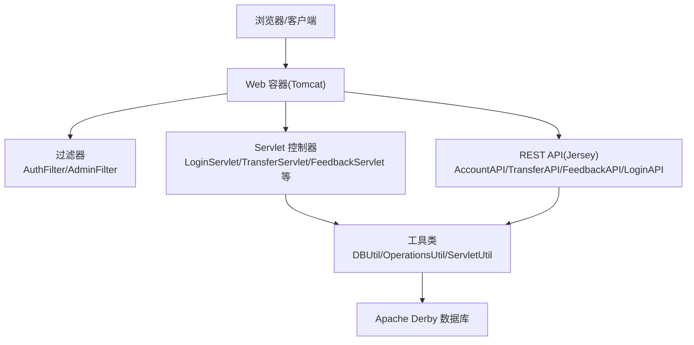
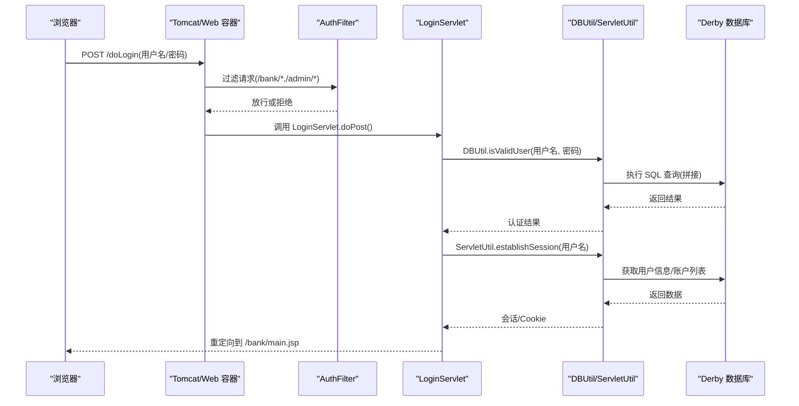
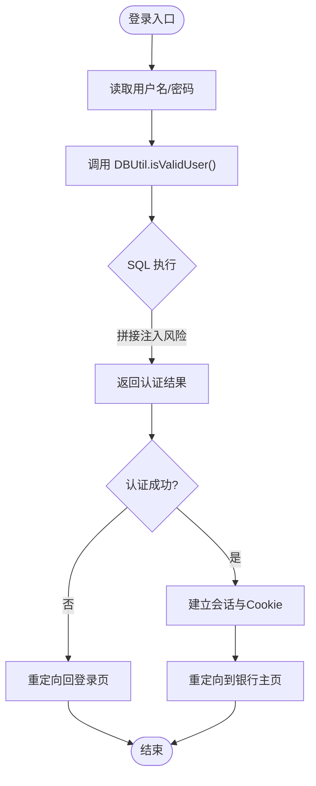
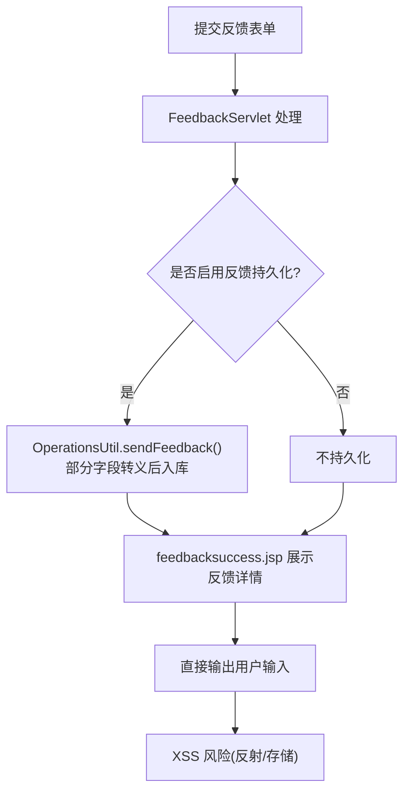
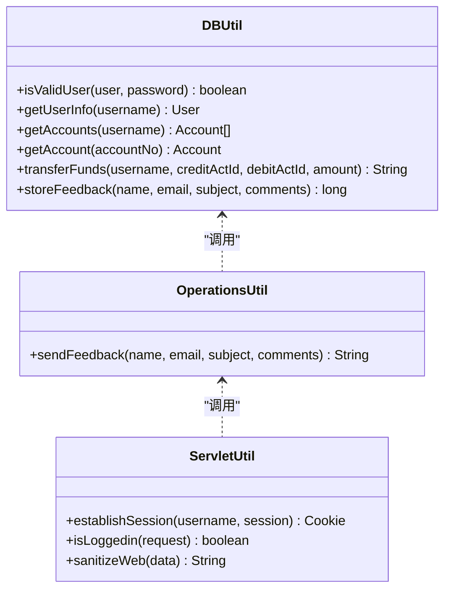
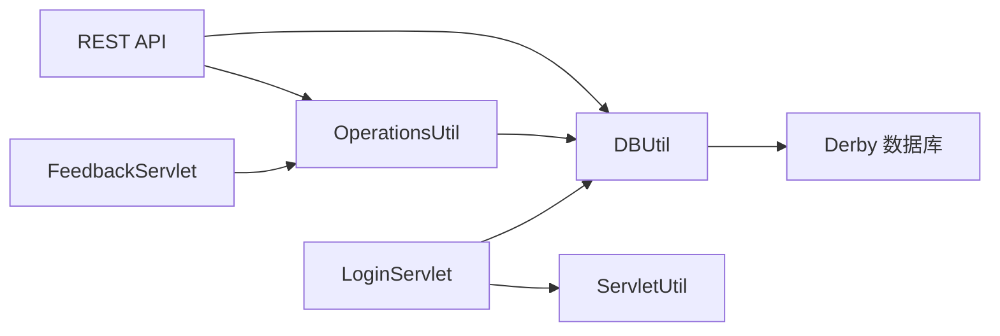

# 安全漏洞教学目的

<cite>
**本文引用的文件**   
- [README.md](file://README.md)
- [web.xml](file://WebContent/WEB-INF/web.xml)
- [app.properties](file://WebContent/WEB-INF/app.properties)
- [DBUtil.java](file://src/com/ibm/security/appscan/altoromutual/util/DBUtil.java)
- [LoginServlet.java](file://src/com/ibm/security/appscan/altoromutual/servlet/LoginServlet.java)
- [login.jsp](file://WebContent/login.jsp)
- [feedbacksuccess.jsp](file://WebContent/feedbacksuccess.jsp)
- [FeedbackServlet.java](file://src/com/ibm/security/appscan/altoromutual/servlet/FeedbackServlet.java)
- [OperationsUtil.java](file://src/com/ibm/security/appscan/altoromutual/util/OperationsUtil.java)
- [ServletUtil.java](file://src/com/ibm/security/appscan/altoromutual/util/ServletUtil.java)
</cite>

## 目录
1. [引言](#引言)
2. [项目结构](#项目结构)
3. [核心组件](#核心组件)
4. [架构总览](#架构总览)
5. [详细组件分析](#详细组件分析)
6. [依赖关系分析](#依赖关系分析)
7. [性能与可扩展性考虑](#性能与可扩展性考虑)
8. [故障排查指南](#故障排查指南)
9. [结论](#结论)
10. [附录：教学实践建议](#附录教学实践建议)

## 引言
AltoroJ 是一个用于安全教育的示例银行 Web 应用，其设计目标是通过真实的银行业务场景演示常见的 Web 应用安全漏洞，帮助学习者理解攻击原理、危害性与修复方法。该项目故意包含多种安全缺陷（如 SQL 注入、跨站脚本、会话管理问题、权限绕过等），以便在隔离环境中进行学习与测试。它不依赖复杂框架，便于聚焦安全原理本身，同时覆盖从前端到后端、从业务逻辑到数据访问的完整链路，适合用于渗透测试演练、安全开发培训与课程教学。

## 项目结构
AltoroJ 采用传统 J2EE 结构：
- Web 层：JSP 页面与静态资源
- Servlet 控制器：处理登录、转账、反馈、订阅等业务请求
- Filter 过滤器：统一认证与管理员权限控制
- REST API：基于 Jersey 的账户、转账、反馈、登录等接口
- 模型与工具类：用户、账户、交易、反馈等实体；数据库操作、通用工具
- 配置：web.xml 路由与过滤器映射；app.properties 行为开关与安全相关特性

图表来源
- [web.xml:12-67](file://WebContent/WEB-INF/web.xml#L12-L67)
- [web.xml:159-223](file://WebContent/WEB-INF/web.xml#L159-L223)

章节来源
- [web.xml:1-227](file://WebContent/WEB-INF/web.xml#L1-L227)

## 核心组件
- 认证与会话
  - LoginServlet 负责登录与登出，调用 DBUtil 验证用户，成功后通过 ServletUtil 建立会话并设置 Cookie。
  - AuthFilter 对 /bank/* 和 /admin/* 路径进行认证拦截。
- 数据访问
  - DBUtil 封装 JDBC 操作，包含用户认证、账户查询、转账、反馈存储等。多处使用字符串拼接 SQL，存在 SQL 注入风险。
- 反馈与 XSS
  - FeedbackServlet 接收反馈表单，支持可选持久化；feedbacksuccess.jsp 展示反馈详情，部分输出未充分转义，存在反射型与存储型 XSS 风险。
- 配置与高级选项
  - app.properties 提供“启用反馈持久化”“命令执行演示”等开关，用于演示更严重的安全问题（需仅在隔离环境开启）。

章节来源
- [LoginServlet.java:64-105](file://src/com/ibm/security/appscan/altoromutual/servlet/LoginServlet.java#L64-L105)
- [DBUtil.java:212-232](file://src/com/ibm/security/appscan/altoromutual/util/DBUtil.java#L212-L232)
- [feedbacksuccess.jsp:42-89](file://WebContent/feedbacksuccess.jsp#L42-L89)
- [app.properties:25-53](file://WebContent/WEB-INF/app.properties#L25-L53)

## 架构总览
下图展示了典型登录流程与关键安全点：

图表来源
- [web.xml:28-59](file://WebContent/WEB-INF/web.xml#L28-L59)
- [LoginServlet.java:64-105](file://src/com/ibm/security/appscan/altoromutual/servlet/LoginServlet.java#L64-L105)
- [DBUtil.java:212-232](file://src/com/ibm/security/appscan/altoromutual/util/DBUtil.java#L212-L232)
- [ServletUtil.java:340-353](file://src/com/ibm/security/appscan/altoromutual/util/ServletUtil.java#L340-L353)

## 详细组件分析

### 认证与会话组件
- 登录流程
  - LoginServlet 读取表单参数 uid/passw，调用 DBUtil.isValidUser 进行认证。
  - 认证成功后，ServletUtil.establishSession 创建会话属性并生成 Cookie，随后重定向至银行主页。
- 安全要点
  - DBUtil 中认证 SQL 使用字符串拼接，易受 SQL 注入影响。
  - 会话状态依赖 Session 属性与 Cookie，若 Cookie 被篡改或会话固定策略缺失，可能导致会话劫持。
  - 过滤器 AuthFilter 仅检查 Session 是否存在用户对象，未实现细粒度权限校验。

图表来源
- [LoginServlet.java:64-105](file://src/com/ibm/security/appscan/altoromutual/servlet/LoginServlet.java#L64-L105)
- [DBUtil.java:212-232](file://src/com/ibm/security/appscan/altoromutual/util/DBUtil.java#L212-L232)
- [ServletUtil.java:340-353](file://src/com/ibm/security/appscan/altoromutual/util/ServletUtil.java#L340-L353)

章节来源
- [LoginServlet.java:64-105](file://src/com/ibm/security/appscan/altoromutual/servlet/LoginServlet.java#L64-L105)
- [DBUtil.java:212-232](file://src/com/ibm/security/appscan/altoromutual/util/DBUtil.java#L212-L232)
- [ServletUtil.java:340-378](file://src/com/ibm/security/appscan/altoromutual/util/ServletUtil.java#L340-L378)

### 反馈与跨站脚本(XSS)组件
- 反馈提交
  - FeedbackServlet 接收 name/email/subject/comments，并在 enableFeedbackRetention 开启时持久化到数据库。
  - OperationsUtil.sendFeedback 在开启持久化时对 email/subject/comments 进行 SQL 转义，但 name 未转义直接入库。
- 反馈展示
  - feedbacksuccess.jsp 直接输出用户输入（name/email/subject/message），部分字段尝试使用正则过滤，但未全面 HTML 转义，存在反射型与存储型 XSS 风险。
- 安全要点
  - 输出侧应统一进行 HTML 转义（如 sanitizeWeb），避免将不可信数据直接写入页面。
  - 输入侧应进行白名单校验与最小化原则，避免允许任意脚本标签。

图表来源
- [FeedbackServlet.java:42-69](file://src/com/ibm/security/appscan/altoromutual/servlet/FeedbackServlet.java#L42-L69)
- [OperationsUtil.java:119-132](file://src/com/ibm/security/appscan/altoromutual/util/OperationsUtil.java#L119-L132)
- [feedbacksuccess.jsp:42-89](file://WebContent/feedbacksuccess.jsp#L42-L89)

章节来源
- [FeedbackServlet.java:42-69](file://src/com/ibm/security/appscan/altoromutual/servlet/FeedbackServlet.java#L42-L69)
- [OperationsUtil.java:119-132](file://src/com/ibm/security/appscan/altoromutual/util/OperationsUtil.java#L119-L132)
- [feedbacksuccess.jsp:42-89](file://WebContent/feedbacksuccess.jsp#L42-L89)

### 数据访问与 SQL 注入组件
- 认证与信息查询
  - DBUtil.isValidUser 与 getUserInfo 等方法直接使用字符串拼接构造 SQL，存在 SQL 注入风险。
  - getAccounts、getAccount、transferFunds 等同样拼接用户可控参数，可能被利用以读取或修改数据。
- 安全要点
  - 应使用 PreparedStatement 与参数绑定，避免字符串拼接。
  - 对输入进行严格类型校验与长度限制，减少注入面。
  - 对敏感操作（转账）增加业务校验与审计日志。

图表来源
- [DBUtil.java:212-232](file://src/com/ibm/security/appscan/altoromutual/util/DBUtil.java#L212-L232)
- [DBUtil.java:241-267](file://src/com/ibm/security/appscan/altoromutual/util/DBUtil.java#L241-L267)
- [DBUtil.java:275-293](file://src/com/ibm/security/appscan/altoromutual/util/DBUtil.java#L275-L293)
- [DBUtil.java:303-364](file://src/com/ibm/security/appscan/altoromutual/util/DBUtil.java#L303-L364)
- [OperationsUtil.java:119-132](file://src/com/ibm/security/appscan/altoromutual/util/OperationsUtil.java#L119-L132)
- [ServletUtil.java:340-378](file://src/com/ibm/security/appscan/altoromutual/util/ServletUtil.java#L340-L378)

章节来源
- [DBUtil.java:212-232](file://src/com/ibm/security/appscan/altoromutual/util/DBUtil.java#L212-L232)
- [DBUtil.java:241-267](file://src/com/ibm/security/appscan/altoromutual/util/DBUtil.java#L241-L267)
- [DBUtil.java:275-293](file://src/com/ibm/security/appscan/altoromutual/util/DBUtil.java#L275-L293)
- [DBUtil.java:303-364](file://src/com/ibm/security/appscan/altoromutual/util/DBUtil.java#L303-L364)

### 权限控制与过滤器
- 过滤器映射
  - web.xml 定义 AuthFilter 与 AdminFilter，分别对 /bank/*、/admin/* 以及特定页面进行拦截。
  - 注意：AdminFilter 的 URL 模式为 /adimn/*（拼写错误），可能形成权限绕过路径。
- 安全要点
  - 应修正 URL 模式拼写，确保管理员路径正确拦截。
  - 在过滤器中实现角色校验与细粒度授权，避免仅凭 Session 判断登录态即放行。

章节来源
- [web.xml:12-59](file://WebContent/WEB-INF/web.xml#L12-L59)

### 配置与高级选项
- app.properties 提供多个可开关的高级功能：
  - enableAdminFunctions：启用管理员功能（需谨慎，可能破坏数据库）
  - advancedStaticPageProcessing：启用命令执行演示（极高风险，仅限隔离环境）
  - enableFeedbackRetention：启用反馈持久化（用于演示存储型 XSS）
- 安全要点
  - 默认关闭这些危险功能，生产环境严禁启用。
  - 在隔离 VM 中进行实验，避免对宿主系统造成损害。

章节来源
- [app.properties:25-53](file://WebContent/WEB-INF/app.properties#L25-L53)

## 依赖关系分析
- 组件耦合
  - LoginServlet 依赖 DBUtil 与 ServletUtil；DBUtil 直接操作数据库；OperationsUtil 封装业务逻辑并调用 DBUtil；ServletUtil 提供会话与工具方法。
- 外部依赖
  - Apache Derby 作为内嵌数据库；Jersey 提供 REST API；Commons Lang 提供字符串转义工具。
- 潜在循环依赖
  - 当前结构未见明显循环依赖，但需注意工具类之间的职责边界，避免过度耦合。

图表来源
- [web.xml:60-67](file://WebContent/WEB-INF/web.xml#L60-L67)
- [LoginServlet.java:64-105](file://src/com/ibm/security/appscan/altoromutual/servlet/LoginServlet.java#L64-L105)
- [FeedbackServlet.java:42-69](file://src/com/ibm/security/appscan/altoromutual/servlet/FeedbackServlet.java#L42-L69)
- [OperationsUtil.java:119-132](file://src/com/ibm/security/appscan/altoromutual/util/OperationsUtil.java#L119-L132)

章节来源
- [web.xml:60-67](file://WebContent/WEB-INF/web.xml#L60-L67)
- [LoginServlet.java:64-105](file://src/com/ibm/security/appscan/altoromutual/servlet/LoginServlet.java#L64-L105)
- [FeedbackServlet.java:42-69](file://src/com/ibm/security/appscan/altoromutual/servlet/FeedbackServlet.java#L42-L69)
- [OperationsUtil.java:119-132](file://src/com/ibm/security/appscan/altoromutual/util/OperationsUtil.java#L119-L132)

## 性能与可扩展性考虑
- 数据库连接
  - DBUtil 使用单例连接与 DataSource 切换，支持外部数据源配置；频繁创建 Statement 可能带来性能开销，建议使用连接池与预编译语句。
- 查询优化
  - 多表查询与动态条件拼接应避免全表扫描；为常用字段添加索引（如 USER_ID、ACCOUNTID）。
- 可扩展性
  - 将 SQL 访问抽象为 DAO 层，便于替换 ORM 或迁移数据库。
  - 引入缓存机制（如账户余额缓存）以减少重复查询。

[本节为一般性指导，不直接分析具体文件]

## 故障排查指南
- 数据库初始化失败
  - 现象：登录时报错无法创建数据库 altoro。
  - 原因：目录权限不足导致无法写入 user.home/altoro。
  - 解决：赋予 Tomcat 运行用户对 user.home 目录读写权限，或通过 JVM 参数指定 derby.system.home。
- 编译错误
  - 现象：部署到 Tomcat 时报编译错误。
  - 原因：构建路径缺失第三方库。
  - 解决：使用 Gradle 构建下载依赖并重新部署。

章节来源
- [README.md:44-57](file://README.md#L44-L57)

## 结论
AltoroJ 通过真实银行场景与故意植入的安全缺陷，为学习者提供了完整的攻防演练平台。通过对认证、会话、反馈、数据访问与权限控制的深入分析，可以清晰理解 SQL 注入、XSS、会话管理与权限绕过的原理与危害。建议在隔离环境中进行实验，结合防御措施（参数化查询、输出转义、严格授权、会话加固）进行修复练习，从而提升安全意识与实战能力。

[本节为总结性内容，不直接分析具体文件]

## 附录：教学实践建议
- 学习环境
  - 使用虚拟机与快照，禁用对外网络，仅允许主机访问。
  - 默认关闭危险高级选项，按需逐步开启以观察不同漏洞效果。
- 学习路径
  - 先理解正常业务流程（登录、查看账户、转账、提交反馈）。
  - 再针对每个模块识别潜在漏洞点（SQL 拼接、输出未转义、权限绕过）。
  - 最后实施修复方案（PreparedStatement、HTML 转义、细粒度授权、会话安全）。
- 评估指标
  - 漏洞发现率、修复覆盖率、回归测试通过率、日志与审计完整性。

[本节为概念性内容，不直接分析具体文件]