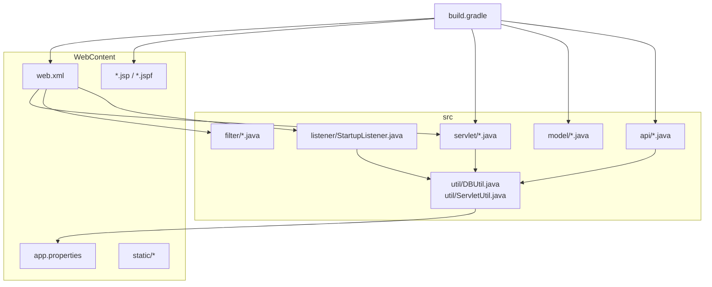
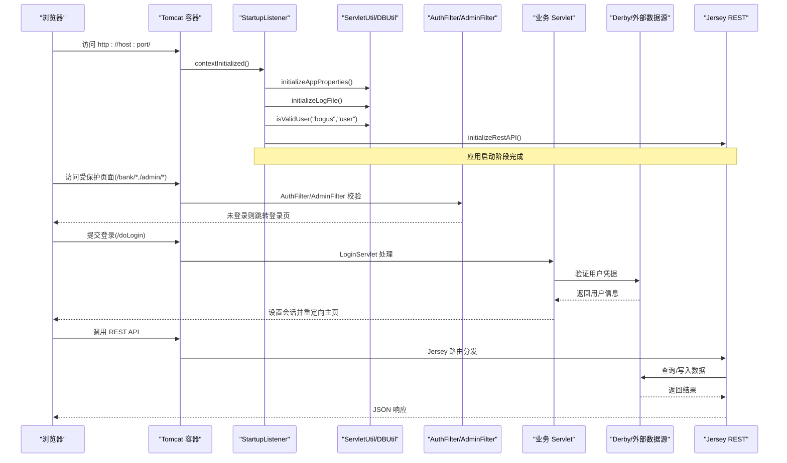
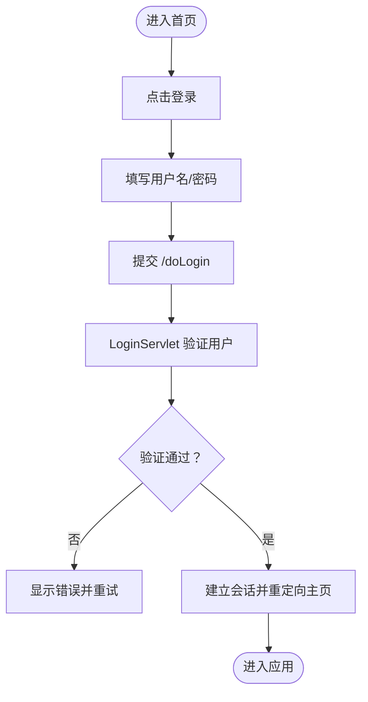
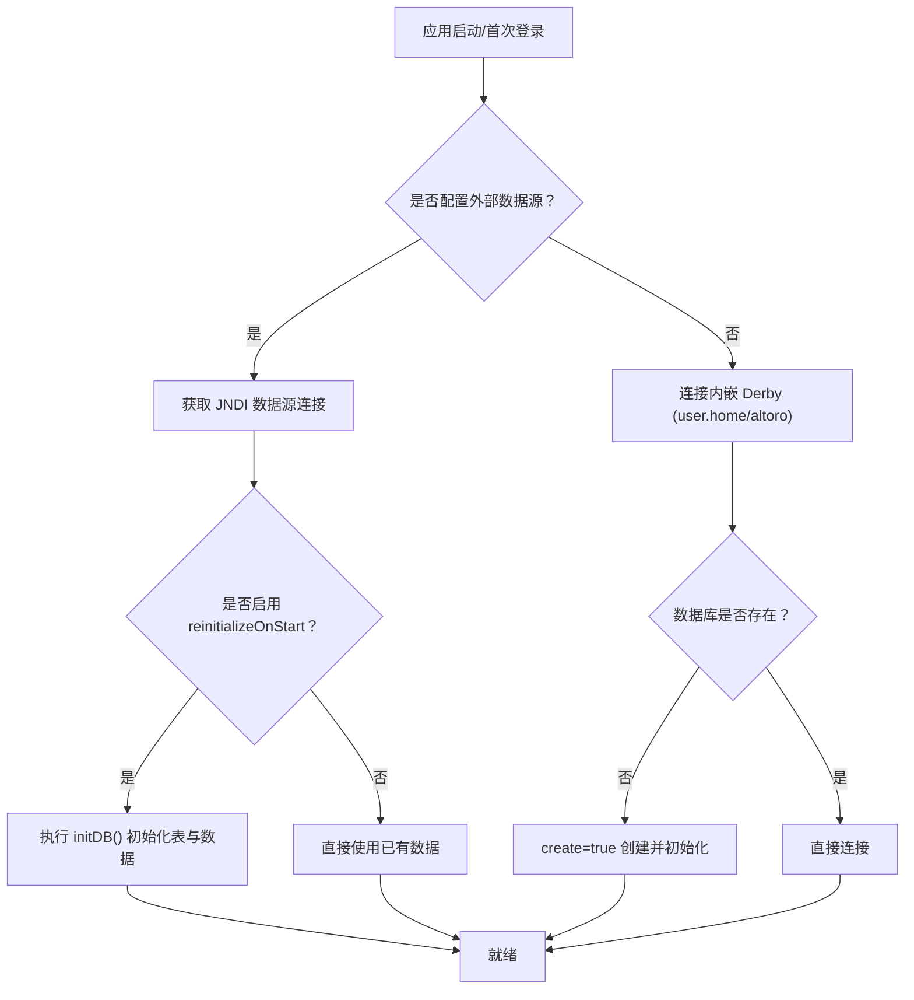
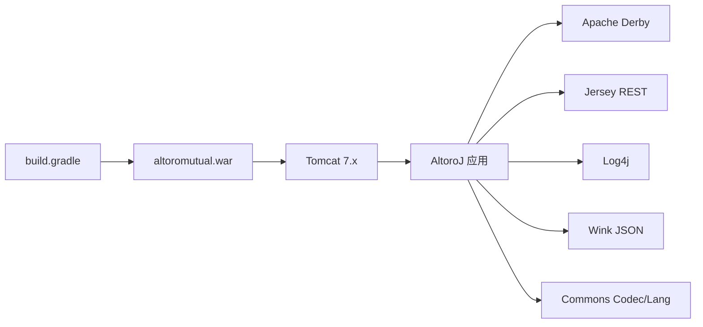

# 快速开始指南

<cite>
**本文引用的文件**   
- [README.md](file://README.md)
- [Importing AltoroJ into Eclipse from GitHub.md](file://Importing%20AltoroJ%20into%20Eclipse%20from%20GitHub.md)
- [build.gradle](file://build.gradle)
- [web.xml](file://WebContent/WEB-INF/web.xml)
- [app.properties](file://WebContent/WEB-INF/app.properties)
- [StartupListener.java](file://src/com/ibm/security/appscan/altoromutual/listener/StartupListener.java)
- [DBUtil.java](file://src/com/ibm/security/appscan/altoromutual/util/DBUtil.java)
- [ServletUtil.java](file://src/com/ibm/security/appscan/altoromutual/util/ServletUtil.java)
</cite>

## 目录
1. [简介](#简介)
2. [项目结构](#项目结构)
3. [核心组件](#核心组件)
4. [架构总览](#架构总览)
5. [详细组件分析](#详细组件分析)
6. [依赖分析](#依赖分析)
7. [性能考虑](#性能考虑)
8. [故障排除指南](#故障排除指南)
9. [结论](#结论)
10. [附录](#附录)

## 简介
本指南面向首次接触 AltoroJ 的开发者，帮助你在本地环境快速搭建并运行该示例银行 Web 应用。你将完成以下目标：
- 在 Eclipse 中导入并构建项目（使用 Gradle 与 Buildship）
- 配置并部署到 Tomcat 服务器
- 使用默认账户登录体验应用功能
- 了解高级选项（app.properties）以扩展行为
- 解决常见安装与运行问题（数据库创建失败、编译错误等）

注意：该项目包含已知安全漏洞，仅用于学习与演示，请在隔离环境中运行。

章节来源
- [README.md:1-10](file://README.md#L1-L10)

## 项目结构
AltoroJ 是一个标准的 J2EE Web 应用，采用传统分层组织方式：
- WebContent：静态资源、JSP、过滤器与 Servlet 映射、REST API 集成配置
- src：Java 源代码（API、过滤器、监听器、模型、Servlet、工具类）
- build.gradle：Gradle 构建脚本，定义 WAR 打包、依赖与源集
- WEB-INF/web.xml：Servlet、Filter、Listener 与 URL 映射
- WEB-INF/app.properties：运行时可配置的高级选项

图表来源
- [build.gradle:1-43](file://build.gradle#L1-L43)
- [web.xml:1-227](file://WebContent/WEB-INF/web.xml#L1-L227)
- [StartupListener.java:1-31](file://src/com/ibm/security/appscan/altoromutual/listener/StartupListener.java#L1-L31)
- [DBUtil.java:79-167](file://src/com/ibm/security/appscan/altoromutual/util/DBUtil.java#L79-L167)
- [ServletUtil.java:200-302](file://src/com/ibm/security/appscan/altoromutual/util/ServletUtil.java#L200-L302)

章节来源
- [build.gradle:1-43](file://build.gradle#L1-L43)
- [web.xml:1-227](file://WebContent/WEB-INF/web.xml#L1-L227)

## 核心组件
- 启动监听器 StartupListener：应用启动时加载 app.properties、初始化日志、触发数据库连接与 REST API 初始化
- 数据库工具 DBUtil：管理 Derby 内嵌数据库或外部数据源的连接与初始化
- 工具类 ServletUtil：读取 app.properties、提供属性布尔判断、初始化日志与 REST API
- web.xml：声明 Servlet、Filter、Listener 及 URL 映射，注册 Jersey REST 容器
- app.properties：启用/禁用高级特性（如管理员功能、反馈持久化、外部数据源、重启重初始化等）

章节来源
- [StartupListener.java:13-23](file://src/com/ibm/security/appscan/altoromutual/listener/StartupListener.java#L13-L23)
- [DBUtil.java:99-167](file://src/com/ibm/security/appscan/altoromutual/util/DBUtil.java#L99-L167)
- [ServletUtil.java:200-302](file://src/com/ibm/security/appscan/altoromutual/util/ServletUtil.java#L200-L302)
- [web.xml:9-68](file://WebContent/WEB-INF/web.xml#L9-L68)
- [app.properties:25-74](file://WebContent/WEB-INF/app.properties#L25-L74)

## 架构总览
下图展示了从浏览器访问到后端处理的关键流程，包括认证过滤器、Servlet 路由、数据库初始化与 REST API 启动。

图表来源
- [web.xml:9-68](file://WebContent/WEB-INF/web.xml#L9-L68)
- [StartupListener.java:13-23](file://src/com/ibm/security/appscan/altoromutual/listener/StartupListener.java#L13-L23)
- [DBUtil.java:99-167](file://src/com/ibm/security/appscan/altoromutual/util/DBUtil.java#L99-L167)
- [ServletUtil.java:200-302](file://src/com/ibm/security/appscan/altoromutual/util/ServletUtil.java#L200-L302)

## 详细组件分析

### 环境与依赖准备
- 推荐 IDE：Eclipse 4.6+（需 Java 8）
- 服务器：Tomcat 7.x
- 构建工具：Gradle 3.0（命令行构建）
- Eclipse 插件：Buildship（自动下载第三方库并在 Eclipse 内运行）

步骤要点
- 安装 JDK、Tomcat、Eclipse，再安装 Gradle
- 通过 Eclipse Marketplace 安装 Buildship
- 将 Tomcat 添加到 Eclipse Servers 视图
- 从 GitHub 克隆项目并导入为现有 Eclipse 项目
- 若导入后构建异常，右键项目“Replace With -> Index”修复索引

章节来源
- [README.md:16-25](file://README.md#L16-L25)
- [Importing AltoroJ into Eclipse from GitHub.md:6-42](file://Importing%20AltoroJ%20into%20Eclipse%20from%20GitHub.md#L6-L42)

### Gradle 构建与打包
- 构建产物：altoromutual.war
- 源集：Java 源码位于 src，Web 内容位于 WebContent
- 依赖：包含 Apache Derby、Jersey、Log4j、Wink 等；Java EE API 作为 providedCompile
- 兼容性：source/target 兼容级别为 1.7

建议
- 在 Eclipse 中使用 Buildship 同步 Gradle 依赖
- 如需命令行构建，执行 Gradle 任务生成 WAR

章节来源
- [build.gradle:1-43](file://build.gradle#L1-L43)

### Tomcat 部署与运行
- 在 Eclipse 中将项目部署到已配置的 Tomcat v7.0 Server
- 启动服务器后，内置浏览器打开首页 index.jsp
- 首次登录会触发数据库初始化（Derby），随后数据持久化至 home 目录下的 altoro 文件夹

章节来源
- [Importing AltoroJ into Eclipse from GitHub.md:45-53](file://Importing%20AltoroJ%20into%20Eclipse%20from%20GitHub.md#L45-L53)
- [README.md:8-10](file://README.md#L8-L10)

### 初始登录与默认账户
- 默认账户：jsmith/demo1234、admin/admin
- 登录流程：
  - 访问首页，点击登录
  - 输入用户名与密码
  - 系统通过 LoginServlet 验证用户并建立会话
  - 成功后跳转到主界面并可访问受保护页面

图表来源
- [web.xml:159-166](file://WebContent/WEB-INF/web.xml#L159-L166)
- [README.md:27-30](file://README.md#L27-L30)

章节来源
- [README.md:27-30](file://README.md#L27-L30)
- [web.xml:159-166](file://WebContent/WEB-INF/web.xml#L159-L166)

### 数据库初始化与存储位置
- 默认使用内嵌 Derby 数据库
- 首次登录时自动创建并初始化数据库
- 数据库目录基于 user.home 环境变量，路径为 user.home/altoro
- 支持外部数据源（如 DB2），需在 Tomcat context.xml 中配置 JNDI 数据源名称，并在 app.properties 中启用 database.alternateDataSource
- 首次使用外部数据源必须开启 database.reinitializeOnStart=true 以完成初始化，之后可关闭

图表来源
- [DBUtil.java:99-167](file://src/com/ibm/security/appscan/altoromutual/util/DBUtil.java#L99-L167)
- [app.properties:57-74](file://WebContent/WEB-INF/app.properties#L57-L74)

章节来源
- [DBUtil.java:99-167](file://src/com/ibm/security/appscan/altoromutual/util/DBUtil.java#L99-L167)
- [app.properties:57-74](file://WebContent/WEB-INF/app.properties#L57-L74)

### 高级选项（app.properties）
- enableAdminFunctions：启用管理员功能（添加用户、修改密码等）。警告：可能破坏数据库，需要配合 reinitializeOnStart 或手动清理
- specialLink：替换导航中的特定链接，便于演示恶意站点检测
- advancedStaticPageProcessing：启用命令执行与路径遍历能力（仅限隔离环境）
- enableFeedbackRetention：启用反馈持久化，便于演示持久型 XSS
- database.alternateDataSource：指定 Tomcat JNDI 数据源名（如 jdbc/AltoroDB），需同时引入对应 JDBC 驱动
- database.reinitializeOnStart：每次重启强制重新初始化数据库（首次使用外部数据源时必须启用一次）

章节来源
- [app.properties:25-74](file://WebContent/WEB-INF/app.properties#L25-L74)

### REST API 与 Swagger
- 通过 Jersey 容器暴露 REST API
- 在 web.xml 中注册 org.glassfish.jersey.servlet.ServletContainer，并指向 AltoroAPI
- 可通过页面底部的 REST API 链接访问 Swagger UI 进行交互

章节来源
- [web.xml:60-68](file://WebContent/WEB-INF/web.xml#L60-L68)
- [README.md:39-41](file://README.md#L39-L41)

## 依赖分析
- 构建与打包：Gradle war 插件，输出 altoromutual.war
- 运行时依赖：
  - Apache Derby（内嵌数据库）
  - Jersey（RESTful API）
  - Log4j（日志）
  - Wink（JSON 支持）
  - Commons Codec/Lang（通用工具）
- 开发期依赖：javax:javaee-api:7.0（providedCompile）

图表来源
- [build.gradle:23-43](file://build.gradle#L23-L43)

章节来源
- [build.gradle:23-43](file://build.gradle#L23-L43)

## 性能考虑
- 首次登录触发数据库初始化，建议在测试环境预初始化以减少冷启动延迟
- 使用外部数据源时，确保连接池与 JDBC 驱动优化配置
- 避免在生产环境启用危险的高级选项（如命令执行、路径遍历）

[本节为通用指导，不直接分析具体文件]

## 故障排除指南
常见问题与解决方案
- 登录时报错“Failed to create database 'altoro'”
  - 原因：数据库目录权限不足或无法写入
  - 排查：查看 Eclipse Console 或 Tomcat 日志 catalina.out，定位 user.home 值
  - 解决：授予 Tomcat 运行用户对 user.home 目录读写权限，或通过 JVM 参数 -Duser.home=新路径 更改数据库位置
- 部署到 Tomcat 出现编译错误
  - 原因：Eclipse 构建路径或依赖缺失
  - 解决：使用 Gradle 构建以拉取第三方依赖并重建项目

章节来源
- [README.md:44-57](file://README.md#L44-L57)

## 结论
按照本指南完成环境准备、项目导入、Gradle 构建与 Tomcat 部署后，即可使用默认账户登录并体验 AltoroJ 的核心功能。如需扩展行为，请谨慎启用 app.properties 中的高级选项，并在隔离环境中进行测试。遇到问题时，优先检查数据库目录权限与 Gradle 依赖同步状态。

[本节为总结性内容，不直接分析具体文件]

## 附录
- 官方在线试用：http://altoromutual.com:8080/（无需本地搭建，但高级选项不可用）
- 许可证：Apache License 2.0

章节来源
- [README.md:12-14](file://README.md#L12-L14)
- [README.md:59-63](file://README.md#L59-L63)