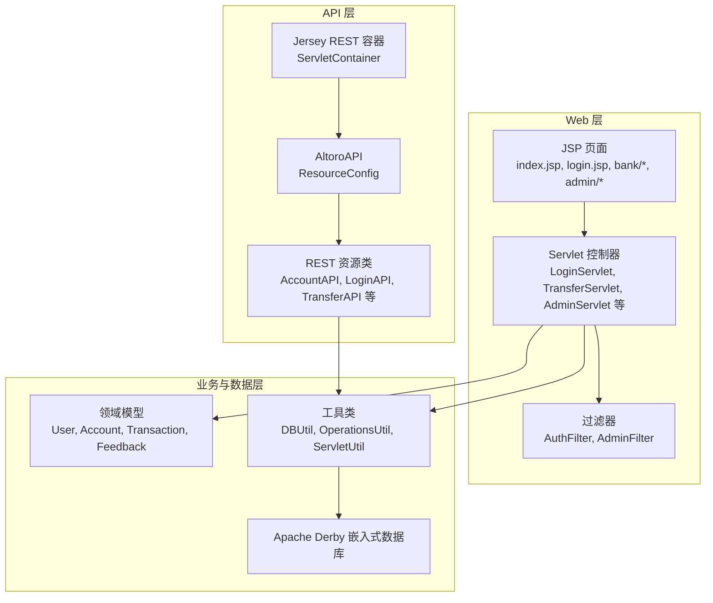
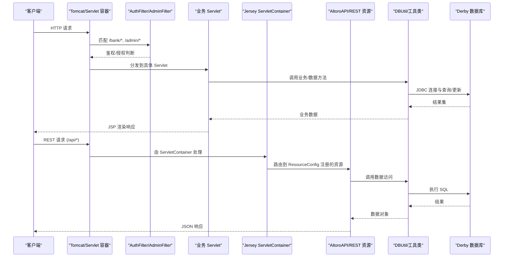
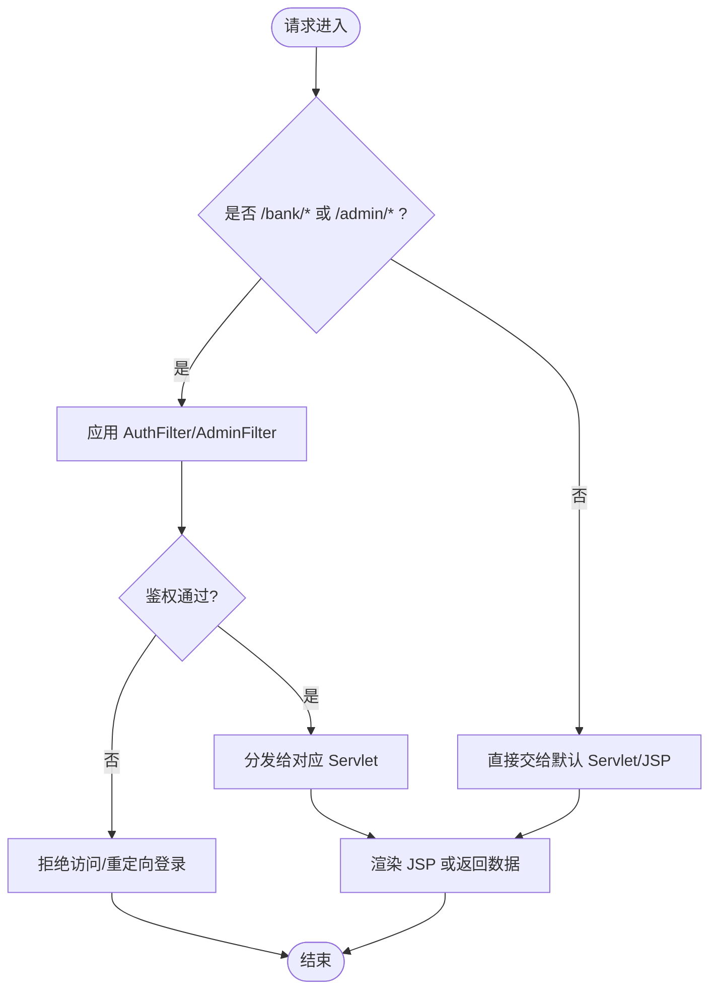
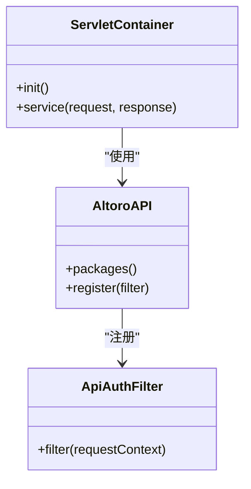
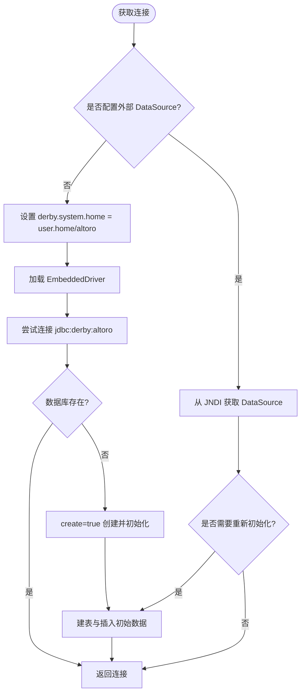
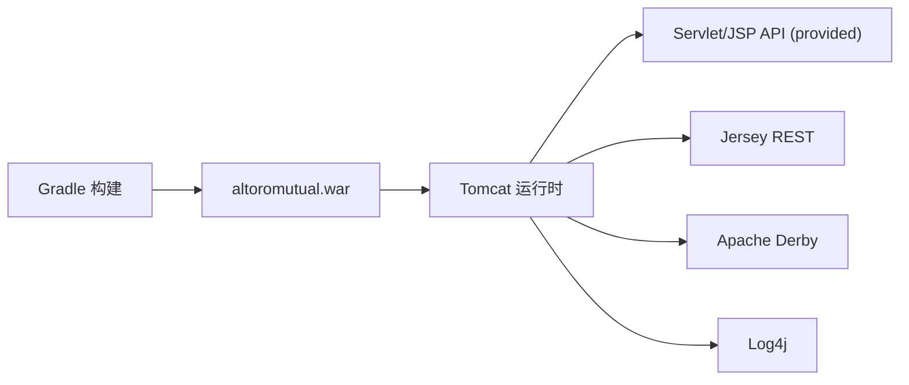

# 技术栈概览

<cite>
**本文引用的文件**   
- [README.md](file://README.md)
- [build.gradle](file://build.gradle)
- [web.xml](file://WebContent/WEB-INF/web.xml)
- [DBUtil.java](file://src/com/ibm/security/appscan/altoromutual/util/DBUtil.java)
- [AltoroAPI.java](file://src/com/ibm/security/appscan/altoromutual/api/AltoroAPI.java)
- [app.properties](file://WebContent/WEB-INF/app.properties)
</cite>

## 目录
1. [简介](#简介)
2. [项目结构](#项目结构)
3. [核心组件](#核心组件)
4. [架构总览](#架构总览)
5. [详细组件分析](#详细组件分析)
6. [依赖关系分析](#依赖关系分析)
7. [性能与可维护性考量](#性能与可维护性考量)
8. [故障排查指南](#故障排查指南)
9. [结论](#结论)

## 简介
AltoroJ 是一个用于演示 Web 应用安全漏洞的示例银行系统。它刻意采用“标准 Java Servlet/JSP + 少量必要库”的技术组合，避免引入复杂框架，从而让学习者聚焦于真实的安全问题与修复思路，而不是被框架细节分散注意力。同时，该项目的技术选型与传统企业级 Java 应用高度相似（Servlet、JSP、JDBC、日志），因此既适合教学，也贴近实际部署环境。

- 设计目标：简单、稳定、易部署，便于演示常见漏洞与修复方法
- 学习价值：在接近真实企业环境的代码结构上理解安全问题
- 运行方式：WAR 包部署到 Tomcat，首次登录时自动初始化嵌入式数据库

**章节来源**
- [README.md:1-10](file://README.md#L1-L10)

## 项目结构
项目遵循传统 J2EE Web 应用组织方式：
- WebContent：静态资源与 JSP 页面
- src：Java 源码（Servlet、Filter、REST API、模型、工具类）
- build.gradle：Gradle 构建脚本，声明依赖与打包行为
- WEB-INF/web.xml：Servlet 与 Filter 映射、Jersey REST 容器配置
- WEB-INF/app.properties：运行时可选开关与数据库相关配置

**图表来源**
- [web.xml:60-68](file://WebContent/WEB-INF/web.xml#L60-L68)
- [AltoroAPI.java:9-14](file://src/com/ibm/security/appscan/altoromutual/api/AltoroAPI.java#L9-L14)
- [DBUtil.java:47-96](file://src/com/ibm/security/appscan/altoromutual/util/DBUtil.java#L47-L96)

**章节来源**
- [web.xml:1-227](file://WebContent/WEB-INF/web.xml#L1-L227)
- [build.gradle:1-43](file://build.gradle#L1-L43)

## 核心组件
- Java Servlet/JSP：作为 MVC 中的控制器与视图层，承载用户交互与业务入口
- Apache Derby 嵌入式数据库：随应用启动并自动初始化，简化部署
- Jersey REST API：通过 ServletContainer 暴露 RESTful 接口，配合 Swagger 文档
- Log4j：提供日志记录能力，贯穿认证、转账、数据库初始化等关键路径
- Gradle 构建：统一依赖管理与 WAR 打包

这些技术共同构成一个“低框架复杂度、高可学性”的平台，既能演示漏洞，又能在不改变整体架构的前提下进行修复与加固。

**章节来源**
- [README.md:4-10](file://README.md#L4-L10)
- [build.gradle:23-37](file://build.gradle#L23-L37)

## 架构总览
下图展示请求从浏览器进入，经 Servlet/Filter 路由到业务逻辑，最终访问 Derby 数据库或返回 JSP 页面的典型流程；同时展示了 Jersey REST 容器的接入点。

**图表来源**
- [web.xml:12-68](file://WebContent/WEB-INF/web.xml#L12-L68)
- [AltoroAPI.java:9-14](file://src/com/ibm/security/appscan/altoromutual/api/AltoroAPI.java#L9-L14)
- [DBUtil.java:99-137](file://src/com/ibm/security/appscan/altoromutual/util/DBUtil.java#L99-L137)

## 详细组件分析

### Servlet/JSP 与 Filter
- web.xml 中集中定义了多个 Servlet（如 LoginServlet、TransferServlet、AdminServlet 等）及其 URL 映射，以及 JSP 处理器映射
- AuthFilter 与 AdminFilter 对 /bank/* 与 /admin/* 路径进行鉴权拦截，确保只有合法会话才能访问受保护资源
- 这种“显式映射 + 过滤器”的方式清晰直观，便于理解请求生命周期与安全边界

**图表来源**
- [web.xml:12-68](file://WebContent/WEB-INF/web.xml#L12-L68)
- [web.xml:159-223](file://WebContent/WEB-INF/web.xml#L159-L223)

**章节来源**
- [web.xml:12-68](file://WebContent/WEB-INF/web.xml#L12-L68)
- [web.xml:159-223](file://WebContent/WEB-INF/web.xml#L159-L223)

### Jersey REST API
- 通过 web.xml 将 org.glassfish.jersey.servlet.ServletContainer 注册为 Servlet，并指定 Application 实现类 AltoroAPI
- AltoroAPI 使用 @ApplicationPath("api") 定义 REST 根路径，并通过 packages 扫描 api 包下的资源类
- 同时注册 ApiAuthFilter 以实现对 REST 接口的鉴权控制

**图表来源**
- [web.xml:60-68](file://WebContent/WEB-INF/web.xml#L60-L68)
- [AltoroAPI.java:9-14](file://src/com/ibm/security/appscan/altoromutual/api/AltoroAPI.java#L9-L14)

**章节来源**
- [web.xml:60-68](file://WebContent/WEB-INF/web.xml#L60-L68)
- [AltoroAPI.java:1-16](file://src/com/ibm/security/appscan/altoromutual/api/AltoroAPI.java#L1-L16)

### Apache Derby 嵌入式数据库
- DBUtil 负责数据库连接管理、初始化与常用数据操作
- 默认使用嵌入式驱动 org.apache.derby.jdbc.EmbeddedDriver，并将数据库目录设置在 user.home/altoro
- 支持通过 app.properties 切换外部 DataSource（例如 Tomcat JNDI 数据源），并在首次启动或需要时重建表结构与初始数据
- 错误码 40000 表示数据库不存在，此时自动创建并初始化

**图表来源**
- [DBUtil.java:47-96](file://src/com/ibm/security/appscan/altoromutual/util/DBUtil.java#L47-L96)
- [DBUtil.java:99-137](file://src/com/ibm/security/appscan/altoromutual/util/DBUtil.java#L99-L137)
- [DBUtil.java:143-167](file://src/com/ibm/security/appscan/altoromutual/util/DBUtil.java#L143-L167)

**章节来源**
- [DBUtil.java:47-167](file://src/com/ibm/security/appscan/altoromutual/util/DBUtil.java#L47-L167)
- [app.properties:57-73](file://WebContent/WEB-INF/app.properties#L57-L73)

### 日志框架（Log4j）
- 项目中通过 Log4AltoroJ 封装日志调用，贯穿数据库初始化、错误捕获、交易记录等场景
- 在构建脚本中声明 log4j:log4j:1.2.16 依赖，满足基础日志需求

**章节来源**
- [build.gradle:33-33](file://build.gradle#L33-L33)
- [DBUtil.java:81-94](file://src/com/ibm/security/appscan/altoromutual/util/DBUtil.java#L81-L94)
- [DBUtil.java:166-166](file://src/com/ibm/security/appscan/altoromutual/util/DBUtil.java#L166-L166)

## 依赖关系分析
- 构建与打包：Gradle 生成 altoromutual.war，排除 classes 与 lib 以便在 Tomcat 中动态加载
- 运行时依赖：
  - Servlet/JSP API（providedCompile javax:javaee-api:7.0）
  - Jersey REST（jersey-server、jersey-container-servlet、jersey-hk2）
  - 嵌入式数据库（org.apache.derby:derby）
  - 日志（log4j:log4j）
  - 其他工具库（commons-codec、commons-lang、wink-json4j）

**图表来源**
- [build.gradle:23-37](file://build.gradle#L23-L37)
- [build.gradle:39-43](file://build.gradle#L39-L43)

**章节来源**
- [build.gradle:23-43](file://build.gradle#L23-L43)

## 性能与可维护性考量
- 简单即高效：少用框架意味着更少的抽象层与反射开销，便于定位瓶颈与优化
- 嵌入式数据库：无需独立数据库服务，降低部署复杂度；但需注意并发写入与磁盘 I/O 限制
- 显式映射与过滤器：职责清晰，易于扩展与维护
- 可插拔数据源：通过 app.properties 切换外部 DataSource，便于在不同环境中迁移

[本节为通用指导，不直接分析具体文件]

## 故障排查指南
- 首次登录提示无法创建数据库
  - 原因：用户主目录权限不足导致 Derby 无法创建数据库目录
  - 解决：确保 Tomcat 运行用户对 user.home 具有读写权限，或通过 JVM 参数修改 user.home 指向可写路径
- 编译失败或第三方库缺失
  - 原因：未正确下载依赖或未执行 Gradle 构建
  - 解决：在 Eclipse 中使用 Buildship 或命令行执行 Gradle 构建，确保依赖下载完成

**章节来源**
- [README.md:44-56](file://README.md#L44-L56)

## 结论
AltoroJ 选择 Servlet/JSP + Derby + Jersey + Log4j 的技术栈，核心目的在于“去框架化”，让学习者专注于安全问题的本质与修复策略，同时保持与企业级 Java 应用的相似性，使所学经验可直接迁移至真实生产环境。对于教育与实践而言，这一技术组合提供了清晰的边界、稳定的运行环境与贴近实际的部署形态，是开展安全攻防演练与修复实践的理想平台。

[本节为总结性内容，不直接分析具体文件]