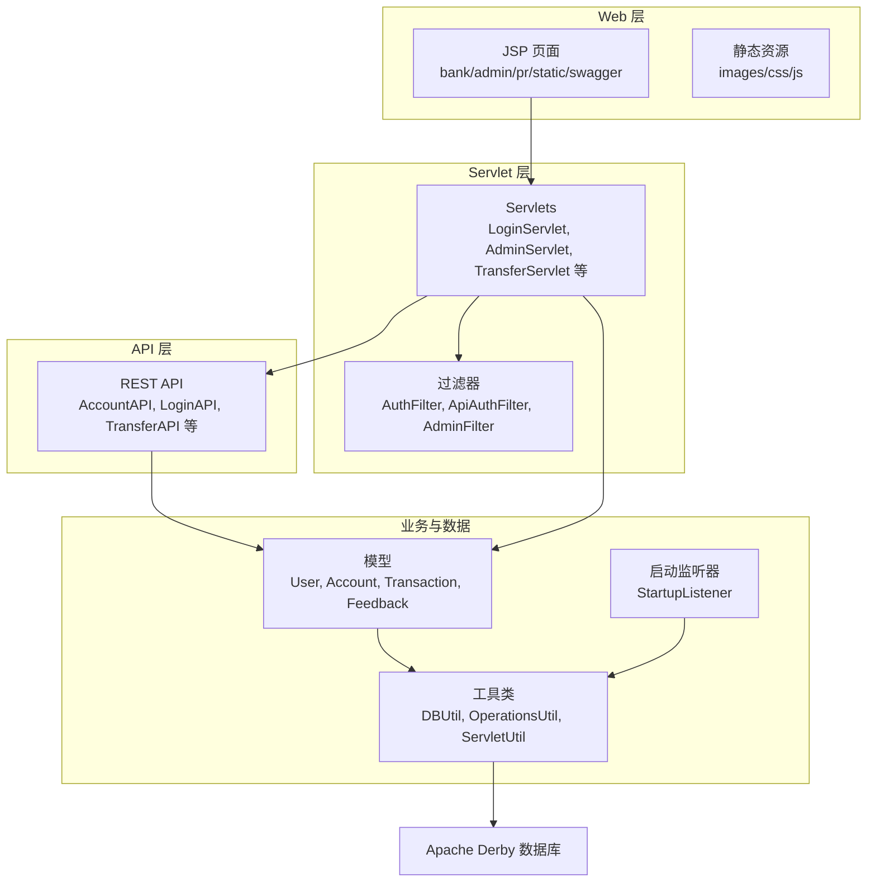
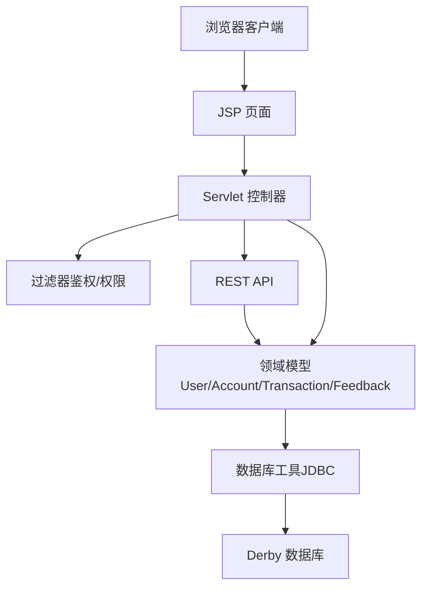
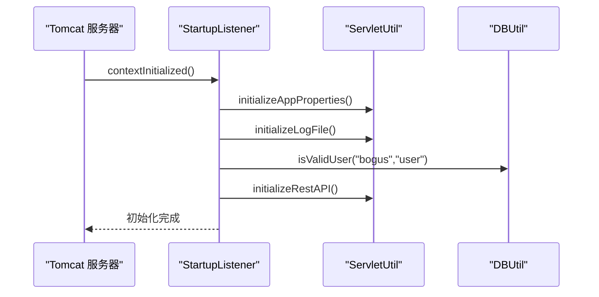
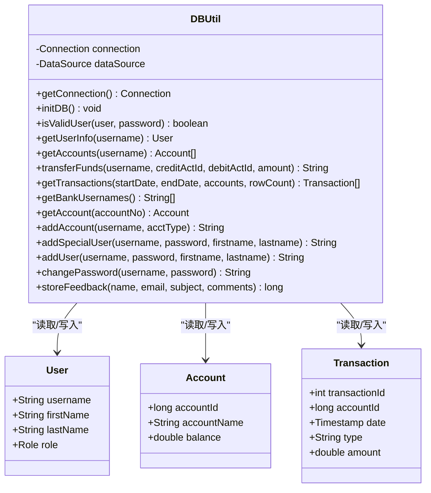
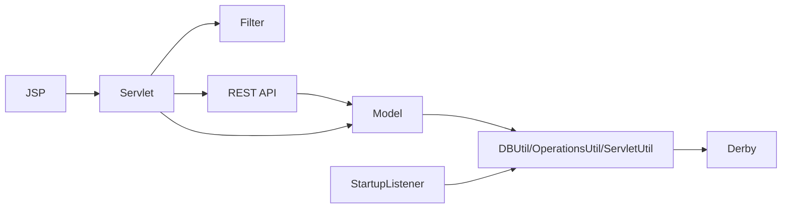

# 项目介绍与目标

<cite>
**本文引用的文件**   
- [README.md](file://README.md)
- [app.properties](file://WebContent/WEB-INF/app.properties)
- [StartupListener.java](file://src/com/ibm/security/appscan/altoromutual/listener/StartupListener.java)
- [DBUtil.java](file://src/com/ibm/security/appscan/altoromutual/util/DBUtil.java)
</cite>

## 目录
1. [简介](#简介)
2. [项目结构](#项目结构)
3. [核心组件](#核心组件)
4. [架构总览](#架构总览)
5. [详细组件分析](#详细组件分析)
6. [依赖关系分析](#依赖关系分析)
7. [性能考虑](#性能考虑)
8. [故障排查指南](#故障排查指南)
9. [结论](#结论)

## 简介
AltoroJ 是由 IBM Security AppScan 团队开发的 Java EE 银行模拟系统，专门用于演示 Web 应用安全漏洞。它的核心目标是展示当 Web 应用只关注功能实现而忽视安全性时可能出现的后果，提供一个简单、无复杂框架依赖的平台，帮助学习者理解并掌握真实的应用安全问题。该项目自 2008 年创建以来，已被全球广泛用于演示应用安全漏洞、教育人们这些问题的易利用性与严重性影响，甚至被纳入学术课程的一部分。

本项目强调“以最小复杂度呈现最大可学习性”：使用标准 Java 与 JSP 技术栈，避免引入额外框架带来的复杂性，使初学者能够聚焦于安全原理本身，而不是框架细节。同时，它内置了 Apache Derby 数据库，首次通过 Web 界面登录时自动初始化，便于快速上手和反复演练。

**章节来源**
- [README.md:4-10](file://README.md#L4-L10)

## 项目结构
从仓库结构可以看出，AltoroJ 采用典型的 Java EE Web 应用组织方式：
- WebContent：存放 JSP、静态资源、配置文件（如 WEB-INF/web.xml、app.properties）
- src：Java 源代码，按包划分职责（api、filter、listener、model、servlet、util）
- 构建与工程配置：build.gradle、.classpath、.project 等

**图表来源**
- [StartupListener.java:10-23](file://src/com/ibm/security/appscan/altoromutual/listener/StartupListener.java#L10-L23)
- [DBUtil.java:45-138](file://src/com/ibm/security/appscan/altoromutual/util/DBUtil.java#L45-L138)

**章节来源**
- [README.md:16-25](file://README.md#L16-L25)

## 核心组件
- 启动监听器 StartupListener：在应用启动时初始化应用属性、日志文件、数据库连接与 REST API。
- 数据库工具 DBUtil：封装 JDBC 操作，负责连接管理、数据库初始化、用户认证、账户与交易查询、转账逻辑等。
- 配置 app.properties：提供行为开关与数据库相关的高级选项，用于演示不同攻击面与安全测试场景。
- README.md：说明项目目的、运行环境、默认账号、高级选项与 REST API 入口。

这些组件共同构成了一个“简单但完整”的银行模拟系统，既能演示常见漏洞（如 SQL 注入、XSS、命令执行等），又能保持足够低的认知门槛，适合教学与培训。

**章节来源**
- [StartupListener.java:10-23](file://src/com/ibm/security/appscan/altoromutual/listener/StartupListener.java#L10-L23)
- [DBUtil.java:45-138](file://src/com/ibm/security/appscan/altoromutual/util/DBUtil.java#L45-L138)
- [app.properties:25-74](file://WebContent/WEB-INF/app.properties#L25-L74)
- [README.md:39-41](file://README.md#L39-L41)

## 架构总览
AltoroJ 的整体架构遵循经典的三层结构：
- 表示层（JSP + 静态资源）：面向用户的页面与交互
- 控制层（Servlet + Filter + REST API）：处理请求、鉴权、路由到业务逻辑
- 数据层（Model + DBUtil + Derby）：持久化存储与数据访问

**图表来源**
- [StartupListener.java:10-23](file://src/com/ibm/security/appscan/altoromutual/listener/StartupListener.java#L10-L23)
- [DBUtil.java:45-138](file://src/com/ibm/security/appscan/altoromutual/util/DBUtil.java#L45-L138)

## 详细组件分析

### 启动流程与初始化（StartupListener）
StartupListener 在 Web 应用启动时执行关键初始化步骤：
- 加载应用属性（ServletUtil.initializeAppProperties）
- 初始化日志文件（ServletUtil.initializeLogFile）
- 触发数据库连通性检查（DBUtil.isValidUser）
- 初始化 REST API（ServletUtil.initializeRestAPI）

该流程确保应用在首次运行时完成必要的环境准备，为后续的用户登录、账户查询、转账等操作提供基础能力。

**图表来源**
- [StartupListener.java:10-23](file://src/com/ibm/security/appscan/altoromutual/listener/StartupListener.java#L10-L23)

**章节来源**
- [StartupListener.java:10-23](file://src/com/ibm/security/appscan/altoromutual/listener/StartupListener.java#L10-L23)

### 数据库与数据模型（DBUtil）
DBUtil 是数据访问的核心，承担以下职责：
- 连接管理：支持外部 DataSource 或内嵌 Derby；根据配置决定是否在启动时重新初始化数据库
- 数据库初始化：建表（PEOPLE、ACCOUNTS、TRANSACTIONS、FEEDBACK）、插入初始数据
- 用户认证：isValidUser 方法包含硬编码回退逻辑与拼接 SQL 的安全风险点
- 账户与交易：getAccounts、getTransactions、transferFunds 等方法封装常用银行业务逻辑
- 反馈与用户管理：storeFeedback、addUser、changePassword 等辅助功能

**图表来源**
- [DBUtil.java:45-138](file://src/com/ibm/security/appscan/altoromutual/util/DBUtil.java#L45-L138)
- [DBUtil.java:143-167](file://src/com/ibm/security/appscan/altoromutual/util/DBUtil.java#L143-L167)
- [DBUtil.java:212-232](file://src/com/ibm/security/appscan/altoromutual/util/DBUtil.java#L212-L232)
- [DBUtil.java:275-293](file://src/com/ibm/security/appscan/altoromutual/util/DBUtil.java#L275-L293)
- [DBUtil.java:303-364](file://src/com/ibm/security/appscan/altoromutual/util/DBUtil.java#L303-L364)
- [DBUtil.java:375-427](file://src/com/ibm/security/appscan/altoromutual/util/DBUtil.java#L375-L427)
- [DBUtil.java:452-470](file://src/com/ibm/security/appscan/altoromutual/util/DBUtil.java#L452-L470)
- [DBUtil.java:472-535](file://src/com/ibm/security/appscan/altoromutual/util/DBUtil.java#L472-L535)

**章节来源**
- [DBUtil.java:45-138](file://src/com/ibm/security/appscan/altoromutual/util/DBUtil.java#L45-L138)
- [DBUtil.java:143-167](file://src/com/ibm/security/appscan/altoromutual/util/DBUtil.java#L143-L167)
- [DBUtil.java:212-232](file://src/com/ibm/security/appscan/altoromutual/util/DBUtil.java#L212-L232)
- [DBUtil.java:275-293](file://src/com/ibm/security/appscan/altoromutual/util/DBUtil.java#L275-L293)
- [DBUtil.java:303-364](file://src/com/ibm/security/appscan/altoromutual/util/DBUtil.java#L303-L364)
- [DBUtil.java:375-427](file://src/com/ibm/security/appscan/altoromutual/util/DBUtil.java#L375-L427)
- [DBUtil.java:452-470](file://src/com/ibm/security/appscan/altoromutual/util/DBUtil.java#L452-L470)
- [DBUtil.java:472-535](file://src/com/ibm/security/appscan/altoromutual/util/DBUtil.java#L472-L535)

### 配置与高级选项（app.properties）
app.properties 提供了多种行为开关与数据库设置，用于扩展演示范围与安全测试场景：
- enableAdminFunctions：启用管理员功能（添加用户、修改密码等）
- specialLink：替换导航链接以演示恶意软件检测
- advancedStaticPageProcessing：启用命令行/Shell 调用，暴露远程命令执行与路径遍历攻击面
- enableFeedbackRetention：开启反馈信息持久化，演示持久型 XSS
- database.alternateDataSource：切换至外部数据源（如 DB2）
- database.reinitializeOnStart：每次重启时重新初始化数据库

这些选项使得 AltoroJ 能够在受控环境中灵活演示不同的攻击向量，同时保持默认关闭以降低风险。

**章节来源**
- [app.properties:25-74](file://WebContent/WEB-INF/app.properties#L25-L74)

### 项目目标与使用说明（README）
README.md 明确了项目的定位与使用方法：
- 警告：应用包含已知安全漏洞，仅在隔离环境运行
- 目标：展示“重功能轻安全”的后果，提供简单平台学习真实安全问题
- 技术栈：标准 Java & JSP，不依赖额外框架
- 数据库：Apache Derby，首次登录自动初始化
- 历史与用途：2008 年创建，全球用于演示与应用安全教学，部分进入学术课程
- 前置条件：Eclipse、Tomcat 7.x、Gradle 3.0、Buildship 插件
- 默认账号：jsmith/demo1234、admin/admin
- 高级选项：通过 app.properties 启用更多功能与攻击演示
- REST API：通过 Swagger 文档与交互

**章节来源**
- [README.md:1-10](file://README.md#L1-L10)
- [README.md:16-25](file://README.md#L16-L25)
- [README.md:27-36](file://README.md#L27-L36)
- [README.md:39-41](file://README.md#L39-L41)

## 依赖关系分析
AltoroJ 的依赖关系清晰且分层明确：
- 表示层依赖 Servlet 与过滤器进行请求处理
- Servlet 与 REST API 依赖模型与工具类进行业务逻辑与数据访问
- 工具类依赖 JDBC 与 Derby 数据库
- 启动监听器在容器启动阶段完成必要的初始化工作

**图表来源**
- [StartupListener.java:10-23](file://src/com/ibm/security/appscan/altoromutual/listener/StartupListener.java#L10-L23)
- [DBUtil.java:45-138](file://src/com/ibm/security/appscan/altoromutual/util/DBUtil.java#L45-L138)

**章节来源**
- [StartupListener.java:10-23](file://src/com/ibm/security/appscan/altoromutual/listener/StartupListener.java#L10-L23)
- [DBUtil.java:45-138](file://src/com/ibm/security/appscan/altoromutual/util/DBUtil.java#L45-L138)

## 性能考虑
- 数据库连接：DBUtil 使用单例模式维护连接，减少频繁创建连接的开销；在外部 DataSource 模式下由容器管理连接池，提升并发性能
- 查询优化：getTransactions 支持限制返回行数（setMaxRows），避免一次性拉取大量数据
- 初始化策略：database.reinitializeOnStart 可在开发环境保证数据一致性，生产环境建议关闭以减少启动时间
- 日志记录：Log4AltoroJ 用于记录错误与事务信息，有助于问题定位但不影响主流程性能

[本节为通用指导，不涉及具体代码片段]

## 故障排查指南
常见问题与解决方案（基于 README 与配置说明）：
- 登录时报错“Failed to create database 'altoro'”：通常是用户目录权限不足导致 Derby 无法创建数据库。可通过 Eclipse Console 或 Tomcat catalina.out 查看 user.home 路径，赋予相应读写权限，或通过 JVM 参数 -Duser.home 指定新路径
- 编译失败：可能是 Java 构建路径未正确配置，需先运行 Gradle 构建以下载第三方库
- 高级选项误用：启用 enableAdminFunctions 或 enableFeedbackRetention 后运行扫描可能导致数据库损坏，需要手动删除数据库或启用 database.reinitializeOnStart 重置

**章节来源**
- [README.md:44-57](file://README.md#L44-L57)
- [app.properties:25-74](file://WebContent/WEB-INF/app.properties#L25-L74)

## 结论
AltoroJ 是一个以“简单即有效”为原则的应用安全教学平台。它通过标准的 Java EE 技术栈与清晰的三层架构，将复杂的 Web 应用安全问题拆解为可理解、可复现、可教学的模块。其核心目标不仅是展示漏洞，更是帮助学习者建立安全意识与修复思路。自 2008 年以来，AltoroJ 在全球范围内被广泛采用，成为应用安全课程的重要组成部分。对于初学者而言，它是一个理想的起点：无需深入框架细节，即可专注于安全原理与实践。

[本节为总结性内容，不涉及具体代码片段]