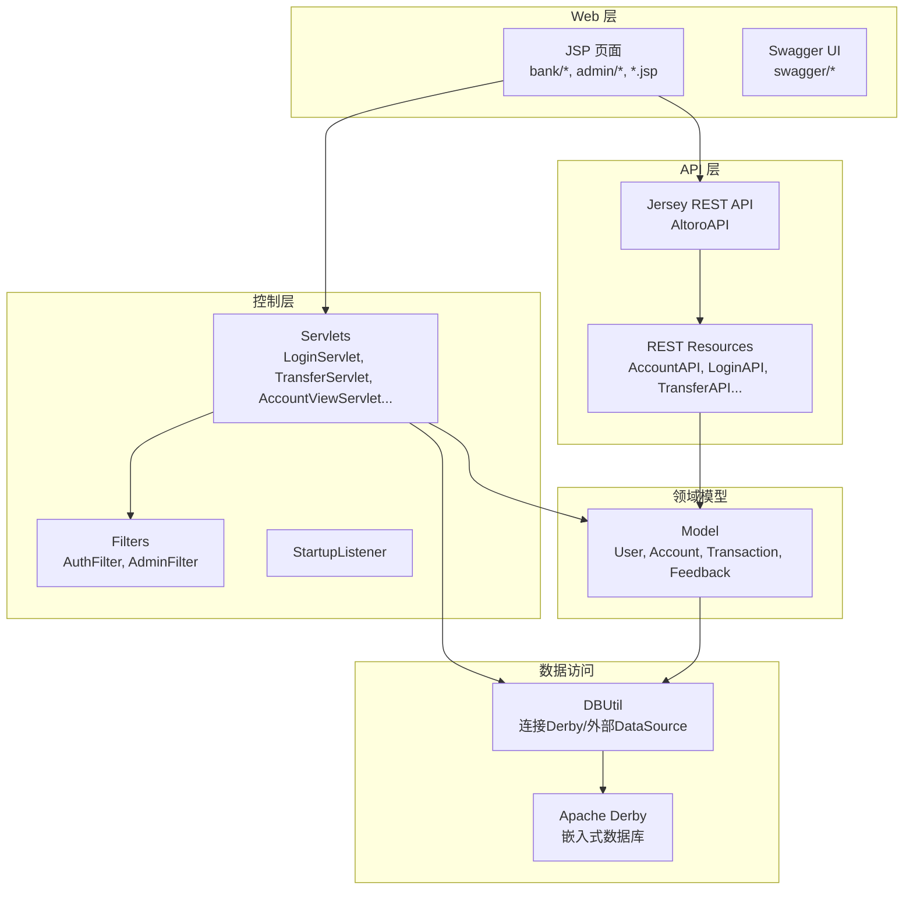
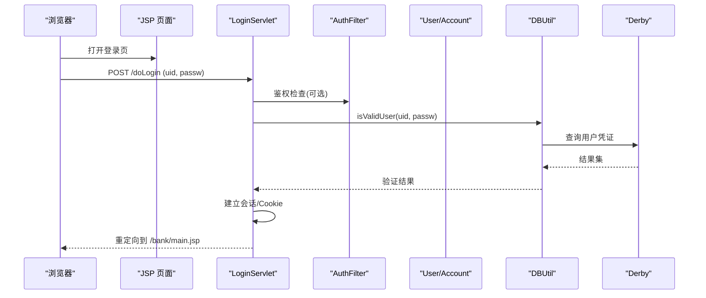
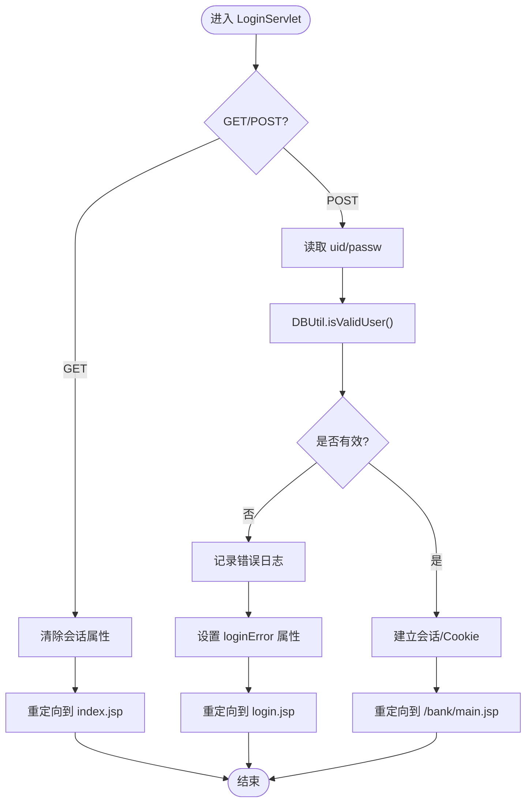
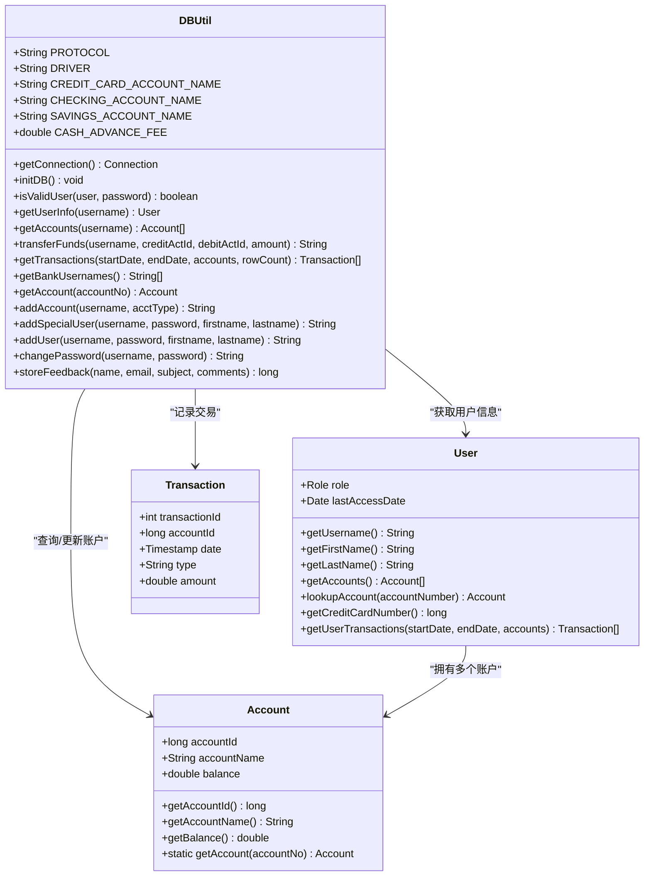
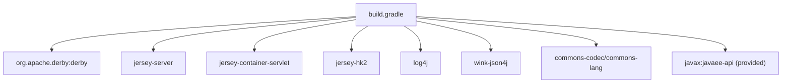

# 项目概述

<cite>
**本文引用的文件**   
- [README.md](file://README.md)
- [web.xml](file://WebContent/WEB-INF/web.xml)
- [build.gradle](file://build.gradle)
- [AltoroAPI.java](file://src/com/ibm/security/appscan/altoromutual/api/AltoroAPI.java)
- [LoginServlet.java](file://src/com/ibm/security/appscan/altoromutual/servlet/LoginServlet.java)
- [User.java](file://src/com/ibm/security/appscan/altoromutual/model/User.java)
- [DBUtil.java](file://src/com/ibm/security/appscan/altoromutual/util/DBUtil.java)
</cite>

## 目录
1. [简介](#简介)
2. [项目结构](#项目结构)
3. [核心组件](#核心组件)
4. [架构总览](#架构总览)
5. [详细组件分析](#详细组件分析)
6. [依赖关系分析](#依赖关系分析)
7. [性能与可扩展性](#性能与可扩展性)
8. [故障排查指南](#故障排查指南)
9. [结论](#结论)
10. [附录：常见用例示例](#附录常见用例示例)

## 简介
AltoroJ 是一个用于演示 Web 应用安全漏洞的 Java EE 银行模拟系统。它通过完整的用户认证、账户管理、资金转账等核心功能，帮助学习者理解真实世界中的安全问题及其影响。该项目采用传统的 Java Servlet/JSP 技术栈，内嵌 Apache Derby 数据库，并通过 Jersey 提供 REST API（使用 Swagger 文档化）。与传统框架相比，AltoroJ 刻意保持简单，不依赖复杂框架，以便更清晰地聚焦于安全原理与漏洞模式，同时便于初学者入门和专家深入分析。

## 项目结构
项目遵循标准 Java EE Web 应用结构：
- WebContent：静态资源与 JSP 页面、Swagger UI、过滤器与监听器配置等
- src：Java 源代码，按包组织为 api、filter、listener、model、servlet、util
- build.gradle：Gradle 构建脚本，定义依赖与打包产物
- web.xml：Servlet、Filter、Listener 及 URL 映射配置



图表来源
- [web.xml:1-227](file://WebContent/WEB-INF/web.xml#L1-L227)
- [AltoroAPI.java:1-16](file://src/com/ibm/security/appscan/altoromutual/api/AltoroAPI.java#L1-L16)
- [build.gradle:23-37](file://build.gradle#L23-L37)

章节来源
- [web.xml:1-227](file://WebContent/WEB-INF/web.xml#L1-L227)
- [build.gradle:1-43](file://build.gradle#L1-L43)

## 核心组件
- 认证与会话：LoginServlet 处理登录/登出，维护会话与 Cookie；AuthFilter 对 /bank/* 与 /admin/* 进行鉴权拦截。
- 账户与转账：AccountViewServlet 展示账户信息；TransferServlet 执行转账逻辑；DBUtil 封装账户查询与转账 SQL。
- 管理员功能：AdminServlet/AdminLoginServlet 提供管理员操作入口；AdminFilter 限制访问。
- REST API：AltoroAPI 注册 Jersey 资源与 ApiAuthFilter，暴露账户、登录、转账等接口。
- 数据访问：DBUtil 负责 Derby 初始化、连接管理、CRUD 操作与事务记录。
- 模型对象：User、Account、Transaction、Feedback 描述业务实体。

章节来源
- [LoginServlet.java:38-108](file://src/com/ibm/security/appscan/altoromutual/servlet/LoginServlet.java#L38-L108)
- [User.java:30-107](file://src/com/ibm/security/appscan/altoromutual/model/User.java#L30-L107)
- [DBUtil.java:45-167](file://src/com/ibm/security/appscan/altoromutual/util/DBUtil.java#L45-L167)
- [AltoroAPI.java:9-15](file://src/com/ibm/security/appscan/altoromutual/api/AltoroAPI.java#L9-L15)

## 架构总览
AltoroJ 采用经典的三层架构：
- 表示层：JSP 页面与 Swagger UI 提供用户界面与 API 文档
- 控制层：Servlet 与 Filter 处理请求、鉴权与路由
- 服务/数据层：Jersey REST 资源与 DBUtil 提供业务能力与数据访问



图表来源
- [web.xml:60-166](file://WebContent/WEB-INF/web.xml#L60-L166)
- [LoginServlet.java:67-101](file://src/com/ibm/security/appscan/altoromutual/servlet/LoginServlet.java#L67-L101)
- [DBUtil.java:212-232](file://src/com/ibm/security/appscan/altoromutual/util/DBUtil.java#L212-L232)

## 详细组件分析

### 认证与会话流程（LoginServlet）
- 功能要点
  - GET 处理登出：清除会话属性并重定向至首页
  - POST 处理登录：读取 uid/passw，调用 DBUtil.isValidUser 校验
  - 成功后建立会话并设置 Cookie，重定向至银行主页
- 错误处理
  - 登录失败时记录日志并返回登录页提示
  - 异常捕获后返回 500 或重定向



图表来源
- [LoginServlet.java:51-101](file://src/com/ibm/security/appscan/altoromutual/servlet/LoginServlet.java#L51-L101)
- [DBUtil.java:212-232](file://src/com/ibm/security/appscan/altoromutual/util/DBUtil.java#L212-L232)

章节来源
- [LoginServlet.java:38-108](file://src/com/ibm/security/appscan/altoromutual/servlet/LoginServlet.java#L38-L108)

### 数据访问与数据库初始化（DBUtil）
- 功能要点
  - 支持外部 DataSource 或内嵌 Derby
  - 首次连接自动创建并初始化表结构与初始数据
  - 提供用户认证、账户查询、转账、交易记录、反馈存储等方法
- 关键路径
  - getConnection：懒加载单例连接，必要时初始化 Derby
  - initDB：建表与插入初始数据
  - transferFunds：转账逻辑，含信用卡特殊处理与手续费



图表来源
- [DBUtil.java:45-167](file://src/com/ibm/security/appscan/altoromutual/util/DBUtil.java#L45-L167)
- [DBUtil.java:212-536](file://src/com/ibm/security/appscan/altoromutual/util/DBUtil.java#L212-L536)
- [User.java:30-107](file://src/com/ibm/security/appscan/altoromutual/model/User.java#L30-L107)

章节来源
- [DBUtil.java:45-167](file://src/com/ibm/security/appscan/altoromutual/util/DBUtil.java#L45-L167)
- [DBUtil.java:212-536](file://src/com/ibm/security/appscan/altoromutual/util/DBUtil.java#L212-L536)
- [User.java:30-107](file://src/com/ibm/security/appscan/altoromutual/model/User.java#L30-L107)

### REST API 与 Swagger 文档（AltoroAPI）
- 功能要点
  - 基于 Jersey 的 REST 容器，ApplicationPath 为 “api”
  - 自动扫描 com.ibm.security.appscan.altoromutual.api 包下的资源类
  - 注册 ApiAuthFilter 实现 API 级鉴权
- 集成点
  - web.xml 中 ServletContainer 指向 AltoroAPI
  - Swagger UI 位于 WebContent/swagger，提供交互式 API 文档

```mermaid
graph LR
Client["客户端"] --> Jersey["Jersey ServletContainer"]
Jersey --> AltoroAPI["AltoroAPI<br/>@ApplicationPath(\"api\")"]
AltoroAPI --> Resources["REST 资源类<br/>AccountAPI, LoginAPI, TransferAPI..."]
AltoroAPI --> ApiAuthFilter["ApiAuthFilter<br/>API 鉴权"]
```

图表来源
- [web.xml:60-68](file://WebContent/WEB-INF/web.xml#L60-L68)
- [AltoroAPI.java:9-15](file://src/com/ibm/security/appscan/altoromutual/api/AltoroAPI.java#L9-L15)

章节来源
- [web.xml:60-68](file://WebContent/WEB-INF/web.xml#L60-L68)
- [AltoroAPI.java:1-16](file://src/com/ibm/security/appscan/altoromutual/api/AltoroAPI.java#L1-L16)

### 过滤器与监听器（AuthFilter/AdminFilter/StartupListener）
- AuthFilter：对 /bank/* 与 /admin/* 进行鉴权拦截，确保受保护资源仅对已认证用户开放
- AdminFilter：针对管理员路径进行额外权限校验
- StartupListener：应用启动时执行初始化逻辑（如数据库初始化）

章节来源
- [web.xml:9-59](file://WebContent/WEB-INF/web.xml#L9-L59)

## 依赖关系分析
- 构建与依赖
  - Gradle 构建 WAR 包，指定源目录与资源目录
  - 依赖包括 Apache Derby、Jersey Server/Container/HK2、Log4j、Wink JSON4J、Commons Codec/Lang
  - 提供 javax:javaee-api 作为编译期依赖
- 运行时依赖
  - Tomcat 7.x 运行环境
  - Eclipse 与 Buildship 插件简化第三方库下载与运行



图表来源
- [build.gradle:23-37](file://build.gradle#L23-L37)

章节来源
- [build.gradle:1-43](file://build.gradle#L1-L43)

## 性能与可扩展性
- 数据库连接
  - DBUtil 使用懒加载单例连接，减少重复创建开销
  - 支持外部 DataSource，便于在生产环境中替换为高性能数据库
- 查询与事务
  - 转账逻辑包含多次 SQL 操作，建议引入事务边界保证一致性
  - 当前未显式提交/回滚，需评估并发场景下的数据一致性
- 扩展建议
  - 引入连接池（如 HikariCP）提升连接复用效率
  - 使用 PreparedStatement 替代字符串拼接，避免 SQL 注入并提升执行计划重用
  - 引入缓存层（如 Ehcache）减少热点账户余额查询压力

[本节为通用指导，不涉及具体文件分析]

## 故障排查指南
- 数据库初始化失败
  - 现象：登录时报错“Failed to create database 'altoro'”
  - 原因：用户主目录下 altoro 文件夹无写权限
  - 解决：授予 Tomcat 运行用户对 user.home 下 altoro 目录读写权限，或通过 JVM 参数 -Duser.home 指定新路径
- 编译错误
  - 现象：在 Tomcat 上部署时报编译错误
  - 原因：Eclipse 构建路径缺失第三方库
  - 解决：运行 Gradle 构建以下载依赖并重新编译

章节来源
- [README.md:44-57](file://README.md#L44-L57)

## 结论
AltoroJ 通过简洁的 Java EE 架构与内嵌 Derby 数据库，提供了一个易于部署与学习的银行模拟平台。其核心价值在于直观演示常见 Web 安全漏洞，帮助学习者从原理与实践两个层面掌握安全防护方法。对于初学者，可从 JSP/Servlet 基础入手；对于有经验的开发者，可深入分析 DBUtil 的数据访问模式与转账逻辑，结合现代框架对比优化方案。

[本节为总结性内容，不涉及具体文件分析]

## 附录：常见用例示例
- 用户登录
  - 步骤：访问登录页 -> 输入用户名与密码 -> 提交到 /doLogin -> 成功则跳转至 /bank/main.jsp
  - 关键点：会话建立与 Cookie 设置；失败时显示错误提示
- 查看账户余额
  - 步骤：登录后访问 /bank/showAccount -> 服务端调用 DBUtil.getAccounts -> 渲染账户列表
- 资金转账
  - 步骤：选择转出/转入账户与金额 -> 提交到 /bank/doTransfer -> 服务端调用 DBUtil.transferFunds -> 更新余额并记录交易
- 管理员操作
  - 步骤：管理员登录 -> 访问 /admin/addUser 或 /admin/changePassword -> 执行相应数据库操作

章节来源
- [web.xml:159-218](file://WebContent/WEB-INF/web.xml#L159-L218)
- [LoginServlet.java:67-101](file://src/com/ibm/security/appscan/altoromutual/servlet/LoginServlet.java#L67-L101)
- [DBUtil.java:303-364](file://src/com/ibm/security/appscan/altoromutual/util/DBUtil.java#L303-L364)